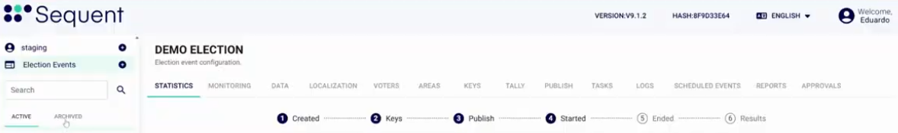
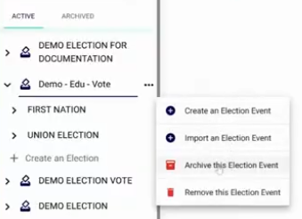
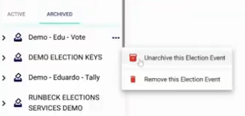

<!--
SPDX-FileCopyrightText: 2025 Sequent Tech <legal@sequentech.io>
SPDX-License-Identifier: AGPL-3.0-only
-->

import GoogleVideo from '@site/src/components/GoogleVideo';

<GoogleVideo id="1nC-EvQ7Xso6eAn5-PU67vKgl6zKTROC9" />

The Sequent Admin Portal allows you to manage the visibility of your electoral events by categorizing them as either Active or Archived. This helps maintain a clean workspace by separating ongoing elections from historical data.

## Understanding Election Statuses

The sidebar contains three tabs to help you organize your events:

* **Active:** This tab displays elections that are currently ongoing or are scheduled to open in the near future.
* **Archived:** This tab stores past elections that have concluded but are being retained for records or auditing purposes.
* **Trash:** This tab lists deleted election events until they are deleted permanently. It is shown to users with the `election-event-delete` permission.

## Archiving an Election

Once an election has ended, you can move it to the Archived list to declutter your active dashboard.

1.  Locate the election in the **Active** tab.
2.  Click the **three-dot icon** next to the election name.
3.  Select `Archive this Election Event`.

## Unarchiving and Restoring Elections

If you need to reactivate an archived election or simply view its data in the active list, you can unarchive it at any time.

1.  Switch to the **Archived** tab in the sidebar.
2.  Locate the desired electoral event.
3.  Click the **three-dot icon** and select `Unarchive this Election Event`.
4.  Confirm the action in the warning prompt. The event will now reappear in the **Active** tab.

## Deleting an Election Event

`Move this Election Event to Trash`, in the election event's three-dot menu, deletes it. The confirmation says how many days it stays in Trash. An election event can't be moved to Trash while it is locked down, while voting is open or paused, while it has ballot box seals, or when it has elections outside your permission labels.

An election event in Trash keeps all its data until it is deleted permanently. It disappears from the Active and Archived tabs and can't be opened or edited; it is archived, so its voters can't vote and its scheduled events and reports don't run, and its voting status can't change.

## Restoring an Election Event from Trash

1.  Switch to the **Trash** tab in the sidebar. Each election event shows when it was deleted and when it will be deleted permanently.
2.  Click **Restore** next to the election event and confirm.
3.  The event returns to the tab it was in: **Active**, or **Archived** if it was archived when it was deleted. Restoring never changes voting status, and scheduled events whose time passed while it was in Trash are stopped, not run late.

## Permanent Deletion

Election events are deleted permanently once their time in Trash is over, seven days by default. From then on Trash shows **Permanent deletion in progress** and the event can no longer be restored. The tenant log records each election event moved to Trash, restored and deleted permanently; **Tasks** shows permanent deletions as *Delete Election Event*, run by *Trash retention*.

The time in Trash is set by the deployment with the `WINDMILL_ELECTION_EVENT_TRASH_RETENTION_DAYS` environment variable (see [Backend components](../../05-reference/03-software-architecture/backend-components.md#election-event-trash)). An election event keeps the permanent deletion date it got when it was deleted, even if the setting changes later.
