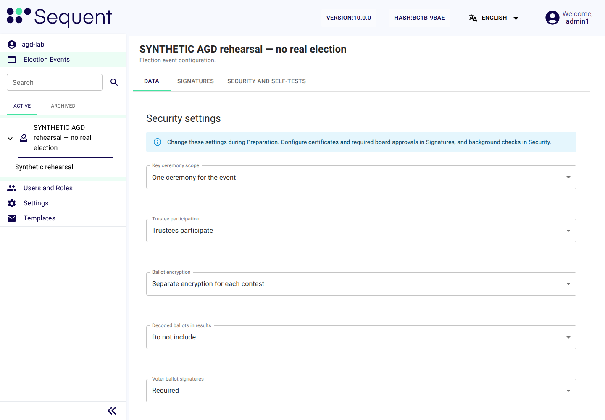

<!--
SPDX-FileCopyrightText: 2026 Sequent Tech Inc <legal@sequentech.io>
SPDX-License-Identifier: AGPL-3.0-only
-->

## Interfaces available to the administrator

| Interface | What you use it for |
|---|---|
| Admin portal, in your browser over HTTPS | every configuration and monitoring task of this handbook |
| Login page of the TOE, which sends you on to the external authentication server | signing in and confirming sensitive actions |
| The server procedures of the Deployment Guide, used by the operator | deployment, hardening, operation and backups |

There is no other interface for administrators in the evaluated configuration.
Over HTTPS, the identity and access management component offers only its
sign-in services: its administration console is not routed, so it cannot be
reached from outside the servers, and its account console is switched off. Use
the TOE's programming interfaces only through the admin portal.

:::warning
Do not use scripts, command-line clients or other tools against the TOE's
interfaces in place of the admin portal. Their requests are subject to the same
server-side checks, but they bypass the confirmation dialogs of the admin
portal, and this handbook gives no secure way to use them.
:::

## Your workstation and browser

- Use a workstation that your organisation manages and keeps up to date, with
  an up-to-date browser. Do not use shared or public computers.
- Use a browser profile without extensions for the admin portal.
- Do not let the browser save the credentials of the external authentication
  server.
- Type the admin portal's address, or use a bookmark you made from the address
  that the Deployment Guide set up. Do not follow links in emails.
- Check that the browser shows a valid HTTPS connection for the admin portal
  and for the external authentication server before you sign in. If the
  browser reports a certificate problem, do not continue: report it to the
  operator.
- You need no command-line tool on this workstation: all your checks are in the
  admin portal.

## Signing in

To sign in to the admin portal:

1. Open the admin portal at its address followed by "`/tenant`". For example,
   if its address is `https://admin.example.org`, open
   `https://admin.example.org/tenant`. Under the heading "Select Tenant", enter
   your organisation's tenant name in the field "Tenant Name" and select the
   button "Continue". After five failed attempts the admin portal shows the
   message "Too many attempts. Please try again later."
2. The admin portal sends you to the login page of the TOE, which sends you to
   the external authentication server of your organisation.
3. Authenticate there with your two factors.
4. The external authentication server sends you back to the admin portal,
   signed in with your personal account.

The TOE holds no password for you: it accepts only the assertion of the
external authentication server, after checking it. If you cannot sign in,
contact the organisation that runs the external authentication server; no
administrator can reset your credentials in the TOE.

:::warning
If the TOE ever shows you a password or one-time-code form of its own, or
offers to register a new account, stop and report it: the evaluated
configuration has none ([Authentication and Session Settings](08-authentication_and_sessions.md)).
:::

## What the admin portal shows

*Illustration: the administrator's view of a synthetic v10.0.0 election event.*

| Part of the screen | What it holds |
|---|---|
| Header | "Version:" and "Hash:" ([Checking the version of the TOE](#checking-the-version-of-the-toe)), the language, and the account icon with "Logout" ([Sessions and logout](#sessions-and-logout)) |
| Side menu | The tenant's name, "Election Events" with the tenant's election events, "Users and Roles", "Settings" and "Templates" |
| Main area, when you select an election event | The tabs "Data", "Signatures" and "Security and self-tests" |

## Confirming sensitive actions

Before some sensitive actions the admin portal shows the dialog "Confirm
Action", which names the action and its consequence. Read it, then select
"Confirm" or "Cancel".

Where an action needs a fresh login, you authenticate again after "Confirm": the admin portal sends you to the
external authentication server of your organisation for a fresh login, and you
authenticate there with your two factors. You enter no password in the TOE.
The external authentication server sends you back to the admin portal, and the
TOE carries out the action only if this fresh login is no more than 60 seconds
old; otherwise it refuses the request, and you start the action again.

Board members authenticate again in the same way before the TOE accepts their
authorisation of a security-critical action.

## Sessions and logout

- After 15 minutes without interaction the TOE ends your session in the admin
  portal. Sign in again to continue.
- To end your session at once, open the account icon in the header, select
  "Logout" and confirm "Are you sure you want to logout?" with "OK".
- Log out whenever you stop working with the TOE, even for a short break, and
  lock your workstation when you leave it.
- If the admin portal shows the dialog "Warning" with "Do you want to stay
  connected to this tenant or logout?", select "Logout" unless you are
  continuing your own work in the same tenant.

:::warning
An open session in an unattended browser lets anyone at the workstation act
with your permissions. The Security Target requires administrators to close
their sessions while they are not actively working with the TOE.
:::

## Checking the version of the TOE

The header of the admin portal shows the label "Version:" followed by the software
release. In a wide window it also shows the label "Hash:" followed by the first eight
characters of the source revision of the TOE, in the form `1A2B-3C4D`.

Check after the deployment, after every update and at the start of each
election event's preparation phase that the version is exactly `10.0.0`.

The header alone does not prove which software is running. Verify that with
[Verify the TOE software](07-self_tests.md#verify-the-toe-software).

:::warning
If the version differs, or the TOE software differs from the accepted delivery,
the system is not the evaluated TOE. Do not start or
continue an election event on it. Inform the election board and the election
organizer, and report it as a security problem
([Environment Measures and Security Problems](12-environment_and_security_problems.md#reporting-a-security-problem)).
:::
