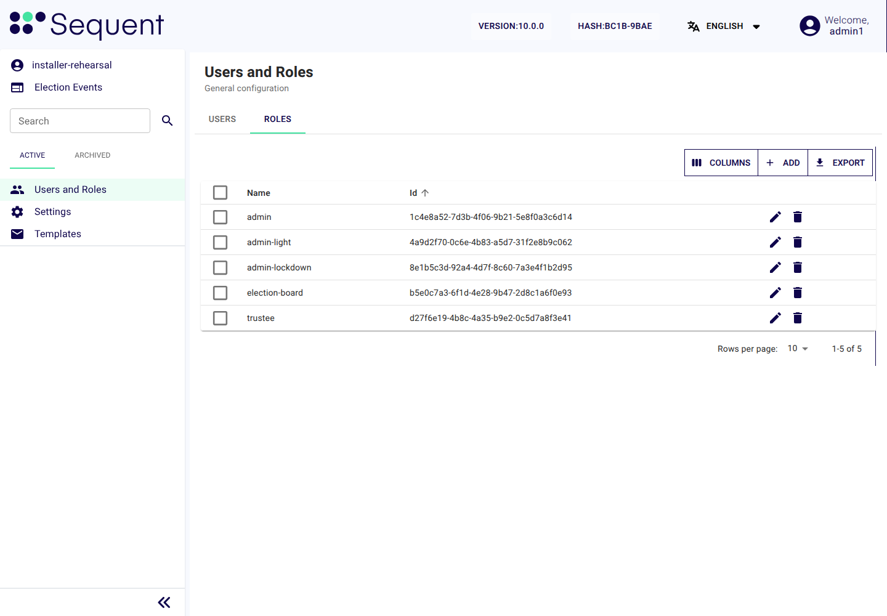
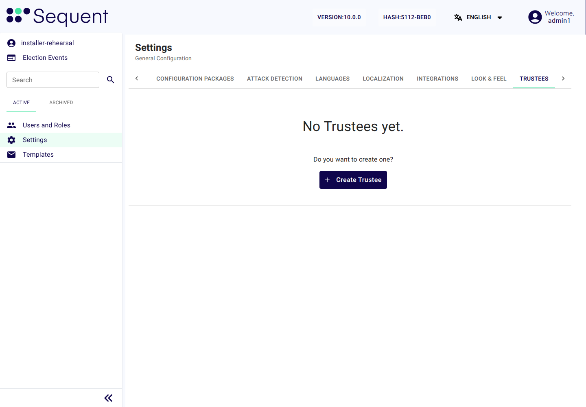
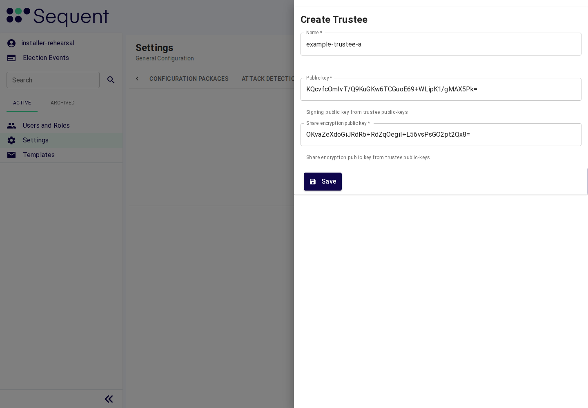
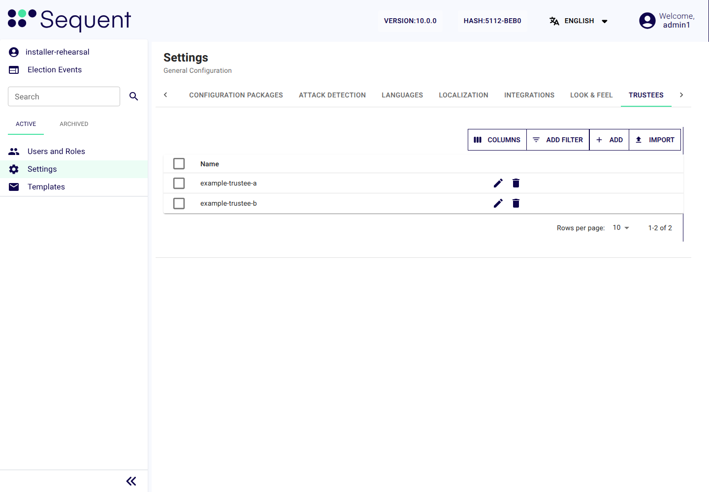
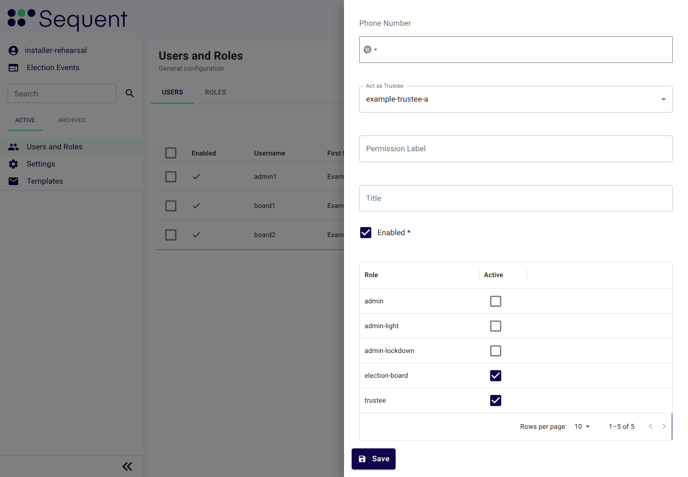

<!--
SPDX-FileCopyrightText: 2026 Sequent Tech Inc <legal@sequentech.io>
SPDX-License-Identifier: AGPL-3.0-only
-->

## Accounts and roles in the TOE

- **Accounts of the tenant.** Administrators, election board members and
  trustees have personal accounts in the tenant. Each account is linked to the
  person's identity at the external authentication server; the TOE stores no
  password for it.
- **Voters** have accounts in the election event, not in the tenant. They are
  created from the voters' register of the election event
  ([Tenant and Election Event Settings](05-tenant_and_event_settings.md)).
- **Roles.** A role is a named set of permissions. An account gets the
  permissions of its roles
  ([The roles of the evaluated configuration](#the-roles-of-the-evaluated-configuration)).

You manage accounts and roles in the side menu "Users and Roles". The tab
"Users" lists the accounts. Select "Add" to create one, or open the account's
"Actions" menu and select "Edit" to view or edit it. The tab "Roles" lists the
roles. Select "Add" to create one, or the edit icon in a role's row to open
"Role Data" and view or edit its permissions. The menu entry needs "View users
and roles" (`users-menu`), the "Users" tab needs "Read User" (`user-read`) and
the "Roles" tab needs "Read Role" (`role-read`).

*Illustration: the Roles tab of a synthetic v10.0.0 tenant. It also lists the
shipped roles `admin-light` and `admin-lockdown`, which no account holds in the
evaluated configuration.*

A change of an account's roles takes effect at the account's next sign-in.

The electoral log does not record changes of staff accounts and roles. Once a
configuration version is approved, the self-test check "Approved access-control
configuration" detects them ([The electoral log](09-audit_and_monitoring.md#the-electoral-log)).

## The roles of the evaluated configuration

The evaluated configuration has exactly three roles for people:

| Role | Who holds it | What the role is for |
|---|---|---|
| `admin`, the administrator role | each administrator | the tenant's settings, the accounts and roles, the protected actions and certificate registrations, the trustees' public keys and the self-tests |
| `election-board`, the election board role | each member of the election board, including the trustees | importing and approving the election data, signing the protected actions, the election execution, counting, reviewing and exporting the audit records, archiving and deleting election events |
| `trustee`, the trustee role | each trustee, in addition to `election-board` | the trustees' own steps of the key ceremony and the counting |

Each role's section below lists every permission that the role gives; a role
gives no other permission. These rules keep the roles apart:

| Rule | Why |
|---|---|
| No account holds `admin` together with `election-board` or `trustee`. | At sign-in, an account with an administrator capability ([The election board role](#the-election-board-role) lists them) gets only the administrator role's permissions. Correct such an assignment; do not rely on this safeguard. |
| No account holds the shipped roles `admin-light` or `admin-lockdown`. | They are not roles of the evaluated configuration. |
| No role holds "Edit Results Publication" (`publish-results-write`), "Datafix account" (`datafix-account`) or "Manually Verify Voter" (`voter-manually-verify`). | The realm settings of the Deployment Guide have removed them. The datafix routes change the voters' register and the voting record outside the import; the manual verification link signs a voter in without the external authentication server. |
| Nobody changes their own access. | The TOE refuses a change of your own roles, and of a role that your own account holds: another administrator makes it. |

As administrator you see an election event's settings, not its election data
(the voters' register, the candidate list and its display data, the set of
election rules and the election dates), its election execution data or its
audit records. They belong to the election board, and the TOE refuses your
reads of them.

### The administrator role

The role `admin` configures the tenant and manages the accounts, the roles, the
protected actions, the certificate registrations, the trustees and the
self-tests:

| Item | Value |
|---|---|
| Who holds it | each administrator, and no board member |
| Set up by | the realm settings of the Deployment Guide. Nobody changes the role: every administrator holds it, and the TOE refuses a change of a role that your own account holds. |
| Permissions | exactly those of the next table. At sign-in the TOE gives an administrator account only these, also where "Role Data" of `admin` shows other permissions, such as "Read Election Event" (`election-event-read`). |
| Your check before the first import | "Role Data" of `admin` shows no "Sign:" permission, no "Edit Election State" (`election-state-write`) and no "Create Election Event" (`election-event-create`). If it shows one, the realm settings were not applied: stop and tell the operator. |

| Function | Permissions |
|---|---|
| Accounts; "Edit User" also changes an account's roles and deletes accounts | <ul><li>"View users and roles" (<code>users-menu</code>)</li><li>"Read User" (<code>user-read</code>)</li><li>"Create User" (<code>user-create</code>)</li><li>"Edit User" (<code>user-write</code>)</li></ul> |
| Roles and their permissions | <ul><li>"Read Role" (<code>role-read</code>)</li><li>"Create Role" (<code>role-create</code>)</li><li>"Edit Role" (<code>role-write</code>)</li><li>"Read User Permission" (<code>user-permission-read</code>)</li><li>"Create User Permission" (<code>user-permission-create</code>)</li><li>"Edit User Permission" (<code>user-permission-write</code>)</li></ul> |
| Tenant settings, among them the policy for signed configuration packages, the attack detection rates and the authentication failure threshold | <ul><li>"Read Tenant" (<code>tenant-read</code>)</li><li>"Edit Tenant" (<code>tenant-write</code>)</li></ul> |
| Tenants: act only in the super-admin tenant, in which nobody works | <ul><li>"Create Tenant" (<code>tenant-create</code>)</li><li>"Delete Tenant" (<code>tenant-delete</code>)</li></ul> |
| Settings screens and message templates | <ul><li>"View settings" (<code>settings-menu</code>)</li><li>"View election types settings" (<code>settings-election-types-tab</code>)</li><li>"View voting channels settings" (<code>settings-voting-channels-tab</code>)</li><li>"View templates settings" (<code>settings-templates-tab</code>)</li><li>"View languages settings" (<code>settings-languages-tab</code>)</li><li>"View localization settings" (<code>settings-localization-tab</code>)</li><li>"View look and feel settings" (<code>settings-look-feel-tab</code>)</li><li>"View countries settings" (<code>settings-countries-tab</code>)</li><li>"View templates" (<code>templates-menu</code>)</li><li>"Read Communication Template" (<code>communication-template-read</code>)</li><li>"Create Communication Template" (<code>communication-template-create</code>)</li><li>"Edit Communication Template" (<code>communication-template-write</code>)</li></ul> |
| An election event's administration settings, on its tab "Data", and the Settings tab "Attack detection". In preparation you change only the settings that [Tenant and Election Event Settings](05-tenant_and_event_settings.md) names; the TOE does not show you each election's own settings | "Admin User" (`admin-user`) |
| Protected actions, trusted issuers and certificate registrations | <ul><li>"Election Event Signatures Tab" (<code>election-event-signatures-tab</code>)</li><li>"Signatures: read protected actions" (<code>signing-rules-read</code>)</li><li>"Signatures: edit protected actions" (<code>signing-rules-write</code>)</li><li>"Signatures: import and remove trusted issuers" (<code>signing-issuers-write</code>)</li><li>"Signatures: edit certificate checks" (<code>signing-checks-write</code>)</li><li>"Signatures: read certificates" (<code>signing-certificates-read</code>)</li><li>"Signatures: register certificates" (<code>signing-certificates-register</code>)</li><li>"Signatures: revoke certificates" (<code>signing-certificates-revoke</code>)</li></ul> |
| Trustees' public keys | <ul><li>"View trustees settings" (<code>settings-trustees-tab</code>)</li><li>"Read Trustee" (<code>trustee-read</code>)</li><li>"Create Trustee" (<code>trustee-create</code>)</li><li>"Edit Trustee" (<code>trustee-write</code>)</li></ul> |
| Self-tests: read the results, run the checks and, in preparation, change the interval and the optional conditions ([Security and Self-Tests](07-self_tests.md)) | <ul><li>"Self-tests: read results" (<code>self-test-read</code>)</li><li>"Self-tests: run checks" (<code>self-test-run</code>)</li><li>"Self-tests: edit settings" (<code>self-test-settings-write</code>)</li></ul> |
| Certificate authorities for voter certificates: not used, because "Voter Digital Certificate Policy" is "Disabled" | <ul><li>"Read certificate authorities" (<code>ca-read</code>)</li><li>"Edit certificate authorities" (<code>ca-write</code>)</li></ul> |

### The election board role

The role `election-board` holds the election board's functions: importing and
approving the election data, signing the protected actions, running the
election execution and the counting, and reviewing and exporting the audit
records:

| Item | Value |
|---|---|
| Who holds it | each member of the election board, including the trustees, and no administrator |
| Set up by | the realm settings of the Deployment Guide |
| Permissions | exactly those of the next table, and the optional permissions below that the election organizer decides. The role holds no other permission. |
| Never in this role | the administrator capabilities: "Admin User" (`admin-user`), "Edit Tenant" (`tenant-write`), "Create User" (`user-create`), "Edit User" (`user-write`), "Create Role" (`role-create`), "Edit Role" (`role-write`), "Signatures: edit protected actions" (`signing-rules-write`), "Signatures: import and remove trusted issuers" (`signing-issuers-write`), "Signatures: edit certificate checks" (`signing-checks-write`), "Signatures: register certificates" (`signing-certificates-register`), "Signatures: revoke certificates" (`signing-certificates-revoke`) and "Self-tests: edit settings" (`self-test-settings-write`). An account with one of them gets only the administrator role's permissions at sign-in. |

| Function | Permissions |
|---|---|
| Create the approval event and import the election data ([The approval event](05-tenant_and_event_settings.md#the-approval-event)) | <ul><li>"Create Election Event" (<code>election-event-create</code>)</li><li>"Upload Documents" (<code>document-upload</code>)</li></ul> |
| Check the imported election data, read only | <ul><li>"Read Election Event" (<code>election-event-read</code>)</li><li>"Read Election" (<code>election-read</code>)</li><li>"Read Contest" (<code>contest-read</code>)</li><li>"Read Candidate" (<code>candidate-read</code>)</li><li>"Read Area" (<code>area-read</code>)</li><li>"View Election Event Data" (<code>election-event-data-tab</code>)</li><li>"View Election Data" (<code>election-data-tab</code>)</li><li>"View Election Event Areas" (<code>election-event-areas-tab</code>)</li></ul> |
| Create, check and publish configuration versions | <ul><li>"View Election Event Publish" (<code>election-event-publish-tab</code>)</li><li>"View Election Publish" (<code>election-publish-tab</code>)</li><li>"Read Publish" (<code>publish-read</code>)</li><li>"Edit Publish" (<code>publish-write</code>)</li><li>"Create Publish" (<code>publish-create</code>)</li><li>"Regenerate Publish" (<code>publish-regenerate</code>)</li><li>"Publish Changes" (<code>publish-changes</code>)</li></ul> |
| Set the lockdown period: only "Start Lockdown Period" and "End Lockdown Period" | <ul><li>"View Election Event Scheduled" (<code>election-event-scheduled-tab</code>)</li><li>"Edit Scheduled Events" (<code>scheduled-event-write</code>)</li><li>"Create Scheduled Event" (<code>scheduled-event-create</code>)</li></ul> |
| Start, interrupt, resume and end the election execution | <ul><li>"Edit Election State" (<code>election-state-write</code>)</li><li>"Start Voting" (<code>publish-start-voting</code>)</li><li>"Pause Voting" (<code>publish-pause-voting</code>)</li><li>"Stop Voting" (<code>publish-stop-voting</code>)</li></ul> |
| Sign the protected actions | <ul><li>"Sign: import election data" (<code>sign-import-election-data</code>)</li><li>"Sign: approve a configuration version" (<code>sign-approve-configuration</code>)</li><li>"Sign: initialize voting" (<code>sign-initialize-voting</code>)</li><li>"Sign: open voting" (<code>sign-open-voting</code>)</li><li>"Sign: close voting" (<code>sign-close-voting</code>)</li><li>"Sign: start counting votes" (<code>sign-start-tally</code>)</li><li>"Sign: generate election returns" (<code>sign-generate-election-returns</code>)</li><li>"Sign: generate other election reports" (<code>sign-generate-reports</code>)</li><li>"Sign: export election execution data" (<code>sign-export-execution-data</code>)</li><li>"Sign: delete election execution data" (<code>sign-delete-execution-data</code>)</li><li>"Sign: read the voters' register in post-processing" (<code>sign-read-voters-register</code>)</li></ul> |
| Follow, cancel and export signing requests; read the protected actions and the certificate registrations | <ul><li>"Election Event Signatures Tab" (<code>election-event-signatures-tab</code>)</li><li>"Signatures: read protected actions" (<code>signing-rules-read</code>)</li><li>"Signatures: read certificates" (<code>signing-certificates-read</code>)</li><li>"Signatures: read requests" (<code>signing-requests-read</code>)</li><li>"Signatures: cancel requests" (<code>signing-requests-cancel</code>)</li><li>"Signatures: export requests" (<code>signing-requests-export</code>)</li></ul> |
| Run the key ceremony and the counting | <ul><li>"View Election Event Keys" (<code>election-event-keys-tab</code>)</li><li>"Admin Ceremony" (<code>admin-ceremony</code>)</li><li>"Create Ceremony" (<code>create-ceremony</code>)</li><li>"Export Ceremony" (<code>export-ceremony</code>)</li><li>"Read Trustee" (<code>trustee-read</code>)</li><li>"View Election Event Tally" (<code>election-event-tally-tab</code>)</li><li>"Read Tally" (<code>tally-read</code>)</li><li>"Read Tally Results" (<code>tally-results-read</code>)</li></ul> |
| Generate and download reports, among them the initialization report | <ul><li>"View Election Event Reports" (<code>election-event-reports-tab</code>)</li><li>"Read Reports" (<code>report-read</code>)</li><li>"Generate Report" (<code>report-generate</code>)</li><li>"Read Documents" (<code>document-read</code>)</li><li>"Download Documents" (<code>document-download</code>)</li></ul> |
| Review, audit and export the electoral log | <ul><li>"View Election Event Logs" (<code>election-event-logs-tab</code>)</li><li>"Read Logs" (<code>logs-read</code>)</li><li>"Export Logs" (<code>logs-export</code>)</li><li>"Audit Electoral Log" (<code>electoral-log-audit</code>)</li><li>"Browse Electoral Log" (<code>electoral-log-console-read</code>)</li></ul> |
| Dashboards, self-tests and tasks; setting up the security dashboard ([Preparing the security dashboard](../05-election_organizer_handbook/06-preparation.md#preparing-the-security-dashboard)) | <ul><li>"Admin Dashboard View" (<code>admin-dashboard-view</code>)</li><li>"View Election Dashboard" (<code>election-dashboard-tab</code>)</li><li>"View Monitoring Dashboards" (<code>monitoring-view</code>)</li><li>"Configure Monitoring Dashboards" (<code>monitoring-configure</code>)</li><li>"Self-tests: read results" (<code>self-test-read</code>)</li><li>"Self-tests: run checks" (<code>self-test-run</code>)</li><li>"View Election Event Tasks" (<code>election-event-tasks-tab</code>)</li><li>"Read Tasks Execution" (<code>tasks-read</code>)</li></ul> |
| Read the voters' register; in post-processing only with the board's signatures for a read session of five minutes | <ul><li>"View Election Event Voters" (<code>election-event-voters-tab</code>)</li><li>"Read Voter" (<code>voter-read</code>)</li></ul> |
| Export the election execution data. Delete an election event: the TOE refuses it before that export and without the board's signatures, because it also deletes the audit records. Archive an election event imported with wrong election data ([Import of election data](05-tenant_and_event_settings.md#import-of-election-data)) | <ul><li>"Export election execution data" (<code>election-execution-export</code>)</li><li>"Delete Election Event" (<code>election-event-delete</code>)</li><li>"Archive Election Event" (<code>election-event-archive</code>)</li></ul> |
| Check the role separation, read only | <ul><li>"View users and roles" (<code>users-menu</code>)</li><li>"Read User" (<code>user-read</code>)</li><li>"Read Role" (<code>role-read</code>)</li><li>"Read User Permission" (<code>user-permission-read</code>)</li></ul> |

The election organizer decides whether the board also needs the following
permissions. Add only those it decides, and only to this role:

| Permission | What it allows |
|---|---|
| "Read Electoral Log Personal Data" (`electoral-log-personal-data-read`) | see the usernames, IP addresses and countries in the electoral log |
| "Read Document Passwords" (`document-password-read`) | read the password of an encrypted file that the TOE generated, such as an export or a report |
| "Reveal Secret Voter Fields" (`voter-secret-attribute-read`) | reveal the voters' secret fields, also in an export or a report |
| "Edit Secret Voter Fields" (`voter-secret-attribute-write`) | import the voters' secret fields of a configuration package |
| "View Election Event Voters Filters" (`ee-voters-filters`) | filter the list of the voters' register |

To check the role:

1. In "Users and Roles", tab "Roles", select the edit icon in the row
   `election-board`. "Role Data" opens.
2. Compare the ticked permissions with the tables above. "Role Data" has no
   "Save" button: each tick or untick is saved at once.
3. Tick each missing permission of the tables, and untick every permission
   that the tables do not name.
4. If you changed the role, ask the board members to sign out and sign in
   again: their next sign-in gives them the corrected permissions.

:::warning
Never remove "Signatures: cancel requests" (`signing-requests-cancel`) from the
role. Without it, only the member who started a signing request can cancel it,
and the other members cannot stop an action they object to.
:::

### The trustee role

The role `trustee` adds the trustees' own steps of the key ceremony and the
counting to the election board role:

| Item | Value |
|---|---|
| Who holds it | each trustee, in addition to `election-board`; also the machine accounts `trustee1` and `trustee2` of the trustee server instances, with no other role |
| Set up by | the realm settings of the Deployment Guide |
| Permissions | exactly the three of the next table. The role holds no other permission. |

| Function | Permissions |
|---|---|
| Take part in the key ceremony and the counting, on the election event's tabs "Keys" and "Tally", as the trustee that "Act as Trustee" names | "Trustee Ceremony" (`trustee-ceremony`) |
| Sign the protected action "Confirm custody (key ceremony)" | "Sign: confirm custody" (`sign-key-ceremony`) |
| Sign the protected action "Authorize tally custody (tally)" | "Sign: authorize tally custody" (`sign-tally-key`) |

:::note
The side menu shows holders of "Trustee Ceremony" the entry "Trustee
Dashboard". The evaluated configuration does not use it: trustees generate
their keys and authorise their custody steps with the trustee tool of the TOE
delivery on an offline workstation
([Trustee Procedures](../05-election_organizer_handbook/09-trustee-procedures.md)).
:::

### Registering the trustees' public keys

Before the key ceremony, register each trustee with the two public keys that
the trustee generated with the trustee tool of the TOE delivery
([Generating your keys](../05-election_organizer_handbook/09-trustee-procedures.md#generating-your-keys)):

| Item | Value |
|---|---|
| Your permissions | "View trustees settings" (`settings-trustees-tab`), "Read Trustee" (`trustee-read`) and "Edit Trustee" (`trustee-write`) of the administrator role |
| The keys | `signing_public_key` and `share_encryption_public_key`, as `./trustee public-keys trustee.json` prints them |
| How you receive them | from the trustee in person, or on a medium that the trustee hands over to you |

To register a trustee:

1. Open Settings, tab "TRUSTEES". Select "Create Trustee" if the list is
   empty, or "Add" if it already shows a trustee.

   

   *Illustration: the Trustees tab of a synthetic v10.0.0 tenant before the
   first registration.*

2. In "Create Trustee", enter the trustee's name in "Name". Paste
   `signing_public_key` into "Public key" and `share_encryption_public_key`
   into "Share encryption public key". Select "Save".

   

   *Illustration: the "Create Trustee" form with synthetic keys. Use the keys
   that your trustee hands over.*

3. Open the registered trustee with its edit icon and check both keys
   together with the trustee, character by character. Close "Edit Trustee"
   without saving.

   

   *Illustration: two registered synthetic trustees, each with its edit icon.*

4. In "Users and Roles", tab "Users", open the trustee's personal account with
   "Actions" > "Edit". Select this trustee's name in "Act as Trustee" and
   select "Save".

   

   *Illustration: a synthetic trustee account bound to its registered trustee.*

5. Give the operator the registered name and the checked
   key pair for the trustee's native instance, `trustee1` or `trustee2`. The
   operator binds the instance's machine account to this name before starting it
   ([Bind each native account to its registered trustee](../../05-reference/06-deployment_guide/08-installing_toe.md#bind-each-native-account-to-its-registered-trustee)).
   The personal account's binding alone does not configure the native instance.

:::warning
A wrong public key lets someone other than the trustee act for the trustee's
share, or stops the key ceremony. Never take the keys from an email or a chat
message, and never change a registered trustee once the key ceremony has
started.
:::

## Personal accounts

Create one personal account for each administrator, each board member and each
trustee whom the election organizer has appointed in writing.
To create a personal account:

1. In "Users and Roles", tab "Users", select "Add".
2. Enter the person's "Username" and "Email" exactly as the external
   authentication server knows them: at the person's first sign-in, the TOE
   links the sign-in to the existing account with the same username or email.
   Enter the person's required "First Name" and "Last Name" as well. The TOE
   sends its email notifications to the administrators and the election board
   at these addresses.
3. Tick "Enabled".
4. Make the account a member of exactly one of the roles of
   [The roles of the evaluated configuration](#the-roles-of-the-evaluated-configuration):
   `admin` or `election-board`. For a trustee, also add `trustee` and, in "Act
   as Trustee", select the trustee whose key share the person holds.
5. Select "Save". This creates the account directly. Reopen it through its
   "Actions" menu > "Edit" and check the identity fields, "Enabled", roles
   and, for a trustee, "Act as Trustee".
6. Ask the person to sign in once. The external authentication server must
   accept them with two factors, and the TOE must link the sign-in to this
   account. If the person ends up in an account you did not create, or in none,
   stop and check the authentication settings
   ([Authentication and Session Settings](08-authentication_and_sessions.md)).

:::warning
Never create an account for a person the election organizer has not
appointed, and never give a board member the administrator role "for a short
time". Role separation is a requirement of the evaluated configuration at all
times.
:::

## Accounts that come with the deployment

The operator creates the customer's tenant as the
Deployment Guide describes, adds the first personal administrator account to
it, and gives you the tenant name that you enter under "Select Tenant" when you
sign in ([Signing in](03-admin_portal.md#signing-in)). Give the same tenant name
to every person for whom you create an account. The super-admin tenant, in
which the TOE was installed, holds no election event and no enabled personal
account: nobody works in it.

Besides the first personal administrator account, the customer's tenant
contains accounts that are not personal accounts:

- **The seeded account `admin`.** It is created with the tenant, has no
  password and holds the permissions of the seeded administrator group. As
  soon as your own personal administrator account works, delete it: in
  "Users", open the "Actions" menu in the exact `admin` row, select "Delete",
  and confirm "Are you sure you want to delete this user?" with "Delete". Check that it no longer appears in the "Users" list.
- **The trustees' service accounts `trustee1` and `trustee2`.** They are the
  machine identities of the two instances of the trustee server. The
  Deployment Guide gives them random passwords. They are not personal
  accounts: never sign in with them or use them for a board member. The
  operator sets their trustee binding as described above. They hold only the
  role `trustee`; preserve their login names, passwords and roles, and do not
  delete them.
- **Technical service accounts of the TOE** (their names start with
  `service-account-`). Do not change or delete them.

:::danger
Until you delete it, the seeded account `admin` holds the user and role
permissions, with which an account can be given any permission. Delete it before you create the accounts of the election board.
:::

## When a person leaves or changes function

When the election organizer tells you that a person no longer holds their
function, act on the same day:

1. In "Users", open the person's account, untick "Enabled" and confirm. A
   disabled account cannot sign in again.
2. Remove the account from all its roles.
3. Ask the organisation that runs the external authentication server to
   withdraw the person's credentials there.
4. If the person was a board member or trustee, revoke the registration of
   their signing certificate on the same day: on the tab "Signatures" of every
   election event of the tenant, area "Certificates", section "Registered
   certificates", select "Revoke" for each certificate registered to the person
   and enter the "Reason". This needs the permission "Signatures: revoke
   certificates" (`signing-certificates-revoke`). A registration cannot be
   deleted. A revoked certificate cannot sign any more; signatures it already
   made still count, and incomplete signing requests it signed are cancelled.
   Inform the election board. A signing request the person had started stays waiting until it is completed,
   cancelled or expires: the board cancels it if needed
   ([Configuring Protected Actions](06-signing_rules.md)).
5. Check that the number of remaining board members who can sign each
   protected action is still at least its "Signatures needed". If not, tell the
   election organizer and the election board at once. In the preparation phase
   the organizer appoints a new member, you create the account, and the board
   approves a new configuration version. Once the execution phase has started, a
   new account or a new role membership fails the self-test check "Approved
   access-control configuration", which stops voting. So the organizer appoints
   more board members than any protected action needs before the board approves
   the configuration version.
6. After the election event's retention period, delete the account as the
   election organizer's regulation requires.

If a person changes from the election board to the administrators, or the other
way round, create a new account for the new function and disable the old one,
so that the electoral log shows clearly which function performed each action.
Do this outside the execution phase.

:::note
During a lockdown period the TOE refuses changes to the voters of the election
event. Lockdown does not block changes to tenant accounts, so disable the
account of a person who leaves at once, also during the execution phase. Disabling
an account or removing roles from it does not fail the self-test check "Approved
access-control configuration".
:::

## Permission labels

Permission labels limit which elections an account can reach. The TOE never
gives an administrator account the permission **Edit Permission Label**
(`permission-label-write`): it also permits access to election data.

Have the election organizer define the required election access in the signed
configuration package. After import, the board checks that each member can reach
every election whose protected actions they must sign. A missing election is a
configuration problem to correct before execution; broadening an administrator's
permissions is not a remedy.
