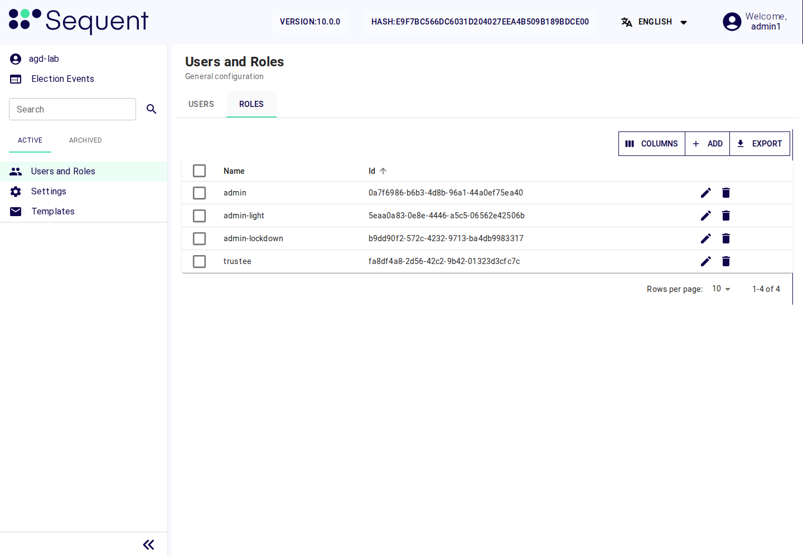

<!--
SPDX-FileCopyrightText: 2026 Sequent Tech Inc <legal@sequentech.io>
SPDX-License-Identifier: AGPL-3.0-only
-->

## Accounts and roles in the TOE

- **Accounts of the tenant.** Administrators, election board members and
  trustees have personal accounts in the tenant. Each account is linked to the
  person's identity at the external authentication server; the TOE stores no
  password for it.
- **Voters** have accounts in the election event, not in the tenant. They are
  created from the voters' register of the election event
  ([Tenant and Election Event Settings](05-tenant_and_event_settings.md)).
- **Roles.** A role is a named set of permissions. An account gets the
  permissions assigned through its roles. Administrator-capable accounts are
  restricted to administration permissions when a token is issued, even if a
  board role was also assigned. Correct conflicting assignments; do not use
  this safeguard as a substitute for separate people and accounts.

You manage accounts and roles in the side menu "Users and Roles". The tab
"Users" lists the accounts. Select "Add" to create one, or open the account's
"Actions" menu and select "Edit" to view or edit it. The tab "Roles" lists the
roles. Select "Add" to create one, or the edit icon in a role's row to open
"Role Data" and view or edit its permissions. The menu entry needs "View users
and roles" (`users-menu`), the "Users" tab needs "Read User" (`user-read`) and
the "Roles" tab needs "Read Role" (`role-read`).

*Illustration: role navigation in a synthetic v10.0.0 tenant before role setup.
The shipped role names shown here are not the completed evaluated configuration;
apply the role assignments and exclusions below.*

A change of an account's roles takes effect at the account's next sign-in.

Creating, changing and deleting users, roles, role permissions and role assignments is recorded
in the electoral log of the tenant (for tenant accounts) or of the election
event (for voters).

## The roles of the evaluated configuration

The evaluated configuration has exactly these roles for people:

| Role | Who holds it | Purpose |
|---|---|---|
| `admin`, with the permissions of the next two sections removed | each administrator | the administrator role |
| `election-board`, shown below as "Election board" | each member of the election board, including the trustees | the election board role |
| `trustee` | each trustee, in addition to "Election board" | the trustees' key and tally ceremony steps |

No account holds the administrator role together with the election board role.
No account holds the shipped roles `admin-light` or `admin-lockdown`.

As administrator you see an election event's settings, not its election data
or its audit records. The election data (the voters' register, the candidate
list and its display data, the set of election rules and the election dates),
the election execution data and the audit records belong to the election
board: a board member imports the election data, the board publishes it in
configuration versions and reviews the audit records. The TOE refuses the
administrator's reads of election data and of audit records.

:::warning
Before the first election event is imported, check that the role `admin`
holds none of the permissions of the next two sections, and remove any that it
holds. The realm settings of the Deployment Guide have already removed them,
among them all "Sign:" permissions, "Edit Election State"
(`election-state-write`), "Create Election Event" (`election-event-create`)
and the permissions that read the voters' register and the electoral log: with
them, an account in the role `admin` could import election data, start and
end the election execution, sign protected actions alone and read the voters'
register and the audit records.
:::

### The election board's permissions

These permissions belong only to the "Election board" role (and, where
stated, to `trustee`). Remove each of them from the role `admin`:

| Function | Permissions |
|---|---|
| Import of election data | "Create Election Event" (`election-event-create`) |
| Configuration versions | <ul><li>"View Election Event Publish" (<code>election-event-publish-tab</code>)</li><li>"View Election Publish" (<code>election-publish-tab</code>)</li><li>"Read Publish" (<code>publish-read</code>)</li><li>"Edit Publish" (<code>publish-write</code>)</li><li>"Create Publish" (<code>publish-create</code>)</li><li>"Regenerate Publish" (<code>publish-regenerate</code>)</li><li>"Publish Changes" (<code>publish-changes</code>)</li></ul> |
| Lockdown periods | <ul><li>"View Election Event Scheduled" (<code>election-event-scheduled-tab</code>)</li><li>"Election Event Scheduled Event Columns" (<code>election-event-scheduled-event-columns</code>)</li><li>"Edit Scheduled Events" (<code>scheduled-event-write</code>)</li><li>"Create Scheduled Event" (<code>scheduled-event-create</code>)</li><li>"Delete Scheduled Event" (<code>scheduled-event-delete</code>)</li></ul> The board creates only "Start Lockdown Period" and "End Lockdown Period". |
| Areas, which are election data: the TOE refuses changes | <ul><li>"Read Area" (<code>area-read</code>)</li><li>"Edit Area" (<code>area-write</code>)</li><li>"Create Area" (<code>area-create</code>)</li><li>"Delete Area" (<code>area-delete</code>)</li><li>"Import Area" (<code>area-import</code>)</li><li>"Upsert Area" (<code>area-upsert</code>)</li><li>"Export Area" (<code>area-export</code>)</li></ul> |
| Sign protected actions | <ul><li>"Sign: initialize voting" (<code>sign-initialize-voting</code>)</li><li>"Sign: open voting" (<code>sign-open-voting</code>)</li><li>"Sign: close voting" (<code>sign-close-voting</code>)</li><li>"Sign: generate election returns" (<code>sign-generate-election-returns</code>)</li><li>"Sign: generate other election reports" (<code>sign-generate-reports</code>)</li><li>"Sign: transmit results" (<code>sign-transmit-results</code>)</li><li>"Sign: approve a voter manually" (<code>sign-approve-voter</code>)</li><li>"Sign: approve a configuration version" (<code>sign-approve-configuration</code>)</li><li>"Sign: import election data" (<code>sign-import-election-data</code>)</li><li>"Sign: start counting votes" (<code>sign-start-tally</code>)</li><li>"Sign: export election execution data" (<code>sign-export-execution-data</code>)</li><li>"Sign: delete election execution data" (<code>sign-delete-execution-data</code>)</li><li>"Sign: read the voters’ register in post-processing" (<code>sign-read-voters-register</code>)</li></ul> |
| Trustee steps (role `trustee` only) | <ul><li>"Sign: confirm custody" (<code>sign-key-ceremony</code>)</li><li>"Sign: authorize tally custody" (<code>sign-tally-key</code>)</li><li>"Trustee Ceremony" (<code>trustee-ceremony</code>)</li></ul> |
| Start, interrupt, resume and end the election execution | <ul><li>"Edit Election State" (<code>election-state-write</code>)</li><li>"Start Voting" (<code>publish-start-voting</code>)</li><li>"Pause Voting" (<code>publish-pause-voting</code>)</li><li>"Stop Voting" (<code>publish-stop-voting</code>)</li></ul> |
| Signing requests | <ul><li>"Signatures: read requests" (<code>signing-requests-read</code>)</li><li>"Signatures: cancel requests" (<code>signing-requests-cancel</code>)</li><li>"Signatures: export requests" (<code>signing-requests-export</code>)</li></ul> |
| Key and tally ceremonies, counting | <ul><li>"View Election Event Keys" (<code>election-event-keys-tab</code>)</li><li>"Read Keys" (<code>keys-read</code>)</li><li>"Admin Ceremony" (<code>admin-ceremony</code>)</li><li>"Create Ceremony" (<code>create-ceremony</code>)</li><li>"Export Ceremony" (<code>export-ceremony</code>)</li><li>"View Election Event Tally" (<code>election-event-tally-tab</code>)</li><li>"Read Tally" (<code>tally-read</code>)</li><li>"Start Tally" (<code>tally-start</code>)</li><li>"Edit Tally" (<code>tally-write</code>)</li><li>"Read Tally Results" (<code>tally-results-read</code>)</li></ul> |
| Archiving and deletion of election events | <ul><li>"Archive Election Event" (<code>election-event-archive</code>)</li><li>"Delete Election Event" (<code>election-event-delete</code>)</li></ul> |
| Audit review and monitoring | <ul><li>"Admin Dashboard View" (<code>admin-dashboard-view</code>)</li><li>"View Election Event Logs" (<code>election-event-logs-tab</code>)</li><li>"Read Logs" (<code>logs-read</code>)</li><li>"Audit Electoral Log" (<code>electoral-log-audit</code>)</li><li>"Browse Electoral Log" (<code>electoral-log-console-read</code>)</li><li>"Query Electoral Log" (<code>electoral-log-console-query</code>)</li><li>"Read Electoral Log Personal Data" (<code>electoral-log-personal-data-read</code>)</li><li>"View Election Event Tasks" (<code>election-event-tasks-tab</code>)</li><li>"Read Tasks Execution" (<code>tasks-read</code>)</li><li>"View Monitoring Dashboards" (<code>monitoring-view</code>)</li></ul> |
| Read the voters' register (post-processing requires board approval for a five-minute read session) | <ul><li>"Read Voter" (<code>voter-read</code>)</li><li>"View Election Event Voters" (<code>election-event-voters-tab</code>)</li></ul> |
| Export of the electoral log and of election execution data | <ul><li>"Export Logs" (<code>logs-export</code>)</li><li>"Read Reports" (<code>report-read</code>)</li><li>"Edit Reports" (<code>report-write</code>)</li><li>"Read Documents" (<code>document-read</code>)</li><li>"Download Documents" (<code>document-download</code>)</li><li>"Export Voter" (<code>voter-export</code>)</li><li>"Read Document Passwords" (<code>document-password-read</code>)</li></ul> |

### Permissions on election data and audit records

Also remove from `admin` every permission that reads, changes or exports
election data, election execution data or audit records. The administrator
role holds none of the following; the election board role holds only those
that the previous section and [Create the "Election board" role](#create-the-election-board-role)
name.

| Object | Permissions |
|---|---|
| Election events and elections | <ul><li>"Read Election Event" (<code>election-event-read</code>)</li><li>"Edit Election Event" (<code>election-event-write</code>)</li><li>"Read Election" (<code>election-read</code>)</li><li>"Edit Election" (<code>election-write</code>)</li><li>"Create Election Event" (<code>election-event-create</code>)</li><li>"Delete Election Event" (<code>election-event-delete</code>)</li><li>"Archive Election Event" (<code>election-event-archive</code>)</li><li>"Create Election" (<code>election-create</code>)</li><li>"Delete Election" (<code>election-delete</code>)</li></ul> |
| Voters' register — records and imports | <ul><li>"Create Voter" (<code>voter-create</code>)</li><li>"Read Voter" (<code>voter-read</code>)</li><li>"Edit Voter" (<code>voter-write</code>)</li><li>"Delete Voter" (<code>voter-delete</code>)</li><li>"Import Voter" (<code>voter-import</code>)</li><li>"Export Voter" (<code>voter-export</code>)</li></ul> |
| Voters' register — additional operations | <ul><li>"Reveal Secret Voter Fields" (<code>voter-secret-attribute-read</code>)</li><li>"Edit Secret Voter Fields" (<code>voter-secret-attribute-write</code>)</li><li>"Manually Verify Voter" (<code>voter-manually-verify</code>)</li><li>"Change Voter Password" (<code>voter-change-password</code>)</li><li>"Generate Voter Information Letter" (<code>voter-information-letter</code>)</li><li>"Edit voters who voted" (<code>voter-voted-edit</code>)</li><li>"Edit voters email/phone fields" (<code>voter-email-tlf-edit</code>)</li><li>"Import Users" (<code>user-import</code>)</li></ul> |
| Voters' register — views and reconciliation | <ul><li>"View Election Event Voters" (<code>election-event-voters-tab</code>)</li><li>"View Election Voters" (<code>election-voters-tab</code>)</li><li>"View Election Event Voters Logs" (<code>ee-voters-logs</code>)</li><li>"Reconcile election event voter list" (<code>election-event-voter-list-reconciliation</code>)</li></ul> |
| Voters' register — applications | <ul><li>"Read Application" (<code>application-read</code>)</li><li>"Edit Application" (<code>application-write</code>)</li><li>"Application Import" (<code>application-import</code>)</li><li>"Application Export" (<code>application-export</code>)</li></ul> |
| Candidate list, ballot display and rules — contests and candidates | <ul><li>"Create Contest" (<code>contest-create</code>)</li><li>"Read Contest" (<code>contest-read</code>)</li><li>"Edit Contest" (<code>contest-write</code>)</li><li>"Delete Contest" (<code>contest-delete</code>)</li><li>"Create Candidate" (<code>candidate-create</code>)</li><li>"Read Candidate" (<code>candidate-read</code>)</li><li>"Edit Candidate" (<code>candidate-write</code>)</li><li>"Delete Candidate" (<code>candidate-delete</code>)</li></ul> |
| Candidate list, ballot display and rules — areas | <ul><li>"Read Area" (<code>area-read</code>)</li><li>"Edit Area" (<code>area-write</code>)</li><li>"Create Area" (<code>area-create</code>)</li><li>"Delete Area" (<code>area-delete</code>)</li><li>"Import Area" (<code>area-import</code>)</li><li>"Upsert Area" (<code>area-upsert</code>)</li><li>"Export Area" (<code>area-export</code>)</li></ul> |
| Election dates and lockdown periods | <ul><li>"View Election Event Scheduled" (<code>election-event-scheduled-tab</code>)</li><li>"Election Event Scheduled Event Columns" (<code>election-event-scheduled-event-columns</code>)</li><li>"Edit Scheduled Events" (<code>scheduled-event-write</code>)</li><li>"Create Scheduled Event" (<code>scheduled-event-create</code>)</li><li>"Delete Scheduled Event" (<code>scheduled-event-delete</code>)</li></ul> |
| Data correction | "Datafix account" (`datafix-account`), which no account holds |
| Configuration versions | <ul><li>"View Election Event Publish" (<code>election-event-publish-tab</code>)</li><li>"View Election Publish" (<code>election-publish-tab</code>)</li><li>"Election Event Publish View" (<code>election-event-publish-view</code>)</li><li>"Preview Election Event Publish" (<code>election-event-publish-preview</code>)</li><li>"Read Publish" (<code>publish-read</code>)</li><li>"Edit Publish" (<code>publish-write</code>)</li><li>"Create Publish" (<code>publish-create</code>)</li><li>"Regenerate Publish" (<code>publish-regenerate</code>)</li><li>"Publish Changes" (<code>publish-changes</code>)</li><li>"Export Publish" (<code>publish-export</code>)</li></ul> |
| Election execution and signing requests | <ul><li>"Edit Election State" (<code>election-state-write</code>)</li><li>"Start Voting" (<code>publish-start-voting</code>)</li><li>"Pause Voting" (<code>publish-pause-voting</code>)</li><li>"Stop Voting" (<code>publish-stop-voting</code>)</li><li>"Signatures: read requests" (<code>signing-requests-read</code>)</li><li>"Signatures: cancel requests" (<code>signing-requests-cancel</code>)</li><li>"Signatures: export requests" (<code>signing-requests-export</code>)</li></ul> |
| Keys — ceremonies | <ul><li>"View Election Event Keys" (<code>election-event-keys-tab</code>)</li><li>"Read Keys" (<code>keys-read</code>)</li><li>"Admin Ceremony" (<code>admin-ceremony</code>)</li><li>"Create Ceremony" (<code>create-ceremony</code>)</li><li>"Export Ceremony" (<code>export-ceremony</code>)</li><li>"Transmission Ceremony" (<code>transmition-ceremony</code>)</li><li>"Trustee Ceremony" (<code>trustee-ceremony</code>)</li></ul> |
| Counting — tally | <ul><li>"View Election Event Tally" (<code>election-event-tally-tab</code>)</li><li>"Read Tally" (<code>tally-read</code>)</li><li>"Start Tally" (<code>tally-start</code>)</li><li>"Edit Tally" (<code>tally-write</code>)</li><li>"Read Tally Results" (<code>tally-results-read</code>)</li></ul> |
| Counting — tally sheets and recounts | <ul><li>"Create Tally Sheet" (<code>tally-sheet-create</code>)</li><li>"View Tally Sheet" (<code>tally-sheet-view</code>)</li><li>"Review Tally Sheet" (<code>tally-sheet-review</code>)</li><li>"Create Tally Sheet Import" (<code>tally-sheet-import-create</code>)</li><li>"View Tally Sheet Import" (<code>tally-sheet-import-view</code>)</li><li>"Review Tally Sheet Import" (<code>tally-sheet-import-review</code>)</li><li>"Execute Tally Recount" (<code>tally-recount-execute</code>)</li><li>"Submit tally resolution" (<code>tally-resolution-submit</code>)</li></ul> |
| Results — transmission | <ul><li>"Generate Transmission Report" (<code>transmission-report-generate</code>)</li><li>"Miru Create" (<code>miru-create</code>)</li><li>"Miru Download" (<code>miru-download</code>)</li><li>"Miru Send" (<code>miru-send</code>)</li><li>"Miru Sign" (<code>miru-sign</code>)</li></ul> |
| Results — publication | <ul><li>"Read Results Publication" (<code>publish-results-read</code>)</li><li>"Edit Results Publication" (<code>publish-results-write</code>)</li></ul> |
| Reports | <ul><li>"View Election Event Reports" (<code>election-event-reports-tab</code>)</li><li>"Read Reports" (<code>report-read</code>)</li><li>"Edit Reports" (<code>report-write</code>)</li><li>"Create Report" (<code>report-create</code>)</li><li>"Generate Report" (<code>report-generate</code>)</li><li>"Delete Report" (<code>report-delete</code>)</li><li>"Preview Report" (<code>report-preview</code>)</li></ul> |
| Documents | <ul><li>"Read Documents" (<code>document-read</code>)</li><li>"Download Documents" (<code>document-download</code>)</li><li>"Upload Documents" (<code>document-upload</code>)</li><li>"Edit Documents" (<code>document-write</code>)</li><li>"Read Document Passwords" (<code>document-password-read</code>)</li></ul> |
| Audit records — electoral log | <ul><li>"View Election Event Logs" (<code>election-event-logs-tab</code>)</li><li>"Read Logs" (<code>logs-read</code>)</li><li>"Export Logs" (<code>logs-export</code>)</li><li>"Audit Electoral Log" (<code>electoral-log-audit</code>)</li><li>"Browse Electoral Log" (<code>electoral-log-console-read</code>)</li><li>"Query Electoral Log" (<code>electoral-log-console-query</code>)</li><li>"Read Electoral Log Personal Data" (<code>electoral-log-personal-data-read</code>)</li></ul> |
| Monitoring — tasks, dashboards and IP addresses | <ul><li>"View Election Event Tasks" (<code>election-event-tasks-tab</code>)</li><li>"Read Tasks Execution" (<code>tasks-read</code>)</li><li>"Export Tasks" (<code>task-export</code>)</li><li>"View Monitoring Dashboards" (<code>monitoring-view</code>)</li><li>"Configure Monitoring Dashboards" (<code>monitoring-configure</code>)</li><li>"View Election IP Address" (<code>election-ip-address-view</code>)</li><li>"View IP Address" (<code>admin-ip-address-view</code>)</li></ul> |

The administrator role uses `admin-user` to read the separate administration
settings projection. Keep its account-management, tenant, trustee-registration
and certificate-management permissions, the relevant menu/tab permissions,
`self-test-read`, `self-test-run` and
`self-test-settings-write`. Do not give it the election-data read/write permissions
listed above. The portal uses the settings projection for administrators; it
does not need those permissions to open an event's administration settings.

The event **Data** tab allows only the named administration settings during
preparation. Individual-election settings are read-only: changes must arrive
through an approved import. **Security and self-tests** shows phase, safety,
checks and notification delivery without exposing ballots, the voter register
or audit records. Board members receive `self-test-read` and `self-test-run`,
but not `self-test-settings-write`.

No role holds "Edit Results Publication" (`publish-results-write`), neither the
administrator role nor the election board role. No account holds "Datafix
account" (`datafix-account`): its data-correction routes change the voters'
register and the voting record outside the import, and the evaluated
configuration does not use them. No role holds "Manually Verify Voter"
(`voter-manually-verify`): its link signs a voter in without the external
authentication server.

Only the "Election board" role holds "Delete Election Event"
(`election-event-delete`) and "Archive Election Event"
(`election-event-archive`). Deleting an election event also deletes its audit
records, so the TOE refuses every deletion of an election event unless its
election execution data has been exported and the required authorisations are
reached. An election event imported with wrong election data is archived by
the election board, not deleted
([Tenant and Election Event Settings](05-tenant_and_event_settings.md#import-of-election-data)).

### Create the "Election board" role

The evaluated installation supplies the `election-board` role. Use it for
board members and trustees, then verify its permissions before use. The display
name "Election board" below refers to this role.

1. In **Users and Roles → Roles**, open `election-board`. On an older tenant
   without this role, select **Add** and create it with that name.
2. In its **Permission** table, verify these permissions:
   - the board functions: "Create Election Event" (`election-event-create`);
     the configuration version permissions of the table above; the lockdown
     period permissions of the table above; every "Sign:"
     permission of the table above except the trustee steps; "Edit Election
     State" (`election-state-write`), "Start Voting" (`publish-start-voting`),
     "Pause Voting" (`publish-pause-voting`), "Stop Voting"
     (`publish-stop-voting`); "Signatures: read requests"
     (`signing-requests-read`), "Signatures: cancel requests"
     (`signing-requests-cancel`), "Signatures: export requests"
     (`signing-requests-export`); "Admin Ceremony" (`admin-ceremony`), "Create
     Ceremony" (`create-ceremony`), "Export Ceremony" (`export-ceremony`),
     "Read Tally" (`tally-read`), "Start Tally" (`tally-start`), "Edit Tally"
     (`tally-write`), "Read Tally Results" (`tally-results-read`); "Read
     Logs" (`logs-read`), "Export Logs" (`logs-export`), "Edit Reports"
     (`report-write`), "Read Reports" (`report-read`), "Read Documents"
     (`document-read`), "Download Documents" (`document-download`),
     "Export Voter" (`voter-export`), "Audit Electoral Log" (`electoral-log-audit`), "Browse
     Electoral Log" (`electoral-log-console-read`), "Query Electoral Log"
     (`electoral-log-console-query`);
     "Delete Election Event" (`election-event-delete`), "Archive Election
     Event" (`election-event-archive`);
   - read-only access to the accounts and roles, so that the board can check
     the role separation: "View users and roles" (`users-menu`), "Read User"
     (`user-read`), "Read Role" (`role-read`) and "Read User Permission"
     (`user-permission-read`);
   - the read and view permissions of the screens the board uses: "Read
     Election Event" (`election-event-read`), "Read Area" (`area-read`), "Read Voter" (`voter-read`), "View Election
     Event Voters" (`election-event-voters-tab`), "View Election Event Data"
     (`election-event-data-tab`), "View Election Data" (`election-data-tab`),
     "View Election Event Keys" (`election-event-keys-tab`), "View Election
     Event Tally" (`election-event-tally-tab`), "View Election Event Publish"
     (`election-event-publish-tab`), "View Election Publish"
     (`election-publish-tab`), "View Election Event Logs"
     (`election-event-logs-tab`), "View Election Event Tasks"
     (`election-event-tasks-tab`), "Read Tasks Execution" (`tasks-read`),
     "Election Event Signatures Tab" (`election-event-signatures-tab`),
     "Signatures: read protected actions" (`signing-rules-read`), "Signatures:
     read certificates" (`signing-certificates-read`), "Read Publish"
     (`publish-read`), "Read Keys" (`keys-read`), "Admin Dashboard View"
     (`admin-dashboard-view`) for the election-event Dashboard, "View Election
     Dashboard" (`election-dashboard-tab`) for an individual election, "View Monitoring Dashboards"
     (`monitoring-view`); `self-test-read` and `self-test-run`.
   - for the board members who prepare the security dashboard, "Configure
     Monitoring Dashboards" (`monitoring-configure`). Add this permission
     before the board approves the election configuration. It enables the
     [dashboard setup procedure](../05-election_organizer_handbook/06-preparation.md#preparing-the-security-dashboard);
     viewing a dashboard alone does not allow its initial setup.
3. Give "Read Electoral Log Personal Data" (`electoral-log-personal-data-read`),
   "Read Document Passwords" (`document-password-read`) and "Reveal Secret
   Voter Fields" (`voter-secret-attribute-read`) only if the election
   organizer decides that the board needs them, and then only to the
   "Election board" role.
4. Do not give the role any permission to create or change users, roles,
   elections, contests, candidates, areas, voters, signing
   rules, trusted issuers, certificate checks, and never
   "Edit Results Publication" (`publish-results-write`). The board creates
   an empty preparation event as the first import authorization context.
   Election data then arrives through the approved import. Configure
   **Import election data** in that context and register the board certificates
   before the board submits its first package. The selected context supplies
   the distinct board approvals for the exact uploaded file.
5. Select "Save", then reopen the role with its edit icon and check the
   permissions. "Export Logs" (`logs-export`) and "Edit Reports"
   (`report-write`) must both be in the role: exporting the electoral log
   needs both. Also check "Read Reports" (`report-read`), "Read Documents"
   (`document-read`) and "Download Documents" (`document-download`), which
   let the board generate and download the initialization report and download
   the exported electoral log. These permissions do not reveal secret voter
   fields; the separate permission in step 3 remains necessary for those.
   Close and reopen "Role Data" to check the saved permissions, then have
   affected users sign out and sign in again to obtain updated tokens.

Do not add administrator capabilities to the board role: `admin-user`,
`tenant-write`, `user-create`, `user-write`, `role-create`, `role-write`,
`signing-rules-write`, issuer/check/certificate-management permissions or
`self-test-settings-write`. These identify an administrator-capable account;
its issued token will have board capabilities removed. Read-only account,
role, rule and certificate access is sufficient for board review.

The evaluated configuration does not transmit results
([Configuring Protected Actions](06-signing_rules.md)); no transmission
ceremony permission is needed.

:::warning
Give "Signatures: cancel requests" (`signing-requests-cancel`) to the whole
"Election board" role. Without it, only the member who started a signing
request can abort it, and the other members cannot stop an action they object
to.
:::

### The trustee role

Use the shipped role `trustee` for trustees. It contains "Trustee Ceremony"
(`trustee-ceremony`) and the read permissions trustees need. In the evaluated
configuration the protected actions "Confirm custody (key ceremony)" and
"Authorize tally custody (tally)" need the trustees' signatures
([Configuring Protected Actions](06-signing_rules.md)): add "Sign: confirm
custody" (`sign-key-ceremony`) and "Sign: authorize tally custody"
(`sign-tally-key`) to `trustee`.

:::note
The side menu shows holders of "Trustee Ceremony" the entry "Trustee
Dashboard". It is not used in the evaluated configuration: trustees perform
their key and tally steps only with the trustee tool of the TOE delivery on an
offline workstation using the short [configuration-driven trustee commands](../05-election_organizer_handbook/09-trustee-procedures.md#generating-your-keys), and
sign their custody steps as protected actions. Trustees may take separate clean
offline sessions on one organizer-controlled computer; each keeps separate
encrypted working media and backups.
:::

### Registering the trustees' public keys

Before the key ceremony, register each trustee in Settings > "TRUSTEES" with
"Create Trustee" if the list is empty, or "Add" if it already contains a
trustee. You need "Create Trustee" (`trustee-create`), "Read Trustee"
(`trustee-read`) and "Edit Trustee" (`trustee-write`).

1. Receive the trustee's two public keys from the trustee in person, or on a
   medium the trustee hands over: `signing_public_key` and
   `share_encryption_public_key`, as `./trustee public-keys trustee.json` prints them.
2. Enter the trustee's name, and paste the two keys into the two key fields.
   Their helper texts name them: "Signing public key from trustee
   public-keys" and "Share encryption public key from trustee public-keys".
3. Check the registered keys together with the trustee, character by
   character.
4. In the trustee's personal account, select this trustee name in "Act as
   Trustee".
5. Give the server operator the registered name and checked public-key pair
   for the corresponding native instance, `trustee1` or `trustee2`. The
   operator must bind that machine account to this registered name before
   starting it, as [Bind each native account to its registered trustee](../../05-reference/06-deployment_guide/08-installing_toe.md#bind-each-native-account-to-its-registered-trustee)
   describes. A correct personal-account binding alone does not configure the
   native instance.

:::warning
A wrong public key lets someone other than the trustee act for the trustee's
share, or stops the key ceremony. Never take the keys from an email or a chat
message, and never change a registered trustee once the key ceremony has
started.
:::

## Personal accounts

Create one personal account for each administrator, each board member and each
trustee whom the election organizer has appointed in writing.

1. In "Users and Roles", tab "Users", select "Add".
2. Enter the person's "Username" and "Email" exactly as the external
   authentication server knows them: at the person's first sign-in, the TOE
   links the sign-in to the existing account with the same username or email.
   Enter the person's required "First Name" and "Last Name" as well. The TOE
   sends its email notifications to the administrators and the election board
   at these addresses.
3. Tick "Enabled".
4. Make the account a member of exactly one of the roles of the table above:
   the administrator role, or "Election board". For a trustee, also add
   `trustee` and, in "Act as Trustee", select the trustee whose key share the
   person holds.
5. Select "Save". This creates the account directly. Reopen it through its
   "Actions" menu > "Edit" and check the identity fields, "Enabled", roles
   and, for a trustee, "Act as Trustee".
6. Ask the person to sign in once. The external authentication server must
   accept them with two factors, and the TOE must link the sign-in to this
   account. If the person ends up in an account you did not create, or in none,
   stop and check the authentication settings
   ([Authentication and Session Settings](08-authentication_and_sessions.md)).

:::warning
Never create an account for a person the election organizer has not
appointed, and never give a board member the administrator role "for a short
time". Role separation is a requirement of the evaluated configuration at all
times.
:::

## Accounts that come with the deployment

The person who runs the servers creates the customer's tenant as the
Deployment Guide describes, adds the first personal administrator account to
it, and gives you the tenant name that you enter under "Select Tenant" when you
sign in ([Signing in](03-admin_portal.md#signing-in)). Give the same tenant name
to every person for whom you create an account. The super-admin tenant, in
which the TOE was installed, holds no election event and no enabled personal
account: nobody works in it.

Besides the first personal administrator account, the customer's tenant
contains accounts that are not personal accounts:

- **The seeded account `admin`.** It is created with the tenant, has no
  password and holds the permissions of the seeded administrator group. As
  soon as your own personal administrator account works, delete it: in
  "Users", open the "Actions" menu in the exact `admin` row, select "Delete",
  and confirm "Are you sure you want to delete this user?" with "Delete". Check that it no longer appears in the "Users" list.
- **The trustees' service accounts `trustee1` and `trustee2`.** They are the
  machine identities of the two instances of the trustee server. The
  Deployment Guide gives them random passwords. They are not personal
  accounts: never sign in with them or use them for a board member. The server
  operator sets their trustee binding as described above; preserve their
  login names, passwords and roles, and do not delete them.
- **Technical service accounts of the TOE** (their names start with
  `service-account-`). Do not change or delete them.

:::danger
Until you delete it, the seeded account `admin` holds the user, role and
permission label permissions, with which an account can be given any
permission. Delete it before you create the accounts of the election board.
:::

## When a person leaves or changes function

When the election organizer tells you that a person no longer holds their
function, act on the same day:

1. In "Users", open the person's account, untick "Enabled" and confirm. A
   disabled account cannot sign in again.
2. Remove the account from all its roles.
3. Ask the organisation that runs the external authentication server to
   withdraw the person's credentials there.
4. If the person was a board member or trustee, revoke the registration of
   their signing certificate on the same day: on the Signatures tab of every
   election event of the tenant, "Certificates", "Registered certificates",
   select "Revoke" for each certificate registered to the person and enter the
   "Reason"
   ("Signatures: revoke certificates", `signing-certificates-revoke`). A
   registration cannot be deleted. A revoked certificate cannot sign any more; signatures it already made still
   count, and incomplete signing requests it signed are cancelled ("A
   certificate that signed it was revoked"). Inform the election board. A
   signing request the person had started stays waiting until it is completed,
   cancelled or expires: the board cancels it if needed
   ([Configuring Protected Actions](06-signing_rules.md)).
5. Check that the number of remaining board members who can sign each
   protected action is still at least its "Signatures needed". If not, the
   election organizer appoints a new member before the next action is due.
6. After the election event's retention period, delete the account as the
   election organizer's regulation requires.

If a person changes from the election board to the administrators, or the other
way round, create a new account for the new function and disable the old one,
so that the electoral log shows clearly which function performed each action.

:::note
During a lockdown period the TOE refuses changes to the voters of the election
event. Lockdown does not block changes to tenant accounts, so disable the
account of a person who leaves at once, also during the execution phase.
:::

## Permission labels

Permission labels are election-data controls. The administrator role does not
hold **Edit Permission Label** (`permission-label-write`), because that permission
also permits access to election data. Do not add it to an administrator account
to make a form available.

Have the election organizer define the required election access in the signed
configuration package. After import, the board checks that each member can reach
every election whose protected actions they must sign. A missing election is a
configuration problem to correct before execution; broadening an administrator's
permissions is not a remedy.
