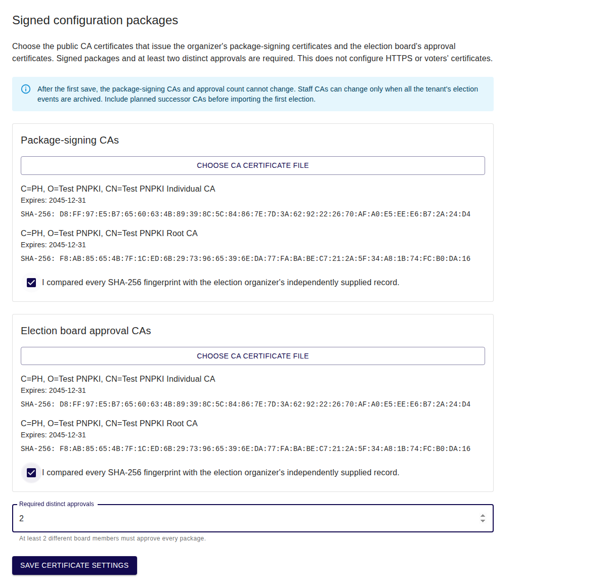
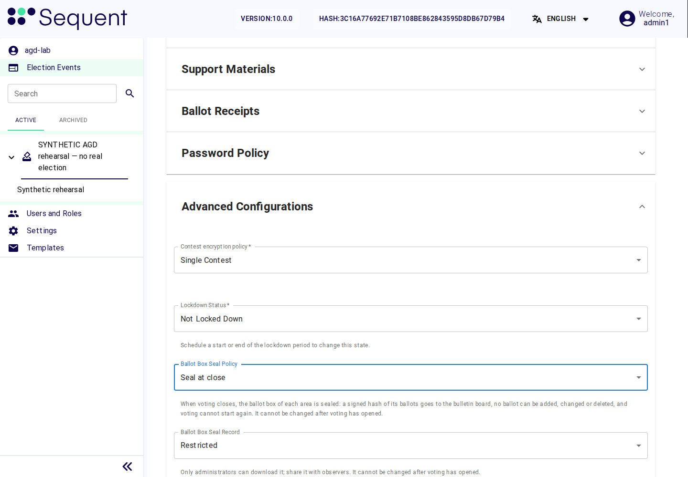

<!--
SPDX-FileCopyrightText: 2026 Sequent Tech Inc <legal@sequentech.io>
SPDX-License-Identifier: AGPL-3.0-only
-->

## Order of work

1. Once per tenant, before the first election event is imported: set up
   signed configuration packages
   ([Signed configuration packages](#signed-configuration-packages)).
2. In the preparation phase, a member of the election board imports the
   election data of each election event as a signed configuration package
   ([Import of election data](#import-of-election-data)).
3. After import, check the administrator settings you can see. Ask the board
   to confirm the remaining event and election values against the reference
   tables below. The signed package must already carry the required values.
   If one differs, use [Correcting imported election
   data](#correcting-imported-election-data) before continuing.
4. Set the protected actions
   ([Configuring Protected Actions](06-signing_rules.md)), the background self-test policy ([Security and Self-Tests](07-self_tests.md)) and check the
   authentication settings
   ([Authentication and Session Settings](08-authentication_and_sessions.md))
   of the election event.
5. Tell the election board that the settings are complete. After completing
   the key ceremony, the board publishes the configuration version and approves it
   ([Publishing the configuration version](#publishing-the-configuration-version)).

All of these steps belong to the preparation phase.

## Signed configuration packages

### What the TOE checks

The election organizer delivers the election data (the voters' register, the
candidate list and its display data, the set of election rules and the
election dates) as a **signed configuration package**: an election event file
with a manifest that the election organizer signs, and with the approvals of
election board members. With the tenant setting `configuration_signing` set as
below, the TOE admits the import of an election event only if:

- the package's signing certificate chains to a CA certificate in
  `package_roots`, and the manifest signature is valid;
- every file of the package matches the manifest: changed, missing or extra
  files are refused;
- the package carries at least `required_approvals` approvals by distinct
  people whose certificates chain to a CA certificate in `staff_roots`;
- the manifest is not dated more than 5 minutes in the future;
- the same package has not been imported before.

Every error stops the import. An unsigned file is refused (`package.unsigned`),
a package with too few approvals is refused (`package.too-few-approvals`), and
a package that was already imported is refused (`package.already-imported`).
While `configuration_signing` is missing, its `policy` is not `required` or
`required_approvals` is not set, the TOE refuses every import. The TOE records
each successful import of a signed package in the electoral log of the new
election event.

### Required values

| Field | Meaning | Default | Required value |
|---|---|---|---|
| `policy` | `required`: only signed packages with enough approvals are imported; with any other value the TOE refuses every import | not set: every import is refused | `required` |
| `package_roots` | the CA certificates, in PEM format, that issue the election organizer's package signing certificates | none | the election organizer's CA certificates for package signing |
| `staff_roots` | the CA certificates, in PEM format, that issue the certificates with which election board members approve a package | none | the election organizer's CA certificates for package approvals |
| `required_approvals` | the number of approvals by distinct members of the election board that a package needs | not set: every import is refused | at least 2, as the election organizer decides |

Get the CA certificates from the election organizer through a channel that
protects their integrity, for example in person, and compare their
fingerprints with the ones the organizer states in writing.

:::warning
Until `configuration_signing` is set with `policy` `required`, the CA
certificates and `required_approvals`, the election board cannot import any
election event. Set it before the first import. Never set `required_approvals`
below 2: with fewer approvals, one board member could bring in election data
that no other member has checked.
:::

### Configure certificates in the admin portal

You need **Edit Tenant** (`tenant-write`) and **View settings** (`settings-menu`)
to use this screen. The tenant mutation is restricted on the server to the
`admin-user` role and the tenant named by the authenticated session. These
portal permissions determine whether the screen is available; they are not an
additional server permission check.

1. Open **Settings → Configuration packages** before importing the first
   election event. The screen is titled **Signed configuration packages**.
2. Under **Package-signing CAs**, select **Choose CA certificate file** and open
   the organizer's public PEM CA file. A file can contain several CA
   certificates, including an approved successor. Do not select a private key
   or a board member's personal certificate.
3. Check the name, expiry date and full **SHA-256** fingerprint of **every**
   displayed certificate against the organizer's independently supplied record.
   Select the confirmation checkbox only when they all match.
4. Repeat these checks under **Election board approval CAs**, using the CA file
   for board members' approval certificates.
5. Set **Required distinct approvals** to the organizer's approved number,
   **at least 2**. Confirm the count and the package-signing CAs carefully:
   these values cannot change after the first save.
6. Select **Save certificate settings**. Continue only after
   **Certificate settings saved and read back successfully.** Reload the page
   and check the saved certificates and approval count before telling the board
   that imports can begin.

*Actual browser capture of the implemented form using synthetic CA certificates
and a simulated tenant API. The certificates shown are examples, not trust
anchors for an evaluated installation.*

The screen accepts public PEM CA files up to **256 KiB**. It rejects malformed,
expired, not-yet-valid, duplicate and personal certificates. Certificate names
and fingerprints are calculated in the browser from their DER bytes; no private
key is needed or sent. Saving changes only `configuration_signing`, preserves
other tenant settings and reads the result back from the server. An intervening
administrator's change causes the save to fail rather than overwrite their
configuration.

### Expected results and recovery

| What you see | What to do |
|---|---|
| **Save certificate settings** is unavailable | Supply both CA files, compare every fingerprint and confirm both sets; choose a whole approval count of at least 2. |
| A certificate-file error | Obtain the correct public PEM CA file. Do not bypass a fingerprint mismatch or use a private key. An expired saved package-signing CA remains fixed: escalate to the organizer and provision a new approved tenant configuration; this screen cannot replace it. |
| **Settings were not confirmed** | Reload before retrying. Check your role and tenant, and whether another administrator changed the settings. Do not tell the board that configuration succeeded. |
| Package-signing CAs or the approval count are disabled | They were already configured. Do not try to change them through a backup or a direct API call. |
| Staff CA replacement is refused | Every tenant election event must be archived before staff CA trust can change. Confirm this with the election board; never archive an ongoing election just to enable a certificate change. |

The database enforces the required policy, approval-count bounds, public PEM
format and change restrictions for direct mutations and tenant restores too.
The TOE performs the authoritative X.509 trust-chain and signature checks when
it imports a package. The browser's successful certificate preview alone does
not authorize an election-data import.

Set this configuration once before the first election. Include the approved
current and successor staff CAs from the start. Replace staff CAs only between
elections, after all of this tenant's election events have been archived.

## Import of election data

A member of the election board imports the election data; you do not. The
voting system accepts election data only as a signed configuration package,
through "Import Election Event". Each import creates a new election event in
the preparation phase. The import needs "Create Election Event"
(`election-event-create`), which only the "Election board" role holds, and the
package must carry the approvals of at least `required_approvals` different
board members, made with certificates that chain to `staff_roots`. The board
members make their approvals outside the TOE, and the TOE verifies them when
the package is imported. The board's procedure, with the digest in "Integrity
Check (SHA-256)", is in the
[Handbook for Election Organizers](../05-election_organizer_handbook/01-about.md).

Your part:

1. Before the first import, set `configuration_signing`
   ([Signed configuration packages](#signed-configuration-packages)).
2. Before the package is approved, give the election organizer the required
   Data-tab values in the tables of this page. After each import, when the
   election board names the new election event, check that those values are
   present and retain them. You see the settings, not the election data.
3. If the election board reports that an import was refused although the
   package is the one the election organizer released, open **Settings → Configuration packages** and check that the saved CA
   fingerprints and approval count still match your approved values. Do not change it. Treat the refusal as a security-relevant event
   ([Security-Relevant Events for Administrators](11-security_relevant_events.md)).

Before the first import, the board creates an empty preparation event as an
**authorization context**. Configure its **Import election data** protected
action, trusted issuers and registered board certificates. The board selects
this event in **Board approval for import**. The exact uploaded file then needs
the context's distinct board approvals as well as the signed-package checks.
The empty context itself is not a configured election ready for voting.

Use the complete signed-package procedure for the evaluated configuration.
The server also gates individual voter, area, candidate and schedule imports
with board authorization and phase checks. An unapproved raw table mutation
cannot replace these procedures. Read-only candidate and contest forms point
back to approved imports.

Some settings available to administrators also affect the ballot design that
is approved in the signed package. The election organizer includes the required
event and election Data-tab values before the package approvals. Administrators
verify those imported values; they do not change them to repair a package.
Otherwise publication can refuse the changed ballot design. The tenant settings,
protected-action rules, certificate registrations and the background audit policy are
configured separately as their procedures describe. Areas remain election data.

### Correcting imported election data

If the imported election data is wrong, nobody corrects it in the TOE:

1. The election organizer issues a corrected signed configuration package.
2. A member of the election board imports it. It becomes a new election event.
3. The election board archives the wrong election event in the preparation
   phase with "Archive this Election Event". An archived election event never
   opens voting; its data and its audit records stay. It is never unarchived.
4. Check the settings of the new election event as after every import.

:::danger
Never delete an election event, and never ask for one to be deleted. Deleting
an election event also deletes its audit records. Only the election board
deletes election events, after the export of the election execution data and
with the required authorisations; the TOE refuses every other deletion.
:::

## Settings of the election event

*Illustration: the Data tab’s Advanced Configurations in a synthetic v10.0.0
event. Use the required values below, and verify the signed package’s settings;
do not copy a sample event’s state or identifiers.*

Open the election event and select **Data → Security settings**. This
administrator form is writable only during preparation. It exposes these
controls without exposing the ballot design, voter register or election dates:

| Control | What to check |
| --- | --- |
| **Key ceremony scope** | Retain the event/election scope specified in the approved package. |
| **Trustee participation** | **Trustees participate**; the evaluated configuration uses manual custody. |
| **Ballot encryption** | Retain the contest encryption policy specified in the approved package. |
| **Decoded ballots in results** | **Do not include**. |
| **Voter ballot signatures** | Retain the approved package's policy. This differs from ballot-box-signed receipts and from voter digital certificates. |
| **Ballot box sealing** | **Seal when voting closes**. |
| **Seal record access** | **Election board only**. |
| **Time zone settings** | Use the organizer's agreed display zones; these do not change the signed election dates. |

Select **Save security settings**, wait for confirmation and reopen the form to
check the saved values. A refusal leaves the operation incomplete: check the
phase and displayed error, and resolve a conflicting edit before retrying.
Do not add board data permissions to make another form available.

### Configuration the board must verify

The following table specifies the values the organizer must include in the
signed package. Give it to the board and obtain its confirmation. Some fields
are election data and are deliberately absent from the administrator form.
The section names below identify the board's read-only **Data** view.

| Setting (section) | Default | Required value | Why |
|---|---|---|---|
| "Scheduled close without signatures" ("Voting lifecycle"): "Refuse" / "Run as system" | "Refuse" | "Refuse" | A scheduled close that is not part of the configuration version the election board approved does not run; the board's signers close voting. |
| "Show User Profile" ("Ballot Design"): a switch | not set, which counts as on | off | The voting portal then shows voters no link to account functions, which the evaluated configuration does not offer. |
| "Show Cast Vote Logs Tab" ("Ballot Design"): "Show Cast Vote Logs Tab" / "Hide Cast Vote Logs Tab" | "Hide Cast Vote Logs Tab" | "Hide Cast Vote Logs Tab" | Audit records are shown only to the election board. With "Hide", the TOE also refuses voters' requests for the log. |
| "Voting Channels Allowed" ("Voting Channels Allowed"): "Online", "Kiosk", "Early voting", "Telephone voting" | "Online" only | "Online" only | The evaluated configuration covers online voting in the execution phase. Early voting accepts ballots before the execution phase. The telephone voting channel is not configured: the TOE has no telephone provider and no credentials for its endpoints, which refuse every request. |
| "Receipts signed by the ballot box" ("Ballot Receipts"): "Disabled" / "Signed by the ballot box" | "Disabled" | "Signed by the ballot box" | The ballot box stores and signs each ballot, and the voter sees the Ballot ID only once the ballot has been received: the voter's feedback that the vote was stored. |
| "Period for checking cast ballots" ("Ballot Receipts"): "No limit" / "Until a date", with "Checks available until" | "No limit" | "Until a date", with "Checks available until" set to the end of the election period | Voters check that their ballot was recorded only during the execution phase. |
| "Lockdown Status" ("Advanced Configurations"): "Locked Down" / "Not Locked Down" | "Not Locked Down" | not set here | It changes only through the scheduled events "Start Lockdown Period" and "End Lockdown Period" ([Modes of Operation and Failure Handling](10-modes_of_operation.md)). |
| "Ballot Box Seal Policy" ("Advanced Configurations"): "Seal at close" / "Do not seal" | "Do not seal" | "Seal at close" | When voting closes, the TOE seals each ballot box: a closed ballot box cannot be reopened, and any later change to it is detected. |
| "Ballot Box Seal Record" ("Advanced Configurations", shown with "Seal at close"): "Restricted" / "Public" | "Restricted" | "Restricted" | With "Public", anyone who knows the election event's identifiers can download the seal record without signing in. |
| "Keys/Tally Ceremonies Policy" ("Advanced Configurations"): "Allow Automatic Ceremonies" / "Manual Ceremonies" | "Manual Ceremonies" | "Manual Ceremonies" | Every trustee must confirm custody of their key share at the key ceremony, and the tally ceremony starts only with the trustees' authorisations. |
| "Batch Anonymity Policy" ("Advanced Configurations"): "Warn" / "Refuse" | "Warn" | "Refuse" | The TOE stops a tally when an area's ballot batch has fewer than five voters, or differs from the batch another tally already posted for the same area and contest, so that no small batch reveals how voters voted. |
| "Voter Digital Certificate Policy" ("Advanced Configurations"): "Enabled" / "Disabled" | "Disabled" | "Disabled" | Voters authenticate only at the external authentication server. |
| "Enrollment" ("Advanced Configurations", "Voter Authentication"): "Enabled" / "Disabled" | not set, which counts as "Enabled" | "Disabled" | Only voters in the voters' register can log in; voters cannot register themselves. |
| "OTP" ("Advanced Configurations", "Voter Authentication"): "Enabled" / "Disabled" | not set, which counts as "Enabled" | "Disabled" | The TOE offers voters no one-time-code form of its own; the second factor belongs to the external authentication server. |

Notes:

- The settings of the section "Voting lifecycle" are part of the election
  event's configuration: the configuration approval signs them, and scheduled
  openings and closings follow the stricter of the current and the published
  settings.
- "Ballot Box Seal Policy" cannot be changed once voting has opened: the TOE
  refuses with "The Ballot Box Seal Policy can't be changed after voting has
  opened." "Ballot Box Seal Record" is locked at the same time.
- "Receipts signed by the ballot box" cannot be changed once voting has
  started ("This cannot be changed once voting has started."). The required
  value must already be in the signed package; a different imported value
  requires a corrected package and a new election event.
- Check "Checks available until" in the time zone that the field shows.
  It must match the end of the election period as the election organizer
  states it to you in writing, with its time zone.
- "Show User Profile", "Enrollment" and "OTP" count as on or "Enabled" when
  their values are not set. The signed package must contain explicit off or
  "Disabled" values. Reopen the imported event to check them; do not toggle
  these controls to repair an incomplete package.
- "Results Website" is not one of your settings: the admin portal shows it
  only to accounts with "Edit Results Publication" (`publish-results-write`),
  which no role holds, and the TOE refuses the import of a package that enables
  the results website. "Publish to results website" is never available.
- An imported package can carry any value of these settings. Check all of them
  after every import, even when the previous election event was correct.

:::warning
Never select "Allow Automatic Ceremonies". It makes the switch "Automatic
Ceremony" available when a key ceremony is created, and an automatic ceremony
removes the trustees' custody confirmation and their authorisation of the
tally: the votes could then be decrypted without the trustees' consent. The
evaluated configuration forbids automatic ceremonies. The switch "Automatic
Ceremony" of each key ceremony decides whether the trustees confirm custody,
whatever this policy says. The election board, which creates
the key ceremony ("Create Key Ceremony" in the Keys tab), never switches on
"Automatic Ceremony" and checks that every trustee confirmed custody. Check
this policy after every import, and again before the key ceremony.
:::

:::warning
With "Do not seal", closed ballot boxes can be reopened and are not protected
by a seal. With receipts "Disabled", voters get no signed confirmation that the
ballot box stored their vote. With "No limit", voters can still check ballots
after the election period has ended. With "Run as system", voting closes at a
scheduled time that nobody authorised. With "Enrollment" or "OTP" set to
"Enabled", or "Show User Profile" on, voters are offered functions of the TOE
before or beside the external authentication server that the evaluated
configuration excludes. With "Show Cast Vote Logs Tab", voters can read
records of the electoral log.
:::

:::warning
No results website is part of the evaluated configuration, and the TOE refuses
the import of a package that enables one. Never give any role "Edit Results
Publication" (`publish-results-write`), so that "Publish to results website" is
never available.
:::

## Settings of each election

Ask the board to open each election's **Data** tab and confirm the following
values. The administrator's limited settings projection does not expose every
field. Record the board's confirmation; if a value is wrong, request a corrected
approved import rather than acquiring election-data permissions.

| Setting (section) | Default | Required value | Why |
|---|---|---|---|
| "Voting Channels Allowed" ("Voting Channels Allowed"): "Online", "Kiosk", "Early voting", "Telephone voting" | as the election event | "Online" only | as for the election event |
| "Audit Button Display Options" ("Ballot Design"): "Show" / "Not Show" / "Show In Help Dialog" | "Show" | "Show" | Every voter is offered "Audit ballot" on the review screen, to check that the ballot was encrypted as intended. |
| "Number of allowed votes" ("Advanced Configuration"): a whole number | 1 | as the electoral regulation requires; 1 if it allows no re-voting | Re-voting: how many times a voter may cast a vote in this election. |
| "Initialize Report Policy" ("Advanced Configuration"): "Not Required" / "Required" | "Not Required" | "Required" | Voting opens in the election only after its initialization report has been generated. The election board generates the report in front of witnesses, who check that the ballot boxes are empty. |
| "Grace Period Policy" ("Advanced Configuration"): "No grace period" / "Grace period without alert" | "No grace period" | "No grace period" | Ballots are accepted only within the election period. |
| "Grace period in seconds" ("Advanced Configuration"): a whole number | 0 | 0 | as above |
| "Allow Tally" ("Advanced Configuration"): "Allowed" / "Disallowed" / "Requires Voting Period End" | "Allowed" | "Requires Voting Period End" | Votes can be counted only after the election period has ended. |

:::warning
In "Number of allowed votes", the value 0 means **unlimited** votes, not "no
re-voting". The signed package must use 1 if the electoral regulation does
not allow re-voting. If re-voting is allowed, only the last vote of each voter
is counted; check that the imported value is the number the regulation allows. The value cannot be changed once voting
has started on any voting channel.
:::

:::warning
With "Allow Tally" set to "Allowed", the default, a tally can be started while
voting is still open. With a grace period, ballots are accepted after the end
of the election period. With "Not Show" or "Show In Help Dialog", voters are
not offered the check that their ballot was encrypted as intended, or must
search for it.
:::

## Areas: early voting

Areas are election data: only the election board reads them, and the TOE
refuses changes to them. Whether an area allows early voting therefore comes
with the imported election data. An area with "Allow Early Voting" ticked
would accept ballots before online voting opens, that is, outside the
execution phase, so the import refuses a package in which an area has it
ticked. Tell the election organizer in writing that no area of a package may
have it ticked.

## Tenants, plugins and the telephone channel

| Item | Required state | Your check |
|---|---|---|
| Tenants | The customer's tenant holds every election event and every account and role for election work. The super-admin tenant serves only the installation steps of the Deployment Guide, holds no election event and has no enabled personal account. | Work only in the customer's tenant. The person who runs the servers confirms in writing that election work uses only the customer's tenant. |
| Telephone voting channel | Not configured: no telephone provider and no credentials for its endpoints, which refuse every request. Voters vote only through the voting portal. | "Voting Channels Allowed" is "Online" only in the election event and in each election. The person who runs the servers confirms in writing that the installation configured no telephone provider. |
| Plugins | None installed: the TOE answers every plugin request that the plugin does not exist. | The person who runs the servers confirms in writing that no plugin is installed. |
| Data correction | No account holds "Datafix account" (`datafix-account`); its data-correction routes are not used. | No role contains it and no account has it ([Users, Roles and Role Separation](04-users_and_roles.md#permissions-on-election-data-and-audit-records)). |
| Manual verification of voters | No account holds "Manually Verify Voter" (`voter-manually-verify`); voters sign in only through the external authentication server. | No role contains it and no account has it ([Users, Roles and Role Separation](04-users_and_roles.md#permissions-on-election-data-and-audit-records)). |

## Publishing the configuration version

The settings of this page, the election data and the signing rules of the
protected actions become valid for voting only as a published configuration
version that the election board has approved. The election board publishes it:
the tab "Publish" and the changes of a version show election data, so the
administrator role holds neither "Read Publish" (`publish-read`) nor "Edit
Publish" (`publish-write`). The TOE accepts a publication only in the
preparation phase and refuses it in every other phase.

1. Check the settings of this page once more, and the protected actions and the
   self-test interval, timeout and additional conditions
   ([Security and Self-Tests](07-self_tests.md)).
2. Tell the election board in writing that the settings of the election event
   are complete, once you hold the written confirmation of the person who runs
   the servers for this election event (plugins, telephone provider and
   tenants, as in the table above).
3. A board member selects "Generate Publication" and "Publish Changes". The
   required board members sign the signing request "Approve a configuration
   version" after comparing its "Changes in this version" with the package they
   approved.
4. The election board tells you when the version is approved. You know that it
   worked when the board confirms the approval; from then on change no setting
   without telling the board.

If an imported Data-tab setting differs from the tables, stop before the board
approves the configuration version and ask the election organizer for a corrected
signed package. The board imports it as a new election event and archives the
wrong one ([Correcting imported election data](#correcting-imported-election-data)).
Do not repair its approved ballot design by editing settings in the TOE.
Complete the separate protected-action and certificate settings before the board
publishes and approves the new event. Do not change settings after preparation.
