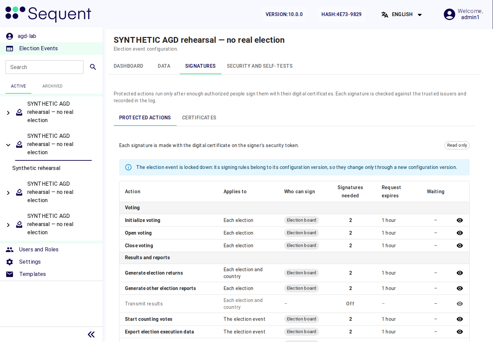
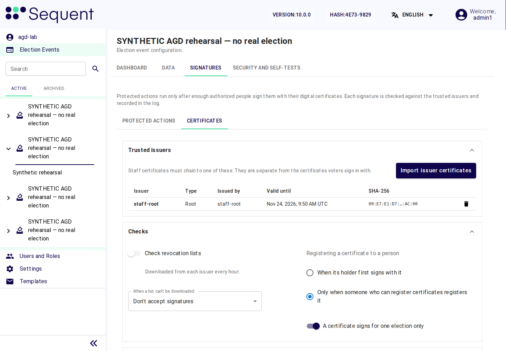

<!--
SPDX-FileCopyrightText: 2026 Sequent Tech Inc <legal@sequentech.io>
SPDX-License-Identifier: AGPL-3.0-only
-->

## What protected actions are

A security-critical action runs only after the required number of election
board members has authorised it. Each authorisation is a signature that a board
member makes with the signing certificate on their security token. The admin
portal calls a security-critical action a **protected action**, and its rule a
**signing rule**: who can sign, how many signatures are needed, and when a
request expires.

You set the signing rules, the trusted issuers and the certificate checks of
each election event on its tab "Signatures". It has three areas: "Protected
actions", "Certificates" and "Requests". "Requests" belongs to the election board: a
request shows what it authorises, for a configuration version its "Changes in
this version", which are election data. The administrator role holds no
permission for it.

Signing rules, trusted issuers, certificate checks and registered certificates
belong to one election event. Set them for every new election event, also for
one that replaces a wrong import. Where signed configuration packages are
required, as in the evaluated configuration, the TOE takes none of them from a
package: an imported election event starts as one created without a package.
The protected actions for which the TOE always requires the board's approval
([Security-critical authorisations required by the Security Target](#security-critical-authorisations-required-by-the-security-target))
then need signatures but have no number yet, the other protected actions are
off, the certificate checks have the values of the column "Default" of
[Checks](#checks), no issuer is trusted and no certificate is registered.

## Permissions

| Function | Permissions | Held by |
|---|---|---|
| Open the tab and read the rules and certificates | <ul><li>"Election Event Signatures Tab" (<code>election-event-signatures-tab</code>)</li><li>"Signatures: read protected actions" (<code>signing-rules-read</code>)</li><li>"Signatures: read certificates" (<code>signing-certificates-read</code>)</li></ul> | administrator role and the role `election-board` |
| Change signing rules | <ul><li>"Signatures: edit protected actions" (<code>signing-rules-write</code>)</li><li>To change "Who can sign", also "Read Role" (<code>role-read</code>)</li><li>To change "Who can sign", also "Edit Role" (<code>role-write</code>)</li></ul> | administrator role only |
| Import and remove trusted issuers | "Signatures: import and remove trusted issuers" (`signing-issuers-write`) | administrator role only |
| Change the certificate checks | "Signatures: edit certificate checks" (`signing-checks-write`) | administrator role only |
| Register certificates to people | "Signatures: register certificates" (`signing-certificates-register`) | administrator role only |
| Revoke certificates | "Signatures: revoke certificates" (`signing-certificates-revoke`) | administrator role only |
| Read, cancel and export signing requests | <ul><li>"Signatures: read requests" (<code>signing-requests-read</code>)</li><li>"Signatures: cancel requests" (<code>signing-requests-cancel</code>)</li><li>"Signatures: export requests" (<code>signing-requests-export</code>)</li></ul> | the role `election-board` only; every board member needs the permission "Signatures: cancel requests" |

Without "Signatures: edit protected actions", the rule shows "Read only.
Changing signing rules needs the permission “Signatures: edit protected
actions”."

## Security-critical authorisations required by the Security Target

The Security Target requires the election board’s authorisations for the
following actions, which the protected actions of the second table of this section
and of [Protected actions to switch on](#protected-actions-to-switch-on) implement:

| Security-critical action | Electoral phase |
|---|---|
| import of the ballot (the candidate list and its display data) | preparation |
| import of the voters' register | preparation |
| import of the set of election rules | preparation |
| import of the election dates | preparation |
| termination of the election execution, the protected action "Close voting" | execution |
| resumption of the election execution, the protected action "Open voting" | execution |
| start of the counting of the votes with determination of the election result | evaluation |
| export of election execution data | post-processing; for an archived election event, preparation |
| deletion of election execution data | post-processing; for an archived election event, preparation |
| the election board's read of the voters' register | post-processing |

The protected action "Open voting" also covers the first opening of voting.
The evaluated procedure imports the four data categories together as a signed
configuration package. The board approves each import in the approval event:
configure there **Import election data**, and **Export election execution data**
and **Delete election execution data** for the export and deletion of the
approval event's own data, and register the board certificates.
The board selects this event in **Board approval for import**; its signing
request binds the exact uploaded file. Package signatures and these online
board approvals are both required. See
[The approval event](05-tenant_and_event_settings.md#the-approval-event).

The TOE always requires configured board approval for these actions:

| Protected action | Additional condition |
| --- | --- |
| **Import election data** | Preparation; the approved upload digest still matches. |
| **Approve a configuration version** | Preparation; the signed publication and self-test baseline still match. |
| **Open voting** | Approved time window and current purpose-specific self-tests. This also covers resumption. |
| **Close voting** | The board's current approved close operation; closure cannot be reversed. |
| **Start counting votes** | Evaluation after close; trustee custody approvals remain separately required. |
| **Export election execution data** | Post-processing, or preparation for an archived election event; the approved complete export profile and current source revision. |
| **Delete election execution data** | Post-processing, or preparation for an archived election event, and a completed export receipt for the current revision. |
| **Read the voters' register in post-processing** | A five-minute read session for the requesting board member and current event state. |

For these rows, **Off** and an undefined or zero signature count cannot bypass
authorization. An unset rule refuses the operation. Configure at least two
distinct board signers before using it. Once a number of signatures is saved for
an action, for one of these rows or for one that you switch on, the TOE refuses
to change it and keeps the action needing signatures: save the number the
electoral regulation fixes. The fields "Who can sign", "The person who starts it
can also sign" and "A request expires after" can still change. The approvals are bound to the action,
requester, exact parameters, event state and current rule. Changed inputs,
revoked or expired certificates, and reused authorizations are refused.

If a number was saved wrong, the election event keeps it. Tell the election
board and the election organizer:

- For an imported election event, the election organizer issues a new revision
  of the signed configuration package, because the TOE refuses the same package
  a second time. A member of the election board imports it as a new election
  event, and the board archives the wrong one
  ([Correcting imported election data](05-tenant_and_event_settings.md#correcting-imported-election-data)).
  Then set the signing rules of the new election event.
- For the approval event, a member of the election board creates a new one,
  which you configure as
  [The approval event](05-tenant_and_event_settings.md#the-approval-event)
  describes, and the board archives the old one. An archived election event
  approves no import and no other board operation except the export and
  deletion of its own data, and **Board approval for import** does not offer it.

For import, counting, export, deletion and register read-out, the portal opens
the signing request when approval is needed. After the required members sign,
the requester selects **Continue operation**. The original operation is
resubmitted with its unchanged parameters; a failed or cancelled request does
not count as success. The register session expires after five minutes or a
change to its bound state, and does not authorize secret-field disclosure.

## Protected actions to switch on

The catalogue of the tab groups the protected actions in "Voting", "Results
and reports", "Enrollment" and "Configuration and keys". For each row the
column "Applies to" shows where the rule applies. Switch on these protected
actions as well, so that every step the election board takes towards the
execution phase needs its authorisations:

| Protected action | Applies to | Required setting | Why |
|---|---|---|---|
| "Approve a configuration version" | The election event | "Needs signatures" on | No configuration version, with its settings and signing rules, becomes valid without the board's approval. Set it before the first "Publish Changes". |
| "Initialize voting" | Each election | "Needs signatures" on | The initialization report, in which witnesses see that the ballot boxes are empty, is authorised by the board. |
| "Generate other election reports" | Each election | "Needs signatures" on | Covers the initialization report. |
| "Confirm custody (key ceremony)" | Each trustee | "Trustees sign this step" on | Each trustee confirms custody of their key share with their own certificate. |
| "Authorize tally custody (tally)" | Each trustee | "Trustees sign this step" on | The tally ceremony starts only with the trustees' authorisations. |

The trustee rows need "Manual Ceremonies"
([Tenant and Election Event Settings](05-tenant_and_event_settings.md)): with
automatic ceremonies the TOE refuses the rule with "This event uses automatic
key ceremonies. Trustees do not perform these steps, so their signatures cannot
be required. To require trustee signatures, use manual key ceremonies."

The protected actions "Transmit results" and "Approve a voter manually" are not
used in the evaluated configuration: voters do not enrol, and results are not
transmitted. Leave the protected action "Generate election returns" off unless the
election organizer wants signed election returns: once saved with a number, a
protected action stays on.

*Illustration: the v10.0.0 Signatures tab after configuration and lockdown in a
synthetic election event. This view is read-only; set the required rules during
preparation, then check their readback. The example is not a list of every
authorisation requirement in the Security Target.*

## Setting a signing rule

You can change signing rules only in the preparation phase and outside a lockdown
period. Set them before the election board approves the configuration version: a
later change needs a new configuration version, which the board approves again. To
set a signing rule:

1. Open the election event, tab "Signatures", area "Protected actions". The
   table shows "Action", "Applies to", "Who can sign", "Signatures needed",
   "Request expires" and "Waiting". A rule that is not switched on shows
   "Off" only for optional actions. Required actions without a configured
   count remain unavailable.
2. Select the edit icon of the action. The drawer opens.
3. For the protected actions "Confirm custody (key ceremony)" and "Authorize
   tally custody (tally)", turn on the switch "Trustees sign this step" and save.
   Once saved, the switch stays on. These two rows have no fields "Who can sign"
   and "Signatures needed", and no requester or expiry controls: each
   trustee signs their own custody step, with the permissions of
   [The trustee role](04-users_and_roles.md#the-trustee-role).
   For every other protected action, set the following fields:

| Field | Required value |
|---|---|
| "Needs signatures" | on |
| "Who can sign" | only the role `election-board`. Never the administrator role. The TOE gives the listed roles the permission "Sign: …" for every election event; a signer must also be able to reach the election. |
| "Signatures needed" | the number the electoral regulation fixes, at least 2. Once the number is saved, the field and the switch "Needs signatures" are disabled, and the field shows the text "This number is fixed once saved." |
| "The person who starts it can also sign" | off, unless the electoral regulation counts the person who starts the action as one of the authorising members |
| "A request expires after" | "30 minutes", "1 hour", "2 hours" or "24 hours", long enough for the board members to sign; never "No limit" |

4. Select "Save". The TOE confirms "The signing rule was saved."

Messages of the drawer:

| Message | Meaning |
|---|---|
| A minimum or maximum signature-count error | The number is outside the permitted range. Mandatory board actions require at least two; keep the evaluated configuration at the organizer's approved count. |
| "No election has … people who can sign. The most is …" | Fewer people can sign than the number you entered. Give the role to more board members, or ask the election organizer. |
| "N requests are waiting for signatures under the current rule. Saving cancels them; the people who started them start again." | Saving a changed rule cancels its waiting requests. |
| "The election event is locked down: signing rules change only through a new configuration version." | The election event is in a lockdown period; the TOE refuses the change. |
| "You don't have the permission for this change." | Your account lacks a permission of the table of [Permissions](#permissions). |
| "Someone else changed this meanwhile. Reload the page and try again." | Reload and check the rule again before you change it. |
| "The number of signatures of this action is already saved and can't change. Reload the page to see it." | The TOE keeps the number of signatures already saved for this protected action, and the action keeps needing signatures. |
| "The server refused these values. Check them and try again." | A value is outside what the TOE accepts. |
| "The signing rule couldn't be saved. Someone may have changed it meanwhile; reload and try again." | Reload and check the rule again before you change it. |
| "It no longer exists. Reload the page." | The election or the trustee of the rule no longer exists. Reload the page. |
| "The signing rule was saved. … can't reach the number yet: add a signer there." or "… add signers there." | The rule is saved, but in the elections it names fewer people can sign than the number. Give the role to more board members who can reach these elections, or ask the election organizer. |
| "The signing rule was saved. Some elections can't reach the number without the person who starts a request." | The rule is saved, but in some elections the number is reached only if the person who starts a request signs too, which the rule does not allow. Give the role to more board members, or ask the election organizer. |

:::warning
Never put the administrator role, or any role that an administrator holds,
into "Who can sign", and never set "Signatures needed" to 1. A single person
could then perform a security-critical action alone. A rule change becomes part
of the next configuration version, which the election board compares with the
electoral regulation before it approves it.
:::

What the TOE does with a rule:

- Each change is recorded in the election event's electoral log; a change of
  "Who can sign" also changes the "Sign:" permissions of the roles and is
  recorded as well.
- A saved rule becomes part of the next configuration version.
- The TOE requires mutually distinct board members, certificates and keys for
  the signatures of one request.

## Trusted issuers and certificate checks

Open the tab "Signatures", area "Certificates".

*Illustration: a synthetic v10.0.0 issuer and certificate policy. The table shows
the SHA-256 shortened; the copy icon next to it copies the complete value. Use your
election event’s actual issuers and revocation policy.*

### Trusted issuers

The board members' signing certificates must chain to one of the trusted issuers.
These are separate from voters' certificates, which the evaluated configuration
does not use (the setting "Voter Digital Certificate Policy" is "Disabled",
[Configuration the board must verify](05-tenant_and_event_settings.md#configuration-the-board-must-verify)).
While the list is empty, no board member can sign.
To import the trusted issuers:

1. Receive the CA certificates that issue the board members' signing
   certificates from the election organizer, with their SHA-256 fingerprints
   in writing, through a channel that protects their integrity.
2. Select the button "Import issuer certificates", then the button "Choose a
   certificate file", choose the file you received, and select the button
   "Import".
3. Check the issuer name and validity in the table.
4. Select the copy icon next to the issuer's "SHA-256" value to copy its complete
   fingerprint, paste it next to the election organizer's value and compare all
   of it. Colons and letter case only affect its display. If any digit differs,
   remove the issuer at once and obtain the correct certificate.

To remove an issuer, select the delete icon in its row and confirm. Certificates it issued
can then no longer sign. Apart from a difference in step 4, remove an issuer only
when the election organizer tells you to.

### Checks

Each check is saved when you change it: the admin portal then shows the message
"The certificate checks were saved." The required values are:

| Check | Default | Required value |
|---|---|---|
| "Check revocation lists": the TOE downloads the list of each issuer every hour | on | on, where the election organizer's CA publishes revocation lists that the TOE can download |
| "When a list can't be downloaded": "Don't accept signatures" / "Accept and mark the signature as unchecked" | "Don't accept signatures" | "Don't accept signatures" |
| "Registering a certificate to a person": "When its holder first signs with it" / "Only when someone who can register certificates registers it" | "When its holder first signs with it" | "Only when someone who can register certificates registers it" |
| "A certificate signs for one election only" | on | on |

If the election organizer's CA publishes no revocation lists that the TOE
can download, revocation is done only by revoking the registration in the TOE
([Registered certificates](#registered-certificates)). Agree with the election organizer that it tells you at once of
every certificate it revokes.

:::warning
With "When its holder first signs with it", the TOE binds a certificate to
whoever signs with it first, without any check by a second person. With
"Accept and mark the signature as unchecked", a certificate that the issuer
has revoked can still sign while its list cannot be downloaded.
:::

### Registered certificates

With "Only when someone who can register certificates registers it", a board
member can sign only after an administrator has registered their certificate.
Only the administrator role holds the permission "Signatures: register certificates".
To register a board member's certificate:

1. Meet the board member in person. Check their identity and receive their
   public certificate (PEM) from them, for example on a medium they hand over.
2. Select the button "Register a certificate". In the field "Person", type part
   of the username and select the board member's account.
3. Paste the certificate into the field "Certificate (PEM)" and select the button
   "Register". The
   TOE confirms "The certificate was registered." It refuses with "This
   certificate can't be registered: check that a trusted issuer issued it,
   that it's valid today and that it's made for signing."
4. Check the columns "Person" and "Valid until" of the new row together with the
   board member.

The list shows each registration with its status: "Active", "Expires soon",
"Expired" or "Revoked". Before the board approves the configuration version, check
that enough signers have unrevoked registrations and that their certificates and
issuing certificates remain valid throughout the election event and its required
signing actions. Check "Valid until" against the planned completion date.

"Expires soon" warns that an otherwise unexpired, unrevoked personal
certificate has fewer than 30 days remaining; this warning alone does not
prevent it from signing. It may be used if its validity and its issuer's
validity cover the whole required period. Arrange and register a renewal
before expiry when further signing will be needed. Do not count "Expired" or
"Revoked" registrations as signers.

To revoke a registration, select the button "Revoke" and fill in the field "Reason". A revoked
certificate cannot sign any more. Signatures on completed requests still count,
except for an action that waits for the button "Continue operation": it runs only
while enough of its signers' certificates are valid; otherwise, when the member who
started it repeats it, the TOE cancels that request and opens a new one for new
signatures. Every waiting request
the certificate signed is cancelled, and the board starts it again if it still
needs it. The electoral log records these cancellations under the administrator
who revoked the certificate. Revoking one registration revokes every registration of that
certificate's key in the tenant.
Revoke a registration on the same day when a board member leaves, loses their
security token, or the election organizer revokes their certificate
([Users, Roles and Role Separation](04-users_and_roles.md)).

## Signing requests

The area "Requests" lists the signing requests of the election event with
their status: "Waiting", "Signed", "Done", "Cancelled", "Expired" or "Failed".
"Export CSV" exports the list. Only the election board uses it.

- A board member starts the request "Approve a configuration version" by
  selecting "Publish Changes"
  ([Tenant and Election Event Settings](05-tenant_and_event_settings.md#publishing-the-configuration-version)).
  You never start, sign or cancel a request.
- Every board member holds the permission "Signatures: cancel requests"
  (`signing-requests-cancel`), so that any board member can abort a
  security-critical action they object to.
- A "Failed" request means that all signatures were given but the action
  failed. When the election board tells you of one, treat it as a
  security-relevant event
  ([Security-Relevant Events for Administrators](11-security_relevant_events.md)).

:::warning
Without the permission "Signatures: cancel requests" in the role `election-board`,
only the member who started a request can abort it. The other members could then not
stop an action they object to.
:::
