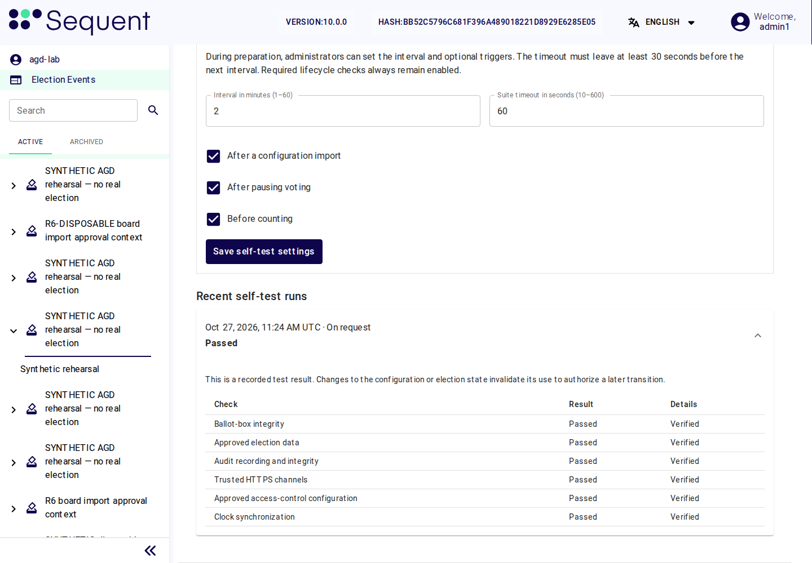

<!--
SPDX-FileCopyrightText: 2026 Sequent Tech Inc <legal@sequentech.io>
SPDX-License-Identifier: AGPL-3.0-only
-->

## Open the security status

Open the election event and select **Security and self-tests**. The page shows
its electoral phase, security state, recent test runs and security email delivery.
Administrators and election-board members can read these results with
`self-test-read`. Running a test requires `self-test-run`.

Tests run in the background. You can leave this page while the worker continues.
The page refreshes every five seconds. A queued, unfinished, missing or timed-out
test is never a passed test.

## Run the checks

1. Select the **Purpose of the test**:
   - **On request** for an additional diagnostic run.
   - **Before starting voting** before the board starts the election.
   - **Before resuming voting** after a pause or a recoverable failure.
   - **Before counting** when the administrator has enabled that additional condition.
2. Select **Run self-tests**. The button changes to **Tests queued or running**.
   Wait for this run rather than starting another one.
3. Expand the newest run under **Recent self-test runs**. Check all six rows,
   their details and the time of the result.
4. Return to the board operation after its required test passes. A test does not
   authorize the operation or replace the required board signatures.

This laboratory run completed with all six checks **Passed**. The displayed
result records that run; it does not open voting or authorize a later operation
after its configuration or election state changes.

A result marked **Earlier election state** cannot authorize a later transition.
Changes to the configuration or security state invalidate earlier evidence.
If the status cannot be refreshed, do not rely on a previously displayed result.

| Check | What the system verifies | If it fails |
| --- | --- | --- |
| Ballot-box integrity | Authenticated ballot admission, contents and order, cast-vote records, voting counters, seals and completed cryptographic tally transcripts. | A detected integrity error is unrecoverable. Do not edit ballots, replace records or attempt to resume voting. |
| Approved election data | Live election data against the baseline captured when the board approved and published the configuration. The baseline itself carries an event-key signature. | Check the approved publication and investigate any difference before another test. |
| Audit recording and integrity | Writing a signed test record, reading back the exact stored record, and verifying the electoral log and its checkpoint evidence. | Restore the audit service or investigate the integrity failure. A failed audit is not a clean result. |
| Trusted HTTPS channels | Public endpoints, trusted certificates and the required TLS profile. A timeout is inconclusive and fails the test. | Correct the endpoint, certificate or network configuration. Never disable certificate verification. |
| Approved access-control configuration | Hasura metadata, realm access-control configuration and signing rules against the signed baseline. | Investigate changed permissions or rules. Do not create a new baseline merely to hide a difference. |
| Clock synchronization | A fresh read-only observation from host chrony, including its authenticated NTS source and synchronization status. | Ask the server operator to restore authenticated time synchronization. |

Before the first approved publication, **The board-approved configuration
baseline is not yet available** is expected. Complete the board review and
publication before expecting all six checks to pass. The software does not
silently learn a new baseline after a failed test.

## Configure the background interval

An administrator with `self-test-settings-write` may change **Automatic
self-tests** during **Preparation**. The controls are read-only in later phases.

1. Set **Interval in minutes (1–60)**. The default is **15 minutes**.
2. Set **Suite timeout in seconds (10–600)**. The default is **60 seconds**.
   Leave at least 30 seconds between the timeout and the interval. For example,
   a one-minute interval permits a timeout of at most 30 seconds.
3. Select additional conditions if needed: **After a configuration import**,
   **After pausing voting**, or **Before counting**.
4. Select **Save self-test settings** and check the confirmation.

Mandatory startup, election-start, start/resume, recovery and periodic checks
remain enabled. Optional conditions cannot switch them off. Only one run may
execute for an event at a time.

Choose the interval with the organizer. Measure the suite on representative
election data before voting opens.

| Election conditions | Starting interval | Check before opening |
| --- | --- | --- |
| One-day election or high activity | 5–15 minutes | Every run finishes within its timeout, leaving time for the next run. |
| Multi-day election | 15–30 minutes | Results are checked throughout the election, including quieter periods. |
| Additional sensitive operation | Enable its additional condition | Its purpose-specific check passes before the board authorizes the operation. |

Never exceed 60 minutes. If a suite cannot finish in time, provide adequate
resources or reduce competing work. Do not treat an unfinished scan or a longer
interval as equivalent protection. A missing or expired successful result
prevents voter access.

## Respond to the security state

- **Operational:** the recorded lifecycle state is operational. Phase, period,
  permission, storage and current self-test checks still apply to each operation.
- **Recovery required:** voting remains unavailable. Resolve the cause, run
  **Before resuming voting**, and have the board authorize **Resume Voting** in
  **Publish**. Repairs alone do not reopen voting.
- **Unrecoverable failure:** election execution cannot resume. Preserve the
  evidence and follow the organizer's failure procedure. A later passed test
  cannot erase an earlier unrecoverable result.

A required service stopping, restarting or losing its heartbeat also prevents
voter operations. During an execution failure, ballot-box reads and writes are
refused. Staff can still inspect the status and perform authorized investigation.

First opening requires the approved start time, current checks, empty ballot
boxes and the initialization procedure. An initialization report is not an
election result. Before opening, use **Before starting voting**, rather than
**Before resuming voting**.

## Check security notifications

Security-state changes and audit-storage problems create distinct notifications
for administrators and the election board. Check **Security email delivery**:

| Delivery state | Meaning and action |
| --- | --- |
| Queued for delivery / Sending | Wait for the result. Definite temporary failures are retried with a delay, up to six attempts. |
| Accepted by mail transport | The mail server accepted the message. This does not prove that a recipient read it. |
| Delivery failed | Ask the mail administrator to inspect the relay configuration and failure details. Preserve the notification identifier. |
| Delivery outcome unknown | A response was lost or interrupted. Check the mail server before arranging another copy; the original may already have arrived. |

The installation must supply an authenticated SMTP relay and correct staff
email addresses. A console log is not an email transport. Notification failures
do not reopen voting or suppress the security event.

Above **80% used audit-storage capacity**, the voter channel is refused.
Missing, stale or future-dated measurements also refuse access. The server
operator must restore usable capacity and a fresh observation. Retain the
associated audit record and notification when investigating the incident.

## Run a separate electoral-log audit

The board may also select **Logs → Audit → Audit electoral log**, with
`electoral-log-audit`. This background task checks log records, the Merkle tree,
checkpoint signatures and configured write-once copies; its result appears in
**Tasks**. It supplements the six-check suite and does not authorize starting or
resuming voting.
