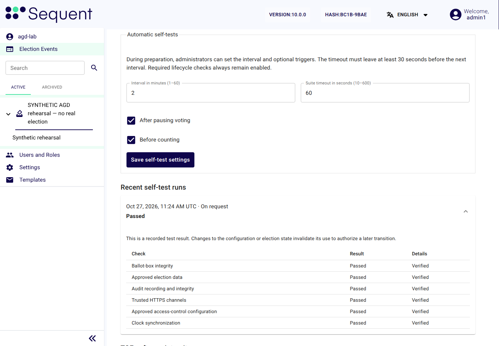
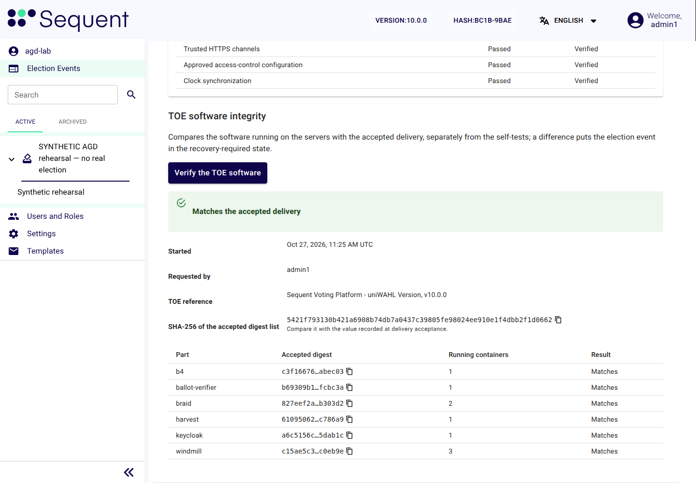
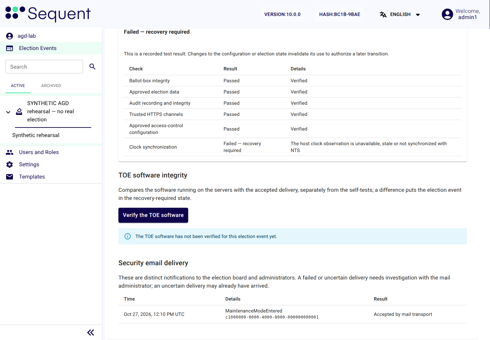

<!--
SPDX-FileCopyrightText: 2026 Sequent Tech Inc <legal@sequentech.io>
SPDX-License-Identifier: AGPL-3.0-only
-->

## Open the security status

Select the election event in the side menu and open its tab **Security and
self-tests**. The tab shows the electoral phase, the security state, the recent
test runs, the integrity of the TOE software and, once a notification exists,
the security email delivery.
Administrators and board members can read these results with the permission
"Self-tests: read results" (`self-test-read`). Running a test requires the
permission "Self-tests: run checks" (`self-test-run`).

Tests run in the background. You can leave this page while they run.
The page refreshes every five seconds. A queued, unfinished, missing or timed-out
test is never a passed test. If the server process running a test ends, the TOE
repeats the test from the start, at most twice; the electoral log then holds the
test's records once for each attempt.

## Run the checks

To run the checks:

1. Select the **Purpose of the test**:
   - **On request** for an additional diagnostic run.
   - **Before starting voting** before the board starts the election execution.
   - **Before resuming voting** after a pause or a recoverable failure.
   - **Before counting** before the board authorizes counting.
2. Select **Run self-tests**. The button changes to **Tests queued or running**.
   Wait for this run rather than starting another one.
3. Expand the newest run under **Recent self-test runs**. Check all six rows,
   their details and the time of the result.
4. Return to the board operation after its required test passes. A test does not
   authorize the operation or replace the required board signatures.

In this example run, all six checks completed with **Passed**. The displayed
result records that run; it does not open voting or authorize a later operation
after its configuration or election event state changes.

A result marked **Earlier election state** cannot authorize a later transition.
After a change of the configuration or the security state, earlier results no
longer count.
If the status cannot be refreshed, do not rely on a previously displayed result.

| Check | What the TOE verifies | If it fails |
| --- | --- | --- |
| Ballot-box integrity | Authenticated ballot admission, contents and order, cast-vote records, voting counters, seals and completed cryptographic tally transcripts. | A detected integrity error gives **Unrecoverable failure**: do not edit ballots, replace records or attempt to resume voting. Data that could not be read gives **Recovery required**. |
| Approved election data | Live election data against the approved baseline, which the TOE captured and signed when the board approved and published the configuration. | **Recovery required**. Tell the election board: it compares the live election data with the approved publication and investigates any difference. Only the exact approved values pass. |
| Audit recording and integrity | Writing a signed test record, reading back the exact stored record, and verifying the electoral log and its checkpoints. | A verified integrity finding in the electoral log gives **Unrecoverable failure**. Any other failure, such as a write or read-back problem, gives **Recovery required**: have the operator restore the audit service. |
| Trusted HTTPS channels | Public endpoints, trusted certificates and the required TLS profile. A timeout is inconclusive and fails the test. | **Recovery required**. Have the operator correct the endpoint, certificate or network configuration: an expired certificate is renewed as [Renew the certificate](../../05-reference/06-deployment_guide/05-certificates_tls.md#renew-the-certificate) describes, and a certificate from another CA needs [Change the CA file](../../05-reference/06-deployment_guide/05-certificates_tls.md#change-the-ca-file), on the election board's decision. Never disable certificate verification. |
| Approved access-control configuration | The TOE's authorization rules, the access-control configuration of its realms, its accounts and roles, and the signing rules against the approved baseline. A staff account that was disabled or lost roles passes; a new account or a new role assignment does not. | **Recovery required**. Investigate the changed permissions or rules with the election board, and restore the approved values. Do not create a new baseline merely to hide a difference. A change of the CA file of the TOE's addresses, which the election board decides, also makes the check fail until the board approves a new configuration version ([Change the CA file](../../05-reference/06-deployment_guide/05-certificates_tls.md#change-the-ca-file)). |
| Clock synchronization | A fresh reading of the servers' time service, including its authenticated source (Network Time Security) and its synchronization status. | **Recovery required**. Have the operator restore the time service ([Authenticated time](../../05-reference/06-deployment_guide/04-hosts_network_time.md#authenticated-time), [Restore time synchronization](../../05-reference/06-deployment_guide/04-hosts_network_time.md#restore-time-synchronization)). [Clock observation](../../05-reference/06-deployment_guide/04-hosts_network_time.md#clock-observation) says what the check reads and when it fails. |

Until the board approves the first configuration version, the tab shows a notice
that the approved baseline is not yet available, and **Purpose of the test** offers
only **On request**. This is expected: nothing has been approved yet to compare
with. A run at start-up or with the purpose **On request** then shows the checks
**Approved election data** and **Approved access-control configuration** as passed
with the detail "No board-approved baseline yet; nothing to compare". Such a run
authorizes nothing. The TOE does not silently learn a new baseline after a failed
test.

## Verify the TOE software

The section **TOE software integrity** of the tab compares the software running
on the servers with the accepted TOE delivery. It is separate from the six
checks, and its result does not authorize starting or resuming voting.
Administrators and board members can run it in every phase, with the permission
"Self-tests: run checks" (`self-test-run`).

Run it before the election board approves a configuration version, after every
restart of a server component, and whenever the integrity of the software is in
doubt. To verify the TOE software:

1. Select **Verify the TOE software**. The button changes to **Verification
   queued or running**. You can leave this page while it runs.
2. Read the result. The table lists the ten TOE parts on the servers
   (admin-portal, b4, ballot-verifier, braid, graphql-engine, harvest, keycloak,
   tls-endpoint, voting-portal and windmill), each with its accepted digest, its
   running containers and its result.
3. Select the copy icon next to **SHA-256 of the accepted digest list**, and
   compare the value with the one the operator gave you
   ([Confirm the server settings to the administrator](../../05-reference/06-deployment_guide/11-selftest_handover.md#confirm-the-server-settings-to-the-administrator)).
   If you are the operator too, compare it with the field `toe.manifest_sha256` of
   your file `site.json`. If they differ, the servers do not hold the accepted digest list, whatever
   the result says: act as for **Differs from the accepted delivery**.

*Illustration: a synthetic election event whose TOE software matches the
accepted delivery.*

| Result | What it means | What you do |
| --- | --- | --- |
| **Matches the accepted delivery** | Each of the ten parts runs its accepted image, the stored content matches the digest, and the required number of its containers is ready: at least two of braid, harvest and windmill, one of every other part. The security state does not change. | Compare the SHA-256 (step 3). |
| **Differs from the accepted delivery** | The stored content, the image or the configuration of a part is not the accepted one. The election event enters **Recovery required** with the reason "TOE software differs from the accepted delivery". The other election events run on the same servers, but their state does not change. | Do not start or continue any election event. Tell the election board and the election organizer, [report it](12-environment_and_security_problems.md#reporting-a-security-problem) and follow [Maintenance mode](10-modes_of_operation.md#maintenance-mode). Verify the TOE software in each other election event as well, so that it also enters **Recovery required**. |
| **Could not verify** | The section gives the reason, for example a part with too few ready containers, or the reason "The host image observation does not cover exactly the ten TOE parts". The security state does not change. This is not a match. | Have the operator correct the cause ([TOE image observation](../../05-reference/06-deployment_guide/11-selftest_handover.md#toe-image-observation)), then verify again. |

The electoral log of the election event records the start and the result of
each verification. If the TOE cannot record the start, the verification does
not run, and the section shows **Could not verify** with the reason "The start
of this check could not be recorded in the electoral log". The election
verifier does not run on the servers, so this section does not cover it: the
operator's
[complete software integrity check of the TOE](../../05-reference/06-deployment_guide/10-verification.md#repeat-the-complete-tsf-software-integrity-check)
does.

## Configure the background interval

An administrator holds the permission "Self-tests: edit settings"
(`self-test-settings-write`), which allows changing the section **Automatic
self-tests** during the preparation phase. The controls are read-only in later
phases. The electoral log records each change and who made it. To change the
self-test settings:

1. Set **Interval in minutes (1–60)**. The default is **15 minutes**.
2. Set **Suite timeout in seconds (10–600)**. The default is **60 seconds**.
   Leave at least 30 seconds between the timeout and the interval. For example,
   a one-minute interval permits a timeout of at most 30 seconds.
3. Select both additional conditions, **After pausing voting** and **Before
   counting**: the evaluated configuration requires them.
4. Select **Save self-test settings** and check the confirmation.

The runs at start-up, at the start of the election period, before starting and
before resuming voting, after recovery and at each interval always happen. The
additional conditions cannot switch them off. Only one run executes for an
election event at a time.

Choose the interval with the organizer. Measure how long the six checks take in
the run of
[Publishing the configuration version](05-tenant_and_event_settings.md#publishing-the-configuration-version),
step 4.

| Election event conditions | Starting interval | Check before opening |
| --- | --- | --- |
| One-day election event or high activity | 5–15 minutes | Every run finishes within its timeout, leaving time for the next run. |
| Multi-day election event | 15–30 minutes | Results are checked throughout the election event, including quieter periods. |

Never exceed 60 minutes. If the six checks cannot finish in time, have the operator
provide adequate resources or reduce competing work. Do not treat an unfinished run
or a longer interval as equivalent protection. A missing or expired successful result
prevents voter access.

## Respond to the security state

- **Operational:** voting has opened and no failure has occurred since it last
  opened or resumed. Phase, period, permission, storage and current self-test checks still apply to each operation.
- **Recovery required:** with the reason "Startup self-tests are required" this is
  the normal state of a new election event: do nothing. Otherwise voting remains
  unavailable. Have the cause resolved. The board runs the checks with the purpose
  **Before resuming voting**, or you do when the board asks you to, and the board
  resumes voting with the protected action "Open voting": the button "Start
  Voting", then the entry "Start Online Voting", in the tab "Publish" of each
  election. Repairs alone do not reopen voting.
- **Unrecoverable failure:** election execution cannot resume. Change nothing on
  the election event and follow
  [An unrecoverable failure](10-modes_of_operation.md#an-unrecoverable-failure).
  A later passed test cannot erase an earlier unrecoverable result.

A required service, `harvest` or `windmill`, that stopped or no longer reports
that it is running also prevents voter operations. Each runs two processes: one
of them stopping or restarting while the other keeps working changes nothing, but
`windmill` reports that it is running only through its single scheduling process
`beat` ([A crash or shutdown of a server component](10-modes_of_operation.md#a-crash-or-shutdown-of-a-server-component)).
During an execution failure, ballot-box reads and writes are
refused. Staff can still inspect the status and perform authorized investigation.

First opening requires the approved start time, current checks, empty ballot
boxes and the initialization procedure. An initialization report is not an
election result. Before opening, use **Before starting voting**, rather than
**Before resuming voting**. A ballot box that is not empty at the start stops
the opening, with the state **Recovery required**.

## Check security notifications

Security-state changes and audit-storage problems send email to the
administrators and the election board
([Email notifications](09-audit_and_monitoring.md#email-notifications)). The
area **Security email delivery** of the tab, which appears once a notification
exists, shows what happened to each one:

*Illustration: a synthetic notification in the area "Security email delivery".*

| Delivery state | Meaning and action |
| --- | --- |
| Queued for delivery / Sending | Wait for the result. Definite temporary failures are retried with a delay, up to six attempts. |
| Accepted by mail transport | The mail server accepted the message. This does not prove that a recipient read it. |
| Delivery failed | Ask the operator to follow it up ([A security notification is not delivered](../../05-reference/06-deployment_guide/11-selftest_handover.md#a-security-notification-is-not-delivered)). Give the operator the notification's identifier and the failure text shown under it. |
| Delivery outcome unknown | A response was lost or interrupted. Ask the operator to follow it up in the same way before you send anyone a copy: the original may already have arrived. |

The operator provides the authenticated mail relay, and you keep the staff
email addresses correct. A failed notification neither reopens voting nor
suppresses the security event.

Above **80% used audit-storage capacity**, the TOE refuses voters and the
machine accounts of the trustee server instances, and in the execution phase it
puts the election event into **Recovery required**
([The audit storage threshold](09-audit_and_monitoring.md#the-audit-storage-threshold)).
Missing, stale or future-dated measurements also refuse access. The
operator must restore usable capacity and a fresh measurement
([Storage](../../05-reference/06-deployment_guide/11-selftest_handover.md#storage), [Extend the data file system](../../05-reference/06-deployment_guide/11-selftest_handover.md#extend-the-data-file-system)),
and only the election board resumes voting.

## The election board's electoral-log audit

The election board may also audit the electoral log: in the election event's
tab "Logs" it selects the button "Audit" and confirms in the dialog "Audit
electoral log". This needs the permission "Audit Electoral Log"
(`electoral-log-audit`). The background task checks the log records, the Merkle
tree, the checkpoint signatures and the configured write-once copies. The result
appears in the election event's tab "Tasks". It supplements the six checks and
does not authorize starting or resuming voting.
