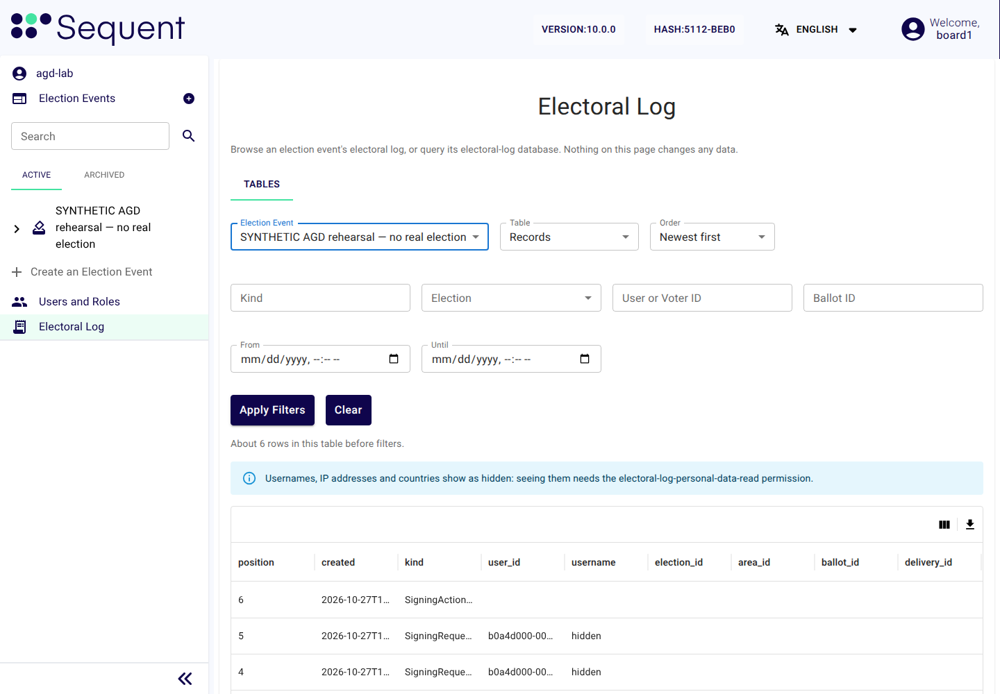
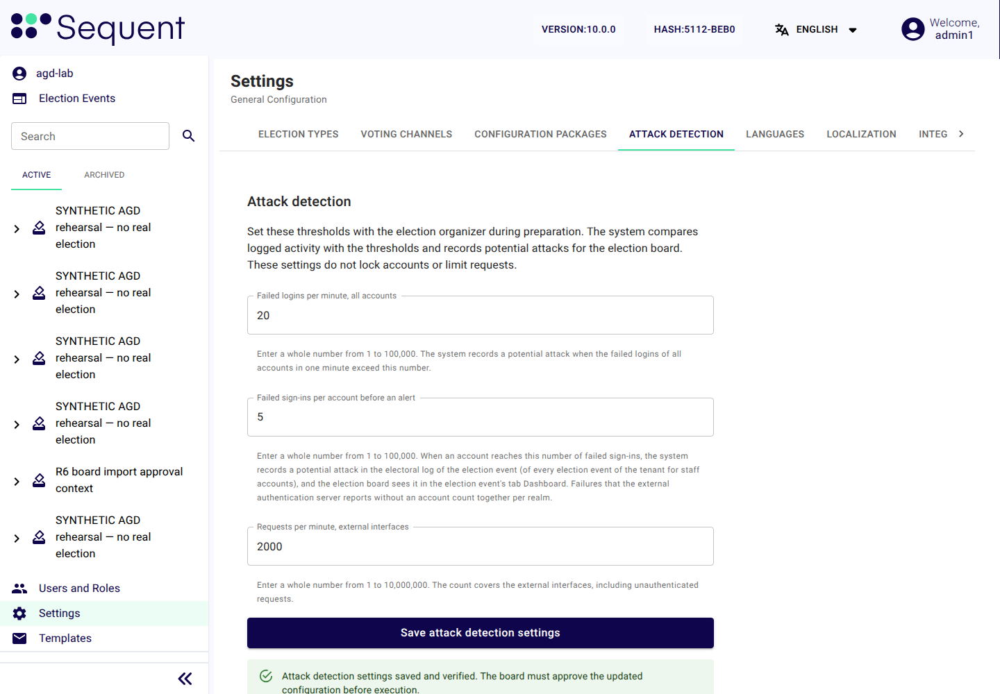

<!--
SPDX-FileCopyrightText: 2026 Sequent Tech Inc <legal@sequentech.io>
SPDX-License-Identifier: AGPL-3.0-only
-->

## The electoral log

Each election event has its own electoral log ([Terms](01-about.md#terms)). Each
record has its time and its type, and a record that a person caused names the
account. The records of the disabling of re-voting, of a download of verification
data and of the archiving name it only in their details, by its user identifier;
the record of an export names no account, but the export's signing request does.
The records are chained, so that a removed or changed record is detected. The
TOE records:

| Caused by | What the electoral log records |
|---|---|
| The election board | The import of election data, each publication and approval of a configuration version, each signing request with its signatures, the start, interruption, resumption and termination of the election execution, the counting, the export, each download of verification data, the archiving and the deletion |
| The administrators | Changes of signing rules, trusted issuers, certificate checks and "Sign:" permissions, certificate registrations and revocations with the signing requests a revocation cancels, the disabling of re-voting in an election, changes of the self-test settings, and changes of the attack-detection settings, which are recorded in every election event of the tenant |
| The TOE | The start and the result of each self-test run and of each verification of the TOE software, maintenance and unrecoverable-failure transitions, audit-storage failures, and attack detections, among them an account reaching the authentication failure threshold. A detection that concerns the tenant's accounts is recorded in every election event of the tenant |
| The voters | Their actions in the voting portal, among them each ballot cast or audited |

The electoral log does not record changes of staff accounts, role assignments,
other role permissions, the realm's password policy or other tenant settings. Once
a configuration version is approved, the self-test check "Approved access-control
configuration" detects such a change
([Security and Self-Tests](07-self_tests.md)).

Nobody can change a record or delete a single record. Only the board's deletion of
the whole election event
([Correcting imported election data](05-tenant_and_event_settings.md#correcting-imported-election-data))
removes its electoral log. Only the election board reads, audits and
exports the electoral log: as administrator you do not read it. You learn of
security-relevant events from the TOE's notifications
([Email notifications](#email-notifications)) and from the election board. The
operator reads the operating logs, only as the Deployment Guide describes; they
are not the electoral log.

## The election board's tools for the audit review

The election board uses these tools. Their permissions belong only to the role
`election-board`
([The election board role](04-users_and_roles.md#the-election-board-role)):

| To | The board uses |
|---|---|
| Read the electoral log of an election event | The tab "Logs" of the election event, or the screen "Electoral Log" in the side menu, where it selects the election event |
| Check the electoral log | The button "Audit" in the tab "Logs". The result appears as the task "Audit Electoral Log" in the tab "Tasks" of the election event |
| Export the electoral log | The button "Export" in the tab "Logs". It asks for the period, the time zone and the format, CSV or PDF |

*Illustration: the screen "Electoral Log" with the synthetic records of a
v10.0.0 election event. This screen is the election board's: an administrator
does not see it.*

Your part: check that the role `election-board` holds these permissions, as
[The election board role](04-users_and_roles.md#the-election-board-role) lists, and
that the page "Role Data" of the role `admin` shows none of them. Add the permission "Read
Electoral Log Personal Data" (`electoral-log-personal-data-read`) to the role
`election-board` only if the election organizer decides so.

## Attack detections

The TOE compares its records of failed logins and of requests with two attack
patterns:

| Pattern | When it matches |
|---|---|
| Brute force | the failed logins of one account reach "Failed sign-ins per account before an alert", or the failed logins across accounts exceed "Failed logins per minute, all accounts" |
| Denial of service | the requests on the external interfaces exceed "Requests per minute, external interfaces" |

These three thresholds are tenant settings on the tab "Attack detection" of the
side menu "Settings". Only the administrator role changes them, with the
permissions "Admin User" (`admin-user`) and "Edit Tenant" (`tenant-write`). Set
them with the election organizer in the preparation phase, from the number of
voters and the expected peak load: high enough that the normal peak does not
match, low enough that an attack does. On a match the TOE writes a record to the
electoral log and shows it on the election event's tab "Dashboard", under "Attack
detections". The election board watches it during the execution phase. Seeing it
needs the permission "View Monitoring Dashboards" (`monitoring-view`), which only
the board holds.

### Set and verify the thresholds

To set and verify the thresholds:

1. Open the tab "Attack detection" of the side menu "Settings".
2. Enter whole numbers in **Failed logins per minute, all accounts** (1–100,000),
   **Failed sign-ins per account before an alert** (1–100,000, default 5,
   [Authentication failure threshold](08-authentication_and_sessions.md#authentication-failure-threshold))
   and **Requests per minute, external interfaces** (1–10,000,000), using the values
   agreed with the election organizer.
3. Select **Save attack detection settings** once.
4. Expect **Attack detection settings saved and verified**. Check that the three
   fields still show the agreed values. These thresholds count for every election
   event of the tenant: tell the election board, which must approve a new
   configuration version of each election event whose version it has already
   approved, before the execution phase.

*Illustration: the administrator saved and read back the thresholds. The numbers
shown are examples, not a recommendation for a live election event.*

If a value is outside the accepted range, correct it and save again. If saving
or verification fails, do not assume the new values took effect: reopen the
tab, inspect the stored values and resolve the displayed cause. The thresholds
cannot be changed while an election event is in the execution phase. They detect
patterns: they do not limit requests or lock accounts.

When the election board tells you of an attack detection, treat it as a
security-relevant event
([Security-Relevant Events for Administrators](11-security_relevant_events.md)):
tell the operator, and whoever runs the network if that is someone else, and
agree the measures with the board.

## The audit storage threshold

The TOE measures the audit database volume every 30 seconds. Above 80% used
capacity it:

- refuses new sessions and requests of voters, so that no vote is cast that
  could not be recorded;
- refuses new sessions, token renewals and requests to `harvest` of the other
  accounts of the tenant that are neither administrators, board members nor
  service accounts: in the evaluated configuration, the machine accounts
  `trustee1` and `trustee2` of the trustee server instances, so key ceremonies
  and tallies wait;
- in the execution phase, unless the election board has paused voting, puts
  the election event into **Recovery required** with the reason "The required
  self-test failed or its validity interval expired", although no self-test
  failed, and pauses its open voting channels;
- writes a record to the electoral log;
- emails the election board and the administrators.

Administrators and board members, the trustees among them, can still sign in
and work. Have the operator extend the storage at once
([Storage](../../05-reference/06-deployment_guide/11-selftest_handover.md#storage), [Extend the data file system](../../05-reference/06-deployment_guide/11-selftest_handover.md#extend-the-data-file-system)):
never by deleting audit records or election execution data. Voters and the
other accounts can sign in again once the used space is at or below the
threshold and the measurement is fresh. Missing, stale, future-dated or
unreadable measurements also refuse their access and stop voting in the same
way. Voting that the TOE stopped does not resume by itself: the election board
resumes it as [Maintenance mode](10-modes_of_operation.md#maintenance-mode)
describes. The other phase, period and self-test checks continue to apply.

## Email notifications

The TOE emails every enabled account, except service accounts, that has an email
address and holds the permission "Edit Tenant" (`tenant-write`) or "Edit Election
State" (`election-state-write`): that is, the administrators and the board
members. It sends an email when:

- an election event enters maintenance mode or has an unrecoverable failure, with
  the reason;
- an election event leaves maintenance mode;
- the electoral phase of an election event changes;
- election execution data is exported;
- verification data of an election event is downloaded;
- an election event is archived;
- re-voting is disabled in an election;
- the audit storage threshold is exceeded, or the TOE has no current measurement
  of the audit storage.

The TOE sends no email for an attack detection or for an account reaching the
authentication failure threshold. The election board sees these on the tab
"Dashboard" of the election event and in the electoral log.

The TOE sends through the authenticated mail relay that the operator configured
during installation
([Configure security email](../../05-reference/06-deployment_guide/01-about.md#configure-security-email)).
The area "Security email delivery" of the tab "Security and self-tests" of the
election event shows queued, sent, failed and uncertain outcomes. That the mail
relay accepted a message does not prove that the recipient read it.

The TOE sends to the address in the field "Email" of each account. Before the
execution phase, check that every administrator's and board member's account has the
person's working address, and agree with the election organizer who reads the
email throughout the execution phase.

## Supporting the election board's audit review

At the beginning of the evaluation phase the election board checks the audit
records. Support the board:

- make sure that every board member who checks the records holds the
  permissions that the tab "Logs" and the screen "Electoral Log" need
  ([The election board's tools for the audit review](#the-election-boards-tools-for-the-audit-review));
- when the board asks you about a record that an administrator caused, for example a
  change of a signing rule, explain why the change was made. The record gives
  the account and the time;
- if the board finds a record it cannot explain, help it to find the cause and
  treat it as a security-relevant event.
