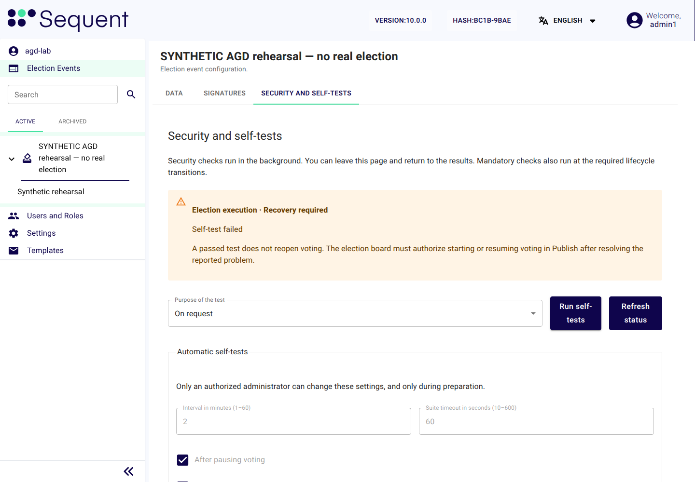

<!--
SPDX-FileCopyrightText: 2026 Sequent Tech Inc <legal@sequentech.io>
SPDX-License-Identifier: AGPL-3.0-only
-->

## The electoral phases

Open the election event's **Security and self-tests** tab to check its phase,
security state and reason. The TOE controls the phase; it is not an editable
setting. Administrators see the security status and administration settings.
Only the election board has access to election execution data and audit records.

| Phase | How it starts | What happens next |
| --- | --- | --- |
| Preparation | The board creates the approval event or imports an approved election event. | The administrators set the administrator settings and signing rules. The board imports the election data, completes the key ceremony, publishes and approves the configuration version, and initializes. |
| Execution | The board or the approved schedule opens voting after the required checks pass. | Voters cast ballots within the approved period. The board may pause, resume or close voting with the required approvals. |
| Evaluation | The approved period ends or the board closes all elections of the election event. | Voting cannot reopen. The board checks the audit and authorizes counting. |
| Post-processing | The board selects **Start post-processing** in **Security and self-tests** and authenticates again. | Completed counting permits normal post-processing. An unrecoverable failure permits investigation. Board-approved read-out and export precede deletion. |

The first opening requires the approved time window, an empty ballot box,
initialization and a current **Before starting voting** result. A scheduled
opening uses its own election-start check, and the TOE refuses it during
maintenance mode or a board pause. A diagnostic **On request** result does not
substitute for either. See
[Security and Self-Tests](07-self_tests.md).

## Lockdown

Lockdown protects configuration settings during the agreed period. The board sees
the field **Lockdown Status** as **Locked Down** on the tab **Data**; you see the
lockdown when the TOE refuses a change with a message that starts "The election
event is locked down". It is separate from the security state.
Lockdown alone does not stop voting.

The board sets the lockdown period after approving the configuration version. The TOE also
enforces electoral phases: ending a lockdown does not permit rewriting approved
election data or returning from evaluation to execution. Administrators cannot
change the board's schedule. Follow
[Preparation Phase Procedures](../05-election_organizer_handbook/06-preparation.md)
when a new configuration version is needed.

## Voting paused by the election board

A pause stops voting, and earlier check results no longer count for opening it
again. The board records in the board's minutes why it paused voting and decides
whether resumption is allowed
under the electoral regulation. An administrator does not take that decision.
To resume voting:

1. Help the board to resolve the reason for the pause.
2. The election board selects **Security and self-tests → Before resuming voting →
   Run self-tests**; you can run it too when the board asks you to.
3. Wait for all six checks in the latest run to pass for the current state.
4. The board authorizes **Start Voting → Start Online Voting** in the election
   event's tab **Publish**. The approved voting period and the required services
   must still be available.

A run that failed, is still pending, has expired or has another purpose does not
allow resumption.
If the board tries too soon, the operation remains refused; wait for its required
check and then submit a new authorized operation.

## Maintenance mode

A new election event shows **Recovery required** with the reason "Startup self-tests
are required" until voting opens for the first time. This is the normal state of the
preparation phase, not maintenance mode: a scheduled opening is allowed from it, and
the steps below do not apply. With any other reason, **Recovery required** on the
tab **Security and self-tests** means that a recoverable failure has stopped normal
voting. The tab gives the reason. The causes are:

- a failed self-test, except for the two integrity findings of
  [An unrecoverable failure](#an-unrecoverable-failure), or a passed self-test
  whose validity has expired;
- a ballot box that is not empty at the start of the election;
- TOE software that differs from the accepted delivery;
- a required service that stopped or no longer reports that it is running;
- external request monitoring (the count of requests on the external interfaces,
  [Attack detections](09-audit_and_monitoring.md#attack-detections)) that is
  unavailable or out of date.

A repair or restart does not reopen voting. Only the election board does, after
the checks below. The TOE records the transition in the electoral log and
emails the administrators and the election board
([Email notifications](09-audit_and_monitoring.md#email-notifications)).

*Illustration: a synthetic election event in maintenance mode, after the check
"Clock synchronization" failed.*

To recover and resume voting:

1. Read the reason and the latest check results in **Security and self-tests**.
2. Tell the election board and the operator the election event, the time and
   the reason. The board records them in the board's minutes; the operator reads
   the log of the failed component and tells the board what it shows.
3. Have the operator correct the cause as the
   [Deployment Guide](../../05-reference/06-deployment_guide/01-about.md)
   describes, for example the service, trusted certificate, authenticated time
   source or storage availability. Never replace records merely to make a test
   pass.
4. The election board runs the checks with the purpose **Before resuming voting**,
   or you do when the board asks you to. Wait for the current six-check result.
5. The board reviews the investigation and authorizes **Start Voting → Start Online Voting**. The
   TOE checks its preconditions again and runs an additional check after
   leaving maintenance.
6. Check **Security email delivery** and confirm that the administrators and the
   election board received the notice. A failed email shows in that area and does
   not change the security state.

## An unrecoverable failure

A detected ballot-box integrity error, or a verified integrity finding in the
electoral log, produces **Unrecoverable failure**.
Election execution cannot resume, even if a later diagnostic check passes.
Do not edit ballots, remove records, replace the approved baseline or delete
execution data to clear the state.

Change nothing on the election event, note the reason the tab shows and the time,
tell the election board, which records them in the board's minutes, and ask the
operator to read the log of the failed component and tell the board what it shows.
The board follows the electoral regulation and may enter post-processing for an authorized
investigation and export. This does not turn an incomplete or failed election event
into a successfully counted election event.

## A crash or shutdown of a server component

During execution, obtain the board's decision before the operator restarts a
component, as
[Restart an authorized failed component](../../05-reference/06-deployment_guide/11-selftest_handover.md#restart-an-authorized-failed-component)
describes. After the restart,
[verify the TOE software](07-self_tests.md#verify-the-toe-software).
A required service that stopped or no longer reports that it is running prevents
voter operations.

After a restart in the execution phase, the TOE records that the election event
needs recovery. Follow [Maintenance mode](#maintenance-mode), including the
purpose-specific checks and board resumption. Do not infer readiness merely from a green container status.

## The audit storage threshold

Above 80% used audit-storage capacity, the TOE refuses new sessions and requests of
voters. Missing, stale, future-dated or unreadable measurements also refuse access. Staff access remains available for recovery.

Have the operator extend storage
([Storage](../../05-reference/06-deployment_guide/11-selftest_handover.md#storage));
never delete audit records or election execution data to make space. A fresh
measurement at or below the threshold removes the storage refusal, but the other
phase, period and self-test checks still apply. See
[Audit, Monitoring and Notifications](09-audit_and_monitoring.md#the-audit-storage-threshold).

## Backups

The operator provides protected, verified backups
([Backups and restore](../../05-reference/06-deployment_guide/11-selftest_handover.md#backups-and-restore)).
A restoration replaces current data with an older state. It needs the board's
decision, and the command `./deploy restore site.json` refuses it while an election
event is in the execution phase.
