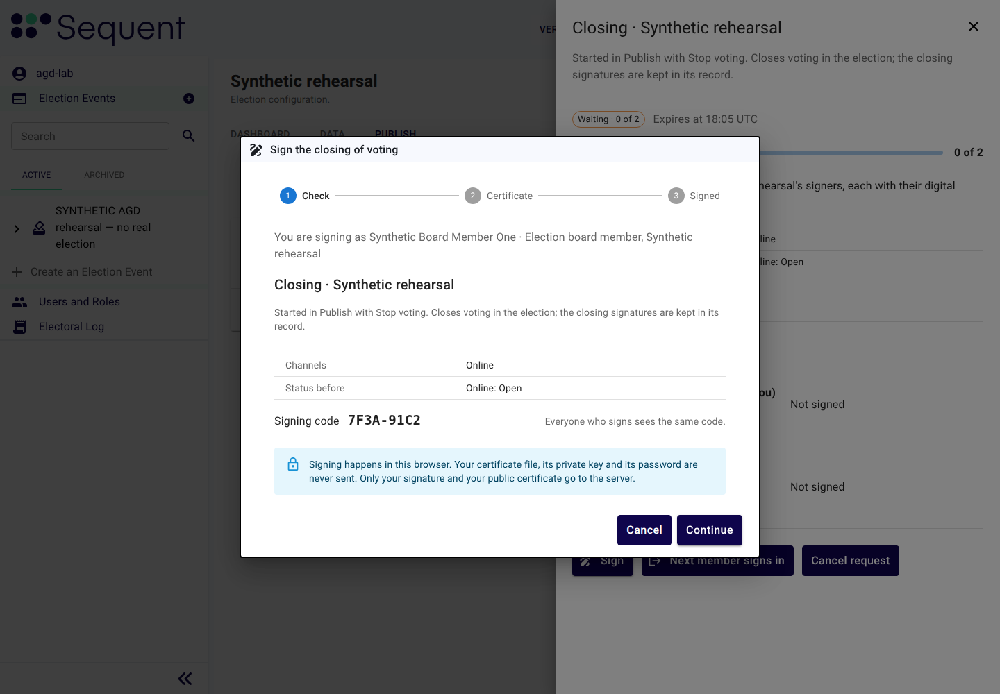

<!--
SPDX-FileCopyrightText: 2026 Sequent Tech Inc <legal@sequentech.io>
SPDX-License-Identifier: AGPL-3.0-only
-->

Board members use the TOE through the admin portal, a web application that the
operational environment serves to the browser. The TOE checks every request
on the server: what the admin portal shows or hides does not grant or deny
anything. Trustees also use the `trustee` program of the `braid` image on
their trustee workstation (see
[Trustee Procedures](09-trustee-procedures.md)).

## Your workstation

- Use only a device that the election organizer provides or allows: an
  up-to-date operating system and browser, only the browser extensions your
  organisation allows, screen lock on, used by you alone.
- Open the admin portal only at the address the administrators gave you.
- Stop at once if the browser shows a certificate warning or the connection is
  not secure. Do not continue and do not add an exception: tell the
  administrators.
- Do not let the browser save any credentials.

## Signing in

To sign in to the admin portal:

1. Open the admin portal at its address followed by `/tenant`. For example,
   if its address is `https://admin.example.org`, open
   `https://admin.example.org/tenant`. Under the heading "Select Tenant", enter in the field
   "Tenant Name" the tenant name that the administrators give you, and select
   the button "Continue".
2. The login page of the TOE sends you on to the external authentication
   server of your organisation.
3. Authenticate there with your two factors.
4. The external authentication server sends you back to the admin portal,
   which shows the tenant and the election events your role allows.

The TOE holds no password for you. If you cannot sign in, contact the
organisation that runs the external authentication server.

:::warning
If the TOE ever shows you a password or one-time-code form of its own, or
offers to register a new account, stop and report it as a security-relevant
event. The evaluated configuration has no such form. The "Certificate password"
field of the signing dialog is not such a form: it opens your own certificate
file in your browser and is never sent (see [Signing](#signing)).
:::

## Confirming an action by authenticating again

Before some actions, for example the buttons "Start Voting", "Pause Voting" and
"Stop Voting", the admin portal shows the dialog "Confirm Action" with what the
action does. Read it, then select "Confirm" or "Cancel". If your last login is
not recent, the admin portal then sends you to the external authentication
server to log in again before it continues.

Before the TOE accepts your authorisation of a security-critical action, you
authenticate again:

1. The admin portal sends you to the external authentication server.
2. Log in there with your two factors, as in [Signing in](#signing-in).
3. The external authentication server sends you back to the admin portal.
   Give your authorisation at once: the TOE accepts it only within 60 seconds
   after this fresh login. After that it refuses the authorisation, and you
   authenticate again.

You never enter a password in the TOE itself to authenticate again: you log
in only at the external authentication server. If the admin portal or the
TOE's login page shows a field for your account password, stop and report it
as a security-relevant event.

## Authorising a security-critical action

A security-critical action runs only when the required number of board
members has authorised it. Each authorisation is a signature made with the
signing certificate on the board member's security token. The administrators
set the number for each action in the field "Signatures needed" on the election
event's tab "Signatures" under "Protected actions"; the electoral regulation
fixes it.
The imports of election data are the exception: board members authorise them
by approving the configuration package with the election organizer's package
tool, outside the TOE, before a board member imports it (see
[Approving a configuration package](06-preparation.md#approving-a-configuration-package)).

### How a signing request works

To authorise a security-critical action:

1. A board member starts the action, for example with the button "Stop Voting".
   Instead of
   performing it, the TOE creates a signing request and opens its panel. The
   panel shows the fields "Signing code" and "Signers", how many have signed
   (for example "2 of 3") and when it expires, in the line "Expires at …".
2. Each authorising board member opens the request: in the panel, or on the
   election event's tab "Signatures" under "Requests". Each one authenticates
   again at the external authentication server before signing (see
   [Confirming an action by authenticating again](#confirming-an-action-by-authenticating-again)).
3. When the last required signature arrives, the TOE performs the action.

### Signing

To sign a request:

1. Check what you sign. For a configuration version, read the table under the
   heading "Changes in this version"; for a document, select the button "Open the
   document". Compare the "Signing code"
   with the other signers: everyone who signs sees the same code.
2. Select "Sign". The dialog "Sign the …" has three steps: "Check",
   "Certificate" and "Signed".
3. Under "Check", the dialog shows the line "You are signing as" with your name.
   Tick the box "I have checked the …" only after you have checked it.
4. Under "Certificate", insert your security token and choose your certificate
   file. Enter the field "Certificate password" and select the button "Open
   certificate". The dialog lists the certificate checks. Every check must
   pass, among them "Issued by a trusted issuer", "Valid today", "Made for
   signing", "Not revoked" and "Registered to you".
5. Select "Sign". The step "Signed" shows how many signatures are in and who
   signs next.

*Illustration: the step "Check" of a synthetic request to close voting, with the
"Signing code" to compare.*

Signing happens in your browser. Your certificate file, its private key and its
password are never sent; only your signature and your public certificate go to
the server.

If several board members sign at one computer, select the button "Next member
signs in": you are signed out, and the next member signs in with their own
account and returns to this request to sign.

### Statuses of a signing request

| Status | Meaning | What to do |
|---|---|---|
| "Waiting" | Signatures are missing | The remaining signers sign before it expires. |
| "Signed" | All signatures are in | Wait for the action to run. |
| "Done" | The action was performed | Check its result, for example on the election event's tab "Publish" or "Logs". |
| "Cancelled" | A board member cancelled it, or what it signs or its rule changed | Signatures given for it no longer count. Start the action again if the board still wants it. |
| "Expired" | It was not complete in time | Start the action again. |
| "Failed" | All signatures are in, but the action failed | The electoral log has the details (the election event's tab "Logs"). Treat it as a security-relevant event. |

### Aborting

Every board member can abort a security-critical action before it runs: open
the request and select the button "Cancel request", then confirm the question
"Cancel this request?" with the button "Cancel request". Signatures given for it no longer count. Abort whenever
what is to be signed differs from what the election board decided.

:::warning
- Never sign something you have not checked yourself, and never sign because
  someone else asks you to.
- Never give your security token or its password to anyone, and never sign for
  another person. The TOE counts each certificate once per request and records
  every signature with the signer's name in the electoral log.
- If your security token is lost or stolen, or you suspect that someone knows
  its password, tell the administrators at once so that they revoke the
  certificate.
:::

## Sessions and logout

- After 15 minutes without interaction the TOE ends your session in the admin
  portal. Sign in again to continue.
- To end your session at once, open the account icon in the header, select
  "Logout" and confirm the question "Are you sure you want to logout?" with the
  button "OK".
- Log out whenever you stop working with the TOE, even for a short break, and
  lock the screen when you leave the workstation.
- If the admin portal shows the question "Do you want to stay connected to this
  tenant or logout?", select "Logout" unless you are continuing your own work.

:::warning
An open session in an unattended browser lets anyone at the workstation act
with your permissions, including starting security-critical actions and
signing with a token left in the device.
:::

## What never to do

- Do not use any interface of the TOE other than the admin portal and, for
  trustees, the `trustee` program on the trustee workstation.
- Do not share accounts, security tokens, certificate passwords, keys files or
  exported files with anyone who is not entitled to them.
- Do not change the settings of the TOE: that is the administrators'
  task. Election data
  changes only through a new signed configuration package.
