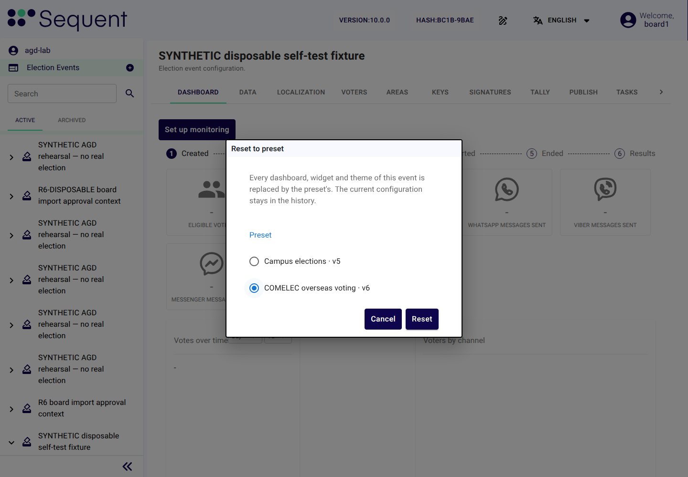
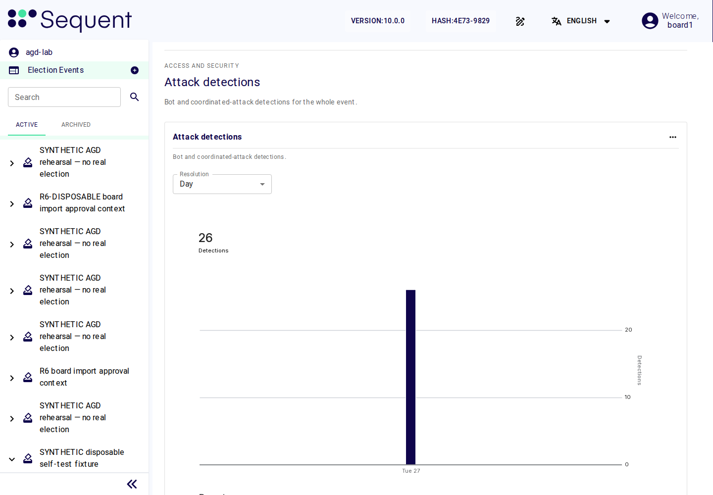
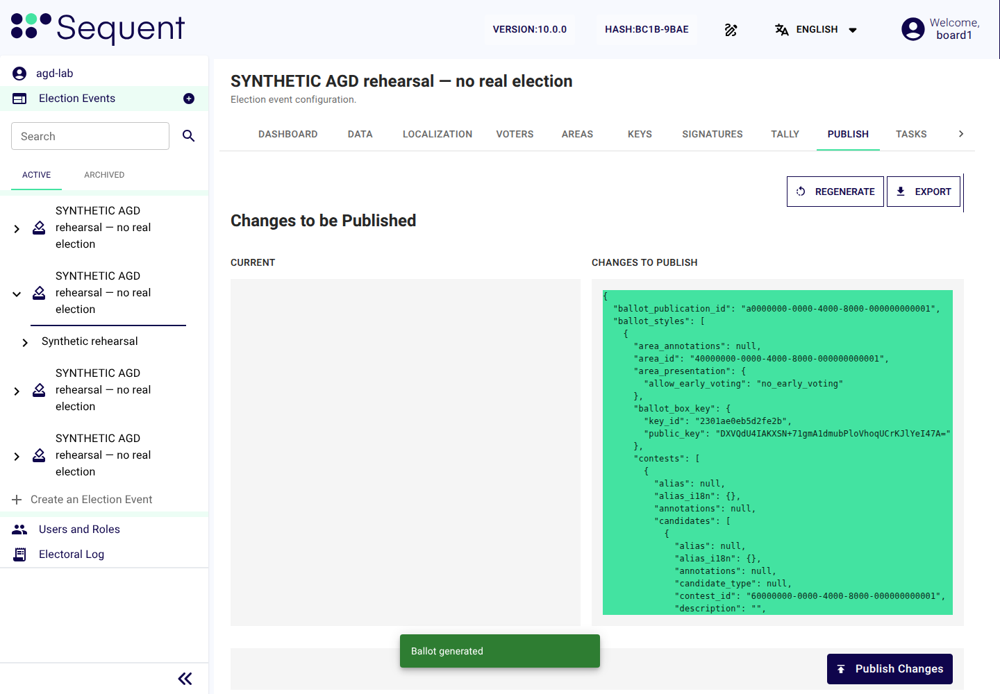
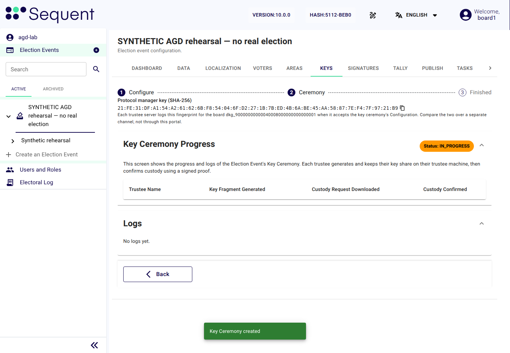

<!--
SPDX-FileCopyrightText: 2026 Sequent Tech Inc <legal@sequentech.io>
SPDX-License-Identifier: AGPL-3.0-only
-->

In the preparation phase the board approves the configuration packages and
imports them, the administrators make the settings, the trustees generate the
election key, the board publishes and approves the configuration version and
sets the lockdown period, and the board checks that everything is ready for
the execution phase. Carry out the steps in this order:

1. [Importing the election data](#importing-the-election-data).
2. [Checking the imported data and the settings](#checking-the-imported-data-and-the-settings).
3. [The key ceremony](#the-key-ceremony).
4. [Approving the configuration](#approving-the-configuration).
5. [Setting the lockdown period](#setting-the-lockdown-period).
6. [The initialization report](#the-initialization-report).
7. [The self-test before the start](#the-self-test-before-the-start).
8. [Checklist before the execution phase](#checklist-before-the-execution-phase).

## Importing the election data

All election data (the voters' register, the candidate list and its display
data, the set of election rules and the election dates) reaches the TOE as a
signed configuration package. The election organizer prepares the package and
signs it (see [Provide the credentials](02-organizer-duties.md#provide-the-credentials)).
The board checks and signs the package before import. The importing board member
also obtains the TOE's required authorisations for the exact uploaded file through
the mandatory **Import election data** rule. Package approvals and this operation's
fresh authorisations are both required. The importing member needs the
permissions "Create Election Event" (`election-event-create`) and "Upload
Documents" (`document-upload`); the members who authorise the import need the
permission "Sign: import election data" (`sign-import-election-data`) and their
registered signing certificates.

Before asking the board to approve the package, the election organizer includes
the required settings of the tab "Data" of the election event and of each election
([Settings of the election event](../04-administrator_handbook/05-tenant_and_event_settings.md#settings-of-the-election-event),
[Settings of each election](../04-administrator_handbook/05-tenant_and_event_settings.md#settings-of-each-election)).
They can affect the approved ballot design, even where administrators can edit
them. Produce the package's ballot-design digests and report settings with the
package tool from that complete configuration. The package tool must include
ballot designs for every area and election. Administrators check these values after import. A difference requires
a corrected signed package and a new election event, rather than an edit before publication.

The required authorisations of an import are the number of package approvals
that the administrators set for the tenant before the first import, as the
electoral regulation fixes it and at least two, and never change afterwards.
If that number is not set, the TOE refuses every import.

### Approving a configuration package

Who: each approving board member. Phase: before the import, which creates
a separate election event in the preparation phase. Permission: no permission in the TOE; your approval certificate, which the
election organizer's certification authority issued to you.
To approve a configuration package:

1. The election organizer gives you, with its package tool, which runs
   outside the TOE, the package to approve: the name of the configuration, its
   revision, its contents and the approval code of this revision.
2. Check the contents against the electoral regulation and against what the
   election organizer announced: the elections, the candidate list and its
   display data, the voters' register (the number of voters, and samples
   against the organizer's own register) and the election dates.
3. Compare the approval code aloud with the other approvers of the same
   revision. Everyone who approves a revision approves the same data and sees
   the same code. If the codes differ, do not approve.
4. If everything matches, sign the approval with your own approval certificate
   in the election organizer's package tool. If anything differs, do not
   approve, and tell the election organizer.

Each approval must come from a different board member; the member who imports
the package may be one of them. The TOE counts an approval only if its
certificate was issued by the certification authority that the
administrators set for package approvals, and it counts two
approvals by the same person or with the same certificate once. Never approve
for another person, and never let anyone use your approval certificate. Your
approval has counted when the import succeeds and its record names the
revision you approved (see [Checking the import](#checking-the-import)).

### Prepare the first import's approval event

The first import needs a place to hold its signing rule and registered board
certificates. Prepare this once before importing the first package:

1. In the side menu, a board member selects the plus icon next to "Election
   Events", then the entry **Create an Election Event**, and creates an empty
   election event named, for example, **Board import approvals**. It stays in the
   preparation phase and is used only for authorisations; do not add election
   data, publish it or open voting.
2. An administrator opens this election event's tab "Signatures". Under
   **Certificates**, the administrator registers each board member's certificate
   to their personal account, and configures the trusted issuers and the
   certificate checks
   ([Trusted issuers and certificate checks](../04-administrator_handbook/06-signing_rules.md#trusted-issuers-and-certificate-checks)).
3. Under **Protected actions**, the administrator configures **Import election
   data** with the number of independent board signatures required by the
   regulation, at least two, and the role `election-board` under **Who can sign**,
   and saves the rule. The action cannot proceed with a missing or disabled rule.
4. Board members sign in with their personal board accounts and confirm that
   they can see this election event's signing requests. Write this election
   event's identifier in the board's minutes; it must remain in the preparation
   phase for further imports.

The approval event contains authorisation records. Importing creates a separate
new election event containing the election data; the administrators configure that
election event's own signing rules and certificate registrations before its
protected actions.

### Importing the package

Who: one board member. Phase: the preparation phase of the approval event; the
import creates a separate election event in the preparation phase. To import the
package:

1. In the side menu, select the plus icon next to "Election Events", then the entry
   **Import Election Event**. In **Board approval for import**, choose the
   approval event configured above. If it is missing, finish its setup first.
2. Choose the signed package. Enter the SHA-256 value supplied by the organizer
   through a separate channel in **Integrity Check (SHA-256)**, then select
   **Import**. For an encrypted package, enter the separately supplied
   **Decryption Password** and select **Ok**.
3. The signing dialog opens a request for **Import election data**. Review its
   file identity, SHA-256 digest and target election event with the other board members.
   Each member authenticates again and signs using their registered certificate.
   Keep the original import dialog open. After the required approvals, the original
   requester selects **Continue operation**.
4. The TOE checks that the stored file is still exactly the approved file.
   It also checks the package signature, every listed file and the package's own
   approvals. A changed upload, invalid or untrusted signature, missing or added
   file, insufficient package approvals or an already-imported revision is refused.
5. Wait for the task to finish and for the message "Election event imported
   Successfully". Open the newly imported election event and perform the checks below. A completed signing
   request alone is not confirmation that the import task succeeded.

If the signing request expires, is cancelled, or the file changes, obtain a new
request and new approvals. If a package check fails, write the error in the
board's minutes and ask the organizer for a corrected signed revision; do not bypass the check.

### Checking the import

Who: the election board. Phase: the preparation phase, right after each import.
Permissions: "Read Logs" (`logs-read`) and "Read Area" (`area-read`).
To check the import:

1. Check that the tab "Security and self-tests" of the new election event shows
   the phase "Preparation".
2. On its tab "Logs", find the record `ConfigurationPackageImported`, whose
   description reads "Configuration … revision … imported from a signed package
   (manifest …).". The configuration and the revision must be the ones the board
   approved.
3. Check the imported data as
   [Checking the imported data and the settings](#checking-the-imported-data-and-the-settings)
   describes.
4. Tell the administrators that a board member imported the
   election event with the entry "Import Election Event" and the digest from the
   election organizer, so that they check and make its settings.
5. Record each import that the TOE refused, with its error message, in the
   board's minutes.

:::warning
- The importing board member always fills the field "Integrity Check (SHA-256)". If it
  is left empty, the admin portal asks in the dialog "Import Without Integrity Check?":
  select "Go Back" and enter the digest, never "Yes, Import without Integrity
  Check". For a signed package the TOE's own check of the signature, of every file and
  of the approvals decides whether the package is accepted, so the board's
  check of the contents before approving is what stops a validly signed but
  wrong package.
- If the TOE refuses the package because the signature, a file or the
  approvals are not valid, stop. Do not approve another file in its place
  without the election organizer. Treat it as a security-relevant event and
  ask the election organizer for a new package.
- The TOE accepts election data only as a signed configuration
  package, through the entry "Import Election Event". Use the entry **Create an Election Event** only for the empty approval event above.
  Do not populate an election event by hand or use the separate voter, area or
  candidate imports in this evaluated workflow: they are not substitutes for the
  organizer's signed package and its approvals. The TOE refuses a schedule import
  and does not offer it. If election
  data ever appears that did not come from a signed package, or an imported
  value of the voters' register, the candidate list, the set of election rules
  or the election dates has changed, stop, approve nothing, and treat it as a
  security-relevant event.
:::

If the imported data is wrong, nobody corrects it by hand, and the wrong
election event is never deleted:

1. The election organizer issues a corrected, signed configuration package as
   a new revision of the configuration.
2. The board approves the corrected package as above, and a board member
   imports it as a new election event.
3. In the preparation phase, a board member archives the wrong election
   event (permission "Archive Election Event", `election-event-archive`):
   open the menu of the election event in the side menu, select the entry
   "Archive this Election Event" and confirm the question "Are you sure to
   archive this item?". The TOE shows the message "The item has been archived",
   and the election event is listed under the side menu's tab "Archived". An archived election event
   never opens voting and nothing sets it back; its data and audit records stay
   in the TOE.
4. The board checks that, of the two election events, only the corrected one is
   listed under the side menu's tab "Active", and writes both in the board's minutes.

## Checking the imported data and the settings

Before the configuration is approved, the election board checks the election
data against the electoral regulation:

- the voters' register: the number of voters (the figure "Eligible Voters" on
  the election event's tab "Dashboard") against the organizer's own register; the board
  checks samples in the package before approving it;
- the elections, contests and candidates, their order and their texts in
  every language;
- the election dates: the start time and end of election time of each
  election, in the election's time zone.

The administrators configure the election event as the Handbook for Election
Administrators describes. The values on its tab "Data" must already match the signed
package; the administrators verify them and configure the separate protected
actions and certificates. The election board checks these settings with them:

| Where | Setting | Required value |
|---|---|---|
| Election event, tab "Data" | "Ballot Box Seal Policy" | "Seal at close" |
| Election event, tab "Data" | "Keys/Tally Ceremonies Policy" (section "Advanced Configurations") | "Manual Ceremonies" |
| Election event, tab "Data" | "Receipts signed by the ballot box" | "Signed by the ballot box" |
| Election event, tab "Data" | "Period for checking cast ballots" | "Until a date", with "Checks available until" at the end of election time |
| Election event, tab "Data" | "Show User Profile" (section "Ballot Design") | Off |
| Election event, tab "Data" | "Show Cast Vote Logs Tab" (section "Ballot Design") | "Hide Cast Vote Logs Tab" |
| Each election, tab "Data" | "Audit Button Display Options" (section "Ballot Design") | "Show" |
| Each election, tab "Data" | "Allow Tally" | "Requires Voting Period End" |
| Each election, tab "Data" | "Initialize Report Policy" | "Required" |
| Each election, tab "Data" | "Grace Period Policy" | "No grace period" |
| Each election, tab "Data" | "Number of allowed votes" | As the electoral regulation fixes it (1 means no re-voting) |
| Election event and each election, tab "Data" | "Voting Channels Allowed" | "Online" only |
| Tenant (set by the administrators, who show it to the board) | Required number of package approvals for imports | As the electoral regulation fixes it, at least 2 |
| Election event, tab "Signatures" | "Signatures needed" of every non-trustee protected action | As the electoral regulation fixes it, at least 2 recommended (see [Security-critical actions](05-electoral-phases.md#security-critical-actions)) |
| Election event, tab "Signatures" | "Trustees sign this step" for both trustee custody actions | On; each trustee signs their own step, with no configurable signature count |
| Election event, tab "Signatures", "Certificates" | "Registering a certificate to a person" | "Only when someone who can register certificates registers it" (the default "When its holder first signs with it" is not allowed) |
| Election event, tab "Signatures", "Certificates" | "Check revocation lists" and "When a list can't be downloaded" | If the election organizer's certification authority publishes revocation lists that the server can download: on, with "Don't accept signatures". Otherwise certificates are withdrawn with the button "Revoke" |
| Users and Roles | "Signatures: register certificates" (`signing-certificates-register`) | Held by administrators only |
| Election event, tab "Security and self-tests" | Automatic self-test interval, timeout and six results | The interval as the electoral regulation fixes it, and both additional conditions, "After pausing voting" and "Before counting", selected (see [Self-test intervals](11-security-relevant-events.md#self-test-intervals)) |
| Header of the admin portal | "Version:" | `10.0.0` |

:::warning
If any setting differs from this table, the TOE is not in its evaluated
configuration and some of its protections do not apply. Do not approve the
configuration. If an imported value of a tab "Data" differs, obtain a corrected signed
package and import a new election event as described above. For the separate signing
and certificate settings and the self-test settings, wait for the administrators to complete their
procedures.
:::

## Preparing the security dashboard

Before approving the configuration, a board member with the permissions "Admin
Dashboard View" (`admin-dashboard-view`), "View Monitoring Dashboards"
(`monitoring-view`) and "Configure Monitoring Dashboards"
(`monitoring-configure`) prepares the dashboard. The first permission opens
the election event's tab "Dashboard"; its name does not assign the administrator role.
To prepare the dashboard:

1. Open the election event's tab "Dashboard" and select the button "Set up
   monitoring".
2. Choose **COMELEC overseas voting · v6**, the supplied monitoring preset
   containing **Attack detections**. This selects a dashboard layout; it does not
   change the imported election data or voting rules. Review the confirmation: it replaces this election event's monitoring layout and retains the
   earlier configuration in its history. Select **Reset** once.
3. After the tab reloads, open its **Dashboard** selector and choose
   **Attack detections**, under **Access and security**.
4. Check that the figures have a current update time. Inspect any detections
   and correlate them with the signed records `PotentialAttackDetected` on the
   election event's tab "Logs" before approving the election event's configuration.

*Illustration: the confirmation with the button "Reset", in a synthetic election
event.*

After setup, the text "Not counted yet" means that the first
background count has not completed; wait for the displayed update before
interpreting the figures.

*Illustration: 26 detections from a completed snapshot, in a synthetic election
event.*

The chart is a record of that snapshot; check its update time before treating it
as current. An older snapshot remains useful when reviewing an ended election
event.

If the tab "Dashboard" is absent, check the permission "Admin Dashboard View". If
the button "Set up monitoring" is absent, check the permission "Configure Monitoring
Dashboards". If saving
is refused, retain the current configuration and resolve the reported cause;
repeated clicks do not establish that a change succeeded. A failed request,
unavailable data source or unfinished first count must never be read as zero
attacks. If the chart cannot be drawn but figures are available, inspect those
figures using the widget's data view.

## Approving the configuration

Who: the election board. Phase: the preparation phase, after the administrators
have made the settings, told the board that they are complete and handed it their
completed
[Checklist before the election board approves the configuration version](../04-administrator_handbook/11-security_relevant_events.md#checklist-before-the-election-board-approves-the-configuration-version),
which the board keeps with the board's minutes, and after the key ceremony has
completed with every trustee's custody confirmed. Permissions:
"Read Publish" (`publish-read`), "Edit Publish" (`publish-write`), "Create
Publish" (`publish-create`), "Regenerate Publish" (`publish-regenerate`),
"Publish Changes" (`publish-changes`) and "Sign: approve a configuration
version" (`sign-approve-configuration`).

Generate the final publication only after the key ceremony, so that the
ballots carry its verified election key. A publication generated before the
ceremony can contain a demo key and is not updated when the ceremony finishes.
If one was generated earlier, regenerate it after the ceremony and obtain the
board's approval before starting lockdown or generating the initialization
report.

A board member publishes the configuration of the election event on its
tab "Publish": select the button "Generate Publication" (the button "Regenerate"
once a publication exists), check the area "Changes to Publish", and select the
button "Publish Changes". Publishing
is possible only in the preparation phase; the TOE refuses it in every later
phase and while the election event is locked down. Each publication is a new
configuration version, and it becomes valid only when the election board
approves it:

1. The TOE creates a signing request for "Approve a configuration version".
2. Each authorising board member opens the request and selects "Changes in
   this version". Compare every change with the package the board approved
   and with the electoral regulation.
3. If everything matches, sign. If anything differs, abort the request
   with the button "Cancel request" and tell the administrators (for a setting) or the
   election organizer (for election data).
4. When the version is approved, tell the administrators: from then on they
   change no setting without telling the board.

*Illustration: a generated v10.0.0 publication awaiting review in a synthetic
election event. The green comparison is proposed content, not evidence of approval.
Review your own complete changes before requesting the board’s signatures.*

The approved configuration version also fixes the signing rules. After the
approval they change only through a new configuration version, which the board
publishes and approves in the same way.

## Setting the lockdown period

Lockdown protects the approved configuration while the election event takes place.
While the election event is locked down, the TOE refuses a new publication,
changes of the signing rules, changes of voters and the deletion of the
election event. It does not stop voting.

Who: one board member. Phase: the preparation phase, after the configuration version is
approved and before the election period starts. Permissions: "View Election
Event Scheduled" (`election-event-scheduled-tab`), "Create Scheduled Event"
(`scheduled-event-create`) and "Edit Scheduled Events" (`scheduled-event-write`).
To set the lockdown period:

1. Ask the election organizer for the start and the end of the lockdown
   period. The start lies after the approval of the configuration version and
   before the election period starts. The end must come before the election
   event is deleted in the post-processing phase, since lockdown refuses the
   deletion.
2. Open the election event's tab "Scheduled Events" and select the button "Add"
   (the button "Create Scheduled Event" if the list is empty).
3. In the field "Type", select "Start Lockdown Period". In the field "Scheduled
   at", enter the start the election organizer decided. Select "Save". The TOE
   shows the message "Scheduled Event created successfully".
4. Repeat with the type "End Lockdown Period" and the end the election
   organizer decided.
5. After the start, check that the field "Lockdown Status" (section "Advanced
   Configurations" of the election event's tab "Data") shows "Locked Down", and
   record both times in the board's minutes.

The field "Type" offers only these two types, and the TOE refuses any other change
of the dates with the message "Election dates change only by the signed import":
the election dates come only with the imported election data.

## The key ceremony

In the key ceremony the trustees generate the key with which the votes are
encrypted. Each trustee keeps their own share of it; the votes can be
decrypted only when at least the threshold of trustees take part in the
counting. The trustees' own steps are in
[Trustee Procedures](09-trustee-procedures.md).

Before the ceremony, check that:

- the election event's field "Keys/Tally Ceremonies Policy" is "Manual Ceremonies";
- every trustee has generated their keys, and the administrators have
  registered each trustee's two public keys in Settings > "TRUSTEES";
- each trustee's account has the role `trustee` and the trustee's name in the
  user field "Act as Trustee";
- each trustee's instance of the trustee server (`braid`) is running (the
  operators confirm it).

To run the ceremony, a board member with the permission "Admin Ceremony"
(`admin-ceremony`) does the following:

1. Open the election event's tab "Keys" and select "Create Key Ceremony".
2. Select the intended election, or "All Elections" if the ceremony covers
   the whole election event. The ceremony name is derived from that selection.
   In the list "Trustees", select both trustees. Set the field "Threshold" to 2.
3. Check that the form does not offer the switch "Automatic Ceremony". It appears
   only if the field "Keys/Tally Ceremonies Policy" allows automatic ceremonies.
4. Select "Create Key Ceremony" and confirm the question "Are you sure you want to
   Create Key Ceremony?" with the button "Yes, Create Key Ceremony".
5. Each trustee then takes part from their own account. Follow the progress
   under the heading "Key Ceremony Progress": for every trustee the columns "Key Fragment
   Generated", "Custody Request Downloaded" and "Custody Confirmed" must be
   ticked.
6. The ceremony is complete only when every selected trustee has the tick in the
   column "Custody Confirmed".

*Illustration: a newly created v10.0.0 ceremony, before trustee progress appears.
“Key Ceremony created” does not mean that custody is confirmed; wait for the
required confirmations from every selected trustee.*

The key ceremony and the tally ceremony run only as manual ceremonies: the field
"Keys/Tally Ceremonies Policy" at "Manual Ceremonies" for every election event, and
the switch "Automatic Ceremony" never on. At the key ceremony the election board checks that every trustee
confirmed custody of their keys, and the tally starts only with the trustees'
authorisations.

:::warning
The switch "Automatic Ceremony" of each ceremony decides whether the trustees
confirm custody: a ceremony created with it switched on runs without their
confirmations, whatever the field "Keys/Tally Ceremonies Policy" says. Check at
every key ceremony that every selected trustee has the tick in the column "Custody
Confirmed".

If the form offers the switch "Automatic Ceremony", if the dialog asks the
question "Are you sure you want to Create Automatic Key Ceremony?", or if a trustee
has no tick in the column "Custody Confirmed" when the ceremony is reported
complete, stop. Select "Cancel Key Ceremony" if the ceremony is still running, do not continue with
the election event, and treat it as a security-relevant event. An automatic
ceremony skips the trustees' confirmations, so the board can no longer be sure
that each share is held by its trustee alone.
:::

If the ceremony fails, the election event's tab "Keys" shows its failure. Have the administrators
and trustees resolve the cause, then create a new ceremony. A trustee who
cannot take part is replaced only as the electoral regulation provides.

## The initialization report

The initialization report shows, before voting opens, that the ballot box of
each election is empty. With the field "Initialize Report Policy" set to "Required" an
election does not open until its initialization report exists, neither at the
scheduled start nor with the button "Start Voting".

Hold the generation in front of the witnesses that the electoral regulation
names:

1. Check that the configuration is approved and the key ceremony is complete.
2. On the tab "Publish" of an election, select the button "Generate Initialization
   Report" and confirm the question "You are about to generate initialization
   report. Are you sure you want to continue?".
3. The TOE creates a signing request for "Initialize voting". Read its
   "Signing code" to the witnesses; the required board members sign.
4. On the election event's tab "Tally", open the initialization ceremony created
   by that approval. Ask the selected trustees to confirm custody for this tally,
   following [Authorising the counting](09-trustee-procedures.md#authorising-the-counting).
   Each trustee creates a fresh proof with this tally's identifier and signs
   their own confirmation. A proof from the key ceremony or another tally
   cannot be reused.
5. Check that the required trustees have confirmed custody and that their
   trustee servers are running. Select "Start Tally" and confirm with "Start
   Tally". Wait for the initialization tally to complete.
6. Release the initialization report: if the protected action "Generate other
   election reports" needs signatures, the required board members sign it.
7. Show or print the report. The witnesses check:
   - the name of the election and the time it was generated;
   - the number of registered voters;
   - that zero ballots were counted and every candidate has zero votes;
   - that the field "Report hash" equals the hash in the records
     `ElectionInitialized` of the election on the election event's tab "Logs".
8. Repeat for every election of the election event.

:::warning
If the report counts any ballot, or its hash differs from the
`ElectionInitialized` record, stop. Do not start voting. Keep the report and
treat it as a security-relevant event: a ballot box that is not empty before
the start means that votes may have been added outside the execution phase.
:::

## The self-test before the start

To run the self-test before voting starts:

1. Open the election event's tab "Security and self-tests". Check that it no
   longer shows the notice "The board-approved configuration baseline is not yet
   available."; otherwise complete the publication first.
2. Select **Before starting voting** under **Purpose of the test**, then **Run
   self-tests** once.
3. Wait for the background run to finish. Expand it and verify that all six
   checks show **Passed**, for the current election event state.
4. Start within the five-minute validity of the opening check and the approved election period.
   If either state or validity has changed, run the required check again.

A failed, missing or expired result blocks opening. Investigate it using
[Operating Modes, Failures and Recovery for the Election Board](12-modes-and-failures.md). A scheduled
opening requests its own **Scheduled election start** check; an earlier
**On request** result is not its authorization.

## Checklist before the execution phase

| Check | Page |
|---|---|
| Role assignments: no administrator in the board, one personal account per member, every board member can abort | [Election Board Roles and Permissions](03-board-roles-and-permissions.md) |
| Election data imported by a board member from signed packages, each package approved by the board before its import and each import checked; each wrong import archived | [Importing the election data](#importing-the-election-data) |
| Settings as in the table above | [Checking the imported data and the settings](#checking-the-imported-data-and-the-settings) |
| Configuration version published and approved by the board | [Approving the configuration](#approving-the-configuration) |
| The scheduled events "Start Lockdown Period" and "End Lockdown Period" created at the times the election organizer decided | [Setting the lockdown period](#setting-the-lockdown-period) |
| Key ceremony complete, every trustee ticked in the column "Custody Confirmed" | [The key ceremony](#the-key-ceremony) |
| Initialization report of every election witnessed, zero ballots, hash matches the electoral log | [The initialization report](#the-initialization-report) |
| All six current opening self-tests passed; no unresolved failure | [The self-test before the start](#the-self-test-before-the-start) |
| The check of the TOE software shows the result "Matches the accepted delivery" | [Verifying the TOE software](07-execution.md#verifying-the-toe-software) |
| Voters have their credentials and the information the election organizer gives them | [Instruct the voters](02-organizer-duties.md#instruct-the-voters) |
