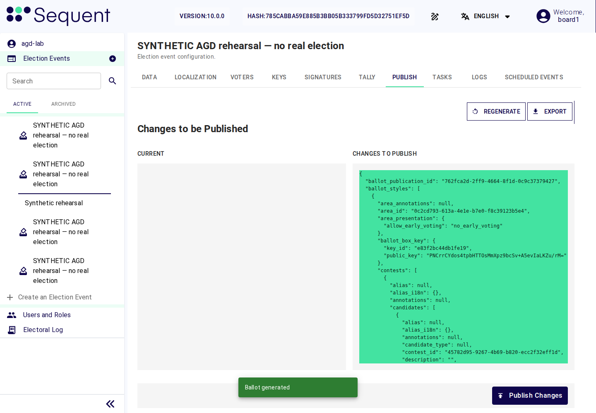
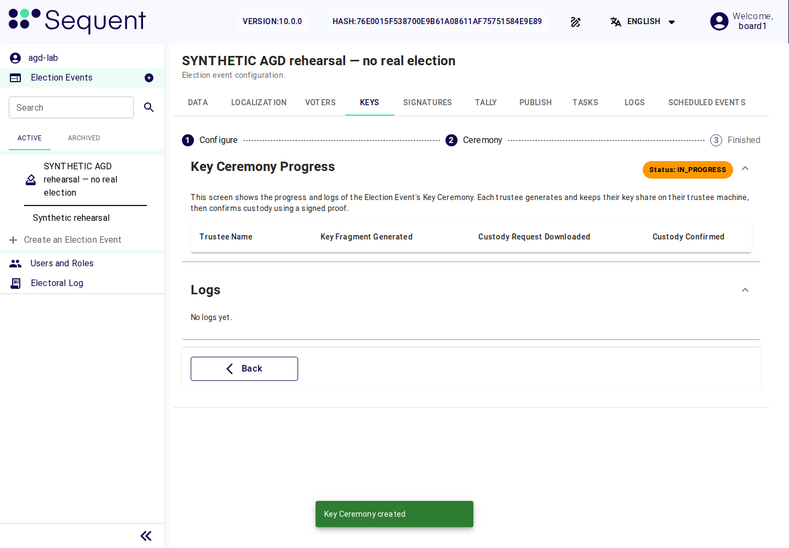

<!--
SPDX-FileCopyrightText: 2026 Sequent Tech Inc <legal@sequentech.io>
SPDX-License-Identifier: AGPL-3.0-only
-->

In the preparation phase the board approves the configuration packages and
imports them, the administrators make the settings, the trustees generate the
election key, the board publishes and approves the configuration version and
sets the lockdown period, and the board checks that everything is ready for
the execution phase. Carry out the steps in this order:

1. [Importing the election data](#importing-the-election-data).
2. [Checking the imported data and the settings](#checking-the-imported-data-and-the-settings).
3. [The key ceremony](#the-key-ceremony).
4. [Approving the configuration](#approving-the-configuration).
5. [Setting the lockdown period](#setting-the-lockdown-period).
6. [The initialization report](#the-initialization-report).
7. [The self-test before the start](#the-self-test-before-the-start).
8. [Checklist before the execution phase](#checklist-before-the-execution-phase).

## Importing the election data

All election data (the voters' register, the candidate list and its display
data, the set of election rules and the election dates) reaches the TOE as a
signed configuration package. The election organizer prepares the package and
signs it (see [Provide the credentials](02-organizer-duties.md#provide-the-credentials)).
The election board authorises the import by approving the package before it
is imported; a board member then imports it. Only the election board role
holds the permission for the import, "Create Election Event"
(`election-event-create`); the administrators never hold it. The import needs
no other permission: it writes every part of the package itself. The voting
system accepts election data only as a signed configuration package.

Before asking the board to approve the package, include the required event and
election Data-tab settings from [the administrator's tables](../04-administrator_handbook/05-tenant_and_event_settings.md#settings-of-the-election-event).
They can affect the approved ballot design, even where administrators can edit
them. Produce the package's ballot-design digests and report settings with the
package tool from that complete configuration. The package tool must include
ballot designs for every area and election. Administrators check these values after import. A difference requires
a corrected signed package and a new event, rather than an edit before publication.

The required authorisations of an import are the number of package approvals
that the administrators set for the tenant before the first import, as the
electoral regulation fixes it and at least two, and never change afterwards.
If that number is not set, the TOE refuses every import.

### Approving a configuration package

Who: each approving board member. Phase: before the import, which creates
the election event in the preparation phase. Permission: no permission in the TOE; your approval certificate, which the
election organizer's certification authority issued to you.

1. The election organizer gives you, with its package tool, which runs
   outside the TOE, the package to approve: the name of the configuration, its
   revision, its contents and the approval code of this revision.
2. Check the contents against the electoral regulation and against what the
   election organizer announced: the elections, the candidate list and its
   display data, the voters' register (the number of voters, and samples
   against the organizer's own register) and the election dates.
3. Compare the approval code aloud with the other approvers of the same
   revision. Everyone who approves a revision approves the same data and sees
   the same code. If the codes differ, do not approve.
4. If everything matches, sign the approval with your own approval certificate
   in the election organizer's package tool. If anything differs, do not
   approve, and tell the election organizer.

Each approval must come from a different board member; the member who imports
the package may be one of them. The TOE counts an approval only if its
certificate was issued by the certification authority that the
administrators set for package approvals, and it counts two
approvals by the same person or with the same certificate once. Never approve
for another person, and never let anyone use your approval certificate. Your
approval has counted when the import succeeds and its record names the
revision you approved (see [Checking the import](#checking-the-import)).

### Importing the package

Who: one board member. Phase: the import creates the election event in the
preparation phase. Permission: "Create Election Event"
(`election-event-create`).

1. Select "Import Election Event", choose the package file, type the
   SHA-256 digest that the election organizer gave you through a separate
   channel into "Integrity Check (SHA-256)", and select "Import". For an
   encrypted package enter the "Decryption Password", received
   separately from the file, and select "Ok".
2. The TOE checks the signature of the package, every file of the package
   against the signed list of its files, and the approvals. It refuses an
   unsigned package, a package with a changed, missing or added file, a
   package signed with a certificate it does not trust, a package with an
   approval that is not valid or with fewer valid approvals from different
   board members than the tenant requires, a revision of the configuration
   that is not newer than the last one imported, and a package that enables
   the results website or in which an area has "Allow Early Voting" ticked.
3. When the TOE accepts the package, it creates the election event and shows
   "Election event imported Successfully".

### Checking the import

Who: the election board. Phase: preparation, right after each import.
Permission: "Read Logs" (`logs-read`) and "Read Area" (`area-read`).

1. Check that the new election event shows "Electoral phase" Preparation.
2. On its Logs tab, find the import record `ConfigurationPackageImported`
   ("Configuration … revision … imported from a signed package (manifest
   …)"). The configuration and the revision must be the ones the board
   approved.
3. Check the imported data as
   [Checking the imported data and the settings](#checking-the-imported-data-and-the-settings)
   describes.
4. Tell the administrators in writing that a board member imported the
   election event with "Import Election Event" and the digest from the
   election organizer, so that they check and make its settings.
5. Record each import that the TOE refused, with its error message, in the
   board's minutes.

:::warning
- The importing board member always fills "Integrity Check (SHA-256)". If it
  is left empty, the admin portal asks "Import Without Integrity Check?":
  select "Go Back" and enter the digest, never "Yes, Import without Integrity
  Check". For a signed package the TOE's own check of the signature, of every file and
  of the approvals decides whether the package is accepted, so the board's
  check of the contents before approving is what stops a validly signed but
  wrong package.
- If the TOE refuses the package because the signature, a file or the
  approvals are not valid, stop. Do not approve another file in its place
  without the election organizer. Treat it as a security-relevant event and
  ask the election organizer for a new package.
- The voting system accepts election data only as a signed configuration
  package, through "Import Election Event". It refuses every other way in and
  every change of imported election data: "Create an Election Event", the
  "Import" of the Voters tab and of Areas, "Import Candidates", "Import
  schedule", and changes of voters, areas, candidates or dates. If election
  data ever appears that did not come from a signed package, or an imported
  value of the voters' register, the candidate list, the set of election rules
  or the election dates has changed, stop, approve nothing, and treat it as a
  security-relevant event.
:::

If the imported data is wrong, nobody corrects it by hand, and the wrong
election event is never deleted:

1. The election organizer issues a corrected, signed configuration package as
   a new revision of the configuration.
2. The board approves the corrected package as above, and a board member
   imports it as a new election event.
3. In the preparation phase, a board member archives the wrong election
   event (permission "Archive Election Event", `election-event-archive`):
   open the menu of the election event in the side menu, select "Archive this
   Election Event" and confirm "Are you sure to archive this item?". The TOE
   shows "The item
   has been archived", and the election event is listed under "Archived". An
   archived election event never opens voting; its data and audit records
   stay in the TOE. Never select "Unarchive this Election Event".
4. The board checks that the corrected election event is the only one under
   "Active" for this election and records both events in its minutes.

## Checking the imported data and the settings

Before the configuration is approved, the election board checks the election
data against the electoral regulation:

- the voters' register: the number of voters ("Eligible Voters" on the
  election event's Dashboard) against the organizer's own register; the board
  checks samples in the package before approving it;
- the elections, contests and candidates, their order and their texts in
  every language;
- the election dates: the start time and end of election time of each
  election, in the election's time zone.

The administrators configure the election event as the Handbook for Election
Administrators describes. Its Data-tab values must already match the signed
package; the administrators verify them and configure the separate protected
actions and certificates. The election board checks these settings with them:

| Where | Setting | Required value |
|---|---|---|
| Election event, Data tab | "Ballot Box Seal Policy" | "Seal at close" |
| Election event, Data tab | "Keys/Tally Ceremonies Policy" (section "Advanced Configurations") | "Manual Ceremonies" |
| Election event, Data tab | "Receipts signed by the ballot box" | "Signed by the ballot box" |
| Election event, Data tab | "Period for checking cast ballots" | "Until a date", with "Checks available until" at the end of election time |
| Election event, Data tab | "Show User Profile" (section "Ballot Design") | Off |
| Election event, Data tab | "Show Cast Vote Logs Tab" (section "Ballot Design") | "Hide Cast Vote Logs Tab" |
| Each election, Data tab | "Audit Button Display Options" (section "Ballot Design") | "Show" |
| Each election, Data tab | "Allow Tally" | "Requires Voting Period End" |
| Each election, Data tab | "Initialize Report Policy" | "Required" |
| Each election, Data tab | "Grace Period Policy" | "No grace period" |
| Each election, Data tab | "Number of allowed votes" | As the electoral regulation fixes it (1 means no re-voting) |
| Election event and each election, Data tab | "Voting Channels Allowed" | "Online" only |
| Tenant (set by the administrators, who show it to the board) | Required number of package approvals for imports | As the electoral regulation fixes it, at least 2 |
| Election event, Signatures tab | "Signatures needed" of every non-trustee protected action | As the electoral regulation fixes it, at least 2 recommended (see [Security-critical actions](05-electoral-phases.md#security-critical-actions)) |
| Election event, Signatures tab | "Trustees sign this step" for both trustee custody actions | On; each trustee signs their own step, with no configurable signature count |
| Election event, Signatures tab, "Certificates" | "Registering a certificate to a person" | "Only when someone who can register certificates registers it" (the default "When its holder first signs with it" is not allowed) |
| Election event, Signatures tab, "Certificates" | "Check revocation lists" and "When a list can't be downloaded" | If the election organizer's certification authority publishes revocation lists that the server can download: on, with "Don't accept signatures". Otherwise certificates are withdrawn with "Revoke" |
| Users and Roles | "Signatures: register certificates" (`signing-certificates-register`) | Held by administrators only |
| Operator configuration and Tasks | Background audit interval and results; the complete self-test controls are not implemented | The interval as the electoral regulation fixes it, and all three additional conditions selected (see [Self-test intervals](11-security-relevant-events.md#self-test-intervals)) |
| Header of the admin portal | "Version" | `Sequent Voting Platform - uniWAHL Version, v10.0.0` |

:::warning
If any setting differs from this table, the TOE is not in its evaluated
configuration and some of its protections do not apply. Do not approve the
configuration. If an imported Data-tab value differs, obtain a corrected signed
package and import a new event as described above. For the separate signing,
certificate settings and background audit policy, wait for the administrators to complete their
procedures.
:::

## Approving the configuration

Who: the election board. Phase: preparation, after the administrators have
made the settings and told the board that they are complete, and after the
key ceremony has completed with every trustee's custody confirmed. Permission:
"Read Publish" (`publish-read`), "Edit Publish" (`publish-write`), "Create
Publish" (`publish-create`), "Regenerate Publish" (`publish-regenerate`),
"Publish Changes" (`publish-changes`) and "Sign: approve a configuration
version" (`sign-approve-configuration`).

Generate the final publication only after the key ceremony, so that the
ballots carry its verified election key. A publication generated before the
ceremony can contain a demo key and is not updated when the ceremony finishes.
If one was generated earlier, regenerate it after the ceremony and obtain the
board's approval before starting lockdown or generating the initialization
report.

A board member publishes the configuration of the election event on its
Publish tab: select "Generate Publication" ("Regenerate" once a publication
exists), check "Changes to Publish", and select "Publish Changes". Publishing
is possible only in the preparation phase; the TOE refuses it in every later
phase and while the election event is locked down. Each publication is a new
configuration version, and it becomes valid only when the election board
approves it:

1. The TOE creates a signing request for "Approve a configuration version".
2. Each authorising board member opens the request and selects "Changes in
   this version". Compare every change with the package the board approved
   and with the electoral regulation.
3. If everything matches, sign. If anything differs, abort the request
   ("Cancel request") and tell the administrators (for a setting) or the
   election organizer (for election data).
4. When the version is approved, tell the administrators: from then on they
   change no setting without telling the board.

*Illustration: a generated v10.0.0 publication awaiting review in a synthetic
election. The green comparison is proposed content, not evidence of approval.
Review your own complete changes before requesting the board’s signatures.*

The approved configuration version also fixes the signing rules. After the
approval they change only through a new configuration version, which the board
publishes and approves in the same way.

## Setting the lockdown period

Lockdown protects the approved configuration while the election takes place.
While the election event is locked down, the TOE refuses a new publication,
changes of the signing rules, changes of voters and the deletion of the
election event (the Handbook for Election Administrators lists what it
refuses). It does not stop voting.

Who: one board member. Phase: preparation, after the configuration version is
approved and before the election period starts. Permission: "View Election
Event Scheduled" (`election-event-scheduled-tab`) and "Create Scheduled Event"
(`scheduled-event-create`).

1. Ask the election organizer for the start and the end of the lockdown
   period. The start lies after the approval of the configuration version and
   before the election period starts. The end must come before the election
   event is deleted in the post-processing phase, since lockdown refuses the
   deletion.
2. Open the election event's "Scheduled Events" tab and select "Add"
   ("Create Scheduled Event" if the list is empty).
3. In "Type", select "Start Lockdown Period". In "Scheduled at", enter the
   start the election organizer decided. Select "Save". The TOE shows
   "Scheduled Event created successfully".
4. Repeat with "Type" "End Lockdown Period" and the end the election
   organizer decided.
5. After the start, check that "Lockdown Status" (section "Advanced
   Configurations" of the election event's Data tab) shows "Locked Down", and
   record both times in the board's minutes.

Create no other scheduled event: the election dates come only with the
imported election data.

## The key ceremony

In the key ceremony the trustees generate the key with which the votes are
encrypted. Each trustee keeps their own share of it; the votes can be
decrypted only when at least the threshold of trustees take part in the
counting. The trustees' own steps are in
[Trustee Procedures](09-trustee-procedures.md).

Before the ceremony, check that:

- the election event's "Keys/Tally Ceremonies Policy" is "Manual Ceremonies";
- every trustee has generated their keys, and the administrators have
  registered each trustee's two public keys in Settings > "TRUSTEES";
- each trustee's account has the role `trustee` and the trustee's name in "Act
  as Trustee";
- each trustee's instance of the trustee server (`braid`) is running (the
  operators confirm it).

Steps for the board member who runs the ceremony (permission "Admin
Ceremony"):

1. Open the election event's Keys tab and select "Create Key Ceremony".
2. Select the intended election, or "All Elections" if the ceremony covers
   the whole election event. The ceremony name is derived from that selection.
   Under "Trustees", select both trustees. Set the "Threshold" to 2.
3. Leave "Automatic Ceremony" switched off.
4. Select "Create Key Ceremony" and confirm "Are you sure you want to Create
   Key Ceremony?" with "Yes, Create Key Ceremony".
5. Each trustee then takes part from their own account. Follow the progress
   under "Key Ceremony Progress": for every trustee the columns "Key Fragment
   Generated", "Custody Request Downloaded" and "Custody Confirmed" must be
   ticked.
6. The ceremony is complete only when every selected trustee shows "Custody
   Confirmed".

*Illustration: a newly created v10.0.0 ceremony, before trustee progress appears.
“Key Ceremony created” does not mean that custody is confirmed; wait for the
required confirmations from every selected trustee.*

The key ceremony and the tally ceremony run only as manual ceremonies:
"Manual Ceremonies" for every election event, and "Automatic Ceremony" never
switched on. At the key ceremony the election board checks that every trustee
confirmed custody of their keys, and the tally starts only with the trustees'
authorisations.

:::warning
The "Automatic Ceremony" switch of each ceremony decides whether the trustees
confirm custody: a ceremony created with it switched on runs without their
confirmations, whatever "Keys/Tally Ceremonies Policy" says. Leave it off at
every ceremony, and check at every key ceremony that every selected trustee
shows "Custody Confirmed".

If a ceremony shows "Automatic Ceremony", if the dialog asks "Are you sure you
want to Create Automatic Key Ceremony?", or if a trustee is shown without
"Custody Confirmed" when the ceremony is reported complete, stop. Select
"Cancel Key Ceremony" if the ceremony is still running, do not continue with
the election event, and treat it as a security-relevant event. An automatic
ceremony skips the trustees' confirmations, so the board can no longer be sure
that each share is held by its trustee alone.
:::

If the ceremony fails, the Keys tab shows its failure. Have the administrators
and trustees resolve the cause, then create a new ceremony. A trustee who
cannot take part is replaced only as the electoral regulation provides.

## The initialization report

The initialization report shows, before voting opens, that the ballot box of
each election is empty. With "Initialize Report Policy" set to "Required" an
election does not open until its initialization report exists, neither at the
scheduled start nor with "Start Voting".

Hold the generation in front of the witnesses that the electoral regulation
names:

1. Check that the configuration is approved and the key ceremony is complete.
2. On the election event's Publish tab, select "Generate Initialization
   Report" and confirm "You are about to generate initialization report. Are
   you sure you want to continue?".
3. The TOE creates a signing request for "Initialize voting". Read its
   "Signing code" to the witnesses; the required board members sign.
4. On the Tally tab, open the initialization ceremony created by that
   approval. Ask the selected trustees to confirm custody for this tally,
   following [the trustee procedure](09-trustee-procedures.md#authorising-the-counting).
   Each trustee creates a fresh proof with this tally's identifier and signs
   their own confirmation. A proof from the key ceremony or another tally
   cannot be reused.
5. Check that the required trustees have confirmed custody and that their
   trustee servers are running. Select "Start Tally" and confirm with "Start
   Tally". Wait for the initialization tally to complete.
6. Release the initialization report: if "Generate other election reports"
   needs signatures, the required board members sign it.
7. Show or print the report. The witnesses check:
   - the name of the election and the time it was generated;
   - the number of registered voters;
   - that zero ballots were counted and every candidate has zero votes;
   - that the "Report hash" equals the hash in the `ElectionInitialized`
     records of the election on the Logs tab.
8. Repeat for every election of the election event.

:::warning
If the report counts any ballot, or its hash differs from the
`ElectionInitialized` record, stop. Do not start voting. Keep the report and
treat it as a security-relevant event: a ballot box that is not empty before
the start means that votes may have been added outside the execution phase.
:::

## The self-test before the start

The complete ST self-test and automatic start gate remain unimplemented.
Do not look for a Self-tests tab or Run self-test action. A board member can
run the narrower **Logs → Audit** check and inspect **Audit Electoral Log**
in **Tasks**, as [Self-Test Settings](../04-administrator_handbook/07-self_tests.md)
explains. A successful audit does not establish complete FPT_TST.1 coverage;
keep that requirement open before approving the evaluated configuration.

## Checklist before the execution phase

| Check | Page |
|---|---|
| Role assignments: no administrator in the board, one personal account per member, every board member can abort | [Election Board Roles and Permissions](03-board-roles-and-permissions.md) |
| Election data imported by a board member from signed packages, each package approved by the board before its import and each import checked; each wrong import archived | [Importing the election data](#importing-the-election-data) |
| Settings as in the table above | [Checking the imported data and the settings](#checking-the-imported-data-and-the-settings) |
| Configuration version published and approved by the board | [Approving the configuration](#approving-the-configuration) |
| "Start Lockdown Period" and "End Lockdown Period" created at the times the election organizer decided | [Setting the lockdown period](#setting-the-lockdown-period) |
| Key ceremony complete, every trustee with "Custody Confirmed" | [The key ceremony](#the-key-ceremony) |
| Initialization report of every election witnessed, zero ballots, hash matches the log | [The initialization report](#the-initialization-report) |
| Complete ST self-test requirement resolved; available log audit reviewed | [The self-test before the start](#the-self-test-before-the-start) |
| Voters have their credentials and the information the election organizer gives them | [Instruct the voters](02-organizer-duties.md#instruct-the-voters) |
