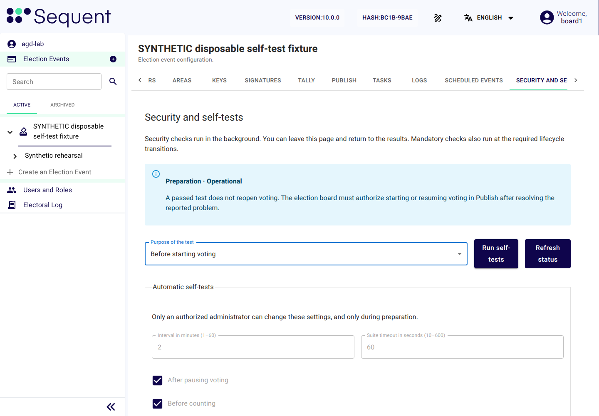
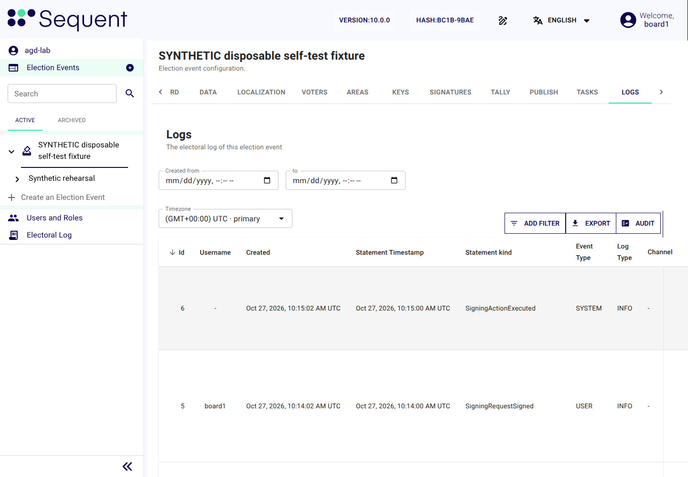
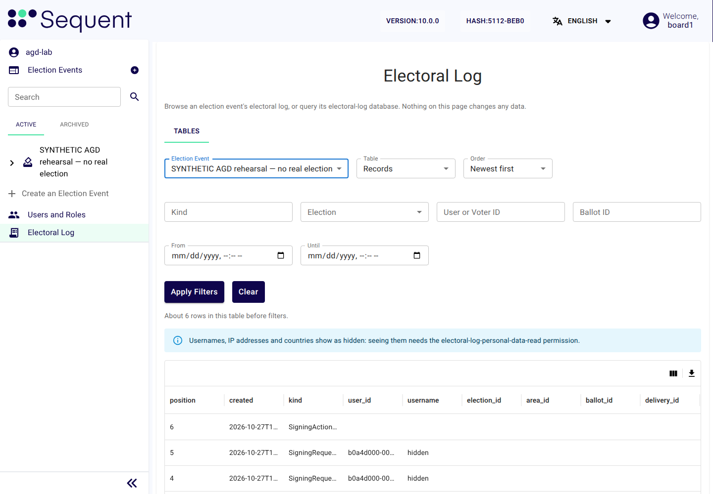

<!--
SPDX-FileCopyrightText: 2026 Sequent Tech Inc <legal@sequentech.io>
SPDX-License-Identifier: AGPL-3.0-only
-->

In the execution phase the voters cast their votes. The election board starts
the election execution, monitors it, interrupts and resumes it when needed, and
terminates it.

## Starting the election execution

Voting opens only within the approved election period, after initialization,
empty-box checks and the six required security checks. Open the election event's
tab "Security and self-tests" to review the current phase, the security state and
the section "Recent self-test runs". A queued task is not a passed test.
See [Security and Self-Tests](../04-administrator_handbook/07-self_tests.md).

**At the scheduled start.** The election dates of the configuration package
contain the scheduled event "Start Voting Period" for the election period
start time. When it is reached:

- the TOE requests the tests with the purpose "Scheduled election start", and opens
  voting only after they pass and the other opening prerequisites hold;
- if a test fails, the board investigates and authorises the recovery; a later pass
  does not resume the election event by itself;
- after a failure or during a board pause the TOE refuses the scheduled start, and
  voting reopens only through the election board;
- a ballot box that is not empty stops the start, and the election event enters
  maintenance mode with the reason "Ballot box not empty at the start of the election".

**With the button "Start Voting".** If the electoral regulation has the election board
open voting itself:

1. On the election event's tab "Security and self-tests", in the field "Purpose of
   the test", select "Before starting voting", then select the button "Run self-tests".
   Wait for all six checks to show the result "Passed". To open a further election
   once voting has opened for another one, select "Before resuming voting" instead:
   the phase is then already "Election execution". At or after the approved start
   time, open its tab "Publish" and select the button "Start Voting".

   

   *Illustration: the tab "Security and self-tests" of a synthetic election event,
   as a board member sees it. The self-test settings are read-only for the board.*

2. Read the dialog "Confirm Action", which asks whether you want to start the voting
   period, and select the button "Confirm". If the admin
   portal sends you to the external authentication server, log in there again
   (see [Confirming an action by authenticating again](04-secure-use.md#confirming-an-action-by-authenticating-again)).
3. The TOE creates a signing request for the protected action "Open voting". Each required board
   member authenticates again at the external authentication server and
   signs.
4. Inspect the voting status and the current security state. If the request
   says another test is needed, let that task finish, review all six results
   and authorize a fresh opening request. A missing or expired test cannot
   be bypassed with an earlier signature.

Opening checks are short-lived and bound to the current election event state.
Changing that state or waiting more than five minutes requires a fresh check.

After the start, check that:

- the tab "Security and self-tests" shows the phase "Election execution" and the
  state "Operational", and the tab "Publish" shows the elections as open;
- the election event's tab "Logs" has the opening record
  (`ElectionVotingPeriodOpen` or `ElectionEventVotingPeriodOpen`) with its time
  and, for a start by the board, the records `SigningRequestSigned` of the board
  members who authorised it;
- all six current self-test results show "Passed" and their completion time
  is within the configured interval.

*Illustration: the tab "Logs" of a synthetic election event, with its buttons
"Export" and "Audit", below the header of the admin portal, beside the side menu
and among the tabs of the election event.*

If the election event enters maintenance mode instead, follow
[Maintenance mode](12-modes-and-failures.md#maintenance-mode).

## Monitoring the election event

At least one board member watches the election event throughout the execution
phase, and checks the following at least once in every configured self-test interval:

| Where | What to look at | Act when |
|---|---|---|
| The election event's tabs "Dashboard" and "Publish" | Election voting status, turnout and ballot boxes | An unexpected state, count or seal; use the tab "Security and self-tests" for the authoritative phase and recovery reason |
| The election event's tab "Security and self-tests" | Current phase, security state, six results and their times | The state "Recovery required" or "Unrecoverable failure", any failed, missing or expired result, or a status-read error |
| The election event's tab "Dashboard", in the dashboard "Attack detections" | Brute-force attempts on accounts and denial-of-service attempts on the external interfaces | Any detection |
| The election event's tab "Logs", or the screen "Electoral Log" in the side menu | The audit records of the election event (see [Security-Relevant Events for the Election Board](11-security-relevant-events.md)) | Any record of a kind listed there as security-relevant |
| Email | Notices from the TOE to the election board, for example on maintenance mode or on the audit storage threshold | Any notice |

The events to act on, with what to do, are in
[Security-Relevant Events for the Election Board](11-security-relevant-events.md).

On the tab "Logs", the column "Statement kind" shows the kind of each record. The
TOE's notices about its own state, such as `MaintenanceModeEntered` or
`PotentialAttackDetected`, have the kind `LifecycleSecurityEvent`, and their column
"Description" starts with that name.

The screen "Electoral Log" in the side menu reads the same records; without the
permission "Read Electoral Log Personal Data" (`electoral-log-personal-data-read`) it
shows usernames, IP addresses and countries as hidden. It needs the
permission "Browse Electoral Log" (`electoral-log-console-read`). Select the
election event in the selector "Election Event" and what to read in the selector
"Table". Narrow the list with the filters "Kind", "Election", "User or Voter ID",
"Ballot ID", "From" and "Until", and open a row to see the whole record.

| Selector "Table" | What it lists |
|---|---|
| "Records" | The audit records of the election event |
| "Ballots" | The accepted ballots, without their content |
| "Voters" | The voters and how many times they voted |
| "Sequencer Queue" | The ballots waiting to be written to the electoral log |

*Illustration: the screen "Electoral Log" with the synthetic records of a v10.0.0
election event.*

## Self-test results

Expand the latest entry in the section "Recent self-test runs" on the election event's tab
"Security and self-tests". Check its purpose, completion time and all six named results:
ballot-box integrity, approved election data, audit recording and integrity,
trusted HTTPS channels, approved access-control configuration and clock
synchronization. Each row includes the result and details.

The result "Earlier election state" means that an old result cannot authorize the
current transition. The results "Queued or running" and "Not completed" are not
successful. If the page cannot refresh its status, do not act on old displayed data.

## Running a self-test on request

To run a self-test on request:

1. Open the election event's tab "Security and self-tests".
2. In the field "Purpose of the test", select "On request".
3. Select the button "Run self-tests" once. The request queues background work; you
   may leave the page while it runs.
4. Return and select the button "Refresh status". Review the six completed results and their
   details. Investigate any failure before deciding how to continue.

Runs with the purpose "On request" do not replace the purpose-specific checks required before
starting, resuming or, when configured, counting. The separate audit with the
button "Audit" on the election event's tab "Logs" remains available for a detailed
audit of the electoral log.

## Verifying the TOE software

The section "TOE software integrity" of the election event's tab "Security and
self-tests" compares the software running on the servers with the accepted TOE
delivery. It is separate from the six self-tests, and its result does not open or
resume voting. It needs the permission "Self-tests: run checks" (`self-test-run`),
which board members and administrators hold. The administrators run it before the
board approves a configuration version, and also compare the value "SHA-256 of the
accepted digest list" with the one the operators gave them
([Verify the TOE software](../04-administrator_handbook/07-self_tests.md#verify-the-toe-software)).
A board member runs it before voting first starts and whenever the board doubts the
software.

To verify the TOE software, select the button "Verify the TOE software". It changes
to "Verification queued or running", and you may leave the page. Then read the
result:

| Result | What it means | What the election board does |
|---|---|---|
| "Matches the accepted delivery" | The parts of the TOE on the servers run the accepted software. The security state does not change. | Nothing. |
| "Differs from the accepted delivery" | A part of the TOE on the servers is not the accepted one. The election event enters maintenance mode with the reason "TOE software differs from the accepted delivery". | Act as in [Security-Relevant Events for the Election Board](11-security-relevant-events.md) and follow [Maintenance mode](12-modes-and-failures.md#maintenance-mode). |
| "Could not verify" | The section gives the reason. The security state does not change. This is not a match. | Have the operators correct the cause, then verify again. |

The electoral log records each result, as the record `TsfIntegrityCheck`.

## Interrupting the election execution

The election board interrupts the election execution when the electoral
regulation calls for it, for example because of a suspected attack or a
problem reported by voters. To interrupt the election execution:

1. On the election event's tab "Publish", select the button "Pause Voting".
2. Read the dialog, which asks whether you want to pause the voting period, and
   select the button "Confirm". If the admin portal sends you to the
   external authentication server, log in there again.
3. Voting is suspended: no voter can open or continue an election action. The
   election event's tab "Logs" shows the interruption record (`ElectionVotingPeriodPause` or
   `ElectionEventVotingPeriodPause`).

The election event stays in the execution phase. Record the reason and the
time in the board's minutes, and tell the election organizer, which announces the
interruption to the voters through its own channels.

## Maintenance mode

The TOE puts the election event into maintenance mode by itself when it finds a
recoverable failure. In the execution phase voting is then suspended, and the
election event's tab "Security and self-tests" shows the state "Recovery required"
with the reason. The TOE records the transition and queues email to the election
board and the administrators. Check the area "Security email delivery" of that tab;
a queued message does not
prove it has arrived. What to do is in
[Maintenance mode](12-modes-and-failures.md#maintenance-mode).

The operators ask the board before they restart a failed server component during the
execution phase
([Restart an authorized failed component](../../05-reference/06-deployment_guide/11-selftest_handover.md#restart-an-authorized-failed-component));
write the decision in the board's minutes.

## Resuming the election execution

The election execution is resumed only by the election board, and only when:

- the cause of the interruption or of maintenance mode has been found and
  removed;
- the resumption is still within the time frame that the electoral regulation
  sets for continuing an interrupted election execution;
- the board has decided to resume under the electoral regulation.

To resume the election execution:

1. Review the reason and what the investigation found. On the election event's tab
   "Security and self-tests", in the field "Purpose of the test", select "Before
   resuming voting", then select the button "Run self-tests". Wait for all six
   results to show "Passed" for the current state.
2. Select the individual election, open its tab "Publish", and select the button
   "Start Voting", then the entry "Start Online Voting". The same control resumes a paused
   channel. Review the confirmation and confirm once.
3. The TOE creates a signing request for the protected action "Open voting". Each required board
   member authenticates again at the external authentication server and
   signs.
4. Check the phase "Election execution" and the state "Operational" on the tab
   "Security and self-tests", and confirm that both the election event's online
   status and the selected election's online status are "Open". Resuming that
   election also reopens the election event; other paused elections remain paused
   until separately authorized. When leaving maintenance mode, find the record
   `MaintenanceModeLeft` on the election event's tab "Logs". A further run with the
   purpose "After maintenance" starts automatically; investigate any failure.

If the time frame for continuing has passed, do not resume: terminate the
election execution and decide under the electoral regulation how the
election event continues.

## Terminating the election execution

The election execution ends at the end of election time, or earlier when the
election board terminates it.

**At the scheduled end.** The election dates contain the scheduled event "End
Voting Period" for the end of election time. When it is reached, the TOE closes
voting by itself. The election event's tab "Dashboard" then shows the text "Closed
by the scheduled close of polls."

**With the button "Stop Voting".** Termination is a security-critical action. To terminate
the election execution:

1. On the election event's tab "Publish", select the button "Stop Voting".
2. The TOE shows the confirmation notice, the dialog "Confirm Action", which says
   that the ballot boxes are then sealed, so that no ballot can be added, changed
   or deleted, and that voting cannot start again. Read it and select the button
   "Confirm". If the admin portal sends you to the external authentication server, log
   in there again.
3. The TOE creates a signing request for the protected action "Close voting". Each required board
   member authenticates again at the external authentication server and
   signs.
4. The TOE closes voting. The election event's tab "Dashboard" shows the text
   "Closed by …" with the names of the signers and the signing code.

In both cases the TOE then seals the ballot boxes. Turn on the switch "Show ballot
boxes" on the tab "Dashboard": the status of each ballot box goes from "Sealing now"
to "Sealed, publishing" and then "Sealed". The election event is now in the evaluation phase.

:::warning
- Termination cannot be undone: voting cannot start again in a closed
  election. Check before you confirm that the end of election time has been
  reached or that the electoral regulation calls for the termination.
- If the status of a ballot box is "Not sealed: incident" or stays "Sealing overdue",
  follow [A ballot box is not sealed](12-modes-and-failures.md#a-ballot-box-is-not-sealed).
:::
