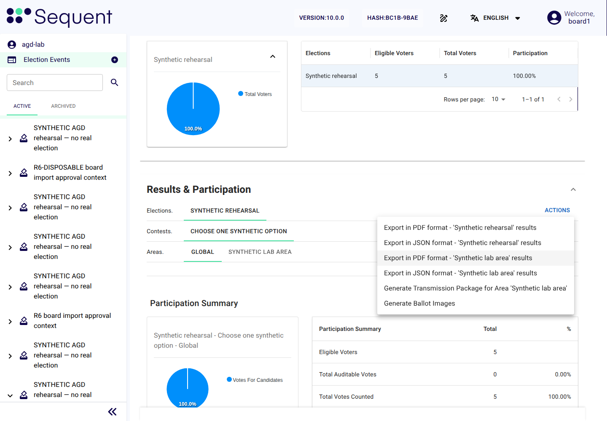

<!--
SPDX-FileCopyrightText: 2026 Sequent Tech Inc <legal@sequentech.io>
SPDX-License-Identifier: AGPL-3.0-only
-->

After the termination of the election execution the election event is in the
evaluation phase. The election board checks the audit records, counts the votes
and determines the result. It then moves the election event to the
post-processing phase, where it downloads and hands over the verification data,
exports the election execution data and finally deletes it. An archived election
event stays in the preparation phase, and the board exports and deletes its data
there.

## Checking the audit records

At the beginning of the evaluation phase, before the votes are counted, the
election board (or a board member it appoints) checks the audit records of the whole
election event. To check the audit records:

1. On the election event's tab "Logs", select the button "Audit". The dialog "Audit
   electoral log" says that the audit checks every log entry and the published
   checkpoints, and that the result is recorded as a task. Select its button
   "Audit".
2. On the election event's tab "Tasks", wait for the task "Audit Electoral Log". It
   must end successfully. A failed task lists its findings in its logs.
3. Read the records on the tab "Logs", or on the screen "Electoral Log" in the side
   menu, for the whole preparation and execution phases. Check at least:
   - every opening, interruption, resumption and termination
     (`ElectionVotingPeriodOpen`, `ElectionVotingPeriodPause`,
     `ElectionVotingPeriodClose` and their `ElectionEvent…` forms) matches a
     decision of the board or the election dates;
   - each interruption the operators reported to the board
     ([Operating the servers](../../05-reference/06-deployment_guide/11-selftest_handover.md#operating-the-servers))
     has its cause and the board's
     decision in the board's minutes; compare the records `MaintenanceModeEntered`,
     `MaintenanceModeLeft` and `ElectoralPhaseChanged` (of the kind
     `LifecycleSecurityEvent`, with the name at the start of their description)
     with the board's minutes;
   - the required self-test runs completed successfully for the relevant
     election event state, and every failed, missing, delayed or expired run was
     investigated; check the separate electoral-log audits as well;
   - every ballot box has a `BallotBoxSealed` record, and there is no
     `BallotBoxSealFailed`;
   - there is no record `PotentialAttackDetected`, `AuditStorageThresholdExceeded`
     or `AuditStorageObservationUnavailable` without an explanation, and the
     dashboard "Attack detections" on the election event's tab "Dashboard" shows
     nothing unexplained;
   - every security-critical action was authorised by the required number of
     different board members (the `Signing…` records), and every refused,
     cancelled or failed signing request (`SigningSignatureRefused`,
     `SigningRequestCancelled`, `SigningCertificateOpenFailed`) is explained;
   - no change of signing rules, permissions, issuers or certificate checks
     (`SigningRuleChanged`, `SigningPermissionChanged`, `SigningIssuerChanged`,
     `SigningChecksChanged`) happened after the preparation phase;
   - there is no election event under the side menu's tab "Active" that the board
     did not import; the `Signing…` records of an import are on the tab "Logs" of the
     approval event;
   - the failed logins in the `KeycloakUserEvent` records show no pattern of
     attack.
4. To keep the records with the board's minutes, export them with the button
   "Export" on the tab "Logs", which asks for the period, the time zone and the
   format, CSV or PDF. This needs the permission "Export Logs" (`logs-export`).
5. Write the result of the check in the board's minutes.

:::warning
If the audit task fails or a record shows an event that the board cannot
explain, do not count the votes yet. Treat it as a security-relevant event and
decide under the electoral regulation whether the election event can be evaluated.
The export of the records contains personal data of voters and board members:
keep it confidential.
:::

## Counting the votes

Counting is a protected board operation. The TOE checks the evaluation phase,
the required board authorization, trustee custody and the tally prerequisites.
When the additional condition "Before counting" is selected in the self-test
settings, a run with that purpose must also have passed at most five minutes before
the board's request, and must still be the latest finished run when counting
executes. Trustee custody and later report
signatures do not replace the board's authorization to start counting.

Before you start, check that:

- the election event is in the evaluation phase;
- on the tab "Dashboard" of each election to count, the status of every ballot box
  is "Sealed": an election can be counted only once every ballot box is sealed and
  its seal record is published;
- the audit records have been checked;
- both trustees are present with their own encrypted media and access to the
  controlled offline workstation (which they may use in turn), and their
  instances of the trustee server are running (the operators confirm it).

A recount is not available in the evaluated configuration. The TOE refuses a results
tally of an election that a results tally already counted, with the message
"Election …: its results are already counted, and a recount is not available.", and
of an election that a results tally has not finished counting, with the message
"Election …: a results tally of it has not finished. Wait until it finishes, or
cancel it.". In both, … is the election's identifier. The TOE refuses in step 3
below, before the board is asked to sign. After a failed or cancelled tally, start
a new one.

To count the votes:

1. On the election event's tab "Tally", select the button "Start Tally Ceremony".
2. In the section "Key Ceremony", select the key ceremony of the election event. In
   the section "Elections to Tally", select the elections to count.
3. Select the button "Start Tally Ceremony". Confirm the dialog with its button "Ok":
   it says that the ceremony asks the trustees to submit public custody proofs, and
   that their instances of the trustee server must stay active.
4. If the TOE answers with the message "The configured before-counting self-test has been
   requested. Wait for all six checks to pass, then authorize counting again.",
   wait for all six results and select the button "Start Tally Ceremony" again.
5. Complete the displayed signing request with the required distinct board
   members, before the request expires. The original requester selects
   the button "Continue operation" when the request is complete. If another self-test
   finished in the meantime, the TOE gives the answer of step 4 and keeps the
   signatures: act as in step 4. If a test failed, these signatures no longer count:
   the TOE cancels the request at the next attempt, and the tab "Security and
   self-tests" shows the state "Recovery required". In the evaluation phase the state
   stays so, because only opening voting returns it to "Operational"; it does not stop
   the counting. Have the cause found and removed
   ([Returning to a secure state](12-modes-and-failures.md#returning-to-a-secure-state),
   steps 1 and 2), write the board's decision in the board's minutes, and start again
   from step 3, which requests a new run with the purpose "Before counting". After the
   state "Unrecoverable failure" the TOE refuses the counting
   ([An unrecoverable failure](12-modes-and-failures.md#an-unrecoverable-failure)).
6. Each trustee authorises the counting with their keys, as
   [Authorising the counting](09-trustee-procedures.md#authorising-the-counting)
   describes. The section "Trustees" shows how many trustees have confirmed custody
   and how many are needed.
7. When enough trustees have confirmed, select the button "Start Tally", and confirm
   the dialog with its button "Start Tally".
8. The TOE checks every ballot box against its seal, then the trustees mix and
   decrypt the votes and the TOE determines the result. The section "Elections
   Tally Progress" shows the progress.
9. When the tally is complete, the result appears in the section "Results &
   Participation".

:::warning
The tally ceremony runs only as a manual ceremony and starts only with the
trustees' authorisations. Stop, and treat it as a security-relevant event, if:

- the wizard offers the button "Start Tally" before any trustee has confirmed
  custody, or shows the message "Select Start Tally to run tally process and display
  results, or Close to cancel." (an automatic ceremony);
- a trustee is shown as having confirmed custody who did not do so;
- the TOE reports that a ballot box does not match its seal.

In each case select the button "Cancel Tally" if the tally has not started, and do not
publish any result.
:::

## Checking and publishing the result

To check and publish the result:

1. Check the result in the section "Results & Participation" for each election: the
   number of eligible voters, the number of votes, the votes counted, valid
   and invalid, and the votes of each candidate. The number of votes counted
   must agree with the column "Counted" of the table of ballot boxes (the switch
   "Show ballot boxes" on the election's tab "Dashboard").
2. Open the menu "Actions" for the election result. A report marked "awaiting
   signatures" is held until its own approval is complete. Select the entry "Open the
   signing request", review the document and configuration revision, and have
   the required distinct board members sign with their personal certificates.
   Repeat for each required area report; approving the election report does
   not approve its area reports.
3. Reopen the menu "Actions" and select the entry "Export in PDF format - '…' results" for
   the report you approved. Check the downloaded PDF's signatures, signer identities,
   configuration revision and totals. If it still says "awaiting signatures",
   check the request's approvals and any refused certificate check. If the
   request has completed but the PDF is unavailable, ask the operators to
   investigate before publishing it.
4. Generate any additional reports the electoral regulation requires. The
   required board members sign each report (protected action "Generate other
   election reports"). The evaluated configuration keeps each
   report's setting "Encryption Policy" at "Unencrypted": no requirement needs
   encrypted reports, and reading one needs a command outside the admin portal.
5. The election board determines the result and records it, with the signed
   reports, in the board's minutes. The election organizer announces it through its
   own channels, after the board has checked the verification data
   ([Downloading the verification data](#downloading-the-verification-data)). The
   evaluated configuration has no results website: the results portal is not deployed,
   and no role holds the permission "Edit Results Publication"
   (`publish-results-write`), so the section "Publish to results website" is never
   available. If it is offered, do not use it, and treat it as a security-relevant
   event.

*Illustration: a synthetic election event. The election and area PDFs became
available after their separate approvals; use your election's expected totals
and authorised signers when checking your own reports.*

After the tally, select the button "Audit" on the tab "Logs" once more, as in
[Checking the audit records](#checking-the-audit-records), and check that the
new task "Audit Electoral Log" on the tab "Tasks" ends successfully. Record the
result in the board's minutes.

## Starting post-processing

Who: a board member. Phase: the evaluation phase. Permission: "Edit Election State"
(`election-state-write`). To start the post-processing phase:

1. On the election event's tab "Security and self-tests", confirm that the phase is
   "Evaluation". Confirm also that every election either has a successfully
   completed results tally, or can never have one because the seal of one of its
   ballot boxes failed (status "Not sealed: incident") and none of its ballot boxes
   is still "Sealing at …", "Sealing now", "Sealing overdue" or "Sealed,
   publishing". A failed results tally does not count. Otherwise the TOE refuses the
   phase change, and the admin portal shows the message "The request was refused or
   could not be completed. Refresh the status and review the election state before
   trying again.".
2. Select the button "Start post-processing". Read the notice in the dialog, which
   says that this phase change cannot be undone.
3. If you are sent to the external authentication server, authenticate again, return
   and select the button "Confirm phase change".
4. Check that the phase is "Post-processing". Further counting and reopening
   voting are refused.

After an unrecoverable failure ([An unrecoverable failure](12-modes-and-failures.md#an-unrecoverable-failure)),
first terminate the election execution. The button "Start post-processing" then
works in the evaluation phase without a completed result, so that the board can
export the data for the investigation. The electoral log records this exception; it
does not turn a failed election event into a valid result or allow it to resume.

## Downloading the verification data

Who: a board member. Phase: the post-processing phase. Permission: "Admin Ceremony"
(`admin-ceremony`).

Download the verification data after starting post-processing and before the
export. Each download is recorded, and a record made after the export makes that
export obsolete for the deletion
([Deleting the election execution data](#deleting-the-election-execution-data)).
Check the verification data before the election organizer announces the result.

Open the completed results tally from the election event's tab "Tally". In the
section "Election verification", each listed protocol board represents one batch.
For every batch, write the full values "Configuration hash" and "Tally ID" of that
protocol board's section in the board's minutes, then select its button "Download
verification data". Before the post-processing phase the TOE refuses the download,
and the admin portal shows the message "Verification data can be downloaded once
post-processing has started.". Each selection of the button exports the file anew
and creates the record `VerificationDataExported`, with the SHA-256 hash of the
downloaded file. Fetching an exported file again also counts as a download: it
creates the record `VerificationDataDownloaded`. Each of these records also sends an
email to the administrators and the board members
([Email notifications](12-modes-and-failures.md#email-notifications)). The button
does not export initialization reports or key-ceremony-only data.

Each `verification-<protocol-board UUID>.json` file contains the public protocol
messages for that batch's key generation, mixing and decryption. Its trusted
anchors are the two values written in the board's minutes; do not take them from
the downloaded file. The displayed value "Tally ID" is that protocol-board UUID written as a complete unsigned decimal
number, not the tally-session ID. Keep every file paired with its own anchors
in the board's minutes.

Verify every expected batch with the election verifier
([Running the election verifier](10-election-verifier.md#running-the-election-verifier))
and hand all files with their anchors to the election organizer, which publishes
them in the post-processing phase
([Publishing the verification data](10-election-verifier.md#publishing-the-verification-data)).
A successful check of one batch does not verify the complete tally.

## Reading the cast votes and the voters' register

The admin portal has no screen that shows the content of a cast vote. The export
holds the cast votes in encrypted form: those that entered the counting in the tally
evidence, and those of each ballot box that no results tally counted in their own
folders
([Exporting the election execution data](#exporting-the-election-execution-data)).
The tally archive of a results tally holds its decrypted ballots: the entry "Export
in TAR_GZ format - '…' results" of the menu "Actions" of the section "Results &
Participation" on the tab "Tally" downloads it. The TOE serves it only in the
post-processing phase; before, the admin portal shows only its progress indicator.

To read the voters' register in the post-processing phase:

1. Open the election event's tab "Voters".
2. The TOE creates a signing request for the protected action "Read the voters' register in
   post-processing": review its scope; the required distinct board members sign.
3. The member who started it selects the button "Continue operation". That member
   then has five minutes for register counts, pages and individual records in this
   election event; a different reader, changed election data or an expired session
   needs a new approval.

Revealing secret fields and exporting remain separately protected. Read only what
the electoral regulation permits, and write the reason in the board's minutes.

## Exporting the election execution data

The export keeps the election execution data (the cast votes, the electoral
log, the tally and results data and the voting records) for the time that the
electoral regulation fixes. Perform it in the post-processing phase, after the
download of the verification data
([Downloading the verification data](#downloading-the-verification-data)), or, for
an archived election event, in the preparation phase; the TOE refuses it in any other
phase. The TOE requires the permission "Export election execution data"
(`election-execution-export`) and the required board signatures. The approval binds
the current election data. To export the election execution data:

1. On the election event's tab "Data", select the button "Export". For an archived
   election event, first select it under the side menu's tab "Archived". The dialog
   "Export Election Event" opens.
2. The dialog has no options: the export always holds the complete election
   execution data in a file encrypted with a password. Read what the dialog says the
   archive includes; the private keys of the trustees and of the protocol manager
   are excluded.
3. If the member who starts the export holds the permission "Reveal Secret Voter
   Fields", the export includes the voters' secret data in decrypted form: the
   secret fields of the voters' register and the voters' secret documents among the
   stored files.
4. Select the button "Export", review the signing request and obtain the required
   distinct board approvals. The original requester selects the button "Continue
   operation" to continue the same export.
5. The TOE generates the password of the file; nobody chooses it. The admin
   portal shows it once, under the label "Password to decrypt the file:". Write the
   password down at once on a separate medium, not in the board's minutes, and keep
   it under the control of at least two board members. Never store it with the file.
6. The export runs as the task "Export Election Event" on the election event's tab
   "Tasks". When it is complete, download the file.
7. The archive holds, in the folder `execution-integrity`, the file `manifest.json`,
   its signature `manifest.sig` and the public key `public-key.pem`. The manifest
   lists the SHA-256 hashes of the exported entries, among them the file
   `execution-security-evidence.json`: the election event's security settings, full
   self-test history with each check's result and start and completion times, the
   approved baseline, applicable attack detections, pending security notices and
   pseudonymous authentication activity. An export of the electoral log alone does
   not contain this evidence.
8. On the tab "Logs", open the record `ExecutionDataExported` and write its archive
   hash, manifest hash and public key in the board's minutes.
9. Keep at least two copies of the file on separate protected media, each
   under the control of at least two board members, and the password apart
   from them.
10. Whoever takes the file over, as the electoral regulation names them, compares
    the file's SHA-256, its manifest and its public key with these values from the
    board's minutes, not with the public key in the archive.

The ballots that a results tally counted are in the tally evidence. Each ballot box
that no results tally counted is in the archive with all its ballots, as a file
`<election ID>/<area ID>.jsonl` in one of these folders:

| Folder | Ballot boxes |
|---|---|
| `failed-ballot-boxes` | Those whose seal failed |
| `sealed-uncounted-ballot-boxes` | Those that are sealed |
| `unsealed-uncounted-ballot-boxes` | Those that have no seal |

The first line of each file describes the ballot box and its seal. Each further line
is one ballot, encrypted, with the ID of the voter who cast it.

:::warning
The export contains everything needed to reconstruct the election event, including
its confidential data. Whoever has the file and its
password has that data. Never send the file or the password by email or chat,
never keep them together, and destroy the copies when the electoral regulation
says so.
:::

## Deleting the election execution data

When the electoral regulation's retention period has ended, the election board
deletes the election execution data, in the post-processing phase or, for an
archived election event, in the preparation phase. This needs the
permission "Delete Election Event" (`election-event-delete`), which only the role
`election-board` holds.

:::warning
Deleting the election event removes its operational data and electoral log.
Signed protocol evidence and the records of authorisations, exports, security
notices and configuration revisions stay in the TOE's databases for verification
and replay prevention; no screen of the admin portal shows them.

Delete only after the export (see
[Exporting the election execution data](#exporting-the-election-execution-data))
and after the lockdown period has ended.
:::

To delete the election execution data:

1. Check that the data has been exported and that the copies are readable.
   If new records, for example a security notice or a download of verification
   data, have arrived since that export, obtain fresh board approvals and export
   again before requesting deletion.
2. In the election event's menu, select the entry "Remove this Election Event"; an
   archived election event is under the side menu's tab "Archived". Confirm the
   question "Are you sure to delete this item?". The dialog also says what the
   deletion requires: the phase, a complete current export and the board's
   approvals.
3. Review the protected deletion request. Obtain the required distinct board
   approvals; the original requester selects the button "Continue operation".
4. The TOE verifies the completed export receipt against the current data and
   lifecycle state. A missing, failed or obsolete export blocks deletion.
   Preserve the refusal and investigate; never remove seals or alter receipts
   to make deletion pass.
5. Check that the election event no longer appears in the list of election
   events, and record the deletion in the board's minutes.
6. Direct the keeper of the system backups to destroy every system backup made
   since this election event was imported, and record the destruction in the
   board's minutes: the deletion is not complete without this. A system backup holds
   the whole installation, every election event and the trustees' protocol state
   ([Create and verify the encrypted backup](../../05-reference/06-deployment_guide/11-selftest_handover.md#create-and-verify-the-encrypted-backup)),
   so check first that no other election event still needs these backups under its
   retention period; if one does, destroy them once it no longer does.

The menu entry "Archive this Election Event" keeps all data and audit records of the
election event and is not a substitute for deletion. The board uses it in the
preparation phase for an election event imported with wrong data (see
[Importing the election data](06-preparation.md#importing-the-election-data)).
An archived election event stays in the preparation phase and never opens voting,
and nothing sets it back. Its data, among it the voters' register, stays in the TOE
until the board exports and deletes it as this section describes.

The approval event never reaches the post-processing phase. The board archives
it at the end of the election event
([At the end of the election event](09-trustee-procedures.md#at-the-end-of-the-election-event))
and then exports and deletes its data as this section describes for an archived
election event; until then its data stays in the TOE. The export and the deletion
need the approval event's rules of "Export election execution data" and "Delete
election execution data"
([Prepare the first import's approval event](06-preparation.md#prepare-the-first-imports-approval-event)):
if they are not saved, have the administrators save them first.
