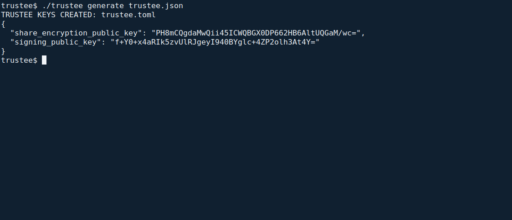
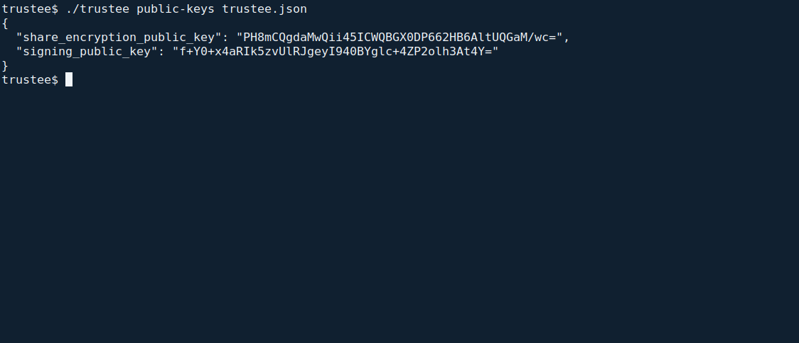
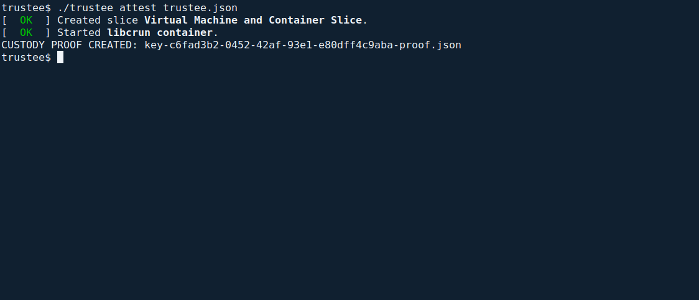

<!--
SPDX-FileCopyrightText: 2026 Sequent Tech Inc <legal@sequentech.io>
SPDX-License-Identifier: AGPL-3.0-only
-->

A trustee is a member of the election board who holds one share of the
election key. The votes can be decrypted only when at least the threshold of
trustees take part in the counting, so each trustee's care for their keys is
what keeps the votes secret.

A trustee works with two things:

- their **personal account** in the admin portal, with the role `trustee` and
  their trustee name in its field "Act as Trustee";
- the accepted **trustee tool** (`./trustee`) on their **trustee workstation**, which
  creates and holds their keys file (`trustee.toml`).

## Where the trustee runs

The trustee **server** already runs inside the protected cluster: one `braid`
instance per trustee, with its own keys and protocol state. Trustees do not need
separate servers or a permanently assigned physical computer.

The offline **trustee tool** creates keys and signs custody authorizations. It
runs the accepted `braid` image's `trustee` program, not the image's default
server command.
[Preparing a trustee workstation](../../05-reference/06-deployment_guide/08-installing_toe.md#preparing-a-trustee-workstation)
shows how to load and verify it.

### Reuse one existing workstation

Trustees may take turns on one organizer-controlled workstation. Each trustee
must retain separate encrypted media, credentials and backups; sharing the
computer never means sharing a keys file or a logged-in session.

For each turn:

1. Start from the organizer's verified offline operating environment. Keep
   networking disabled. Do not mount the workstation's ordinary data disks or
   enable persistent swap, hibernation, shell/session recording or cloud backup.
2. Unlock only your own encrypted working medium. Keep your keys file and
   generated proofs there. Do not copy another trustee's keys or mount their medium.
3. Use your own `trustee.json` configuration and the accepted `./trustee` tool.
   It mounts only your encrypted working directory and keeps networking disabled.
4. Copy out only the public keys or custody proof that the portal needs. Lock
   and remove your medium, then shut down fully before the next trustee starts
   a fresh session. Keep the device physically controlled between sessions.

A dedicated encrypted workstation per trustee is also suitable, but is not
required. If a shared device cannot provide this clean offline session,
use a separately controlled offline device. Ordinary OS user accounts alone do
not provide this separation.

### Browser trustees and the evaluated configuration

The product includes a browser page for trustees, which the evaluated configuration
does not offer: the side menu has no entry "Trustee Dashboard", and the page's
address opens an empty page. This evaluated configuration
uses the server-side `braid` component identified by the Security Target, so
browser trustees do not replace those cluster instances. The portal handles
public custody requests and signed proofs; private trustee keys stay out of it.
Use the offline tool for key generation and custody authorization. If the side
menu shows the entry "Trustee Dashboard", do not use it, and tell the administrators.

## Generating your keys

First complete [Preparing a trustee workstation](../../05-reference/06-deployment_guide/08-installing_toe.md#preparing-a-trustee-workstation).
That procedure prepares the accepted tool once and explains the small public
`trustee.json` configuration. Open a root terminal in its accepted `deployment`
folder, with only your encrypted working medium unlocked. Generate keys once:

```sh
./trustee generate trustee.json
```

Expect `TRUSTEE KEYS CREATED: trustee.toml`, followed by the two **public** keys
as JSON: `signing_public_key` and `share_encryption_public_key`. The private file
stays in the configured encrypted working directory with owner-only permissions.
The command refuses to overwrite existing keys.



*Illustration: keys generated on the encrypted working medium of a laboratory offline
VM, with synthetic data.*

To display your public keys again:

```sh
./trustee public-keys trustee.json
```



*Illustration: the two public keys of a synthetic trustee; the private keys are not
shown.*

If the command stops, follow its message: disable networking and swap, check that
your own encrypted medium is unlocked and the private directory has permissions
700. If keys already exist, use the command `./trustee public-keys`; never remove them merely to make
the command `./trustee generate` succeed. A changed image or digest requires checking the accepted
delivery again.

Give both public keys to the administrators, in person or on a medium you hand
over yourself. They register them under your trustee name
([Registering the trustees' public keys](../04-administrator_handbook/04-users_and_roles.md#registering-the-trustees-public-keys)).
Check the registered keys with them, character by character, before the key
ceremony.

## Protecting your keys file

Your keys file holds your private keys in plaintext: your signing key and the
key that decrypts the shares of the election key dealt to you. Whoever has it
can act as you in the ceremonies and contribute your share to decrypting the
votes.

- Keep it on your own protected medium: your own encrypted working medium; keep it separate from
  another trustee’s media.
- Never send it by email or chat.
- Never paste it into any web page: the steps of the admin portal take only the
  public custody request and the custody proof.
- Make two backups, in separate locked places, and keep them as securely as the
  original.
- Report the loss or exposure of the keys file or of a backup to the election
  board at once (see
  [If your keys file is lost or exposed](#if-your-keys-file-is-lost-or-exposed)).

### Handing over the keys file for your trustee server instance

Your instance of the trustee server (`braid`), the part of the TOE that takes part in the
ceremonies for you on the protected server, needs your keys file. At the
commissioning of the TOE, after you have generated your keys
([Generating your keys](#generating-your-keys)) and before the first key ceremony,
bring your encrypted medium to the operator: the installer reads the media of both
trustees in one run
([Transfer the matching keys and start the instances](../../05-reference/06-deployment_guide/08-installing_toe.md#transfer-the-matching-keys-and-start-the-instances)).
Hand the keys file over only in person and watch every step. The operators keep it
only in the cluster's encrypted secrets. No copy may stay on the operator's
devices. Your instance also keeps its protocol state on the protected
server; the operators protect and back it up
([Back up the trustee state](../../05-reference/06-deployment_guide/08-installing_toe.md#back-up-the-trustee-state)).

:::warning
A copy of your keys file anywhere else (a mailbox, a chat, a shared folder, a
web form, an unencrypted backup) can be used by someone else to take part in
the counting as you. If the threshold of trustees is reached by such copies,
the secrecy of the votes is lost.
:::

## Taking part in the key ceremony

Who: each trustee the ceremony names. Phase: the preparation phase. Permissions:
"Trustee Ceremony" (`trustee-ceremony`) and "Sign: confirm custody" (`sign-key-ceremony`),
both of the role `trustee`.

When the election board has created the key ceremony, the admin portal invites
you to take part in it. To take part:

1. Sign in with your personal account and open the election event's tab "Keys".
   With the board member who created the ceremony, check in person that its row
   shows the name and the time in the column "Started at" that the board wrote in
   its minutes, and that the member's page of the ceremony lists under the heading
   "Key Ceremony Progress" the trustees that the board decided. If anything
   differs, or the list shows a ceremony that the board did not create, stop and
   tell the board.
2. Compare the protocol manager key before you download the custody request. The
   board gives you, over a channel that does not pass through the TOE, the value
   "Protocol manager key (SHA-256)" and the board name `dkg_…` of the ceremony.
   The operators show you the log of your instance of the trustee server, on the
   screen or on a printout, with `trustee1` or `trustee2` as your instance and the
   board name in place of `BOARD_NAME`:

   ```sh
   k3s kubectl -n step-infra logs deployment/trustee1 | grep "protocol manager key SHA-256" | grep BOARD_NAME
   ```

   Find the line "session opened: Configuration accepted, protocol manager key
   SHA-256 …" for that board name, and compare all 32 pairs of the value with the
   board's, not only the first and the last. If they match, write down the date,
   the board name, the value and who compared, and select the ceremony's key
   action. If they differ, or there is no such line, do not create or upload a
   custody proof for this ceremony, and tell the board; the operators keep the
   log.
3. The page "Trustee Key Ceremony" says that you participate as a trustee and
   shows your trustee name. Check that it is yours.
4. Select the button "Download Custody Request". The admin portal shows the message
   "Public custody request downloaded successfully." The file
   `<trustee name>-custody-request.json` (your trustee name, with spaces and
   special characters replaced by "-") is public: it holds identifiers and
   your registered public keys.
5. Select the button "Next". The dialog "Back Up Your Local Trustee Keys" asks you to
   back up the file `trustee.toml` in at least two secure locations. Tick the boxes "First backup
   secured" and "Second backup secured" only when both backups exist, then select the
   button "Confirm Backups and Continue".
6. Move the downloaded public request into your own encrypted working directory.
   The portal shows three short public configuration fields. Copy their values
   into your file `trustee.json`: `request_file`, `proof_file` and `tally_session_id`.
   For the key ceremony, `tally_session_id` must be `null`. Keep your existing
   working directory and private-key filename. From the accepted tool folder, run:

   ```sh
   ./trustee attest trustee.json
   ```

   Expect `CUSTODY PROOF CREATED:` followed by the configured proof filename.
   A missing request, a mismatched trustee key or an existing proof file stops
   the command. Check the current ceremony request and your own medium; for an
   existing output, choose a new `proof_file` name without deleting the old proof.

   

   *Illustration: the offline VM creating a proof for a laboratory key ceremony, with
   synthetic data. Your ceremony identifier and configured filename will differ.*

7. Move the new public proof back. On the step "Confirm Trustee Custody",
   upload it. The admin portal checks the proof when you select the file.
   Sign it with your signing certificate (protected action "Confirm custody (key
   ceremony)").
8. The admin portal shows the message "Trustee custody confirmed successfully." On
   the tab "Keys", your row shows a tick in the column "Custody Confirmed".

Keep the file `<trustee name>-custody-request.json` on your encrypted working medium: you need
it again for the counting.

If the admin portal shows the message "Invalid custody proof, please try again", check that
you used the request of this ceremony and your own keys file, and create the
proof again. A proof is valid only for its election event, ceremony and
trustee.

## Authorising the counting

Who: each trustee the tally needs. Phase: the preparation phase for an initialization
report, or the evaluation phase for counting the votes. Permissions:
"Trustee Ceremony" (`trustee-ceremony`) and "Sign: authorize tally custody" (`sign-tally-key`),
both of the role `trustee`.

When the election board has created the tally ceremony, the admin portal invites
you to take part in it. Check its
purpose with the board: an initialization report checks that the ballot box
is empty before voting; an electoral-results tally counts votes after voting
has closed. Both require a new custody proof bound to their own tally.
To authorise the tally:

1. Sign in with your personal account, open the election event's tab "Tally" and
   select the tally's action.
2. In the section "Trustees process", compare the displayed tally identifier with the
   tally the board announced. The portal shows the public fields to use in
   the file `trustee.json`: your saved `request_file`, a new `proof_file` for this tally,
   and the exact `tally_session_id` in quotes. Copy those three values into your
   own offline configuration. Keep your working directory and keys unchanged.
3. On the offline workstation, open a root terminal in the accepted tool folder
   and run the same short command:

   ```sh
   ./trustee attest trustee.json
   ```

   Expect `CUSTODY PROOF CREATED:` and this tally's proof filename. The command
   never replaces an existing proof. If it stops, check the request, your own
   keys and the new output filename. Do not substitute another tally identifier.

4. Upload the new public proof named by the command. Sign it with your signing
   certificate (protected action "Authorize tally custody (tally)").
5. Check that the section "Trustees" of the tally counts your confirmation.

A tally proof is bound to its tally: a proof from the key ceremony or from
another tally is not accepted.

:::warning
Authorise only a tally that the election board decided. For counting votes,
this must be in the evaluation phase, after voting has closed and the audit
records were checked. For an initialization report, this must be in the
preparation phase, after the configuration was approved and before voting
starts. If the purpose, phase or identifier does not match, do not run the
command and tell the election board.
:::

## What trustees never do

- Do not use the entry "Trustee Dashboard" if the side menu ever shows it
  ([Browser trustees and the evaluated configuration](#browser-trustees-and-the-evaluated-configuration)):
  that page would handle your keys in the browser.
- Do not use any device other than an organizer-controlled one prepared as
  [Reuse one existing workstation](#reuse-one-existing-workstation) and
  [Preparing a trustee workstation](../../05-reference/06-deployment_guide/08-installing_toe.md#preparing-a-trustee-workstation) describe.
- Do not tick the backup confirmations without real backups.
- Do not give your keys file, its backups or your signing token to another
  trustee or board member, except as described in
  [A trustee leaves](03-board-roles-and-permissions.md#a-trustee-leaves).

## If your keys file is lost or exposed

To handle the loss or exposure:

1. Tell the election board at once, with the time and what happened.
2. The election board treats it as a security-relevant event and records it in the
   board's minutes.
3. If a keys file is lost, restore it from a backup, only on the trustee
   workstation: both trustees are needed to count the votes.
4. If a keys file may have been exposed, the board decides under the
   electoral regulation. Before the execution phase the safe course is a new
   key ceremony with new keys for every trustee. After the start, the board
   weighs whether enough shares may be known to others to reach the threshold.

## At the end of the election event

The trustee keys are needed until the votes are counted. After the tally and the
export
([Exporting the election execution data](08-evaluation-and-post-processing.md#exporting-the-election-execution-data)),
the election board decides when they are destroyed and writes its instruction in
the board's minutes. Once they are destroyed, no election event of the
installation can be counted with them. Then:

1. A board member archives the approval event, as for a wrong import
   ([Importing the election data](06-preparation.md#importing-the-election-data)):
   the operators' command refuses while any election event of the installation is
   neither in the post-processing phase nor archived.
2. The operators destroy the keys and the protocol state of both trustee server
   instances, with the board present
   ([Remove the trustee keys at the end of the election event](../../05-reference/06-deployment_guide/08-installing_toe.md#remove-the-trustee-keys-at-the-end-of-the-election-event)).
   Their command prints the public keys of each instance: the board compares them
   with those of the registered trustees, which an administrator shows in
   Settings > "TRUSTEES".
3. Each trustee destroys their keys file and every backup of it on the trustee
   workstation, in the presence of another board member. In a root terminal in the
   accepted `deployment` folder, with only their own encrypted working medium
   unlocked, the trustee runs:

   ```sh
   ./trustee destroy trustee.json
   ```

   For each backup, with its medium mounted, they run the same command with the
   backup's absolute path added, for example
   `./trustee destroy trustee.json /media/usb/trustee.toml`. The tool warns that
   the file is overwritten with zeros, flushed to the medium and removed, and asks
   for the phrase `DESTROY KEYS FILE`: type it. Expect, with the file's path in
   place of `PATH`, the line `destroyed the keys file PATH (… bytes) of`, the two
   public keys (`public_key:` and `share_encryption_public_key:`), the line
   `KEYS FILE DESTROYED: PATH` and the two sentences "An overwrite reaches only the
   file the file system shows: a flash medium, a journaling or copy-on-write file
   system, a snapshot or an earlier copy of the file can keep its content elsewhere
   on the medium. The election board decides what happens to the medium itself."
   The board member compares the two public keys with those that the operators'
   command printed for the trustee's instance. If the tool stops with a message
   that starts with `TRUSTEE OPERATION STOPPED:`, follow the message; if the file
   cannot be destroyed, tell the board. Two board members destroy in the same way,
   each file with its absolute path, the keys file and backups that a trustee who
   left handed over
   ([A trustee leaves](03-board-roles-and-permissions.md#a-trustee-leaves)).
4. The board directs the keepers of the backups to destroy the retained
   trustee-state backups, and the system backups as
   [Deleting the election execution data](08-evaluation-and-post-processing.md#deleting-the-election-execution-data)
   describes: a system backup holds the whole installation.

The board records each destruction in the board's minutes. The operators' command
erases no backup and no copy of the servers' disks, and destroying a file does not
erase what a storage medium may keep: the election organizer decides what happens
to the servers' disks, and the election board what happens to the trustees'
media.

A later election event on the installation needs new trustee keys. Once their
old keys file is destroyed, each trustee generates a new one
([Generating your keys](#generating-your-keys)) and gives its public keys to the
administrators, who register them under the trustee's name in place of the old
ones
([Registering the trustees' public keys](../04-administrator_handbook/04-users_and_roles.md#registering-the-trustees-public-keys)).
Before that election event's key ceremony, both trustees bring their media to the
operators, as at the commissioning
([Handing over the keys file for your trustee server instance](#handing-over-the-keys-file-for-your-trustee-server-instance)),
and the operators install the new keys files
([Install new trustee keys for a later election event](../../05-reference/06-deployment_guide/08-installing_toe.md#install-new-trustee-keys-for-a-later-election-event)).
