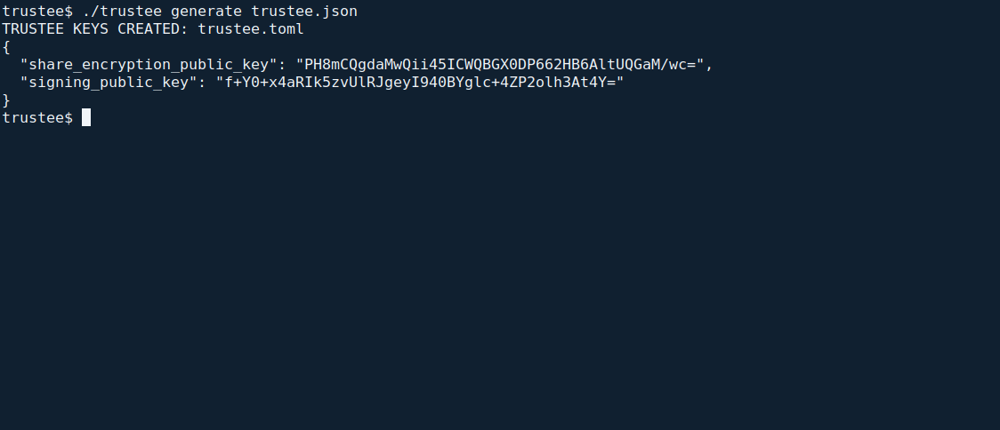
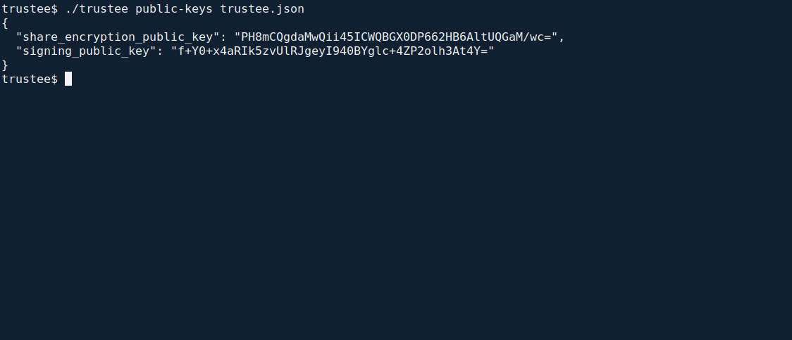
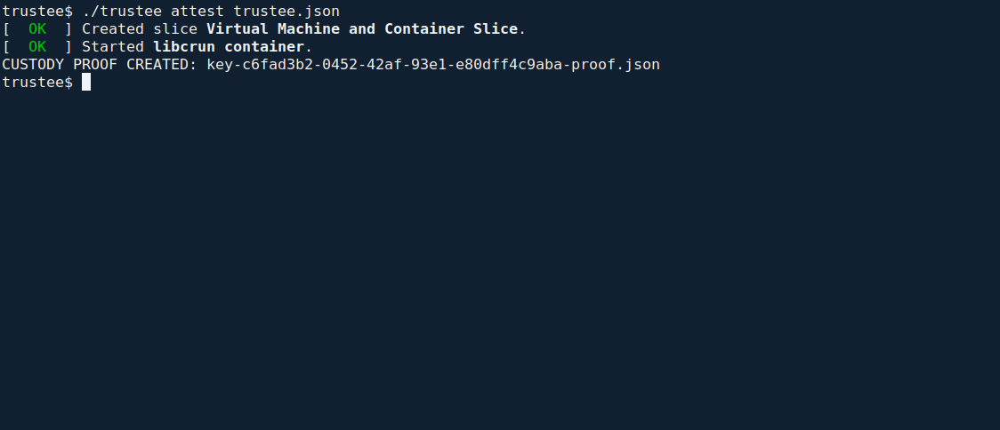

<!--
SPDX-FileCopyrightText: 2026 Sequent Tech Inc <legal@sequentech.io>
SPDX-License-Identifier: AGPL-3.0-only
-->

A trustee is a member of the election board who holds one share of the
election key. The votes can be decrypted only when at least the threshold of
trustees take part in the counting, so each trustee's care for their keys is
what keeps the votes secret.

A trustee works with two things:

- their **personal account** in the admin portal, with the role `trustee` and
  their trustee name in "Act as Trustee";
- the accepted **trustee tool** (`./trustee`) on their **trustee workstation**, which
  creates and holds their keys file (`trustee.toml`).

## Where the trustee runs

The trustee **server** already runs inside the protected cluster: one `braid`
instance per trustee, with its own keys and protocol state. Trustees do not need
separate servers or a permanently assigned physical computer.

The offline **trustee tool** creates keys and signs custody authorizations. It
runs the accepted `braid` image's `trustee` program, not the image's default
server command. The Deployment Guide shows how to load and verify it.

### Reuse one existing workstation

Trustees may take turns on one organizer-controlled workstation. Each trustee
must retain separate encrypted media, credentials and backups; sharing the
computer never means sharing a keys file or a logged-in session.

For each turn:

1. Start from the organizer's verified offline operating environment. Keep
   networking disabled. Do not mount the workstation's ordinary data disks or
   enable persistent swap, hibernation, shell/session recording or cloud backup.
2. Unlock only your own encrypted working medium. Keep your keys file and
   generated proofs there. Do not copy another trustee's keys or mount their medium.
3. Use your own `trustee.json` configuration and the accepted `./trustee` tool.
   It mounts only your encrypted working directory and keeps networking disabled.
4. Copy out only the public keys or custody proof that the portal needs. Lock
   and remove your medium, then shut down fully before the next trustee starts
   a fresh session. Keep the device physically controlled between sessions.

A dedicated encrypted workstation per trustee is also suitable, but is not
required. If a shared device cannot provide the clean offline session above,
use a separately controlled offline device. Ordinary OS user accounts alone do
not provide this separation.

### Browser trustees and the evaluated configuration

The product includes a browser **Trustee Dashboard**. This evaluated configuration
uses the server-side `braid` component identified by the Security Target, so
browser trustees do not replace those cluster instances. The portal handles
public custody requests and signed proofs; private trustee keys stay out of it.
Use the offline tool for key generation and custody authorization.

## Generating your keys

First complete [Preparing a trustee workstation](../../05-reference/06-deployment_guide/08-installing_toe.md#preparing-a-trustee-workstation).
That procedure prepares the accepted tool once and explains the small public
`trustee.json` configuration. Open a root terminal in its accepted `deployment`
folder, with only your encrypted working medium unlocked. Generate keys once:

```sh
./trustee generate trustee.json
```

Expect `TRUSTEE KEYS CREATED: trustee.toml`, followed by the two **public** keys
as JSON: `signing_public_key` and `share_encryption_public_key`. The private file
stays in the configured encrypted working directory with owner-only permissions.
The command refuses to overwrite existing keys.



To display your public keys again:

```sh
./trustee public-keys trustee.json
```



If the command stops, follow its message: disable networking and swap, check that
your own encrypted medium is unlocked and the private directory has permissions
700. If keys already exist, use `public-keys`; never remove them merely to make
`generate` succeed. A changed image or digest requires checking the accepted
delivery again.

Give both public keys to the administrators, in person or on a medium you hand
over yourself. They register them under your trustee name in Settings >
"TRUSTEES" ("Create Trustee"). Check the registered keys with them, character
by character, before the key ceremony.

## Protecting your keys file

Your keys file holds your private keys in plaintext: your signing key and the
key that decrypts the shares of the election key dealt to you. Whoever has it
can act as you in the ceremonies and contribute your share to decrypting the
votes.

- Keep it on your own protected medium: your own encrypted working medium; keep it separate from
  another trustee’s media.
- Never send it by email or chat.
- Never paste it into any web page other than the ceremony step that needs
  it. In the evaluated configuration no ceremony step needs it: the steps of
  the admin portal take only the public custody request and the custody proof.
- Make two backups, in separate locked places, and keep them as securely as the
  original.
- Report the loss or exposure of the keys file or of a backup to the election
  board at once (see
  [If your keys file is lost or exposed](#if-your-keys-file-is-lost-or-exposed)).

### Handing over the keys file for your trustee server instance

Your instance of the trustee server (`braid`), the part of the TOE that takes part in the
ceremonies for you on the protected server, needs your keys file. Hand
it over only in person, to the operator who installs it for your instance, and
watch the installation. The operators keep it only in the cluster's encrypted
secrets, as the Deployment Guide describes. No copy may stay on the operator's
devices. Your instance also keeps its protocol state on the protected
server; the operators protect and back it up as the Deployment Guide
describes.

:::warning
A copy of your keys file anywhere else (a mailbox, a chat, a shared folder, a
web form, an unencrypted backup) can be used by someone else to take part in
the counting as you. If the threshold of trustees is reached by such copies,
the secrecy of the votes is lost.
:::

## Taking part in the key ceremony

Who: each trustee the ceremony names. Phase: preparation. Permission: the role
`trustee` with "Trustee Ceremony" (`trustee-ceremony`), and "Sign: confirm
custody" (`sign-key-ceremony`) where that protected action needs signatures.

When the election board has created the key ceremony, the admin portal shows
you: "You have been invited to participate in a Key Ceremony."

1. Sign in with your personal account and open the election event's Keys tab.
   Select the ceremony's key action.
2. The page "Trustee Key Ceremony" says that you participate as a trustee and
   shows your trustee name. Check that it is yours.
3. Select "Download Custody Request". The admin portal confirms "Public
   custody request downloaded successfully." The file
   `<trustee name>-custody-request.json` (your trustee name, with spaces and
   special characters replaced by "-") is public: it holds identifiers and
   your registered public keys.
4. Select "Next". The dialog "Back Up Your Local Trustee Keys" asks you to back up
   `trustee.toml` in at least two secure locations. Tick "First backup secured"
   and "Second backup secured" only when both backups exist, then select
   "Confirm Backups and Continue".
5. Move the downloaded public request into your own encrypted working directory.
   The portal shows three short public configuration fields. Copy their values
   into your `trustee.json`: `request_file`, `proof_file` and `tally_session_id`.
   For the key ceremony, `tally_session_id` must be `null`. Keep your existing
   working directory and private-key filename. From the accepted tool folder, run:

   ```sh
   ./trustee attest trustee.json
   ```

   Expect `CUSTODY PROOF CREATED:` followed by the configured proof filename.
   A missing request, a mismatched trustee key or an existing proof file stops
   the command. Check the current ceremony request and your own medium; for an
   existing output, choose a new `proof_file` name without deleting the old proof.

   

   This capture shows the actual offline VM creating a proof for a laboratory
   key ceremony. Your ceremony identifier and configured filename will differ.

6. Move the new public proof back. On the step "Confirm Trustee Custody",
   upload it. The admin portal checks the proof when you select the file.
   If the protected action
   "Confirm custody (key ceremony)" needs signatures, sign it with your signing
   certificate.
7. The admin portal shows "Trustee custody confirmed successfully." On the Keys
   tab your row shows "Custody Confirmed".

Keep `<trustee name>-custody-request.json`: you need it again for the counting.

If the admin portal shows "Invalid custody proof, please try again", check that
you used the request of this ceremony and your own keys file, and create the
proof again. A proof is valid only for its election event, ceremony and
trustee.

## Authorising the counting

Who: each trustee the tally needs. Phase: preparation for an initialization
report, or evaluation for counting the votes. Permission: the role
`trustee` with "Trustee Ceremony" (`trustee-ceremony`), and "Sign: authorize
tally custody" (`sign-tally-key`) where that protected action needs
signatures.

When the election board has created the tally ceremony, the admin portal shows
you: "You have been invited to participate in a Tally ceremony." Check its
purpose with the board: an initialization report checks that the ballot box
is empty before voting; an electoral-results tally counts votes after voting
has closed. Both require a new custody proof bound to their own tally.

1. Sign in with your personal account, open the election event's Tally tab and
   select the tally's action.
2. Under "Trustees process", compare the displayed tally identifier with the
   tally the board announced. The portal shows the public fields to use in
   `trustee.json`: your saved `request_file`, a new `proof_file` for this tally,
   and the exact `tally_session_id` in quotes. Copy those three values into your
   own offline configuration. Keep your working directory and keys unchanged.
3. On the offline workstation, open a root terminal in the accepted tool folder
   and run the same short command:

   ```sh
   ./trustee attest trustee.json
   ```

   Expect `CUSTODY PROOF CREATED:` and this tally's proof filename. The command
   never replaces an existing proof. If it stops, check the request, your own
   keys and the new output filename. Do not substitute another tally identifier.

4. Upload the new public proof named by the command. If the protected action "Authorize
   tally custody (tally)" needs signatures, sign it with your signing
   certificate.
5. Check that the section "Trustees" ("Custody confirmation status") of the
   tally counts your confirmation.

A tally proof is bound to its tally: a proof from the key ceremony or from
another tally is not accepted.

:::warning
Authorise only a tally that the election board decided. For counting votes,
this must be in the evaluation phase, after voting has closed and the audit
records were checked. For an initialization report, this must be in the
preparation phase, after the configuration was approved and before voting
starts. If the purpose, phase or identifier does not match, do not run the
command and tell the election board.
:::

## What trustees never do

- Do not use the page "Trustee Dashboard" of the admin portal. In the evaluated
  configuration custody authorization uses the offline trustee tool; the
  server-side instance runs in the cluster. That page would handle your keys in
  the browser.
- Use only an organizer-controlled device prepared as described above.
- Do not tick the backup confirmations without real backups.
- Do not give your keys file, its backups or your signing token to another
  trustee or board member, except as described in
  [A trustee leaves](03-board-roles-and-permissions.md#a-trustee-leaves).

## If your keys file is lost or exposed

1. Tell the election board at once, with the time and what happened.
2. The election board treats it as a security-relevant event and records it.
3. If a keys file is lost, restore it from a backup, only on the trustee
   workstation: both trustees are needed to count the votes.
4. If a keys file may have been exposed, the board decides under the
   electoral regulation. Before the execution phase the safe course is a new
   key ceremony with new keys for every trustee. After the start, the board
   weighs whether enough shares may be known to others to reach the threshold.

## At the end of the election

When the electoral regulation's retention period has ended and the election
execution data has been deleted, each trustee destroys their keys file and all
its backups, in the presence of another board member, and the board records it
in its minutes. The operators remove the copy held for your trustee server
instance as the Deployment Guide describes.
