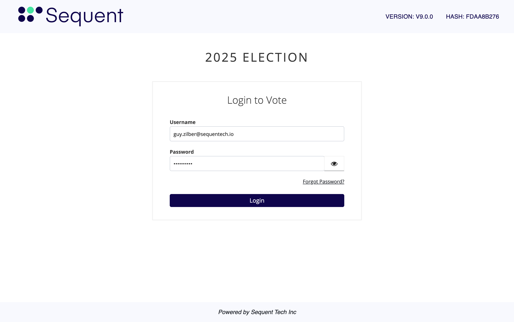
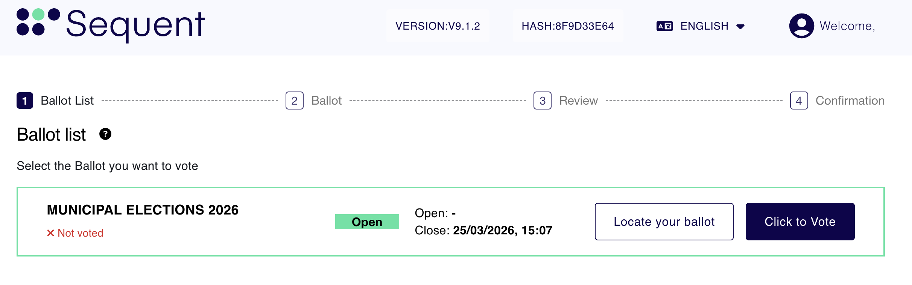
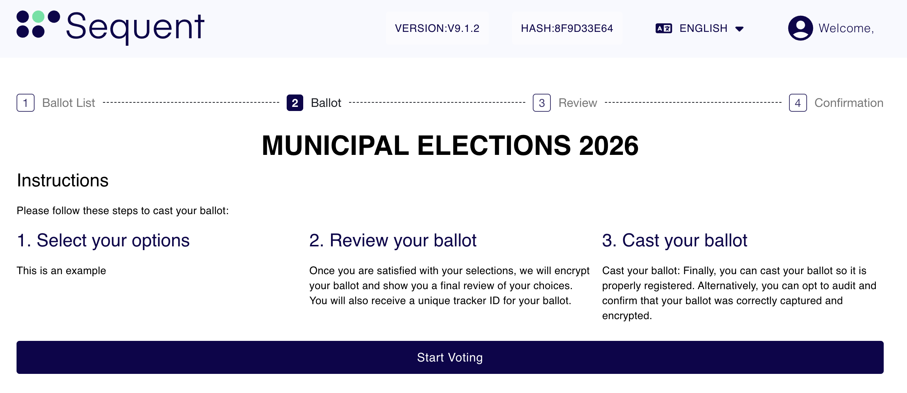
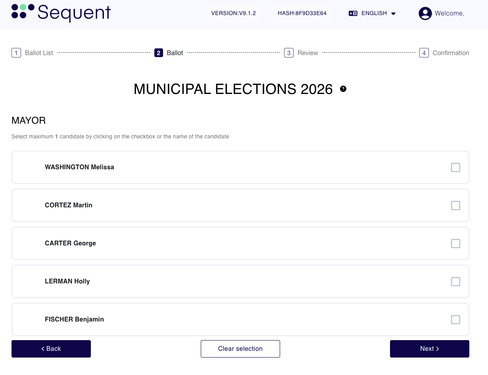

import GoogleVideo from '@site/src/components/GoogleVideo';

<!--
-- SPDX-FileCopyrightText: 2025 Sequent Tech Inc <legal@sequentech.io>
SPDX-License-Identifier: AGPL-3.0-only
-->

<GoogleVideo id="1nLAuC8ho_0QLeX2iuPdGdjb-vpdUvQqm" />

To participate in the election, follow the steps below to authenticate, select your candidates, and securely cast your ballot.

## Step 1: Login to the Voting Portal

1. Enter your login credentials (username and password).
2. Select `Login`.

:::info
**Authentication Method:** The image above shows a standard login, but your specific authentication method may vary. Refer to your specific login instructions for additional information.
:::

## Step 2: Select Your Ballot

From the dashboard, you will see a list of ballots available to you. Note that multiple ballots may appear depending on your eligibility.

1. Locate the ballot you wish to vote on.
2. Select the `Click to Vote` button.

:::info
**A ballot you already cast:** Its card shows **Voted**. The voting portal keeps no receipts in the browser, so it shows no check mark: to check your ballot, use the Tracking ID on your receipt. The `Track your ballot` button opens the ballot tracker. When your election has transparency enabled and is open, and you cast every ballot it allows you, `Click to Vote` is disabled, with the hint "You already cast this ballot". The hint shows as a tooltip, and screen readers read it. See [Track your Vote](./02-voter_track_your_vote.md).
:::

## Step 3: Review Instructions

Before beginning, the system provides simple instructions on how to navigate the digital ballot.

1. Review the provided instructions.
2. Select `Start Voting`.

## Step 4: Mark Your Ballot

This screen is where you choose your candidates and make your selections.

1. Select your preferred candidates.
2. Select `Next` to proceed to the Ballot Review screen or the next available contest.

:::tip
**Optional Actions:**
* `Clear Selection` Select this to remove all currently selected candidates.
* `Back` Select this to return to the ballot selection screen.
:::

## Step 5: Review and Cast Your Vote

This stage allows you to verify your choices before they are permanently recorded.

1. Review your selections one last time.
2. **Note your Tracking ID:** This unique identifier is used for tracking or auditing your ballot later. It is in a green box above the steps. When your election has transparency enabled, the box is next to the title of the screen on a wide screen, under the title on a narrower one, and above the steps, under a **Tracking ID** label, on a phone.
3. Select `Cast your Ballot`.

:::info
**Transparency:** When your election has transparency enabled, the box shows your Tracking ID as its first two groups of four characters, such as `30ff d314`, with a dotted check mark for a ballot that is not cast yet, a **Not cast** tag, a copy button and a help button. Select the short ID to show the full Tracking ID in the box. The copy button copies the full Tracking ID. The check mark opens the **Ballot status** dialog. See [Check your transparency receipt](./04-voter_transparency_receipt.md).
:::

:::warning
**Auditing your Ballot:** You may choose to "Audit your Ballot" to ensure selections were correctly encrypted. Please note that **auditing will void the ballot**. Refer to the "Auditing your Ballot" tutorial for more details.
:::

## Step 6: Confirmation and Receipt

Once submitted, the confirmation screen verifies that your vote was successfully cast.

1. **Tracking ID:** A unique ID is displayed to help you track your submission. When your election has transparency enabled, it shows as the short ID, a link to Ballot Tracking, with a **Cast** tag, and a check mark next to it shows how far your browser has verified your ballot. Select the check mark to open the **Ballot status** dialog, where you can also save your receipt.
2. **QR Code:** When scanned, the QR code takes you directly to **Ballot Tracking** to verify your ballot by its Tracking ID.
3. Select `Finish` to return to the main election selection screen.

:::tip
**Save Your Receipt:** You can select the `Print` button to download or print a physical copy of your vote receipt.
:::