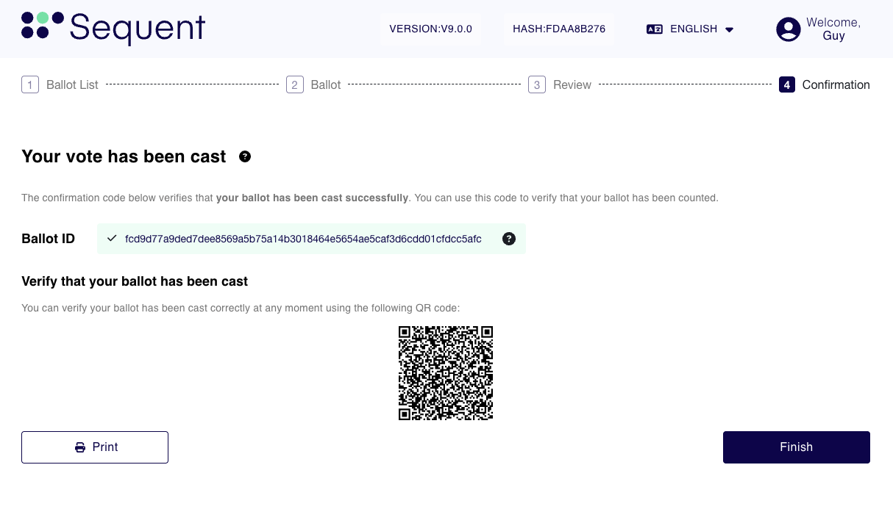
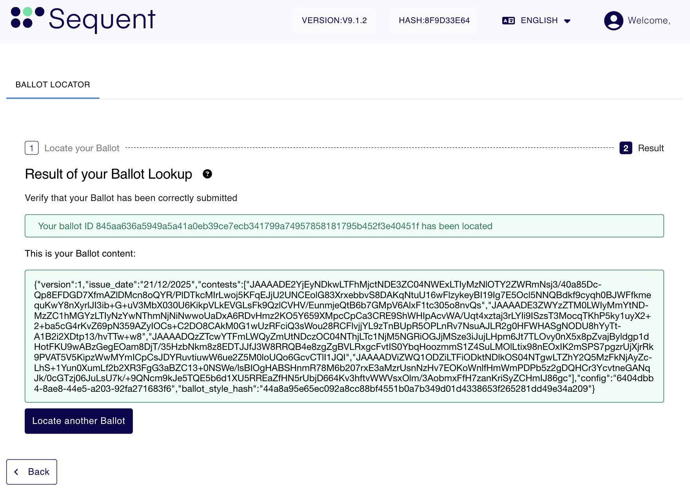
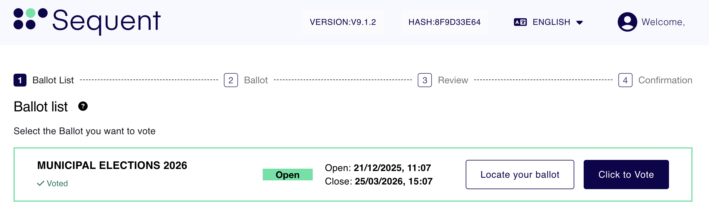
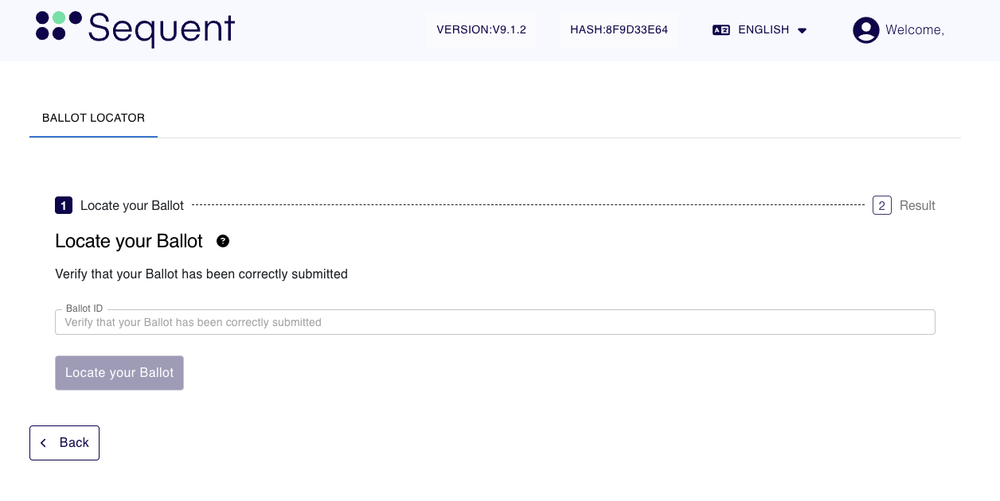

import GoogleVideo from '@site/src/components/GoogleVideo';

<!--
-- SPDX-FileCopyrightText: 2025 Sequent Tech Inc <legal@sequentech.io>
SPDX-License-Identifier: AGPL-3.0-only
-->

<GoogleVideo id="1UawaEBS2MWuXBRAHd1gceEXvn1p19mM_" />

It is possible to verify that your ballot has been correctly submitted.
In the Voting Portal's landing page `/election-chooser` click on the button 
`Track your ballot` to go to `/ballot-locator`.

Once you have finished voting, you can verify that your ballot was successfully recorded in the digital ballot box. There are different ways to access Ballot Tracking:

## Option 1: Access from the Confirmation Screen

### Step 1.1: Secure Your Tracking ID

After casting your vote, you will reach the Confirmation Screen:



From this screen, you can directly access Ballot Tracking prefilled to look up the vote you cast in three different ways:

<ul type="a" style={{listStyleType: 'upper-alpha'}}>
<li>You can click in the `Tracking ID` appearing highlighted with a green background in the image above.</li>
<li>You can scan with a mobile device the QR Code appearing in the screen.</li>
<li>You can copy the Tracking ID and manually enter it in the Ballot Tracking Screen at a later stage. See the explanation for this in Option 2.</li>
</ul>

When available for your election, the copy button appears next to the ID on both the Review and Confirmation screens. It copies the complete ID, even when the displayed ID is shortened, and its icon turns into a check for a moment to confirm it: a green one when your election has transparency enabled. If the copy button is hidden on Review, it is also hidden on Confirmation.

When your election has transparency enabled, these screens show the short Tracking ID: the first two groups of four characters, such as `30ff d314`. The full ID has 16 groups, and the copy button copies it in groups of four. A check mark next to the Tracking ID shows how far your browser has verified the ballot, and a tag shows where the ballot stands: **Not cast** on the Review screen and **Cast** on the Confirmation screen. On the Review screen, select the short ID to show the full Tracking ID in the box. Selecting the check mark opens the **Ballot status** dialog, which has the full Tracking ID and, once you cast the ballot, **Open in the ballot tracker**. See [Check your transparency receipt](./04-voter_transparency_receipt.md).

With transparency enabled, the box on the Review screen reads **Your Tracking ID:** followed by the short ID. It is next to the title of the screen on a wide screen and under the title on a narrower one. On a phone it is above the steps, under a **Tracking ID** label, without "Your". On the Confirmation screen the **Tracking ID** heading is next to the box, and above it on a phone.

:::tip
**Alternative:** You can also click in the `Print` button and the same options will be available but originating from the PDF you downloaded instead.
:::

### Step 1.2: Access Ballot Tracking

Once you performed one of the three possible options to access Ballot Tracking explained in the Step before, you will see the following screen:



If the ballot is found, the page shows its content. In an election without transparency, a green confirmation message states:

```
Your tracking ID [Tracking ID] has been found
```

When your election has transparency enabled, the page does not show this message, and screen readers announce it. **Back** and **Find another Ballot** are then at the top of the page. Without transparency they are at the bottom, under the content.

When your election has transparency enabled, the result also shows the short Tracking ID with the **Cast** and **Found** tags, and the ballot's receipt: see [The receipt in Ballot Tracking](#the-receipt-in-ballot-tracking).

The ballot content is a JSON-formatted block of data that contains the technical details of your submission, including the timestamp and encrypted contest data, proving your vote is securely in the system. Without transparency it shows in a box, after "This is your Ballot content:". When your election has transparency enabled, **Your ballot content** is a card with the ballot as it is in the public record. The card says what the content is, for example "Encrypted, as in the public record", with its format and size, and shows a one-line preview. Select its title or the arrow to expand it: the JSON shows formatted, with colours and line numbers. The card has a copy button, which copies the JSON and turns into a green check for a moment, and a download button, which saves it as a file named after the short Tracking ID, such as `ballot-30ffd314.json`.

## The receipt in Ballot Tracking

When your election has transparency enabled, the result shows the ballot's receipt, with **Your ballot content** under its steps:

- The short Tracking ID, with its **Cast** and **Found** tags, and the full Tracking ID with a copy button that copies it in groups of four and turns into a green check for a moment.
- The status of your ballot, as your browser checks it against the election's public record, in up to four steps: **Added to the public record**, **Confirmed by witnesses** (how many witnesses signed, and how many the policy needs), **Anchored in public hubs** (with their number, such as "Anchored in 3 public hubs") and **Anchored where browsers check**. A step that the election's policy does not use is left out.
- **Save receipt**, which saves the receipt file, and **Check it independently**, which opens the ballot verifier with your receipt.

If a step is late, Ballot Tracking says that this is not evidence of tampering and that you can check again later, on any device. If a check fails, it explains why and offers **Save evidence** and **How to report it**.

If you looked the ballot up by its short ID, Ballot Tracking adds: "Found by its short ID. To be certain it is yours, compare the full Tracking ID with your receipt." In a public election it asks the public record for the receipt, on any device. The voting portal keeps no receipts in the browser, so in a private election the page says that no receipt could be checked here. Check the receipt file you kept in the ballot verifier instead.

## An audited ballot

A ballot that you audited is never cast. When the record that Ballot Tracking finds for a Tracking ID is an audited ballot, which holds what the portal revealed when you audited it, the page treats it differently from a cast ballot. It says: "This ballot was audited, so it was never cast. Check that the selections decoded below are the ones you made." When a check fails or could not run, it keeps only the first sentence. Its tags are **Auditable** and **Found**, and it shows the same status and steps as a cast ballot.

Your browser checks that the ballot's hash is its Tracking ID, and that its ciphertext reproduces from the plaintext and randomness the ballot carries. Only then does it decode the ballot, and show **Your selections, decoded**: each contest with the candidates you chose. **Print** prints them. If these are not the selections you made, contact the election authority. If a check fails, the tag is **Audit failed**, and a card with that title says not to cast from this device and to tell the election authority. If this device could not run the checks, the page shows **The audit could not be checked** and no selections.

When you audit a ballot in an election with transparency enabled, the portal publishes the ballot and the secret it encrypted with in the public record. The audit screen then sends you to a hub's ballot verifier to compare the choices: see [Audit your Vote](./03-voter_audit_ballot.md#audit-with-transparency).

## Telephone voting ballot locator

When the **Telephone voting** channel is enabled for an election, the IVR reads a short ballot locator after the vote is cast. This locator is the first four hexadecimal characters of the full Tracking ID. Hexadecimal characters can contain the digits `0` through `9` and the letters `a` through `f`.

After logging in to the Voting Portal, enter either the four-character locator provided by the IVR or the full Tracking ID in Ballot Tracking. Short-locator searches are limited to ballots belonging to the authenticated voter in the current election. Enabling telephone voting only at the election-event level is not sufficient; the channel must be enabled for the individual election. Ballot Tracking also accepts the short Tracking ID, with the same limit to the voter's own ballots.

### Collisions

Because a four-character locator or a short ID is shorter than the full Tracking ID, two or more of the voter's ballots can have the same prefix. If this happens, Ballot Tracking does not select the first, last, or any other matching ballot. It says how many ballots share the short ID, lists them, each with its full Tracking ID and when it was cast, or audited, and asks the voter to choose one or to enter the full Tracking ID.

When your election has transparency enabled and is public, a short ID finds ballots, but it never proves that one is yours. Ballot Tracking asks the election's public record for every ballot that starts with the first three characters, and keeps the ones that share your short ID in your browser, so that the record's servers do not learn which ballot you looked for. It lists up to five ballots, with the third group of four characters highlighted so that you can compare it with your receipt. Only the full Tracking ID on your receipt says which one is yours: the voting portal keeps no receipts in the browser, so it does not mark one as yours. If more than five ballots share the short ID, Ballot Tracking asks you for the third group instead of listing them. Selecting a listed ballot does send its Tracking ID to the election's server, to show you the ballot. If the public record cannot list ballots by their start, Ballot Tracking falls back to asking the election's server with the short ID you typed, and says that the server sees that ID.

:::info
**Your ballot content:** Please note that even though you have access to the content of your ballot, this is encrypted so that it's not possible to obtain the intention of the vote from it. This is a security measure intended to maintain the secrecy of the vote and preventing anyone to prove how they voted. A cast ballot stays encrypted; only a ballot that you audited, which is never cast, shows its selections.
:::

## Until when you can check your ballot

Your election may set a date until which ballots can be checked. While checks are open, the Ballot Locator shows that date under its title. After it, the Ballot Locator shows when checks ended, and ballots can no longer be looked up or their receipts printed.

The Ballot Locator only finds your own ballots, and shows the Tracking ID, when the ballot was cast and its encrypted content. It never shows your choices.

## Option 2: Lookup the vote using a saved Tracking ID

As explained earlier in [step 1.1](#step-11-secure-your-tracking-id), after casting the vote you can simply save the Tracking ID by copying it and saving it somewhere safe. With this, you can then follow the steps below to look it up and ensure that the vote is found using Ballot Tracking.

:::info
**Prerequisites:** The steps below assume you have already logged in as a voter.
:::

### Step 2.1 : Access Ballot Tracking

After logging in as a voter, you will see the Ballot List as depicted below:



Then follow the steps below:

1. Navigate back to your Ballot List (the main election dashboard).

2. Find the relevant election for your ballot.

3. Click the white `Track your ballot` button.

:::tip
An election you voted in shows **Voted**. The voting portal keeps no receipts or Tracking IDs in the browser, so after you sign in again the ballot list has no check mark for your ballot. To check it, look it up here with the Tracking ID from your receipt. With transparency enabled, once you cast every ballot the open election allows you, `Click to Vote` is disabled, with the hint "You already cast this ballot".
:::

### Step 2.2: Search for Your Ballot


Once you are on the Ballot Tracking page:

1. Enter your `Tracking ID`. When your election has transparency enabled, the card **Check your ballot in the public record** has a labelled **Tracking ID** field with a search icon.

2. Paste the ID you saved from Step 1 into the search field. It can be the short ID, such as `30ff d314`, or the full ID, with or without spaces. The field groups the characters in fours as you type. With transparency enabled, the chips under it show the formats: **Short**, **Full** (16 groups of four) and **Spaces optional**. If you type or paste characters that cannot be part of a Tracking ID, the field leaves them out and the page says "A Tracking ID has only digits and the letters a to f." (without transparency, "Invalid Tracking ID format"). If a short ID matches more than one of your ballots, see [Collisions](#collisions).

3. Submit: Click the **Find** button to search the records (**Find your Ballot**, without transparency). It is off until the field holds a short or a full ID.

When your election has transparency enabled, three cards under the search card say what the tracker does: **Cast ballots**, **Audited ballots** and **Your vote stays secret**.

### Step 2.3: Review the Results


If the ballot is found, at the top of the screen you will see a green confirmation message stating:

**"Your tracking ID [ID Number] has been found."**

When your election has transparency enabled, the page does not show this message, and screen readers announce it. The result shows instead the short Tracking ID with the **Cast** and **Found** tags, and the ballot's receipt: see [The receipt in Ballot Tracking](#the-receipt-in-ballot-tracking).

Below it, you will see your ballot content. This is a JSON-formatted block of data that contains the technical details of your submission, including the timestamp and encrypted contest data, proving your vote is securely in the system. To look for another ballot, select **Find another Ballot**: at the top of the page when your election has transparency enabled, and under the content otherwise.
