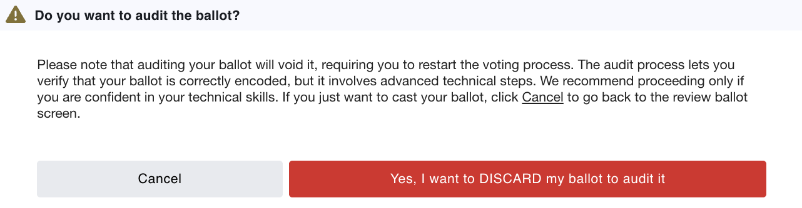
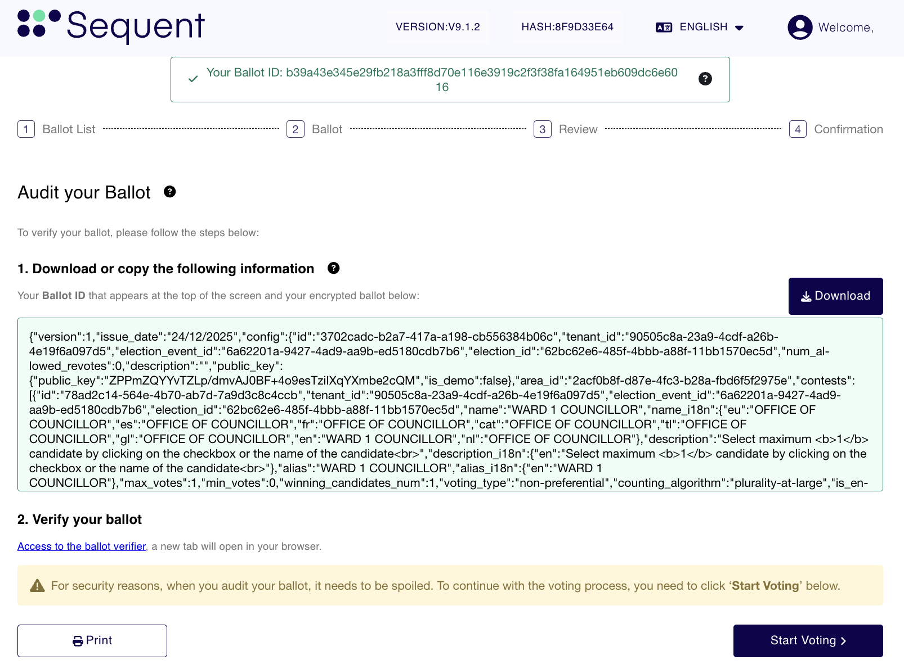
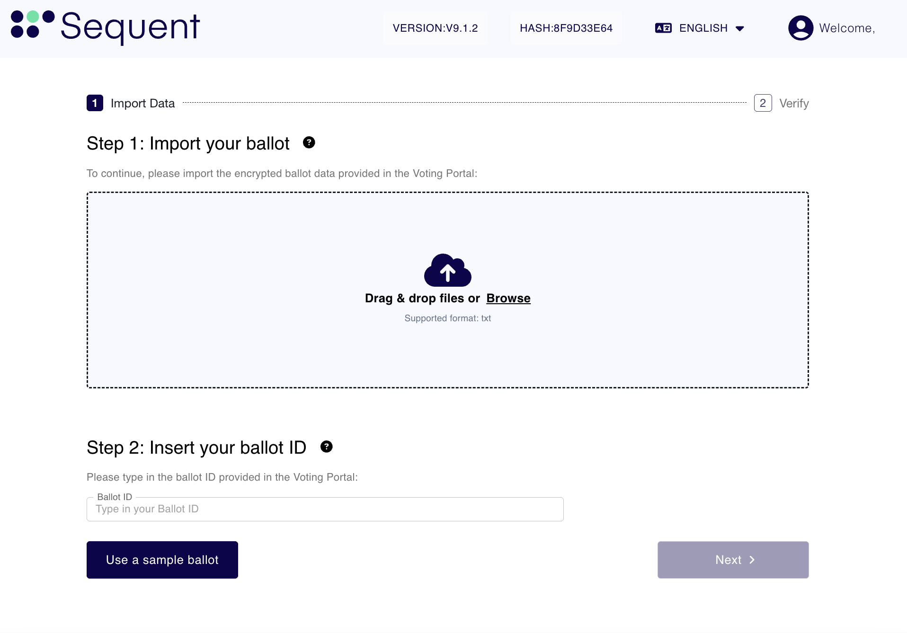
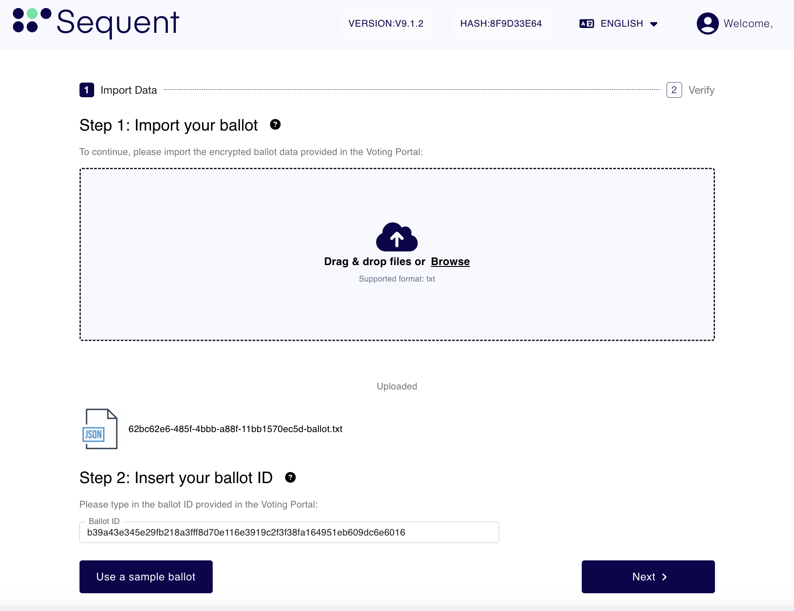
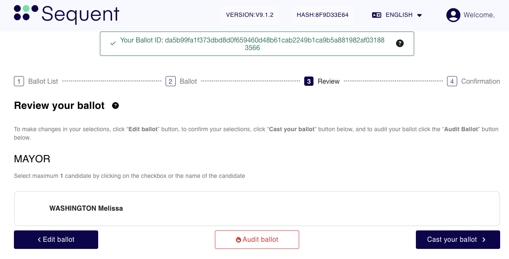

import GoogleVideo from '@site/src/components/GoogleVideo';

<!--
-- SPDX-FileCopyrightText: 2025 Sequent Tech Inc <legal@sequentech.io>
SPDX-License-Identifier: AGPL-3.0-only
-->

<GoogleVideo id="1lh_8MiMxbyFmLkrk-zYCJbYNHh5otryL" />

The audit process allows you to verify that your ballot was correctly encrypted and that your selections match your intent. This process involves "spoiling" the ballot to prove its integrity, which is intended for users with technical confidence.

## Step 1: Initiate the Audit
From the Ballot Review screen, before the final step before casting your vote, you have the option to audit your selections.

### Step 1.1 Note the `Tracking ID` 
Appearing highlighted with a green background in the image above. When your election has transparency enabled, the box is next to the title of the screen on a wide screen, under the title on a narrower one, and above the steps on a phone.

When your election has transparency enabled, the box shows the short Tracking ID next to a dotted check mark and a **Not cast** tag. Select the short ID to show the full Tracking ID in the box. The copy button next to the ID copies the full Tracking ID. The full ID is also in the **Ballot status** dialog that the check mark opens.

### Step 1.2 Begin the Audit
Select the `Audit ballot` button. When your election has transparency enabled, you can also select the check mark next to the Tracking ID: the **Ballot status** dialog says **Not cast yet** and has an **Audit ballot** button below the checks.

A confirmation appears. What it says, and what follows, depends on whether your election has transparency enabled:

- With transparency, follow [Audit with transparency](#audit-with-transparency).
- Without transparency, follow [Audit without transparency](#audit-without-transparency).

## Audit with transparency

When your election has transparency enabled, you do not download anything. The portal publishes how it encrypted your ballot in the election's public record, and you check it on a hub: a site that the voting portal does not control.

### Step 2: Confirm the audit
The confirmation asks **Audit this ballot instead of casting it?** It says that the portal publishes how it encrypted the ballot, so that you can check on a hub that it holds what you chose. The ballot is never cast or counted, because its secret would show how you voted. Then you vote again, with a new Tracking ID.

Select **Audit ballot** to audit it, or **Cancel** to go back to the review screen.

### Step 3: Pick a hub
The audit screen is titled **Check your audited ballot**. It keeps the review screen's green box with your Tracking ID, now with a grey double check and the tag **Audited**. The check mark opens the **Ballot status** dialog, which tags the ballot **Audited** too.

Three steps explain the audit:

1. **Encrypted on this device:** with its Tracking ID, before you chose to audit it.
2. **Opened in the public record:** the portal published the secret it encrypted with, and the record marks the ballot Audited.
3. **Compare it on a hub:** the hub decodes the ballot in your browser and shows the choices it holds. Only you know what you chose.

The third step lists the hubs of the election's policy that run a ballot verifier, as tiles in a random order each time. Each tile names the hub and who runs it. Select one: the hub's site opens in a new tab, with the full Tracking ID in the link. If no hub in the policy runs a ballot verifier, the screen offers the election authority's own ballot verifier instead, and without one, a link to the ballot in Ballot Tracking.

:::tip
The check is strongest on another device, such as your phone. Open any hub's site there and paste the Tracking ID.
:::

**Why audit?** at the foot of the screen answers the usual questions. It is collapsed until you open it.

### Step 4: Compare on the hub
The hub's page has the hub's own header. It says that it is a transparency hub, who runs it, and that it never asks you to vote, sign in or pay. It shows the full Tracking ID with the tag **Audited**.

Your browser fetches the ballot and the secret from the election's public record, not from the voting portal. Under **Checked in your browser** it shows three checks:

- **In the public record:** the entry number and when the ballot was audited. It was never cast.
- **Secret matches the ballot:** encrypting again with the secret gives the same ballot.
- **Decoded:** the choices, read with the election's published ballot design.

Then it asks **Do these match what you chose?**

- Select **Yes, they match** when the decoded choices are yours. The page says **Your ballot was encrypted as you chose**. Select **Back to the voting site**.
- Select **No, something’s different** when they are not. The page says **Don’t vote on this device**. Select **Save evidence** and report it to the election authority, whose contact comes from the election's policy. Then vote from another device.

Your answer stays in your browser. The hub does not learn what you chose.

If the hub cannot check the ballot, it says why instead of showing choices: for example, the link is not complete, the audit is not in the public record yet, or the ballot was cast and not audited. A cast ballot is never decoded. When a state says to try again later, select **Try again**.

### Step 5: Vote again
Back on the voting site, select **Vote again**. You get a new ballot with a new Tracking ID. That is the ballot that counts, and you can audit it too before you cast it.

## Audit without transparency

When your election does not have transparency enabled, you download the audited ballot and import it into the Ballot Verifier.

A warning modal will appear. 

### Step 2: Review the information carefully

**Auditing your ballot will void it**, requiring you to restart the voting process from the beginning.

This process lets you verify that your ballot is correctly encoded by your device and that your selects are encoded as you intended.

### Step 2.1 Confirm the Dialog
Select `Yes, I want to DISCARD my ballot to audit it` to proceed.

### Step 3: Download Audit Data
Once you confirm the audit, the system generates the technical data required for verification.

### Step 3.1 Download Encrypted Data:
Click the `Download` button to save the JSON-formatted ballot data to your device.

### Step 3.2 Open Verifier: 
Click the link `Access to the ballot verifier` to open the audit tool in a new browser tab.

:::warning After downloading your data, you must click `Start Voting` at the bottom of the screen if you wish to return to the election and cast a non-voided ballot.
:::

### Step 4: Import Data to the Verifier
In the new Ballot Verifier tab, you must provide the information you just saved.

### Step 4.1 Import your ballot: 
Drag and drop the file you downloaded into the upload area, or click Browse to select it.

### Step 4.2 Insert your tracking ID: 
Type or paste the full `Tracking ID` you noted in the previous step into the input field. The field groups the characters in fours as you type, and spaces are optional. It takes only the full ID, 64 characters made of digits and the letters `a` to `f`. A short ID is refused: the verifier compares the whole ID, and a short ID has only 32 bits, which a birthday search could match.

Once the file is uploaded and the ID is correctly entered (see image below), click `Next`.

### Step 5: Review Audit Results
The Verifier decodes the encrypted file and displays the contents for your inspection.

### Step 5.1 Verify Tracking ID: 
Ensure the Decoded Tracking ID matches the Tracking ID you provided. Both show in groups of four, with the short ID in bold. If they differ, the verifier highlights the groups of the ID you provided that differ from the decoded one, and shows `Doesn’t match the decoded Tracking ID`.

### Step 5.2 Review Selections: 
The system displays the decoded candidates for each contest.

Contests decided by acclamation are also shown so this screen matches the
Voting Portal review. Because an acclaimed contest is not encoded in the
ballot, it has no decoded selection. The verifier obtains it from the ballot
configuration and displays its acclamation notice and all available candidates
as disabled options. This is display-only and does not change the decoded
ballot or the Tracking ID verification.

### Step 5.3 Confirm Intent: 
Ensure these selections match the choices you made in the Voting Portal.

## Check the audited ballot in Ballot Tracking

When your election has transparency enabled, you can also check an audited ballot in the ballot tracker. Enter its Tracking ID in **Ballot Tracking**. Your browser checks the ballot and shows **Your selections, decoded**, with the **Auditable** and **Found** tags. If these are not the selections you made, contact the election authority. See [Track your Vote](./02-voter_track_your_vote.md#an-audited-ballot).
