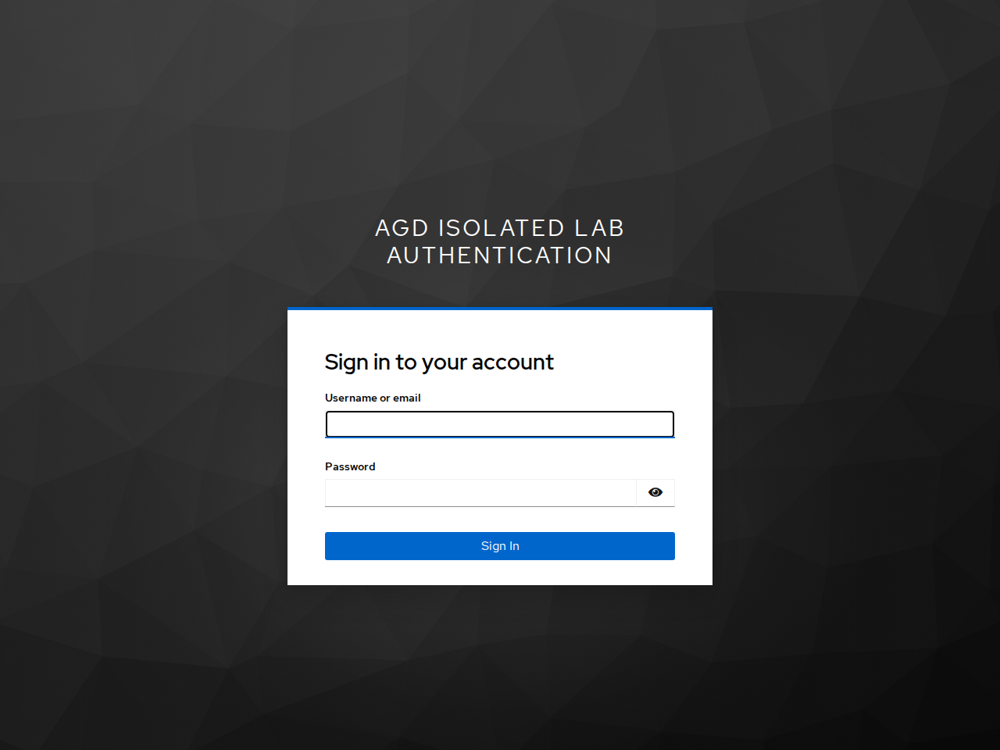

<!--
SPDX-FileCopyrightText: 2026 Sequent Tech Inc <legal@sequentech.io>
SPDX-License-Identifier: AGPL-3.0-only
-->

## Log in

To log in:

1. Open the voting portal with the address your election organizer gave you.
   Do the checks in [Before You Vote](03-before_you_vote.md) first.
2. The voting portal sends you to the login page of the authentication service
   your election organizer tells you about. Check that it is the page the
   election organizer described.
3. Log in there as the election organizer's instructions say.
4. The authentication service sends you back to the voting portal. It shows the
   "Ballot list" with the ballots you can vote on. If you have only one ballot,
   the voting portal may open it directly.

*Illustration: the isolated rehearsal’s external authentication service, before
any credentials are entered. Your authentication service may look different;
use only the address and login method your election organizer specifies.*

If your election has support materials that you must read first, the voting
portal tells you so before you can vote. Open them, tick "I have read the
Support Materials" and select "Continue".

The voting system has no form of its own for your password, no option to stay
logged in, no self-registration and no password reset. If you have forgotten your
login details, follow the election organizer's instructions or contact the
election organizer.

## What the ballot list shows

For each ballot, the "Ballot list" shows:

| Item | Meaning |
|---|---|
| The name of the ballot | The ballot you can vote on. |
| "Open" | You can vote in this ballot now. |
| "Closed" | You cannot vote in this ballot now: voting has not started, is paused, or has ended. |
| "Voted" or "Not voted" | Whether a vote of yours has been cast in this ballot. |
| "Open:" and "Close:" with dates | When voting in this ballot starts and ends. |
| "Election Begins in" with the time left | Shown before voting in this ballot starts. |
| "Click to Vote" | Opens the ballot. Shown only while voting is open. |
| "Locate your ballot" | Opens the ballot locator, where you can find a ballot you have cast. |

Before voting starts, after it has ended in all ballots, and during
maintenance, the voting portal shows no ballots but "There was a problem
fetching the data. Please try again later or contact support for assistance."
(see [Election States and Problems for Voters](10-states_and_problems.md)).

## If you cannot log in

| What happens | What it means | What to do |
|---|---|---|
| Your login is refused several times in a row | After a number of failed logins in a row, the authentication service may lock your account for a while. | Wait, then try again with the correct login details. If you still cannot log in, contact the election organizer. |
| Your login is refused although your details are correct | You may not be in the voters' register of this election. | Try again later. If it still fails, contact the election organizer. |
| "You are not listed as a voter in this election. Please contact support." | The voting system does not find you as a voter of this election. | Contact the election organizer. |
| "The voting portal could not start. Please try again." | The voting portal could not load, for example because the voting system is refusing voter logins for a while to protect its records (see [Logins refused to protect the records](10-states_and_problems.md#logins-refused-to-protect-the-records)). | Select "Try again". If it keeps happening, contact the election organizer. |
| A certificate or security warning, or an address you do not recognise | You may not be on the real voting portal. The real voting portal never causes a certificate warning. | Stop. Do not continue, and do not try another address or link. Close the page and tell the election organizer. |

When a message on the screen says "contact support", contact your election
organizer.

:::warning

**Unexpected failed logins can mean that someone is trying to use your
account.** If your account is locked although you did not try to log in, or
the voting portal shows "Voted" for a ballot you have not voted on, tell the
election organizer at once.

:::
