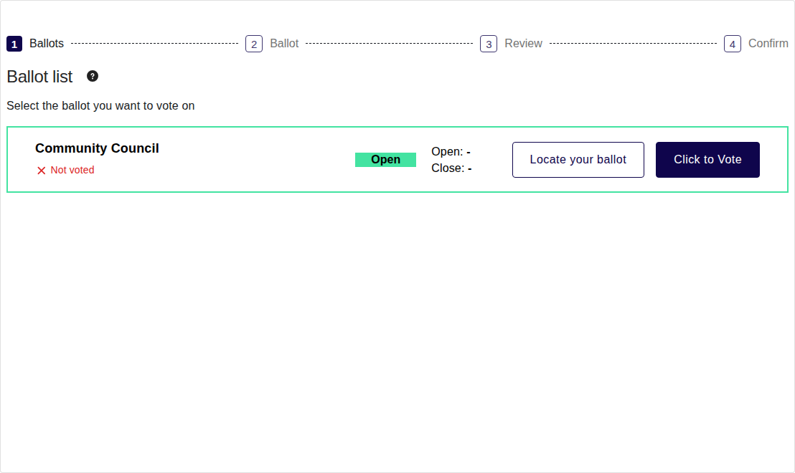
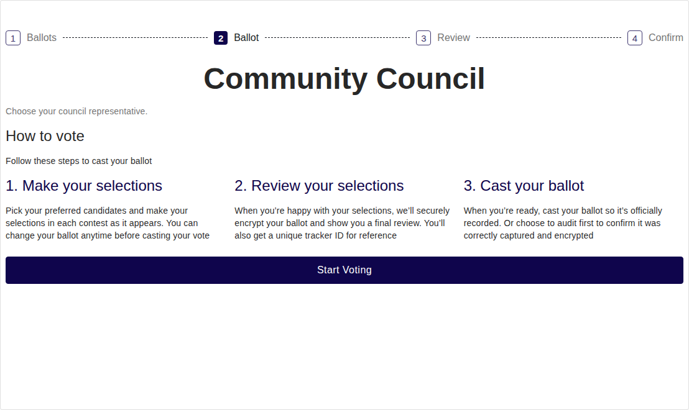
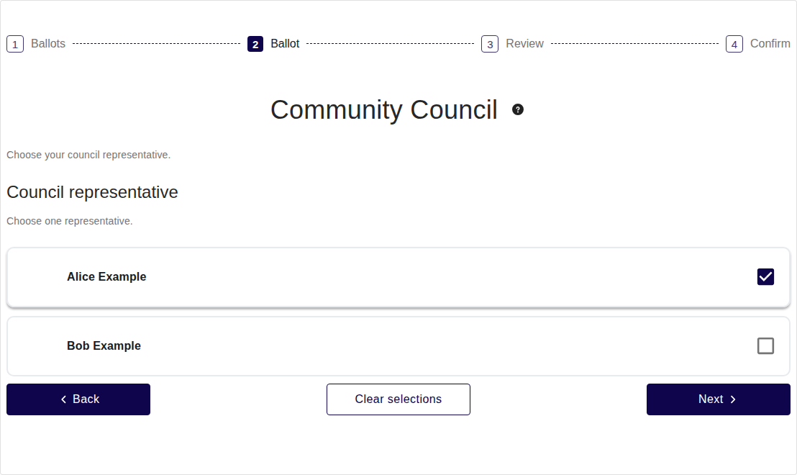
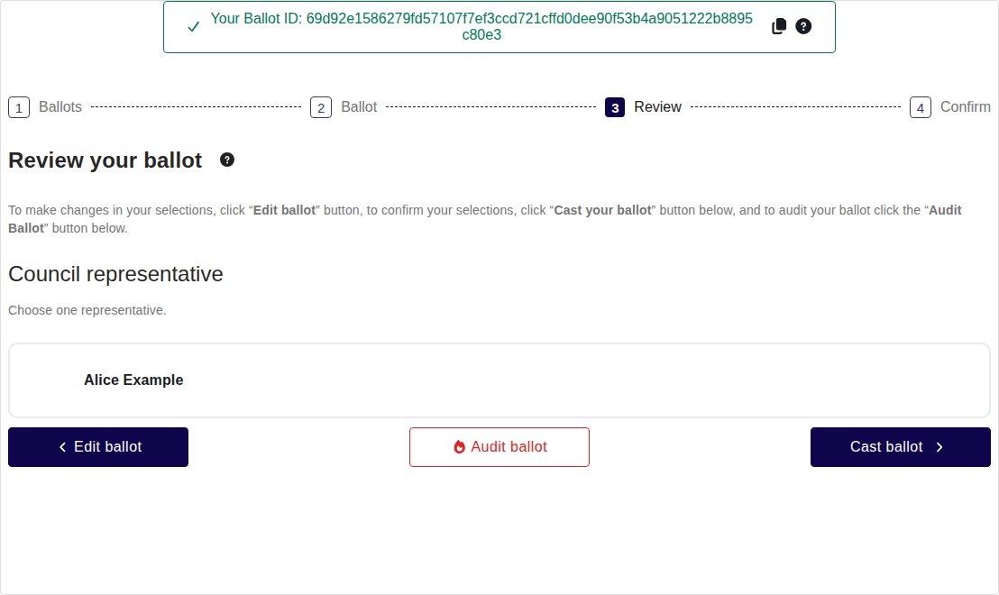
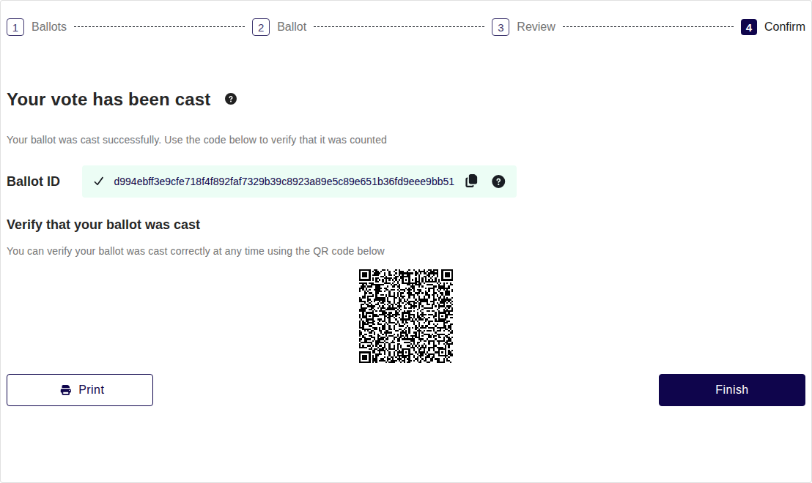

<!--
SPDX-FileCopyrightText: 2026 Sequent Tech Inc <legal@sequentech.io>
SPDX-License-Identifier: AGPL-3.0-only
-->

You can vote only while the ballot shows "Open" in the "Ballot list". Your vote
counts only after you have cast it and the voting portal shows "Your vote has
been cast".

The screenshots show the current voting screens with a synthetic example
called **Community Council**. Your election name, candidates and Ballot IDs will
differ. The example confirmation illustrates the screen; it is not a cast vote
in a real election.

## Step 1: Open the ballot

1. In the "Ballot list", find the ballot you want to vote on.
2. Select "Click to Vote".

## Step 2: Read the instructions

The voting portal shows "How to vote" with the three steps of voting: make your
selections, review them, and cast your ballot.

1. Read the instructions.
2. Select "Start Voting".

If your election offers it, the screen also shows "Decline to Vote". If you
select it and confirm with "Decline to vote", the voting portal goes directly
to the review screen with a ballot that records that you declined to vote. You
cast it in the same way as any other ballot.

## Step 3: Make your selections

1. For each question (contest), select the options you want. The question says
   how many options you can select.
2. To remove all your selections and start again, select "Clear selections".
3. When you have finished, select "Next".

Before it continues, the voting portal may ask you to look again at your
selections:

| Message | What it means | Your choices |
|---|---|---|
| "Your vote is invalid or blank" | Some of your answers make one or more contests invalid or blank. | "Review selections" to go back, or "Continue" |
| "Review your ballot" | Your selections may need your attention, for example because you selected fewer options than allowed. The ballot is valid. | "Back and review" to go back, or "Continue" |
| "You have not selected any candidates" | Your ballot would be cast blank. A blank ballot is valid. | "Cancel" to go back, or "Continue" |

Nothing is sent as a vote at this step.

## Step 4: Review your ballot

When you select "Next", your browser encrypts your ballot. The voting portal
then shows "Review your ballot" with your selections. At the top it shows "Your
Ballot ID:" followed by a code.

:::info

**Your vote has not been cast yet.** The voting system has received your
encrypted ballot, but it does not count until you cast it. If you look up this
Ballot ID now, nothing is found.

:::

1. Check every selection carefully.
2. Choose the action you need:

| Button | What happens next |
|---|---|
| **Edit ballot** | Return to your selections and change them. |
| **Audit ballot** | Check this ballot’s encryption. It is spoiled and can never be cast; voting again creates a new encrypted ballot and Ballot ID. See [Auditing Your Ballot](06-auditing_your_ballot.md). |
| **Cast ballot** | Submit the ballot. Continue with step 5 and wait for confirmation. |

If you left a contest unfilled, the voting portal shows "Some selections are
unfilled". Select "Review selections" to go back, or "Continue with these
selections" to cast the ballot as it is.

If you reload the page before you cast, the voting portal may take you back to
your ballot when you select "Cast ballot", and encrypt it again. Check your
selections and continue as before.

## Step 5: Cast your vote

1. Select "Cast ballot".
2. If your election asks you to confirm, the voting portal shows "Are you sure
   you want to cast your vote?" Select "Yes, I want to cast my vote". For a
   blank ballot the question is "Are you sure you want to cast a blank ballot?"
   and you select "Yes, cast my blank ballot". Select "Cancel" if you do not
   want to cast yet.
3. Your election may ask you to log in again before your vote is cast, to make
   sure it is you. Log in at the login page of the authentication service, as
   in [Logging In to Vote](04-logging_in.md). Do this within 5 minutes. If more
   time passes, the voting portal shows "Your session has expired. Please start
   again" and your vote is not cast; open the ballot again with "Click to Vote".
4. The voting portal shows "Your vote has been cast".

:::warning

**Cast only a ballot that shows exactly your selections.** If you have audited
a ballot, check that the ballot you cast has a new Ballot ID: an audited ballot
can never be cast. Once cast, a vote cannot be changed. If your election allows
you to vote again, a new vote replaces it in the count (see
[Voting Again](08-voting_again.md)).

:::

## Step 6: The confirmation

The confirmation screen "Your vote has been cast" appears only after the
intermediate ballot box has confirmed with its signature that it stored your
encrypted vote, and your browser has checked that signature. It shows:

- "Ballot ID" with the code of your cast ballot. Selecting the code opens the
  ballot locator, where you can find your ballot later.
- "Verify that your ballot was cast" with a QR code that also opens the ballot
  locator. Although the screen says "at any time", the ballot locator lets you
  check your ballot only until the end of the election period.
- "Print": saves a receipt for your vote as a PDF file. If this fails, the
  voting portal shows "Error" with "An error occurred. Please try again".
- "Finish": takes you back to the "Ballot list" if you have more ballots to vote
  on. Otherwise it logs you out.

For a blank ballot, the screen says "Your ballot was cast blank, which is a
valid, deliberate choice." If the screen shows "We couldn’t check whether you
have more elections to vote in. Please retry.", select "Retry". Your vote has
been cast all the same.

Write down or copy the Ballot ID, or save the receipt, if you want to check your
ballot later. How to check it:
[Checking That Your Vote Was Stored and Counted](07-checking_storage.md).

## If you stop before casting

You can stop at any time before you cast: close the browser, log out, or leave
the voting portal. A technical problem can also interrupt you. In all these
cases, nothing is cast, and you keep your right to vote. While voting is open,
log in again and start again from step 1.

## If casting fails

If the voting portal shows an error instead of "Your vote has been cast", your
vote may or may not have been cast. Do not assume either:

1. Log in again, if needed, and open the "Ballot list".
2. If the ballot shows "Not voted" and voting is still open, vote again from
   step 1.
3. If the ballot shows "Voted", use "Locate your ballot" to find your ballot
   (see [Checking That Your Vote Was Stored and Counted](07-checking_storage.md)).
4. If you are unsure, or the error keeps coming back, contact the election
   organizer. Tell them the message and the time.

The messages you may see are listed in
[Election States and Problems for Voters](10-states_and_problems.md).
