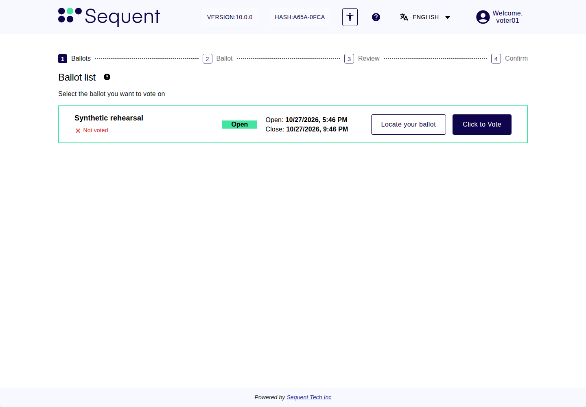
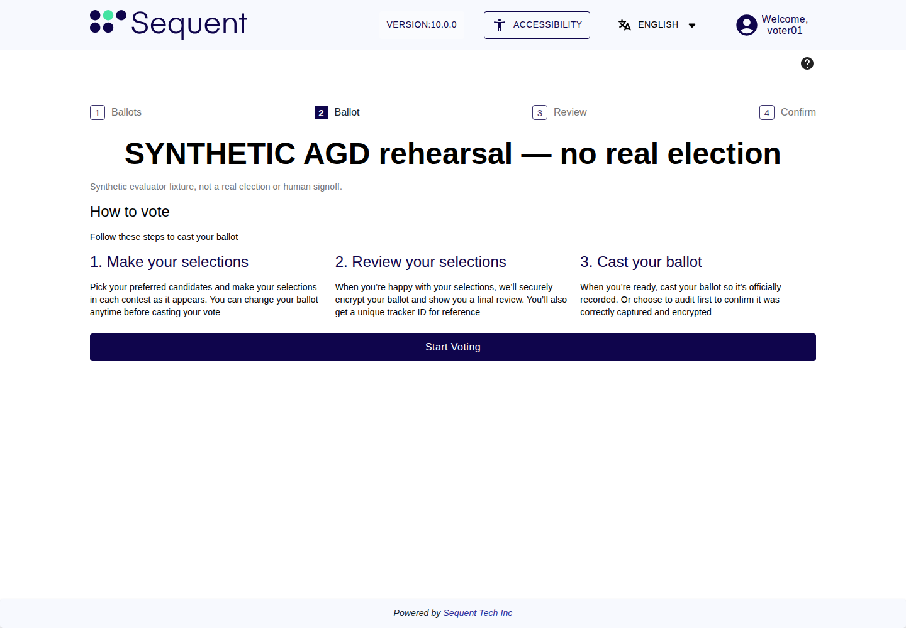
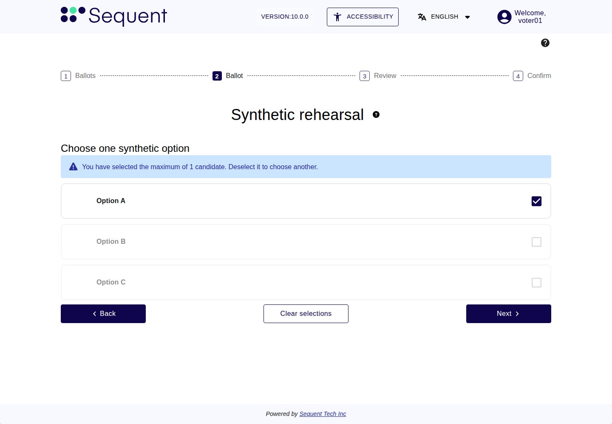
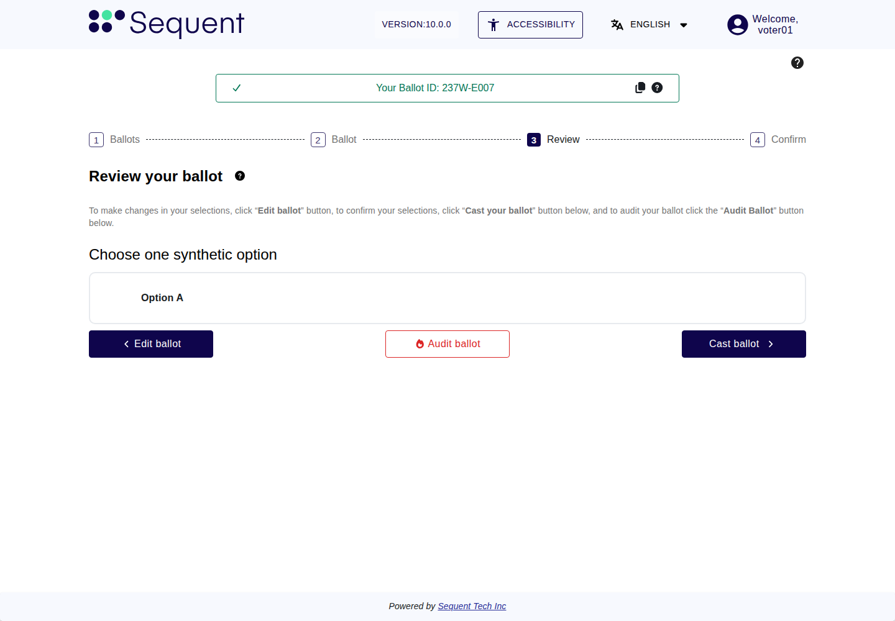
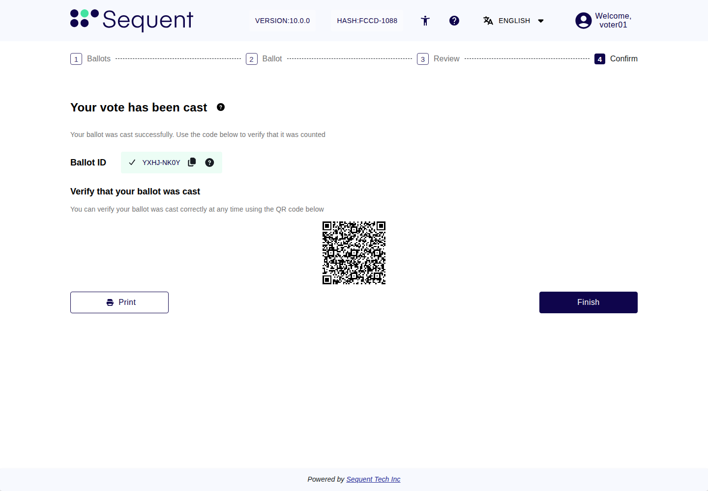

<!--
SPDX-FileCopyrightText: 2026 Sequent Tech Inc <legal@sequentech.io>
SPDX-License-Identifier: AGPL-3.0-only
-->

You can vote only while the ballot shows the status "Open" on the screen
"Ballot list". Your vote counts only after you have cast it and the voting
portal shows the confirmation screen "Your vote has been cast".

## Open the ballot

If your election offers instructions for each screen, they are in the bar at the
top of the screen: the question-mark icon shows them, and the speaker icon next
to it reads them aloud where your election has recorded them or your browser
has a voice for your language. If your election offers it, the accessibility
icon there changes how the voting portal looks on your device, for example its
text size or contrast. If your election offers several languages, the language
selector in this bar changes the language of the screens.

On a wide screen the bar also shows the labels "VERSION:" and "HASH:", which
identify the software of the voting portal; you need them only if someone asks
for them when you report a problem. The small question-mark icon next to a title
or next to the Ballot ID opens a short help text.

To open your ballot:

1. On the screen "Ballot list", find the ballot you want to vote on.
2. Select the button "Click to Vote".

## Start voting

The voting portal shows the screen "How to vote" with the three steps of voting:
make your selections, review them, and cast your ballot. To start voting:

1. Read the three steps.
2. Select the button "Start Voting".

If your election offers it, the screen also shows the button "Decline to Vote".
If you select it and confirm with the button "Decline to vote", the voting
portal goes directly to the review screen with a ballot that records that you
declined to vote. You cast it in the same way as any other ballot.

## Make your selections

To make your selections:

1. For each question (contest), select the options you want. Select a chosen
   option again to remove it. The voting portal may show how many more options
   you can select, or that you have reached the maximum.
2. To remove all your selections and start again, select the button
   "Clear selections".
3. When you have finished, select the button "Next".

Before it continues, the voting portal may ask you to look again at your
selections:

| Dialog | What it means | Your choices |
|---|---|---|
| "Your vote is invalid or blank" | Some of your answers make one or more contests invalid or blank. | The button "Review selections" to go back, or the button "Continue" |
| "Review your ballot" (a dialog with the same title as the review screen) | Your selections may need your attention, for example because you selected fewer options than allowed. The ballot is valid. | The button "Back and review" to go back, or the button "Continue" |
| "You have not selected any candidates" | Your ballot would be cast blank. A blank ballot is valid. | The button "Cancel" to go back, or the button "Continue" |

When you continue, your browser encrypts your ballot on your device and the
voting portal opens the review screen. Nothing is cast at this step.

A question can carry a notice that it was decided by acclamation: its candidates
are elected without a vote, so you cannot select anything there and no vote is
recorded for it. Answer the other questions as usual. If every question of your
ballot was decided this way, you have nothing to cast: the review screen has the
title "Decided by acclamation" and the button "Finish", and there is no Ballot
ID, no button "Audit ballot" and no receipt.

## Review your ballot

The voting portal shows the review screen "Review your ballot" with your
selections. Your ballot is already encrypted: at the top, the screen shows the
label "Your Ballot ID:" followed by the short code of this encrypted ballot, such
as `G5AT-12SZ`. The copy icon
next to it copies the full Ballot ID. Compare ballots only with the full Ballot
ID; the short code is not proof (see
[Your Ballot ID](07-checking_storage.md#your-ballot-id)). You can now cast this
ballot, or audit it to check that it contains your selections.

:::info

**Your vote has not been cast yet.** When this screen opens, the voting portal
sends your encrypted ballot to the intermediate ballot box. It stores it
as received, not as cast, and confirms this with its signature, which
your browser checks. The short code is calculated from your encrypted ballot
and this confirmation. A received ballot is never counted; only casting it makes it
count. Until you cast it, the ballot locator does not find this Ballot ID.

:::

While your ballot is being sent, the screen shows no Ballot ID and the buttons
"Audit ballot" and "Cast ballot" are disabled. If an error message appears and the button
"Cast ballot" stays disabled, nothing has been cast: select the button
"Edit ballot", then the button "Next", to send your ballot again. If it happens
again, see
[Messages and what to do](10-states_and_problems.md#messages-and-what-to-do).

To finish the review:

1. Check every selection carefully.
2. Choose the action you need:

| Button | What happens next |
|---|---|
| "Edit ballot" | Return to your selections and change them. |
| "Audit ballot" | Check this ballot’s encryption. The intermediate ballot box first records the audit and from then on refuses to cast this ballot; the voting portal discards it. To vote, you start again with a new encrypted ballot and a new Ballot ID. See [Auditing Your Ballot](06-auditing_your_ballot.md). |
| "Cast ballot" | Submit the ballot. Continue with [Cast your vote](#cast-your-vote) and wait for the confirmation. |

If you reload the page before you cast, your browser loses the encrypted ballot,
and the review screen can keep loading without the button "Cast ballot". Nothing
has been cast. Open the voting portal again with its address and start again
from [Open the ballot](#open-the-ballot).

## Cast your vote

To cast your vote:

1. Select the button "Cast ballot".
2. If you left a contest unfilled, the voting portal may show the dialog
   "Some selections are unfilled". Select the button "Review selections" to go
   back. The button "Continue with these selections" goes on to cast the ballot,
   without the question of the next step.
3. If your election asks you to confirm, the voting portal shows the question
   "Are you sure you want to cast your vote?" Select the button
   "Yes, I want to cast my vote". For a blank ballot the question is
   "Are you sure you want to cast a blank ballot?" and you select the button
   "Yes, cast my blank ballot". Select the button "Cancel" if you do not want to
   cast yet.
4. Your election may ask you to log in again before your vote is cast, to make
   sure it is you. Log in at the login page of the authentication service, as
   in [Logging In to Vote](04-logging_in.md). Do this within 5 minutes. If more
   time passes, the voting portal shows the message
   "Your session has expired. Please start again" and your vote is not cast; open
   the ballot again with the button "Click to Vote".
5. The voting portal shows the confirmation screen "Your vote has been cast".

:::warning

**Cast only a ballot that shows exactly your selections.** If you have audited
a ballot, check that the ballot you cast has a different full Ballot ID. Once cast, a
vote cannot be changed. If your election allows
you to vote again, a new vote replaces it in the count (see
[Voting Again](08-voting_again.md)).

:::

## The confirmation

The confirmation screen "Your vote has been cast" appears only after the
intermediate ballot box has confirmed with its signature that it stored your
encrypted vote, and your browser has checked that signature. It shows:

- The label "Ballot ID" with the short code of your cast ballot. Selecting the
  code opens the ballot locator, where you can find your ballot later. The copy
  icon next to it copies the full Ballot ID.
- The heading "Verify that your ballot was cast" with a QR code that opens the
  ballot locator on the device that scans it, where you must log in, so scan it
  only with a device you trust. Although the screen says "at any time", the
  ballot locator lets you check your ballot only while voting is open, at the
  latest until the end of the election period.
- The button "Print": saves a receipt for your vote as a PDF file. If this fails,
  the voting portal shows the dialog "Error" with the message
  "An error occurred. Please try again".
- The button "Finish": takes you back to the screen "Ballot list" if there is a
  ballot you can still vote in, including voting again where your election allows
  it. Otherwise it logs you out.

If you want to check your ballot later, copy the full Ballot ID with the copy
icon and paste it into a text file that you keep. How to check it:
[Checking That Your Vote Was Stored and Counted](07-checking_storage.md).

The Ballot ID alone does not let you check after the election that your vote was
counted. For that check, copy your encrypted ballot from the ballot locator
before voting ends (see
[Copy your encrypted ballot to check that it was counted](07-checking_storage.md#copy-your-encrypted-ballot-to-check-that-it-was-counted)).

## If you stop before casting

You can stop at any time before you cast: close the browser, log out, or leave
the voting portal. A technical problem can also interrupt you. In all these
cases, nothing is cast, and you keep your right to vote. While voting is open,
log in again and start again from [Open the ballot](#open-the-ballot).

## If casting fails

If the voting portal shows an error instead of the confirmation screen
"Your vote has been cast", your vote may or may not have been cast. Do not assume
either. To find out:

1. If the review screen is still open, select the copy icon next to the label
   "Your Ballot ID:" and paste the full Ballot ID into a text file. The ballot
   locator can search only with a Ballot ID.
2. Log in again, if needed, and open the screen "Ballot list".
3. If the ballot shows the status "Not voted" and voting is still open, vote again
   from [Open the ballot](#open-the-ballot).
4. If the ballot shows the status "Voted", a vote of yours has been cast. If you
   have its Ballot ID, use the button "Locate your ballot" to find it (see
   [Checking That Your Vote Was Stored and Counted](07-checking_storage.md)).
5. If you are unsure, or the error keeps coming back, contact the election
   organizer. Tell them the message and the time.

The most frequent messages are listed in
[Election States and Problems for Voters](10-states_and_problems.md).
