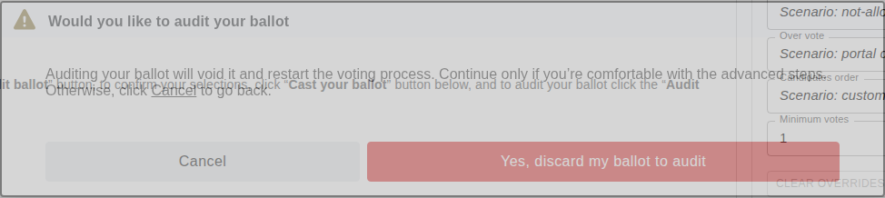
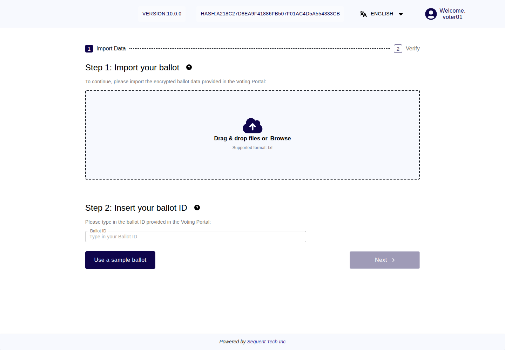

<!--
SPDX-FileCopyrightText: 2026 Sequent Tech Inc <legal@sequentech.io>
SPDX-License-Identifier: AGPL-3.0-only
-->

## What an audit checks

Your browser encrypts your ballot on your device. An audit lets you check that
it encrypted exactly your selections, and nothing else. This is called checking
that your vote is cast as intended.

It works like this. On the review screen you can either cast the encrypted
ballot or audit it. If you audit it, the voting portal reveals the secret values
it used to encrypt that ballot, and the ballot verifier checks with them that
the encrypted ballot contains your selections. A ballot whose secret values have
been revealed is spoiled: the voting system never casts it. The voting portal
takes you back to your choices, and your ballot is encrypted anew, with new
secret values and a new Ballot ID, before you can cast it. Because your device
cannot know in advance whether you will audit or cast a ballot, a device that
encrypts wrongly can be caught by an audit.

Auditing is optional. You can audit as many times as you like before you cast.

:::warning

- **An audited ballot can never be cast.** Before you cast the new ballot,
  check that its Ballot ID on the review screen is different from the code
  you noted on the original review screen. If it is the same, do not cast, and
  tell the election organizer.
- **An audit shows your selections.** The file you download and the ballot
  verifier show the selections of the audited ballot. Audit only where nobody
  can see your screen, keep the file to yourself, and delete it when you have
  finished the check.

:::

## Step 1: Start the audit

*Current voting interface with synthetic example data. Auditing spoils this
ballot; cancel if you want to return to the review screen.*

1. On "Review your ballot", note the Ballot ID shown after "Your Ballot ID:".
   After the audit you check that your new ballot has a different one.
2. Select "Audit ballot".
3. The voting portal asks "Would you like to audit your ballot" and explains:
   "Auditing your ballot will void it and restart the voting process. Continue
   only if you’re comfortable with the advanced steps. Otherwise, click Cancel to
   go back."
4. Select "Yes, discard my ballot to audit". To return to the review screen
   instead, select "Cancel".

## Step 2: Save the audit details

The voting portal shows "Check your ballot" with "To check your ballot, follow
the steps below:".

1. Under "1. Save the following details:", note the Ballot ID shown at the top
   of this screen after "Your Ballot ID:". Copy it exactly. This is the Ballot
   ID you type into the ballot verifier.
   It is the full 64-character hash of the encrypted ballot. When the review
   screen used a short signed-receipt code, keep that code separately: the
   verifier needs the full identifier from **Check your ballot**.
2. Select "Download". Your browser saves your encrypted ballot, with the secret
   values used to encrypt it, as a text file. The screen also shows the same
   data as text below the button.

## Step 3: Open the ballot verifier

1. Under "2. Check your ballot", select the link "Check your ballot code". The
   ballot verifier opens in a new tab of your browser.
2. Check that it opened from the voting portal and that the browser shows a
   secure connection without warnings.
3. If the ballot verifier asks you to log in, log in in the same way as for the
   voting portal.

## Step 4: Check your ballot in the ballot verifier

*Illustration: the v10.0.0 verifier before a file is loaded. Use your own audit
file and Ballot ID, not “Use a sample ballot”. This empty screen does not show
a successful verification.*

1. Under "Step 1: Import your ballot", drag the file you downloaded onto the area
   that says "Drag & drop files or", or select "Browse" and choose the file. The
   supported format is txt. If the ballot verifier shows "Could not import this
   file. Please try again.", or "Error" with "There was a problem importing the
   auditable ballot.", choose the file you downloaded in step 2.
2. Under "Step 2: Insert your ballot ID", type or paste the Ballot ID you noted
   in step 2 into the field "Ballot ID".
3. Select "Next".
4. The ballot verifier shows "Ballot ID" with two values: "Decoded Ballot Id"
   (read from your file) and "The Ballot Id you provided". They must be the
   same. If they are not, the ballot verifier shows "Does’t match the decoded
   ballot ID".
5. Under "Verify your ballot selections", the ballot verifier shows the
   selections it has decoded from your encrypted ballot. Check that they are
   exactly the selections you made in the voting portal.

The check is successful if both Ballot ID values are the same and the decoded
selections are exactly yours.

:::warning

**Check only the file you downloaded.** Do not select "Use a sample ballot" in
the ballot verifier. It loads an example ballot, and a check of it says nothing
about your ballot.

:::

## Step 5: Vote

1. Go back to the tab of the voting portal. At the bottom of "Check your ballot"
   it says: "For security reasons, when you audit your ballot, it needs to be
   spoiled. To continue with the voting process, you need to click ‘Start
   Voting’ below."
2. Select "Start Voting". The voting portal takes you back to your choices.
3. Make or check your selections, and select "Next". Your browser encrypts your
   ballot anew.
4. On "Review your ballot", check that the Ballot ID after "Your Ballot ID:" is
   different from the one you noted before the audit. If it is the same, do not
   cast. Tell the election organizer.
5. Cast the new ballot as described in
   [Casting Your Vote](05-casting_your_vote.md), or audit it, too.
6. When the voting portal shows "Your vote has been cast", check that the
   Ballot ID shown there matches the new review screen's code and differs
   from the original review screen's code.
7. Delete the file you downloaded, and close the tab of the ballot verifier.

If you try to cast an audited ballot, the voting system refuses it. The voting
portal shows "Failed to validate your vote. Please try again later or contact
support", and your vote is not cast. Open the ballot again with "Click to Vote"
and vote with a new ballot.

## If the check fails

If any of the following happens, do not cast a ballot on this device. Note the
message and the time, and tell the election organizer. If you want to vote,
use another device you trust.

| What the ballot verifier shows | What it means |
|---|---|
| "Ballot verification failed" with "The ciphertext in this auditable ballot is not the encryption of the plaintext and randomness it contains. The ballot cannot be trusted." | The encrypted ballot does not contain what the file says. |
| "Ballot verification failed" with "The ballot style in this auditable ballot is not the one published for the election: its public key or its contests and candidates differ, or it is not published. The ballot cannot be trusted." | The ballot was not encrypted for the published ballot of your election. |
| "This auditable ballot does not match any ballot published for this election event, so it cannot be verified." | The file does not belong to a ballot of this election. Check that you chose the file of this audit. If you did, report it. |
| "This auditable ballot uses an older ballot format whose Ballot ID does not cover the ballot style. Its Ballot ID cannot confirm that the ballot was encrypted with the published election key." | The check cannot confirm the encryption key. |
| "Does’t match the decoded ballot ID" | The Ballot ID you typed is not the one of this file. Check that you typed the Ballot ID from the top of "Check your ballot". If it was correct, report it. |
| The decoded selections are not the ones you made | Your device did not encrypt your selections. |

If the ballot verifier shows "The ballots published for this election event
could not be loaded, so this auditable ballot cannot be verified yet. Please
try again.", the check could not be done. Try again later.

If the voting portal shows "There is no ballot available for audit. Please
contact support", go back to the "Ballot list", open the ballot again with
"Click to Vote", and contact the election organizer if it happens again.
