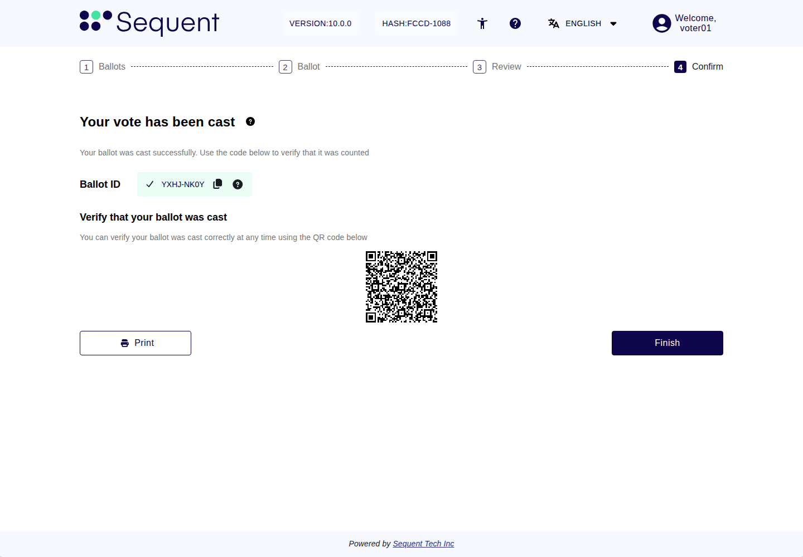
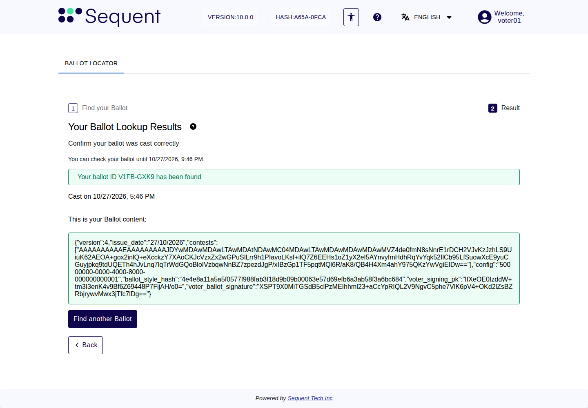

<!--
SPDX-FileCopyrightText: 2026 Sequent Tech Inc <legal@sequentech.io>
SPDX-License-Identifier: AGPL-3.0-only
-->

## The confirmation when you cast

When you cast your vote, the intermediate ballot box stores your encrypted vote
and confirms this with its signature. Your browser checks that signature. Only
if it is correct does the voting portal show the confirmation screen
"Your vote has been cast" with your Ballot ID (see [Casting Your Vote](05-casting_your_vote.md)).

:::warning

**Report it if a check of your browser fails.** Your browser checks each
confirmation of the intermediate ballot box and the Ballot ID of your encrypted
ballot. If one of these checks fails, the voting portal shows the message
"There was an error related to the ballot hashing process." followed by
"Please report this issue to support.", on the review screen or after you select
the button "Cast ballot", or it shows a page "Oops! Unexpected Error" with the
code "INCONSISTENT_HASH". Do not cast a ballot on this device. Note the time and
the whole message, and tell the election organizer. Then log in again on a device
you trust and look at your ballot on the screen "Ballot list" and, if you have its
Ballot ID, with the button "Locate your ballot".

:::

## Your Ballot ID

*Illustration: an example with test data. Use the Ballot ID from your own
confirmed vote.*

The Ballot ID lets you find your encrypted ballot in the intermediate ballot
box. It does not reveal your selections. It has two forms:

- **The short code**, in two groups of four characters, such as `G5AT-12SZ`.
  The review and confirmation screens show it, and the link and the QR code of
  the confirmation screen contain it.
- **The full Ballot ID**, 64 characters long (digits and the letters a to f).
  It is the hash of your encrypted ballot. The copy icon next to the short
  code, on the review and the confirmation screen, copies it. The audit screen
  "Check your ballot" shows it.

:::warning

**The short code is not proof.** It is calculated from the full Ballot ID and
the confirmation of the intermediate ballot box, but has only eight characters.
With enough computing power, someone who controls
the voting system could make a different ballot with the same short code. A
matching short code therefore does not prove that a ballot is yours. To check
your ballot, and to compare Ballot IDs, always use the full Ballot ID.

:::

- Keep the full Ballot ID of your cast ballot: copy it on the confirmation
  screen and paste it into a text file that you keep. The button "Print" on the
  confirmation screen saves a receipt with the short code.
- The Ballot ID does not show how you voted. The ballot locator finds a ballot
  only for the voter who cast it, while that voter is logged in.
- If you vote more than once (only where your election allows it), each cast
  ballot has its own Ballot ID.

## Find your ballot with the ballot locator

You can check that your cast ballot is stored in the intermediate ballot box
while voting is open, at the latest until the end of the election period. To
find it:

1. Log in to the voting portal and select the button "Locate your ballot" for the
   ballot on the screen "Ballot list". The link and the QR code of the
   confirmation screen also open the ballot locator, but they look up the short
   code; to check with the full Ballot ID, select the button "Find another Ballot"
   there.
2. The voting portal shows the screen "Find your Ballot". Under the title it says
   "You can check your ballot until" followed by the date and time when checks
   end.
3. Paste the full Ballot ID into the field "Ballot ID". If the voting portal shows
   the message "Invalid Ballot ID format", check what you pasted.
4. Select the button "Find your Ballot".
5. The voting portal shows the heading "Your Ballot Lookup Results" with one of
   the results below.
6. To look up another Ballot ID, select the button "Find another Ballot".

| Result | What it means | What to do |
|---|---|---|
| The message "Your ballot ID" followed by the code and "has been found" | Your ballot is stored. The voting portal also shows the label "Cast on" with the time it was cast, and the label "This is your Ballot content:" with your encrypted ballot. | Check that the time matches when you cast your vote. To check later that it was counted, copy the encrypted ballot (see [Copy your encrypted ballot to check that it was counted](#copy-your-encrypted-ballot-to-check-that-it-was-counted)). |
| The message "Your ballot ID" followed by the code and "was not found" | No cast ballot of yours has this Ballot ID. | Check that you entered the full Ballot ID of your cast ballot. If it is correct, tell the election organizer. |
| The message "More than one of your ballots matches" followed by the code and "Use the full ballot ID." | The code you entered matches more than one of your cast ballots. | Enter the full Ballot ID. |
| The message "Something went wrong." | The lookup could not be done, for example because the election is in maintenance mode or voting has ended (see [Election States and Problems for Voters](10-states_and_problems.md)). | Try again later. If it keeps happening, tell the election organizer. |
| The text "Checks ended on" followed by a date | The period for checking cast ballots is over. The ballot locator no longer looks up ballots. | Nothing. A copy of your encrypted ballot still lets you check after the election that your vote was counted ([After the election: was your vote counted?](#after-the-election-was-your-vote-counted)). |

*Illustration: an example with test data. Use the Ballot ID from your own
confirmed vote.*

The ballot content is the encrypted ballot that the intermediate ballot box
stored under your Ballot ID. It is shown so that you can see that ballot: your
full Ballot ID is its hash, so it stands for this ballot and no other. The ballot
content is encrypted. It does not show your selections.

:::warning

**Tell the election organizer at once** if your ballot is not found although
you saw the confirmation screen "Your vote has been cast" and entered the full
Ballot ID correctly, if the cast time is not when you voted, or if the ballot locator finds a ballot
you did not cast.

:::

## Copy your encrypted ballot to check that it was counted

You do not need a copy of your encrypted ballot to find it again: your Ballot
ID is enough. Copy it only if you want to check after the election that your
vote was counted. The verification data of the count contain the encrypted
ballots, not the Ballot IDs, so the election verifier needs the encrypted ballot
itself.

- Copy it while the ballot locator shows it: while voting is open, at the latest
  until the end of the election period.
- If you voted again, copy the ballot of the last vote you cast. Only your last
  vote is counted: the ballot locator still finds your earlier ballots, but they
  are not among the counted ballots.

To copy it:

1. Find your ballot, as described in
   [Find your ballot with the ballot locator](#find-your-ballot-with-the-ballot-locator).
2. Select all the text in the box under the label "This is your Ballot content:",
   from the opening `{` to the closing `}`, and copy it. Copy all of it, not only
   a part.
3. Paste it, exactly as shown and without any change, into an empty text file,
   and save the file. Put nothing else into this file, because the check reads the
   whole file as your ballot. Keep your full Ballot ID in another file.
4. Open the file again and check that it contains the whole text shown by the
   ballot locator, from its first to its last character.

The copy does not show your selections.

## After the election: was your vote counted?

After voting has closed, the election board counts the votes. Before
decrypting them, the voting system separates the votes from the voters' names
and mixes them. Every mixing step and the decryption come with mathematical
proofs (proofs of a correct shuffle and of a correct decryption).

When the result has been determined, in the post-processing phase of the
election, the election organizer:

- publishes one verification file for each part of the count (a count can have
  several parts, called batches), and with each file two long values that belong
  to it, its configuration hash and its Tally ID, at a public place it names to
  the voters (for example its own website);
- publishes each file's configuration hash and Tally ID a second time on another
  channel, for example in an official notice;
- makes the election verifier available to voters and observers.

Before the election period, the election organizer tells you where this will
be published and how to run the check. Use each file only with its own
configuration hash and Tally ID. Copy these two values in full, as text: the
Tally ID is a long decimal number, which must not be rounded.

The election verifier checks your copy of your encrypted ballot against the
verification data. The check succeeds only if your ballot is in the ballot box
that was mixed, and every mixing step and the decryption are proven correct. To
run the check:

- The election verifier runs on a computer with a container runtime (a program
  such as Podman). You also need the program `jq`, which takes the encrypted value
  out of your copy. The election organizer's instructions give the commands. Keep
  the file with your copy unchanged.
- If your ballot has several questions, the election organizer's instructions
  tell you whether this check is available for it.
- If you do not want to run the check yourself, or have no such computer, give
  your file to an observer you trust and ask them to run it for you.
- If there are several files and you do not know which one contains your ballot,
  check every file first, then look for your ballot in each file that passed, each
  time with that file's own configuration hash and Tally ID. Not finding it in one
  file means nothing by itself.

:::warning

**Take the verification data and the election verifier from the place the
election organizer names, and the configuration hash and the Tally ID from
their second publication.** Values taken from the same place as the file
prove nothing if that place was manipulated. If any file fails its checks, or
your ballot is in none of the files that passed, note what the election verifier
reported and tell the election organizer. You can also report it as a security
problem (see
[Election States and Problems for Voters](10-states_and_problems.md)).

:::

The confirmation screen says "Use the code below to verify that it was
counted". The code is your Ballot ID. With it you find your ballot with the
ballot locator while voting is open, and copy the encrypted ballot that
you need for the check after the election.
