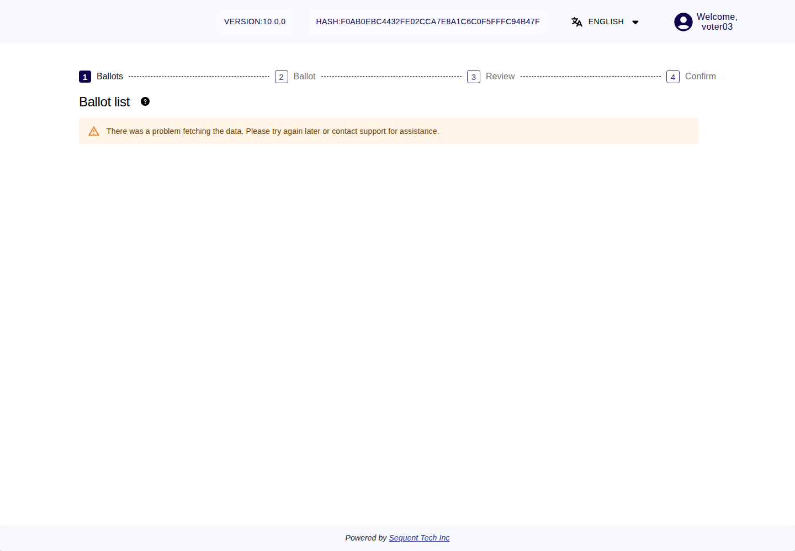
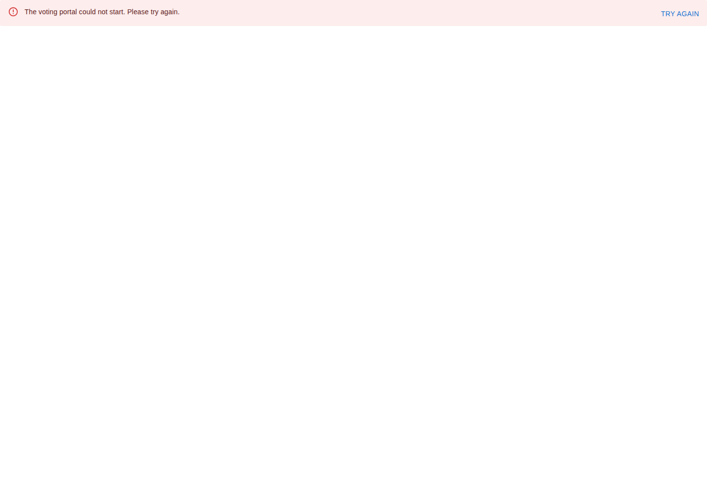

<!--
SPDX-FileCopyrightText: 2026 Sequent Tech Inc <legal@sequentech.io>
SPDX-License-Identifier: AGPL-3.0-only
-->

## States of an election

An election goes through these states, in the phases named in
[About the Handbook for Voters](01-about.md). The voting portal shows them to
you as follows.

| State (phase) | What you see | What you can do |
|---|---|---|
| Before voting starts (preparation) | The ballot shows "Closed". "Open:" shows a start time in the future, and "Election Begins in" shows the time left. | Wait until voting starts. You can already log in. |
| Voting is open (execution) | The ballot shows "Open" and "Click to Vote". | Vote, audit, check your cast ballot and copy your encrypted ballot. |
| Voting is paused (execution) | The ballot shows "Closed" during the election period. | Wait. Nobody can start or continue voting while voting is paused. Votes already cast stay stored. |
| Voting has ended (evaluation) | The ballot shows "Closed" after the end of the election period, or earlier if the election board has ended voting. The "Ballot list" may say "Voting closed on" followed by the closing time. | Nothing more. Voting cannot be reopened. "Locate your ballot" shows "Checks ended on" followed by the date. |
| Counting and result (evaluation, then post-processing) | The election board counts the votes and the result is determined. In the post-processing phase the election organizer publishes the verification data. | Check that your vote was counted, or ask an observer you trust to do it (see [Checking That Your Vote Was Stored and Counted](07-checking_storage.md)). |

## If a failure happens during voting

If the voting system detects a failure it can recover from while voting is
open, it puts the election into maintenance mode. In maintenance mode, voting
is paused for everyone: no voter can start or continue voting, and nobody can
read or change the stored votes through the voter interfaces. A ballot already
shown in your browser may show "Closed". When you load the ballot list again,
you may instead see the message below, with no voting button. Ballot lookup is
also unavailable during maintenance; this does not mean your stored vote has
been lost. Only the election board can resume voting, and the voting system
first checks itself before it allows that.

*The deployed voting portal during a recoverable maintenance state. The voter
has logged in, but cannot load a ballot or start voting.*

If you see "There was a problem fetching the data. Please try again later or
contact support for assistance.", wait and try again later. If it continues,
tell the election organizer the message and time. Do not use another voting
address to work around the refusal.

The same can happen at the start of the election period: the voting system
checks itself before it opens voting. If that check fails, voting does not
open. The ballot remains closed or the ballot list is unavailable until the
problem is solved.

For you this means:

- A ballot you had not cast is not cast. You keep your right to vote.
- A vote you had already cast stays stored.
- When voting is open again, log in, check "Voted" or "Not voted" in the "Ballot
  list", and vote if you have not voted yet.

If the failure cannot be repaired, voting in the election stops for good. The
election organizer then tells voters what happens next under the electoral
regulation.

## Logins refused to protect the records

The voting system keeps records of what happens during the election. If it can
no longer keep them safely (for example, because the storage for these records
is almost full), it refuses new voter logins and voter requests until the
problem is solved. The portal can show "The voting portal could not start.
Please try again." with a **Try again** button. Wait before trying again; if it
continues, contact the election organizer. The message alone does not identify
the cause or change whether a previous vote was cast.

*Actual rehearsal screen while new voter sign-in was refused to protect the
audit records. Existing cast votes remained stored. Voting stayed paused after
storage was restored until the election board authorized recovery.*

## Messages and what to do

When a message says "contact support", contact your election organizer. Always
tell them the message and the time.

| Message | What it means | What to do |
|---|---|---|
| "The voting portal could not start. Please try again." | The portal could not complete sign-in or startup. This can happen when the system refuses voter access to protect its records. | Wait and select **Try again**. If it continues, tell the election organizer the message and time. |
| "There was a problem fetching the data. Please try again later or contact support for assistance." | The portal could not load your ballots. This can happen during maintenance or a connection problem; the message alone does not identify the cause. | Wait and try again later. If it continues, contact the election organizer. The message does not confirm whether an earlier vote was cast. |
| "This election does not allow casting a vote. It may be closed, archived, or outside the allowed voting period" | Voting is not open for this ballot: it has not started, is paused or has ended. Your vote was not cast. | Look at the "Ballot list". If voting is paused, wait and try again when it shows "Open". |
| "A network problem occurred. Please try again later or contact support" | The connection to the voting system failed. | Check your internet connection. Check "Voted" or "Not voted" before you try again (see [Casting Your Vote](05-casting_your_vote.md)). |
| "A timeout occurred while casting your vote. Please try again later or contact support" | The voting system did not answer in time. Your vote may or may not have been cast. | Check "Voted" or "Not voted" and use "Locate your ballot" before you try again. |
| "An unknown error occurred while casting your vote. Please try again later or contact support" | Casting failed for an unknown reason. Your vote may or may not have been cast. | As above. |
| "There was a problem processing your vote. Please try again later or contact support" | The voting system could not process your vote. | As above. |
| "An internal error occurred while casting your vote. Please try again later or contact support" | An error in the voting system. | As above. |
| "Failed to validate your vote. Please try again later or contact support" | The voting system refused your encrypted ballot because it did not pass its checks, for example because it is a ballot you have audited. Your vote was not cast. | Open the ballot again with "Click to Vote" and vote with a new ballot, on a device you trust. If it happens again, tell the election organizer. |
| "The ballot id does not match with the cast vote." | The Ballot ID does not belong to the ballot sent. Your vote was not cast. | Tell the election organizer. Try again on a device you trust. |
| "There was an error related to the ballot hashing process." followed by "Please report this issue to support.", or a page "Oops! Unexpected Error" with "INCONSISTENT_HASH" | A confirmation of the intermediate ballot box, or the Ballot ID of your encrypted ballot, did not pass the check of your browser. | Do not cast a ballot on this device. Tell the election organizer (see [Checking That Your Vote Was Stored and Counted](07-checking_storage.md)). |
| "You are not authorized to cast a vote. Please contact support." | The voting system does not let you cast a vote in this ballot. | Contact the election organizer. |
| "Your session has expired. Please start again" | You took more than 5 minutes to log in again before casting. Your vote was not cast. | Open the ballot again with "Click to Vote". |
| "Login failed. Your username or password may be incorrect. Please try again or contact support" | Logging in again before casting failed. Your vote was not cast. | Open the ballot again and try again. |
| "Session storage is not available. Please try again or contact support." | Your browser did not keep the data needed to cast your vote. Your vote was not cast. | Try again. If it happens again, use another browser you trust. |
| "This ballot is not available. Please contact support" | The ballot cannot be shown. | Contact the election organizer. |
| "The election event hasn’t been published yet. Please try again later or contact support for assistance." | The election is not ready yet. | Try again later. |
| "There are no elections you can vote for. This could be because the area doesn’t have any contest associated. Please try again later or contact support for assistance." | You have no ballot to vote on. | Contact the election organizer if you expected one. |

Messages about re-voting are in [Voting Again](08-voting_again.md). Messages of
the ballot verifier are in [Auditing Your Ballot](06-auditing_your_ballot.md).
Messages about logging in are in [Logging In to Vote](04-logging_in.md).

## Signs that something is wrong

:::warning

**Stop and tell the election organizer** if you notice any of these:

- the browser shows a certificate or security warning (the real voting portal
  never causes one), or the address is not the one the election organizer gave
  you; do not try another address or link instead;
- the login page looks different from what the election organizer described,
  or someone asks you for your login details;
- your account is locked, or a ballot shows "Voted", although you have not
  logged in or voted;
- the ballot shows questions or options you did not expect, or the review
  screen shows selections you did not make;
- an audit fails (see [Auditing Your Ballot](06-auditing_your_ballot.md));
- your cast ballot is not found with "Locate your ballot", or the cast time is
  wrong;
- someone watches you vote, pressures you, or asks you to show how you voted.

Do not cast your vote while something looks wrong. Note what you saw, the
message and the time, and tell the election organizer. If you think you have
found a security flaw in the voting system, also report it as described below.

:::

## Reporting a security problem

If you think you have found a security flaw in the voting system, report it to
Sequent's security contact,
[security@sequentech.io](mailto:security@sequentech.io). Send questions about
suspected security flaws, including about a report you have made, to the same
address. You may also tell your election organizer, who forwards the report to
Sequent.

Encrypting your report is recommended. Use Sequent's security-contact OpenPGP
key, fingerprint `DB6B035E872AB5DA90C7194A60D3CBE30BAC91ED`. It is the key
with which the delivery of the voting system is verified (as the Deployment
Guide describes), and it is also published on Sequent's
[Vulnerability Disclosure Policy page](https://docs.sequentech.io/docusaurus/main/docs/technology/vulnerability-disclosure-policy).
Unencrypted reports are accepted and handled in the same way.

Your report should contain:

- the name of the election and the address of the voting portal;
- what happened, and what effect it had;
- the date, the time and your time zone;
- the steps that led to it;
- how Sequent can contact you.

:::warning

**Never put a password, a one-time code, a private key, a key share or how you
voted in a report.** Do not try to exploit the problem any further on a live
election.

:::

Sequent acknowledges your report within five business days and gives you the
reference of the flaw record for it. Use this reference when you ask about the
status of your report.
