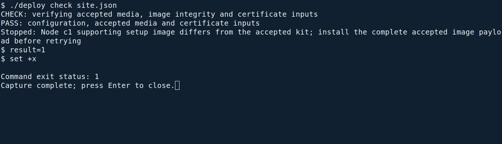
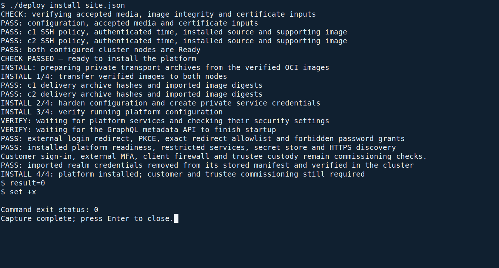

<!--
SPDX-FileCopyrightText: 2026 Sequent Tech Inc <legal@sequentech.io>
SPDX-License-Identifier: AGPL-3.0-only
-->

| Item | Value |
| --- | --- |
| Document ID | AGD-04 |
| Title | Deployment Guide |
| TOE reference | Sequent Voting Platform - uniWAHL Version, v10.0.0 |
| Document version | 1.0 |
| Software release | v10.0.0 |

This guide holds the preparative procedures of the Sequent Voting Platform -
uniWAHL Version, v10.0.0 (the TOE). It describes how to accept the delivered
TOE, how to prepare its operational environment and how to install and
configure the TOE, so that it starts in its evaluated configuration.

There is exactly one evaluated configuration: all seven TOE parts deployed and
operated together, on the operational environment that this guide describes, with
every setting this guide makes. A deployment that leaves out a step, changes a
setting or adds a component the guide does not name is not the evaluated
configuration.

## Who this guide is for

This guide is for the person who runs the servers, as the Handbook for Election
Administrators calls this person; this guide calls them the operator. In the TOE's
role model this is
the administrator in their platform duties: installing the servers and the
cluster, the certificates, the connection to the external authentication server,
the TOE images and the initial accounts. The operator needs root access to the
two servers and works from the administration workstation.

The administrator's duties inside the platform (users and roles, tenant and
election event settings, self-tests) are in the
[Handbook for Election Administrators (AGD-02)](../../02-election_managers/04-administrator_handbook/01-about.md).
The administrator never imports, reads or changes election data and never
reads the TOE's audit records (the electoral log): the election board imports
the election data and reviews the electoral log. The duties of the election
board and the trustees are in the
[Handbook for Election Organizers (AGD-03)](../../02-election_managers/05-election_organizer_handbook/01-about.md),
and the voters' guidance is the
[Handbook for Voters (AGD-01)](../../03-voters/02-voter_handbook/01-about.md).

## The TOE

| Part | What it does |
| --- | --- |
| harvest | Central backend: access control, voters' register, ballot boxes, import and export |
| windmill | Worker for the asynchronous tasks |
| keycloak | Identities, sessions and tokens; the link to the external authentication server |
| ballot-verifier | The voter's check that a ballot was cast as intended |
| election-verifier | Verifies the shuffle and decryption proofs of an election |
| braid | The trustee: key generation, mixing and threshold decryption |
| b4 | The bulletin board of the trustees |

Each part is an OCI image. The guidance documents AGD-01 to AGD-04 are
delivered with them. Everything else this guide installs is operational
environment, not TOE: the servers, the operating system and the cluster
software installed from the installation kit, the TLS endpoint and the ingress
in front of the TOE, the container runtime, the
database, the object storage, the GraphQL engine, the two web portals, the
network, the time server, the external authentication server and the web
browsers.

## Install from one configuration file

Start here. The normal platform installation is **two commands on the administration
workstation**. The `deploy` program is an actual file in the delivered
`deployment/` directory; it is not a command that must already be installed or a
function hidden in a special shell. Customer and trustee commissioning then uses
one further command, with checkpoints for the responsible people.

The first command checks the supplied configuration, files and servers. The second
prepares the hardened configuration, installs the platform and checks the result.
The detailed chapters explain those operations and their security conditions;
they are not a second list to repeat after the installer has run.

### Before running the installer

Complete these preparations once:

1. Accept the delivered TOE and guidance using
   [Verifying the Delivery](../08-delivery_verification.md), including its
   confirmation of receipt. The installation command does not authorize acceptance.
2. Provide the [Operational Environment](02-operational_environment.md), verify the
   installation kit and boot C1 and C2 from it as described in
   [Installing the Servers](03-installation_kit.md#install-c1-and-c2). The operator
   confirms the disk at each server console before it is erased.
   Use the administration SSH key authorized by the site file, and verify each
   server’s SSH host key through the server console before recording it in the
   workstation’s `known_hosts`. The installer refuses unknown or changed SSH host keys.
3. Obtain the site TLS certificate and private key from your certificate process,
   and the external identity provider's registration and CA certificate. The
   [certificate requirements](05-certificates_tls.md) and
   [identity-provider requirements](06-authentication_server.md) remain mandatory.
   The installer cannot issue a trusted certificate or register an application at
   another organization's identity provider for you.
4. Extract the verified guidance package. Open its `deployment/site.example.json`
   in a text editor, save a private working copy as `site.json`, and fill in the
   site's public values and file paths. Keep passwords, tokens and private keys
   out of this JSON file: it refers to protected files where those are needed.

The configuration is JSON, matching the installation kit's existing site-file
format. JSON makes the site values explicit without adding a YAML interpreter to
an offline workstation. The file is data; the installer does not execute it as
shell code.


Fill the configuration from the approved site plan and verified delivery records:

| Field | What to supply |
| --- | --- |
| `nodes` | C1 and C2 administration-network addresses |
| `ssh_identity` | Path to the administration workstation's protected SSH key |
| `hosts` | Voting, administration, ballot-verifier and external-authentication host names |
| `idp_alias` | The external provider's alias in the TOE |
| `kit` | Verified kit directory and the signing fingerprint received independently |
| `toe` | Accepted delivery root containing `images/` and `image-digests.txt`, `format: "oci"`, and the digest-list file's SHA-256 from the accepted delivery record |
| `tls` | Paths to the issued site certificate, protected private key and CA, plus the independently checked CA fingerprint |
| `identity_provider` | Paths to the protected provider definition and CA, plus the independently checked CA fingerprint |
| `operator` | The installation operator's existing identity-provider user name and e-mail; the separate service-administrator name |
| `release` | Software version and exact Step source revision from the accepted image provenance |
| `commissioning` | Customer slug, first administrator identity, and two trustee names with paths to their independently held key files; used by the commissioning command |

Use absolute paths. The example's addresses, hash placeholders and names are
examples only. The installer refuses unknown fields and invalid values. A
successful schema check does not prove that the values describe your approved site.

Point `toe.directory` directly at the accepted delivery medium. For example, this
section of `site.json` selects the OCI images already supplied by Sequent:

```json
"toe": {
  "directory": "/media/toe",
  "format": "oci",
  "manifest_sha256": "REPLACE_WITH_THE_ACCEPTED_IMAGE_DIGESTS_FILE_SHA256"
}
```

The medium contains `image-digests.txt` and one OCI image directory under `images/`
for each of the seven TOE parts. Leave those files unchanged. You do not create
tar files or enter six more hashes: the check validates the delivered image
descriptors and blobs, and installation prepares and checks its own temporary
transport archives for the six server images. The election-verifier image remains
part of the accepted delivery even though it is not installed on the servers.

Keep the `identity_provider.definition` file private: it contains the client
secret. Its format and required settings are described in
[Connecting the Authentication Server](06-authentication_server.md#write-the-provider-definition).
The certificate and CA inputs are checked before they are installed. Do not put
private-key contents, client secrets or passwords into `site.json`.

### Check the site

Open a root terminal on the administration workstation, in the extracted
`deployment` directory, and run:

```bash
./deploy check site.json
```

Here `./deploy` means the file named `deploy` in this directory, and `site.json`
is your working configuration. From another directory, use the full paths to both
files instead.

**Expected result.** The checks finish with
`CHECK PASSED — ready to install the platform`. Read the individual check results:
the file paths, certificates, server identities and policies must match this site.


*Actual terminal capture from the VM rehearsal on 2026-10-26. The check accepts
the delivered OCI image layout directly and verifies the media, certificates,
server access, authenticated time, private ingress and node readiness before
printing the success line. These isolated rehearsal VMs used corrected, prebuilt
operating-system configurations, a signed supporting-image rehearsal supplement
and a recorded laboratory time-server CA. This capture demonstrates the preflight
check; it does not show acceptance of a newly delivered ISO or a completed platform
installation.*

**If the result differs.** Correct the configuration or the named prerequisite and
run this read-only check again. Do not change a certificate fingerprint to match
an unexpected certificate, suppress an error, or proceed after a failed check.
A missing `deploy` means the terminal is not in the extracted directory; it does
not mean a package must be downloaded from the Internet. If existing platform
state is detected, stop: this fresh-install workflow is not an upgrade or an
instruction to clear an occupied cluster.

If the check reports missing supporting-image metadata or an incompatible
supporting image on a server, obtain the corrected complete signed installation
kit from Sequent. The installer compares the signed image and public-asset records
with the actual installed supporting image automatically. Do not edit an inventory,
replace an individual tool or accept a different image just to pass the check.



*Actual negative check from the same VM rehearsal. The command stopped with exit
status 1 before application installation because C1's supporting image did not
match the supplied kit. Treat this as a failed check and obtain the matching
complete kit; the earlier media-check success does not authorize installation.*

### Install the platform

After the check passes, run:

```bash
./deploy install site.json
```

Use the same configuration file. The installer works over the administration
network with the configured SSH identities; you do not log into each server to
paste a sequence of shell fragments.

Image transfer and verified public-asset setup can take several minutes. Keep the
terminal open while the installer reports progress. The message
`VERIFY: waiting for the GraphQL metadata API to finish startup` is a normal,
bounded readiness wait; it needs no additional command. If startup does not finish
within the allowed time, the installer stops and reports the failure.

**Expected result.** The installer reports its stages and ends with
`INSTALL 4/4: platform installed; customer and trustee commissioning still required`. This means the platform
installation finished; it does not mean the customer accounts, trustee custody or
election handover have been approved.



*Actual terminal capture from the clean VM rehearsal on 2026-10-26. The command
installed the accepted TOE OCI images, verified the running platform and removed
the imported realm credentials from its stored manifest before exiting with
status 0. The rehearsal used the corrected prebuilt operating-system
configurations and signed supporting-image fixture described above; it was not a
new ISO acceptance test. Customer and trustee commissioning still follow.*

**If the result differs.** Keep the reported stage and error. A stopped installation
may already have written files or started services: do not erase its state, repeat
secret generation or rerun a write blindly. Diagnose the named stage using the
corresponding reference chapter and Sequent's support procedure. Never put a
partially configured installation into operation.

### Commission the customer and trustees

Platform installation is followed by one commissioning command. First, create the
customer's tenant through the portal using the installation account, as described
in [Create the customer's tenant](08-installing_toe.md#create-the-customers-tenant).
Use the customer's agreed short name; do not create a second tenant if one already
exists.

Fill the `commissioning` section in the same `site.json`. It names that customer
slug, the first administrator's existing external identity, and the two trustees'
registered names and private key-file paths. Each trustee generates and retains
their own keys; this command does not generate election trustees' keys or take over
their custody decisions.

```bash
./deploy commission site.json
```

The command resolves the customer tenant and performs the account and server
configuration. Follow its checkpoints for the external identity-provider
registration, public-key registration in the portal and the trustees' physical
handover of their media. Type `CONTINUE` only after the stated action is complete.
These are actions by the responsible people; do not mark
them done merely to make the command continue.

**Expected result.** The configured customer administrator and both native trustee
instances pass their checks. The command ends with
`COMMISSIONING COMMANDS COMPLETE — perform the browser, client-network and board handover checks in AGD-04.` Complete the
remaining browser, MFA, client-network and board integrity-audit checks; a server check
alone cannot establish those conditions.


*Actual terminal capture from the same clean VM rehearsal. Both registered
public-key pairs were checked before import, both native trustees became ready,
and the command exited with status 0. This laboratory run used test key media to
exercise the custody checkpoints; it does not establish real trustees' physical
custody. Complete the site's browser, client-network and election-board handover
checks before operational use.*

**If the result differs.** Stop at the reported stage. Check the customer slug,
registered trustee names and key media with their owners. Never choose a different
tenant, substitute another trustee's keys, repeat account creation blindly or give
a personal account a local password.

Then complete the personal-account and role checks in [Initial Accounts](09-accounts.md)
and the browser, integrity-audit and handover checks in
[Verifying the Installation](10-verification.md) and
[Self-Test and Handover](11-selftest_handover.md). Keep the operator's confirmation
and the election board's decisions as actual records. Each person authenticates
at the external identity provider; the installer does not impersonate them.

### Repeat a check later

To repeat the read-only installation checks later, use:

```bash
./deploy verify site.json
```

A verification result describes the checks that ran. It is not an authorization
to hold an election or a record of evaluator acceptance.

Backup, restore and trustee-key removal are later lifecycle operations. They are
not performed by the installation command. Their explicit commands remain in the
relevant reference sections for use at the authorized lifecycle stage.

## Detailed operations and acceptance criteria

The following chapters preserve the configuration requirements, expected outputs
and fault handling needed to inspect an installation. An operation identifier such
as `04-check-secret-encryption` names a check in that reference; normal installation
uses the two commands above.

| Reference | Purpose |
| --- | --- |
| [Installing the Servers](03-installation_kit.md) | Kit acceptance, disk confirmation and installed-node checks |
| [Network, Time and Cluster Checks](04-hosts_network_time.md) | Firewall, root-key access, authenticated time and encrypted cluster secrets |
| [Certificates and TLS](05-certificates_tls.md) | Trusted site certificate and required TLS profile |
| [Connecting the Authentication Server](06-authentication_server.md) | Trusted external identity provider and its registration |
| [Configuring the Deployment](07-hardening.md) | Generated secrets, production identity settings, routes and role templates |
| [Installing the TOE](08-installing_toe.md) | Delivered image identities, customer tenant and trustee commissioning |
| [Initial Accounts](09-accounts.md) | Personal accounts, role separation and first sign-in |
| [Verifying the Installation](10-verification.md) | Runtime and browser acceptance checks |
| [Self-Test and Handover](11-selftest_handover.md) | Operator confirmation, actual audit scope, backups and recovery |

Never copy, print or send a password, private key, token or client secret. Do not
record an installation with shell tracing or an indiscriminate terminal transcript.
The real VM screenshots in this guide show only the stated, non-secret operations;
their example addresses and identifiers are not values to enter at your site.

## Document history

| Release | Changes |
| --- | --- |
| v10.0.0 | First edition for the evaluated configuration. |
