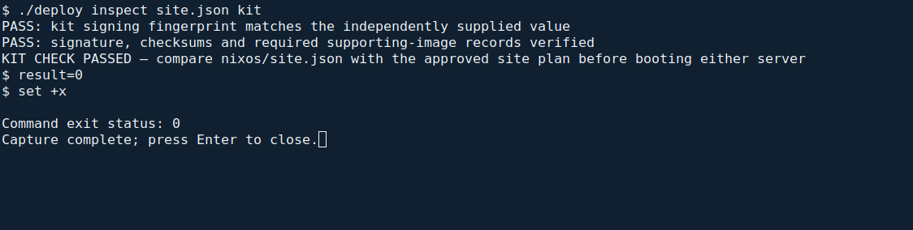
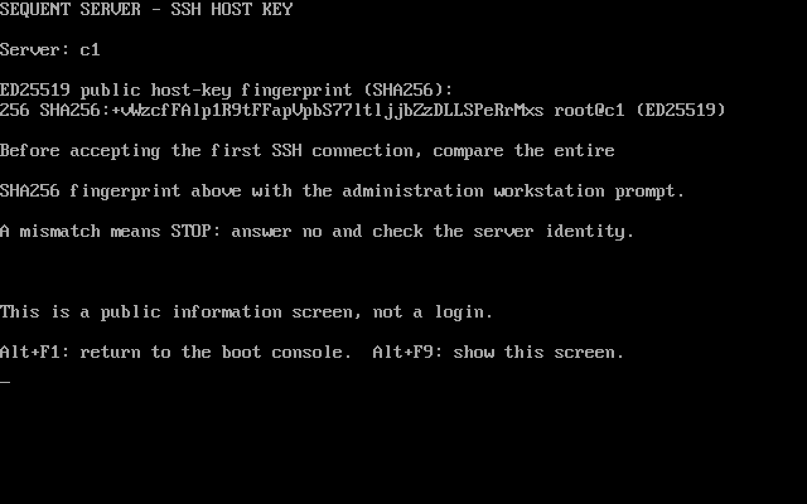
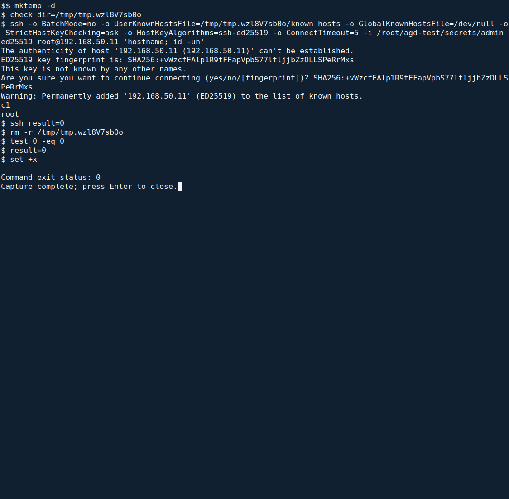

<!--
SPDX-FileCopyrightText: 2026 Sequent Tech Inc <legal@sequentech.io>
SPDX-License-Identifier: AGPL-3.0-only
-->

Start here after accepting the delivery and preparing the protected working
configuration described in [Before running the installer](01-about.md#before-running-the-installer).
This chapter verifies the installation kit, then installs the operating system
on C1 and C2. Application installation happens afterwards.

The kit is built for your site and delivered on a USB drive. It contains the
server installer image (`nixos/*.iso`), site file, cluster software and join
token, supporting images, cluster manifests, the `sequent` utility and signed
checksums. The kit is operational environment; TOE images come separately from
the accepted delivery medium.

## Verify the kit

<!-- deployment-step: 03-001 -->
<!-- deployment-step: 03-002 -->

**Where:** a root terminal on the administration workstation, in the extracted
and verified guidance package's `deployment` directory. Mount the kit read-only.
Set `kit.directory` in your working `site.json` to that mounted directory and
`kit.signing_fingerprint` to the fingerprint received separately from the kit.

Run this short pre-boot check:

```bash
./deploy inspect site.json kit
```

It uses the workstation's verification tools to check the independently received
fingerprint, the signature over the checksum list, the files and required
supporting-image records. It does not execute the kit's `sequent` program or
connect to either server. It can therefore run before either server is installed.

**Expected result:** both `PASS` lines, then
`KIT CHECK PASSED — compare nixos/site.json with the approved site plan before booting either server`.



*Actual rehearsal inspection. The command and final result illustrate the
pre-boot check; use the kit and independently supplied fingerprint for your site.*

**If it fails:** leave the kit unused. For a fingerprint mismatch, do not copy
the drive's fingerprint into your expected value. For a signature, checksum,
missing-file or supporting-image mismatch, obtain a corrected complete kit.
Do not remove checksum entries or regenerate a checksum list.

## Check the site file

<!-- deployment-step: 03-003 -->

After the kit passes, open its `nixos/site.json` **read-only** in your editor and
compare it with the approved site plan. Do not edit the delivered file in place.
The workstation's working `site.json` and the kit's `nixos/site.json` have
different purposes: the first supplies installation inputs; the second is built
into the server image.

| Compare | Required match |
| --- | --- |
| Site and network | Domain, interface, prefix length, gateway, DNS and NTS time-server addresses |
| Cluster network | Pod and service network ranges |
| Nodes | C1 has role `server`; C2 has role `agent`; names and addresses match the plan |
| Disks | Any pinned disk identifies the disk approved for erasure |
| `admin.authorizedKeys` | Only approved administration-workstation SSH public keys |
| `admin.allowedSourceCidr` | Only the administration workstation's approved source network |

**Expected result:** every row agrees with the approved plan. A successful file
signature or schema check does not prove that the delivered values describe your
site. Anyone holding a listed administration key has root access to both servers.

**If any value is wrong:** do not boot the installer. Ask Sequent for a kit built
from the corrected site definition. The [server disk-confirmation screenshot
below](#install-c1-and-c2) shows the next check after the site values are accepted;
its laboratory disk and network values are not defaults for your site.

## Install C1 and C2

:::warning
The installer erases the disk it shows. The USB drive also carries the cluster's
join token. Keep it under the same physical protection as the servers.
:::

1. Use your workstation's approved USB-image writer to write the accepted
   `nixos/*.iso` to the installation USB. Select the USB by its physical device
   identity; image writing replaces its existing contents.
2. Boot C1 from that USB in UEFI mode. The installer starts automatically.
   Press **1** to select C1.
3. Check the selected role, disk and capacity against the site plan. Press
   **Enter** only when the displayed disk is the approved disk to erase.
   Any other key cancels without writing.


*Actual C1 VM console from the installation rehearsal. `/dev/vda` and its capacity
identify the laboratory disk. Confirm your own physical disk before pressing Enter.*

4. Wait for **Installation complete**. Remove the USB and press any key to
   restart into the installed system.
5. Repeat on C2 with the same USB, selecting **2**. Install C1 first because C2
   joins it at first boot. Once both installations finish, lock away or destroy
   the installation USB according to the site's media procedure.


*Actual C2 VM console. This is operating-system installation completion;
application installation and customer/trustee commissioning still follow.*

**If it stops:** read the displayed error and whether writing began. Press
**Alt+F2** for the installer console and run:

```bash
tail -n 80 /run/sequent-install.log
```

This shows the last 80 installation log lines. Find the failed operation and
retain those lines with the installation record. The successful-installation
screen above is the completion reference; an error or a missing completion
message is not success. Do not repeat an erasing installation on the assumption
that the first attempt did nothing. Confirm the disk state and approved recovery
with the operator.

## Verify SSH host keys before first use

The installed servers do not have a console password. Each server automatically
prepares a **public SSH host-key fingerprint** screen during boot. This lets you
verify its identity before making the first SSH connection.

1. At C1's trusted physical or hypervisor console, press **Alt+F9**. In a remote
   console viewer, use its send-key menu if it intercepts that combination.
   Check that **Server** identifies C1 and record the complete `SHA256:…`
   fingerprint. No login is needed. **Alt+F1** returns to the boot console.



*Actual read-only display service running on the isolated rehearsal C1 VM.
The existing fixture was updated for this capture; this is not a new installer
image acceptance test. Your server generates its own fingerprint.*

2. Return to the root terminal on the administration workstation, in the
   guidance package's `deployment` directory. Read the C1 address and approved
   key path from your working configuration, then connect:

```bash
SERVER=$(jq -er '.nodes.c1' site.json)
ADMIN_KEY=$(jq -er '.ssh_identity' site.json)
ssh -o BatchMode=no -o StrictHostKeyChecking=ask \
  -o HostKeyAlgorithms=ssh-ed25519 -i "$ADMIN_KEY" "root@$SERVER" 'hostname; id -un'
```

3. Compare the **entire** fingerprint in the SSH prompt with C1's console.
   Only if they match, enter the complete `SHA256:…` value from the console
   at the `yes/no/[fingerprint]` prompt. SSH accepts a matching fingerprint,
   records the host key, and authenticates with your administration key.

**Expected result:** the first connection reports that the host was added to
known hosts, then prints C1's configured name and `root`. It returns to the
workstation prompt. If that exact host key was already verified and recorded,
there is no first-use question.



*Actual SSH connection to the rehearsal C1 VM: the fingerprint matches the
console above, and `hostname; id -un` returns `c1` and `root`. The capture uses
a temporary known-hosts file to replay first use; use the normal command above
so your verified keys remain available to the installer.*

4. Repeat the console comparison on **C2**; it has its own host key. At the
   workstation run the following, then enter C2's matching fingerprint:

```bash
SERVER=$(jq -er '.nodes.c2' site.json)
ssh -o BatchMode=no -o StrictHostKeyChecking=ask \
  -o HostKeyAlgorithms=ssh-ed25519 -i "$ADMIN_KEY" "root@$SERVER" 'hostname; id -un'
```

**Expected result:** C2's configured name and `root`.

**If something differs:** a missing console fingerprint, unexpected server
name, different fingerprint or changed-host warning means **stop**. Answer
`no` to a new-key prompt. Check the physical server, approved address and any
authorized reinstall before updating trust. Never disable host-key checking
or delete a known-host entry merely to silence a warning. If the fingerprint
matches but authentication fails, check that the approved key matches
`admin.authorizedKeys` in the accepted site definition.

## Check the installed servers

<!-- deployment-step: 03-004 -->

After verifying both SSH host keys above, run the single
[site preflight](01-about.md#check-the-site) from the administration workstation's
`deployment` directory:

```bash
./deploy check site.json
```

**Expected result:** `PASS: both configured cluster nodes are Ready`, followed by
`CHECK PASSED — ready to install the platform`.


**If it fails:** for SSH refusal, check the workstation's source network, node
addresses and authorized key. For an unknown or changed host key, verify it at
the server console; never disable host-key checking. For a missing or unready
node, inspect the boot logs and inter-node network. Do not install applications
until both configured nodes are ready.

## Prepare the deployment directory

<!-- deployment-step: 03-005 -->
<!-- deployment-step: 03-006 -->

**Automatic part of `./deploy install site.json`.** The installer creates
`/root/deploy` on each server with mode `700`, and its public site-values file
`hosts.env` with mode `600`, owned by root. It creates C1's working copy of the
verified cluster manifests. You do not type values into separate server shell
sessions or copy these manifests yourself.

`hosts.env` contains the web host names, authentication host and alias, node
addresses and the installation realm. Commissioning adds the customer realm;
preserve that value during authorized maintenance. Protected passwords and keys
are separate inputs and must not be printed.

Continue at [Install the platform](01-about.md#install-the-platform). Its actual
terminal capture and expected final message cover this automatic directory and
manifest preparation. If installation reports a permission, existing-directory
or missing-manifest error, stop and inspect the partial state; do not recursively
copy into an existing directory or replace the customer realm blindly.
