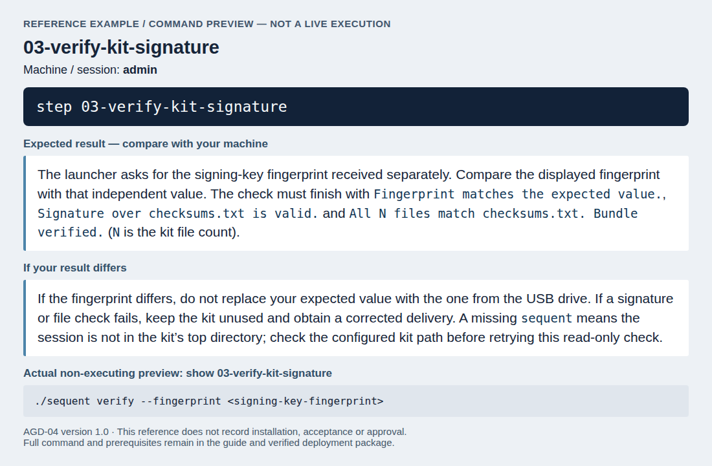
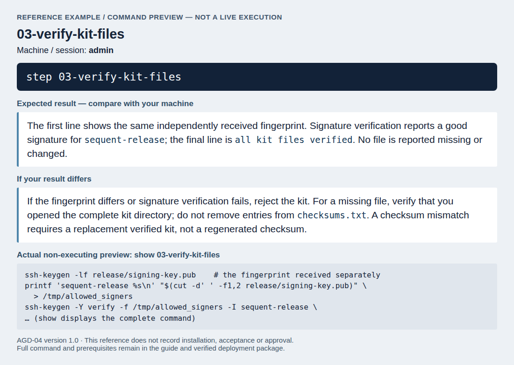
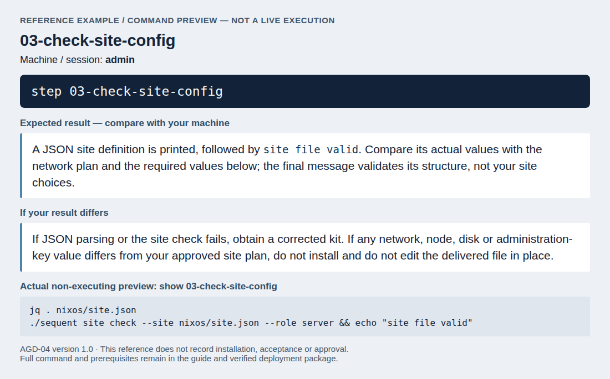
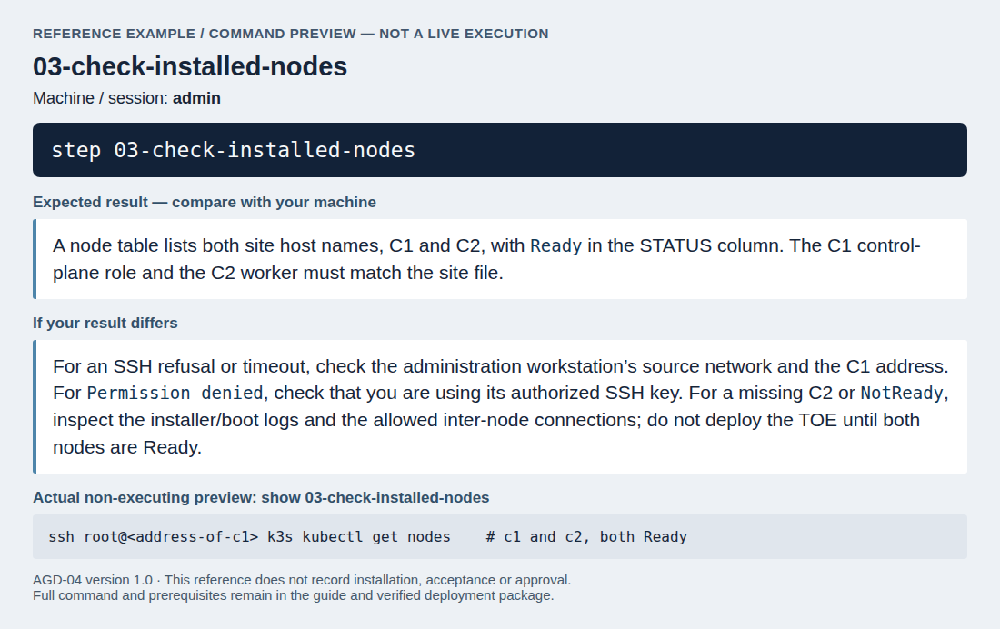
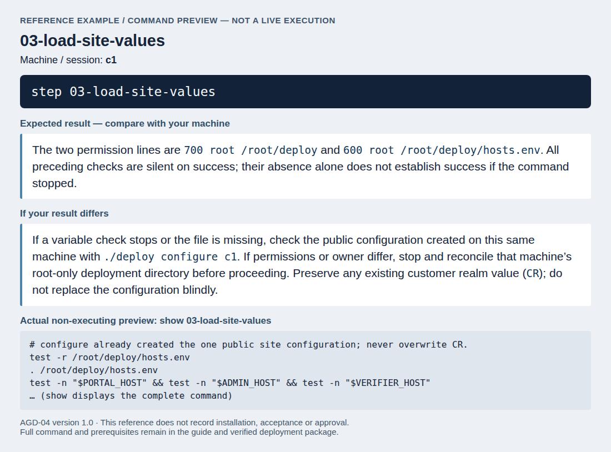
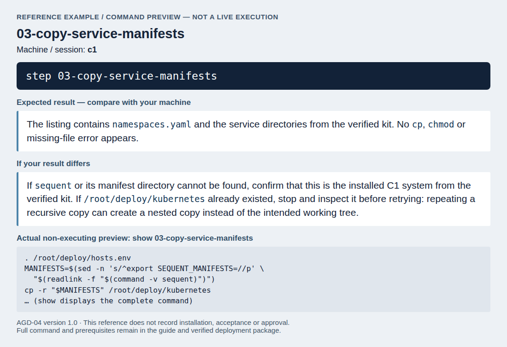

<!--
SPDX-FileCopyrightText: 2026 Sequent Tech Inc <legal@sequentech.io>
SPDX-License-Identifier: AGPL-3.0-only
-->

The two servers are installed from the installation kit. Sequent builds the
kit for your site from the site file you provide and delivers it on a USB
drive. The fingerprint of the key that signs it comes separately from the
drive. The kit contains the installer image (`nixos/*.iso`) with the operating
system of both servers, the cluster software, the supporting images, the site
file and the cluster's join token; the cluster manifests (`kubernetes/`); the
`sequent` command; and `checksums.txt`, its signature `checksums.txt.sig` and
the public key `release/signing-key.pub`.

The kit is operational environment. The TOE images come from the verified
delivery medium, never from the kit (see [Installing the TOE](08-installing_toe.md)).

## Verify the kit

:::warning
Install nothing from a kit that fails this check. The kit carries the
operating system of the servers and the join token of the cluster.
:::

On the administration workstation, in the kit's top directory, run the kit's
own check with the fingerprint you received separately:

<!-- deployment-step: 03-001 -->

**Run on: `admin`.** In that machine’s deployment session, enter:

```bash
step 03-verify-kit-signature
```

**Expected result.** The launcher asks for the signing-key fingerprint received separately. Compare the displayed fingerprint with that independent value. The check must finish with `Fingerprint matches the expected value.`, `Signature over checksums.txt is valid.` and `All N files match checksums.txt. Bundle verified.` (`N` is the kit file count).

**If the result differs.** If the fingerprint differs, do not replace your expected value with the one from the USB drive. If a signature or file check fails, keep the kit unused and obtain a corrected delivery. A missing `sequent` means the session is not in the kit’s top directory; check the configured kit path before retrying this read-only check.



*Reference screenshot of the command and its documented checks; it is not a record of a successful run on your servers.*

It must print, in this order, the lines `Signing key fingerprint: ...` (the
fingerprint you received), `Fingerprint matches the expected value.`,
`Signature over checksums.txt is valid.` and
`All N files match checksums.txt. Bundle verified.`

Then check the kit a second time with the standard tools, so that the result
does not depend only on a program from the kit:

<!-- deployment-step: 03-002 -->

**Run on: `admin`.** In that machine’s deployment session, enter:

```bash
step 03-verify-kit-files
```

**Expected result.** The first line shows the same independently received fingerprint. Signature verification reports a good signature for `sequent-release`; the final line is `all kit files verified`. No file is reported missing or changed.

**If the result differs.** If the fingerprint differs or signature verification fails, reject the kit. For a missing file, verify that you opened the complete kit directory; do not remove entries from `checksums.txt`. A checksum mismatch requires a replacement verified kit, not a regenerated checksum.



*Reference screenshot of the command and its documented checks; it is not a record of a successful run on your servers.*

`ssh-keygen -Y verify` must report a good signature for `sequent-release`, and
the last command must print `all kit files verified`.

## Check the site file

The kit's `nixos/site.json` is the site file built into the installer. It
must describe your site exactly:

<!-- deployment-step: 03-003 -->

**Run on: `admin`.** In that machine’s deployment session, enter:

```bash
step 03-check-site-config
```

**Expected result.** A JSON site definition is printed, followed by `site file valid`. Compare its actual values with the network plan and the required values below; the final message validates its structure, not your site choices.

**If the result differs.** If JSON parsing or the site check fails, obtain a corrected kit. If any network, node, disk or administration-key value differs from your approved site plan, do not install and do not edit the delivered file in place.



*Reference screenshot of the command and its documented checks; it is not a record of a successful run on your servers.*

Compare each value with your network plan: `site.domain`; under `network` the
interface, prefix length, gateway, `dns` and `ntp` (IP addresses of your DNS
and NTS time servers), `podCidr` and `serviceCidr`; under `nodes` the host
names and addresses of C1 (role `server`) and C2 (role `agent`) and any pinned
disks.

:::warning
`admin.authorizedKeys` must contain only the SSH public key of the
administration workstation, and `admin.allowedSourceCidr` only the network of
that workstation. Anyone holding a listed key has root access to both
servers. If a value is wrong, do not install: ask Sequent for a kit built from
a corrected site file.
:::

## Install C1 and C2

:::warning
The installer erases the disk it shows. Keep the USB stick as securely as the
servers: it carries the cluster's join token. After both installations, keep it
locked away or destroy it.
:::

1. Write `nixos/*.iso` to a USB stick and boot C1 from it in UEFI mode.
2. The installer starts by itself. Press **1** for C1.
3. It shows the disk it will erase. Press **Enter** to install; any other key
   cancels without writing anything.
4. When it says *Installation complete*, remove the USB stick and press any
   key. C1 restarts into the installed system.
5. Repeat on C2 with the same stick, pressing **2**. Install C1 first: C2
   joins it at first boot.

If the installer stops, the screen says why and whether anything was written.
Alt+F2 opens a console with the log at `/run/sequent-install.log`.

Check from the administration workstation that both nodes are in the cluster:

<!-- deployment-step: 03-004 -->

**Run on: `admin`.** In that machine’s deployment session, enter:

```bash
step 03-check-installed-nodes
```

**Expected result.** A node table lists both site host names, C1 and C2, with `Ready` in the STATUS column. The C1 control-plane role and the C2 worker must match the site file.

**If the result differs.** For an SSH refusal or timeout, check the administration workstation’s source network and the C1 address. For `Permission denied`, check that you are using its authorized SSH key. For a missing C2 or `NotReady`, inspect the installer/boot logs and the allowed inter-node connections; do not deploy the TOE until both nodes are Ready.



*Reference screenshot of the command and its documented checks; it is not a record of a successful run on your servers.*

## Prepare the deployment directory

All later configuration is made in `/root/deploy` on C1, a directory that only
root can read. Start the configured C1 session and check the public file of
shell variables created by `./deploy configure c1`:

<!-- deployment-step: 03-005 -->

**Run on: `c1`.** In that machine’s deployment session, enter:

```bash
step 03-load-site-values
```

**Expected result.** The two permission lines are `700 root /root/deploy` and `600 root /root/deploy/hosts.env`. All preceding checks are silent on success; their absence alone does not establish success if the command stopped.

**If the result differs.** If a variable check stops or the file is missing, check the public configuration created on this same machine with `./deploy configure c1`. If permissions or owner differ, stop and reconcile that machine’s root-only deployment directory before proceeding. Preserve any existing customer realm value (`CR`); do not replace the configuration blindly.



*Reference screenshot of the command and its documented checks; it is not a record of a successful run on your servers.*

- PORTAL_HOST, ADMIN_HOST and VERIFIER_HOST are the full host names of the
  voting portal, the administration portal and the ballot verifier.
- AUTH_HOST is the host name of the external authentication server.
- IDP_ALIAS is a short name for that server inside the TOE, in lower-case
  letters, digits and hyphens.
- R is the name of the realm of the super-admin tenant, which serves only
  the steps of this guide. Do not change it.
  [Create the customer's tenant](08-installing_toe.md#create-the-customers-tenant)
  later adds CR, the name of the customer's realm.

Configure each other machine with the same public site values. Its session
loads its own `hosts.env` automatically. The directory must be mode 700 and the
file mode 600, both owned by root. Keep any later CR addition when reopening a session.

Then make a working copy of the cluster manifests that the `sequent` command
carries. All later changes are made to this copy:

<!-- deployment-step: 03-006 -->

**Run on: `c1`.** In that machine’s deployment session, enter:

```bash
step 03-copy-service-manifests
```

**Expected result.** The listing contains `namespaces.yaml` and the service directories from the verified kit. No `cp`, `chmod` or missing-file error appears.

**If the result differs.** If `sequent` or its manifest directory cannot be found, confirm that this is the installed C1 system from the verified kit. If `/root/deploy/kubernetes` already existed, stop and inspect it before retrying: repeating a recursive copy can create a nested copy instead of the intended working tree.



*Reference screenshot of the command and its documented checks; it is not a record of a successful run on your servers.*
