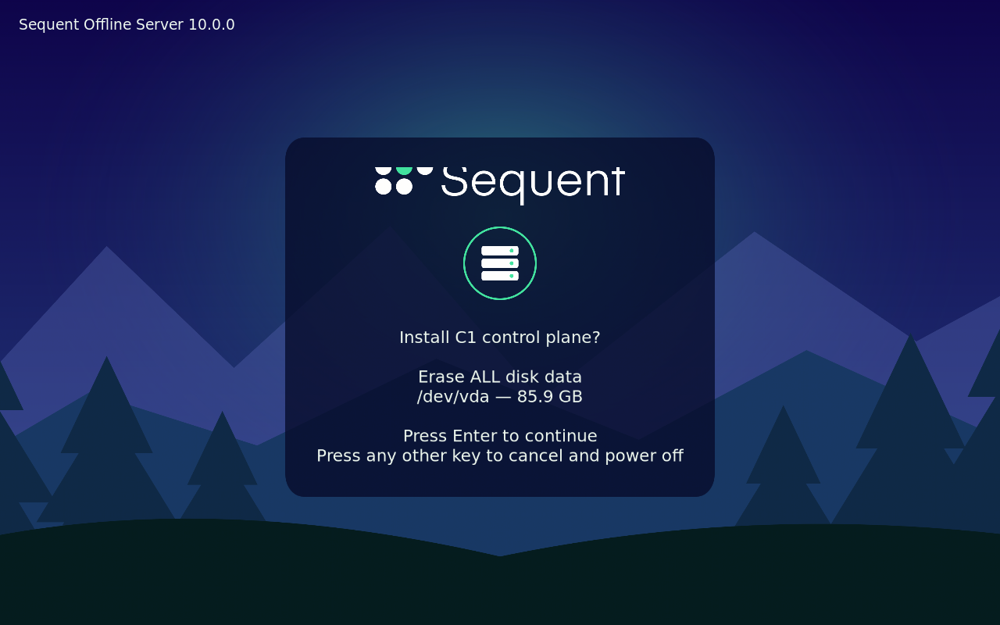
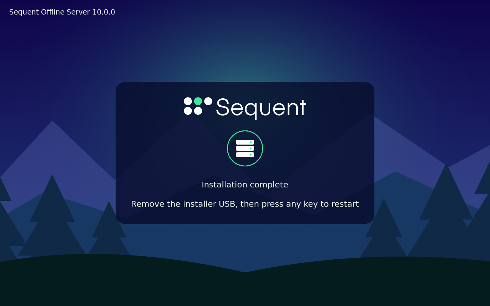

<!--
SPDX-FileCopyrightText: 2026 Sequent Tech Inc <legal@sequentech.io>
SPDX-License-Identifier: AGPL-3.0-only
-->

The two servers are installed from the installation kit. Sequent builds the
kit for your site from the site file you provide and delivers it on a USB
drive. The fingerprint of the key that signs it comes separately from the
drive. The kit contains the installer image (`nixos/*.iso`) with the operating
system of both servers, the cluster software, the supporting images, the site
file and the cluster's join token; the cluster manifests (`kubernetes/`); the
`sequent` command; and `checksums.txt`, its signature `checksums.txt.sig` and
the public key `release/signing-key.pub`.

The kit is operational environment. The TOE images come from the verified
delivery medium, never from the kit (see [Installing the TOE](08-installing_toe.md)).

## Verify the kit

:::warning
Install nothing from a kit that fails this check. The kit carries the
operating system of the servers and the join token of the cluster.
:::

On the administration workstation, in the kit's top directory, run the kit's
own check with the fingerprint you received separately:

<!-- deployment-step: 03-001 -->

**Operation reference:** `03-verify-kit-signature` on `admin`.

```bash
read -r -p "Signing-key fingerprint received separately: " FINGERPRINT
./sequent verify --fingerprint "$FINGERPRINT"
```

**Expected result.** The first line asks for the signing-key fingerprint received separately. Compare the displayed fingerprint with that independent value. The check must finish with `Fingerprint matches the expected value.`, `Signature over checksums.txt is valid.` and `All N files match checksums.txt. Bundle verified.` (`N` is the kit file count).

**If the result differs.** If the fingerprint differs, do not replace your expected value with the one from the USB drive. If a signature or file check fails, keep the kit unused and obtain a corrected delivery. A missing `sequent` means the session is not in the kit’s top directory; check the configured kit path before retrying this read-only check.


It must print, in this order, the lines `Signing key fingerprint: ...` (the
fingerprint you received), `Fingerprint matches the expected value.`,
`Signature over checksums.txt is valid.` and
`All N files match checksums.txt. Bundle verified.`

Then check the kit a second time with the standard tools, so that the result
does not depend only on a program from the kit:

<!-- deployment-step: 03-002 -->

**Operation reference:** `03-verify-kit-files` on `admin`.

```bash
set -e -o pipefail
ssh-keygen -lf release/signing-key.pub    # the fingerprint received separately
printf 'sequent-release %s\n' "$(cut -d' ' -f1,2 release/signing-key.pub)" \
  > /tmp/allowed_signers
ssh-keygen -Y verify -f /tmp/allowed_signers -I sequent-release \
  -n sequent-release -s checksums.txt.sig < checksums.txt
sha256sum --check --strict --quiet checksums.txt && echo "all kit files verified"
```

**Expected result.** The first line shows the same independently received fingerprint. Signature verification reports a good signature for `sequent-release`; the final line is `all kit files verified`. No file is reported missing or changed.

**If the result differs.** If the fingerprint differs or signature verification fails, reject the kit. For a missing file, verify that you opened the complete kit directory; do not remove entries from `checksums.txt`. A checksum mismatch requires a replacement verified kit, not a regenerated checksum.


`ssh-keygen -Y verify` must report a good signature for `sequent-release`, and
the last command must print `all kit files verified`.

## Check the site file

The kit's `nixos/site.json` is the site file built into the installer. It
must describe your site exactly:

<!-- deployment-step: 03-003 -->

**Operation reference:** `03-check-site-config` on `admin`.

```bash
jq . nixos/site.json
./sequent site check --site nixos/site.json --role server && echo "site file valid"
```

**Expected result.** A JSON site definition is printed, followed by `site file valid`. Compare its actual values with the network plan and the required values below; the final message validates its structure, not your site choices.

**If the result differs.** If JSON parsing or the site check fails, obtain a corrected kit. If any network, node, disk or administration-key value differs from your approved site plan, do not install and do not edit the delivered file in place.


Compare each value with your network plan: `site.domain`; under `network` the
interface, prefix length, gateway, `dns` and `ntp` (IP addresses of your DNS
and NTS time servers), `podCidr` and `serviceCidr`; under `nodes` the host
names and addresses of C1 (role `server`) and C2 (role `agent`) and any pinned
disks.

:::warning
`admin.authorizedKeys` must contain only the SSH public key of the
administration workstation, and `admin.allowedSourceCidr` only the network of
that workstation. Anyone holding a listed key has root access to both
servers. If a value is wrong, do not install: ask Sequent for a kit built from
a corrected site file.
:::

## Install C1 and C2

:::warning
The installer erases the disk it shows. Keep the USB stick as securely as the
servers: it carries the cluster's join token. After both installations, keep it
locked away or destroy it.
:::

1. Write `nixos/*.iso` to a USB stick and boot C1 from it in UEFI mode.
2. The installer starts by itself. Press **1** for C1.
3. It shows the disk it will erase. Press **Enter** to install; any other key
   cancels without writing anything.
4. When it says *Installation complete*, remove the USB stick and press any
   key. C1 restarts into the installed system.
5. Repeat on C2 with the same stick, pressing **2**. Install C1 first: C2
   joins it at first boot.



*Actual C1 VM console captured during the site-kit installation rehearsal on
2026-10-25. Check the role, disk and capacity on your own server before confirming;
`/dev/vda` and the displayed capacity belong to this rehearsal.*



*Actual C2 VM console from the same installation rehearsal. This message means the
server operating system has been installed. Remove the installer media and restart;
the platform installation and commissioning still follow.*

If the installer stops, the screen says why and whether anything was written.
Alt+F2 opens a console with the log at `/run/sequent-install.log`.

Check from the administration workstation that both nodes are in the cluster:

<!-- deployment-step: 03-004 -->

**Operation reference:** `03-check-installed-nodes` on `admin`.

**Expected result.** A node table lists both site host names, C1 and C2, with `Ready` in the STATUS column. The C1 control-plane role and the C2 worker must match the site file.

**If the result differs.** For an SSH refusal or timeout, check the administration workstation’s source network and the C1 address. For `Permission denied`, check that you are using its authorized SSH key. For a missing C2 or `NotReady`, inspect the installer/boot logs and the allowed inter-node connections; do not deploy the TOE until both nodes are Ready.


## Prepare the deployment directory

All later configuration is made in `/root/deploy` on C1, a directory that only
root can read. The installer creates this directory and its public `hosts.env`
from the validated site configuration; the operator does not configure a separate
shell session on every machine:

<!-- deployment-step: 03-005 -->

**Operation reference:** `03-load-site-values` on `c1`.

**Expected result.** The two permission lines are `700 root /root/deploy` and `600 root /root/deploy/hosts.env`. All preceding checks are silent on success; their absence alone does not establish success if the command stopped.

**If the result differs.** If a variable check stops or the file is missing, compare the reported installation stage with the validated `site.json`. If permissions or owner differ, stop and reconcile that machine’s root-only deployment directory before proceeding. Preserve any existing customer realm value (`CR`); do not replace the configuration blindly.


- PORTAL_HOST, ADMIN_HOST and VERIFIER_HOST are the full host names of the
  voting portal, the administration portal and the ballot verifier.
- AUTH_HOST is the host name of the external authentication server.
- IDP_ALIAS is a short name for that server inside the TOE, in lower-case
  letters, digits and hyphens.
- R is the name of the realm of the super-admin tenant, which serves only
  the steps of this guide. Do not change it.
  [Create the customer's tenant](08-installing_toe.md#create-the-customers-tenant)
  later adds CR, the name of the customer's realm.

The installer transfers the same public site values to the nodes. The directory
must be mode 700 and the file mode 600, both owned by root. Commissioning adds the
customer realm; preserve it during later maintenance.

Then make a working copy of the cluster manifests that the `sequent` command
carries. All later changes are made to this copy:

<!-- deployment-step: 03-006 -->

**Operation reference:** `03-copy-service-manifests` on `c1`.

**Expected result.** The listing contains `namespaces.yaml` and the service directories from the verified kit. No `cp`, `chmod` or missing-file error appears.

**If the result differs.** If `sequent` or its manifest directory cannot be found, confirm that this is the installed C1 system from the verified kit. If `/root/deploy/kubernetes` already existed, stop and inspect it before retrying: repeating a recursive copy can create a nested copy instead of the intended working tree.
