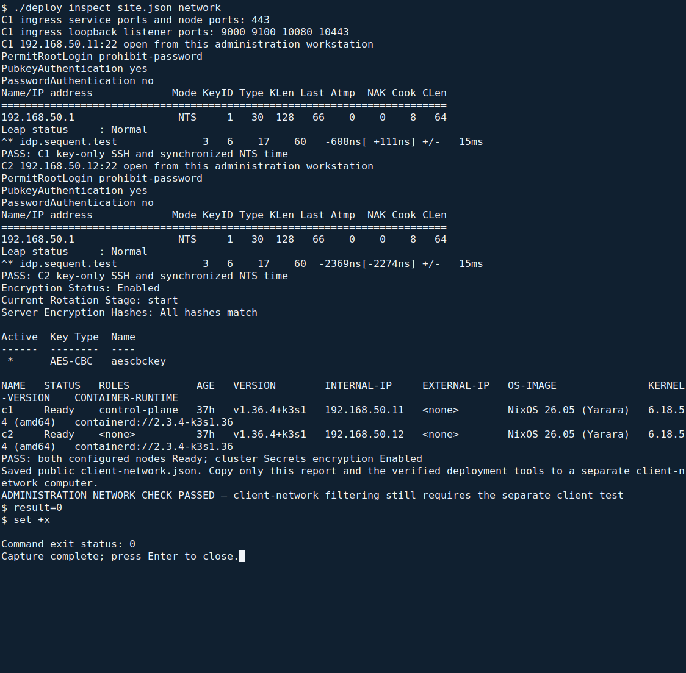
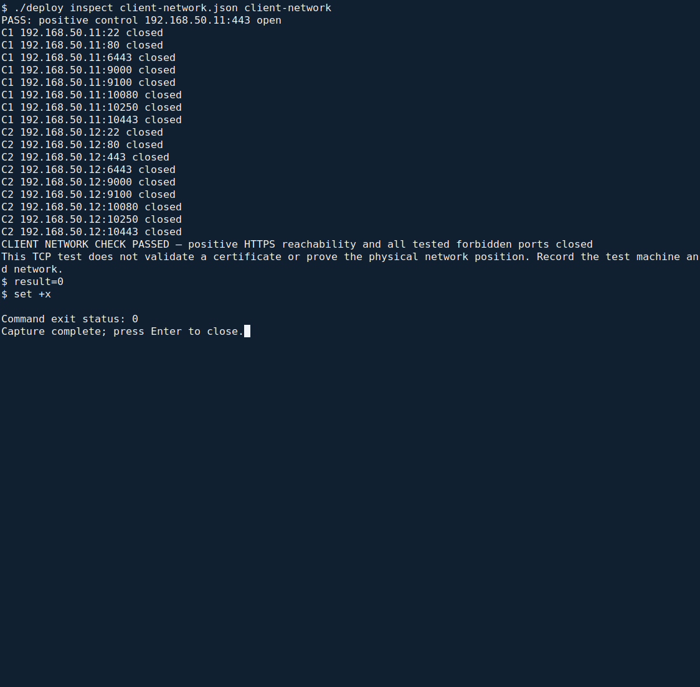

<!--
SPDX-FileCopyrightText: 2026 Sequent Tech Inc <legal@sequentech.io>
SPDX-License-Identifier: AGPL-3.0-only
-->

Use the read-only inspection below to see the actual network, SSH, time,
secret-encryption and node results. The initial `./deploy check site.json`
already enforces the corresponding pre-installation requirements; this inspection
also works after installation and exports the public inputs for the separate
client-network check.

## Inspect from the administration workstation

**Where:** a root terminal on the administration workstation, in the extracted
`deployment` directory containing the same approved `site.json`.

```bash
./deploy inspect site.json network
```

It connects to C1 and C2 using the configured administration key and verified
SSH host keys. It prints the checks below and writes **`client-network.json`** in
the current directory. That report contains only node addresses, the voting host
and actual ingress ports; it contains no SSH key path, credential or secret.



*Actual inspection against the rehearsal VMs. Use the values printed by your own
run. The report also includes loopback listener ports so the client-network test
does not omit an ingress listener.*

**Expected final result:**
`ADMINISTRATION NETWORK CHECK PASSED — client-network filtering still requires the separate client test`.
Each individual result below must also pass.

**If it stops:** use the named failure and the matching section below. Do not
continue on partial output. If `client-network.json` already exists with different
contents, preserve that earlier report and run the inspection from a clean
working copy of the verified `deployment` directory; do not silently reuse old
port or node values.

## Network filtering

<!-- deployment-step: 04-001 -->
<!-- deployment-step: 04-007 -->

The inspection prints these lines automatically:

- **C1 ingress service ports and node ports:** actual values read from the
  Traefik service. Missing ports or an unavailable service fail the inspection.
- **C1 ingress loopback listener ports:** actual configured listener ports.
  Any listener not restricted to C1's loopback address fails the inspection.
- **C1/C2 address:22 open:** SSH is reachable from this administration workstation.
  The same run then checks authenticated, key-only SSH access.

<!-- deployment-step: 04-002 -->

The [site firewall](02-operational_environment.md#network) must expose only the
approved connections. Test its client side from a **separate computer connected
to a client network**, after the TLS endpoint has been installed:

1. Copy the verified `deployment` tools and the newly generated
   `client-network.json` to that computer. **Do not copy `site.json`, private keys,
   passwords or provider definitions.**
2. Open a terminal in that copied `deployment` directory. It needs Python 3;
   it does not need root access or an administration SSH key.
3. Run:

   ```bash
   ./deploy inspect client-network.json client-network
   ```



*Actual laboratory client-network test. The test must run from the corresponding
client network at your site. A run from the administration workstation does not
prove the client-side firewall rule.*

**Expected result:** the positive control reports C1 port 443 `open`; every
forbidden address/port reports `closed`; the final line is
`CLIENT NETWORK CHECK PASSED — positive HTTPS reachability and all tested forbidden ports closed`.
The tested ports include SSH, plain HTTP, cluster API/kubelet and the actual
service, node and loopback ingress ports. C2 port 443 must also be closed.

**If the positive control fails:** first establish that this computer is actually
on the intended client network, the route works and C1's TLS endpoint is running.
An unreachable computer that reports every port closed has not passed the test.

**If any forbidden port is open:** stop and correct the controlled site firewall.
Do not broaden SSH access to make administration work. Repeat this client-side
check afterwards. Record the test machine, network position and result; TCP
reachability alone does not validate a certificate, so also perform
[Check the TLS profile](05-certificates_tls.md#check-the-tls-profile).

## SSH access

<!-- deployment-step: 04-003 -->

The `network` inspection above checks **both servers** and prints their policy:

| Setting | Required output |
| --- | --- |
| Password login | `passwordauthentication no` |
| Public-key login | `pubkeyauthentication yes` |
| Root login | `permitrootlogin prohibit-password` or `permitrootlogin without-password` |

Each server must then report `PASS: C1 key-only SSH and synchronized NTS time`
or the corresponding C2 line. The [inspection screenshot](#inspect-from-the-administration-workstation)
shows these actual policy results; no additional hidden server command is needed.

**If it differs:** stop. Root login `yes` permits an unacceptable password path;
root login `no` prevents the required administration-key access. Check the
installed kit and approved site configuration. Do not loosen policy as a workaround.

## Authenticated time

<!-- deployment-step: 04-004 -->

The same inspection prints the `chronyc` authentication table, leap status and
selected source on **both C1 and C2**. Every source must show `NTS`; leap status
must be `Normal`; a site time server must be selected (marked `*`).

**If it differs:** investigate DNS and the permitted UDP-123/TCP-4460 paths with
the time-server operator. A non-NTS source, no selected source or unsynchronized
clock is a failure. Do not continue or hand-edit the installed time configuration
into a weaker mode. The combined PASS line appears only after the SSH and all
three time conditions pass.

## Encryption of cluster secrets

<!-- deployment-step: 04-005 -->

The inspection prints C1's secret-encryption status. It must include the literal
line **`Encryption Status: Enabled`**. Other key-rotation details do not replace
this requirement.

**If disabled or unavailable:** stop before creating application Secrets.
Confirm that C1 came from the approved kit and have the operator resolve the
installation. Do not create Secrets as a test or enable encryption ad hoc on an
unknown cluster state.

## Cluster nodes

<!-- deployment-step: 04-006 -->

The inspection prints the actual node table and checks it again as structured
data. There must be exactly two nodes, both `Ready`, with internal addresses
matching `nodes.c1` and `nodes.c2` in `site.json`.

**If a node is missing, unready or at the wrong address:** stop and reconcile
its boot state, network and approved site definition. The initial preflight
also requires a fresh cluster with no existing `step-apps` or `step-infra`
installation; a later read-only inspection may legitimately see the running
platform. Do not mistake a healthy existing deployment for a fresh installation.
