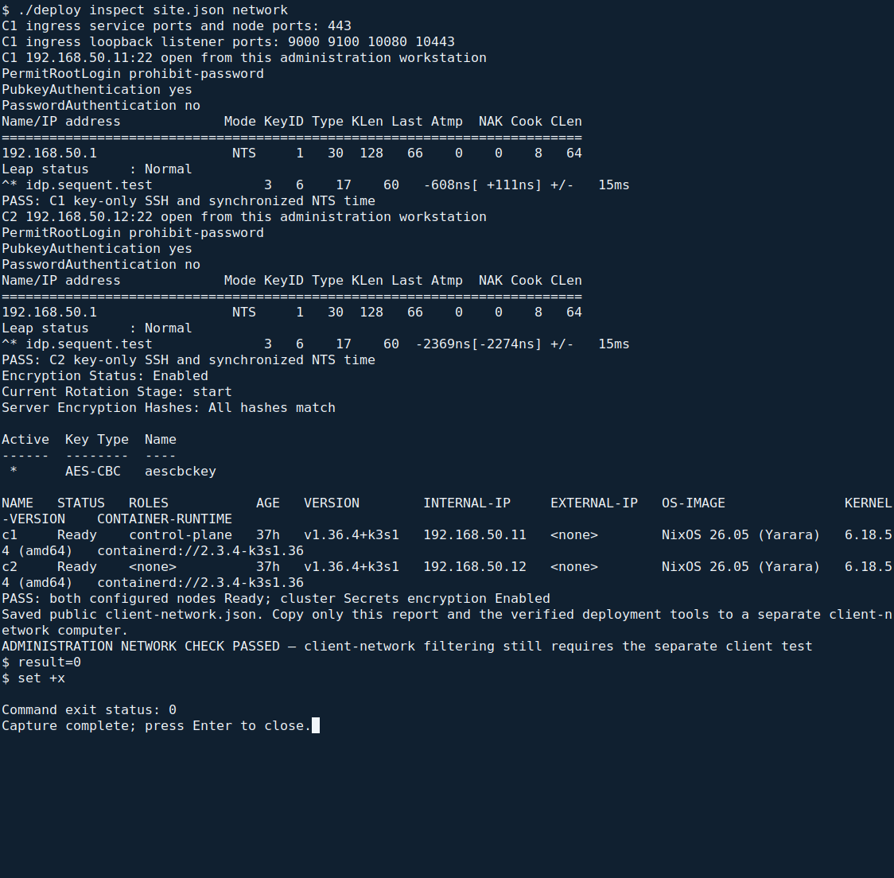
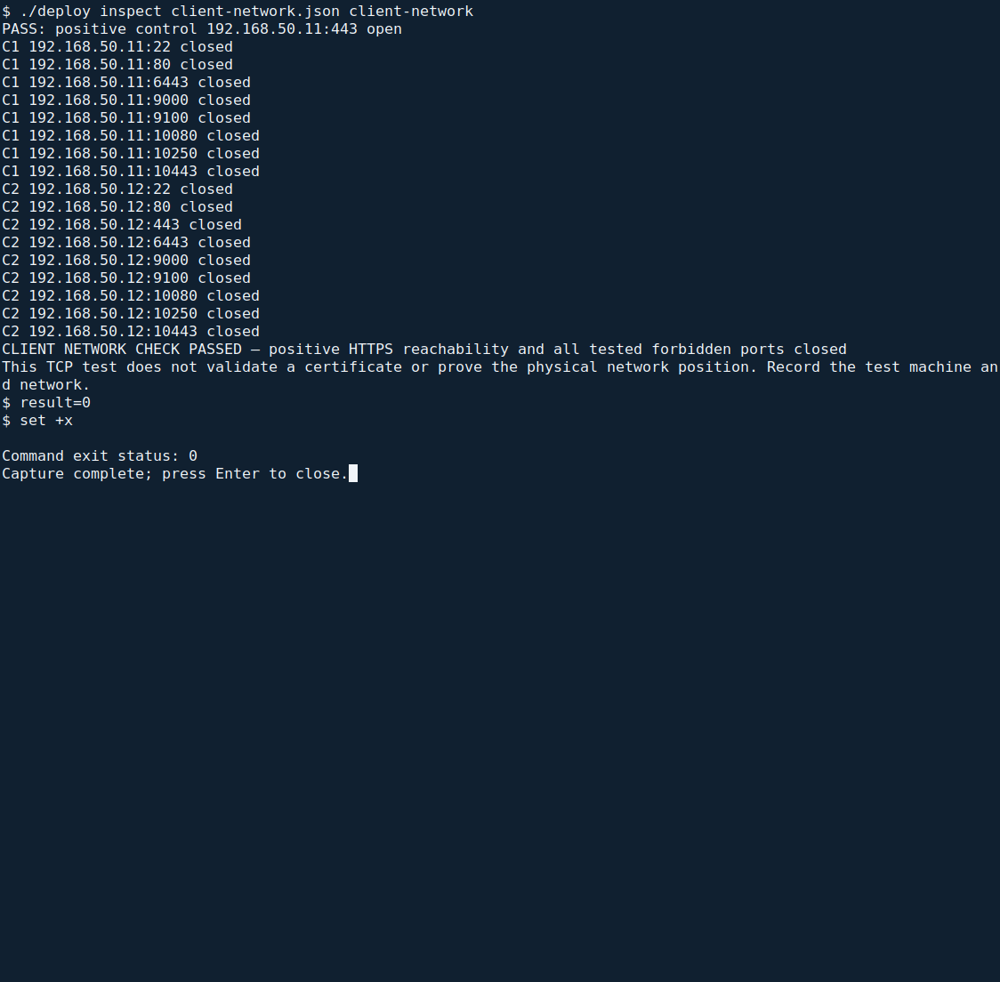

<!--
SPDX-FileCopyrightText: 2026 Sequent Tech Inc <legal@sequentech.io>
SPDX-License-Identifier: AGPL-3.0-only
-->

Use the read-only inspection below to see the actual network, SSH, time,
secret-encryption and node results. The initial `./deploy check site.json`
already enforces the corresponding pre-installation requirements; this inspection
also works after installation and exports the public inputs for the separate
client-network check.

## Inspect from the administration workstation

**Where:** a root terminal on the administration workstation, in the deployment
directory containing the same approved `site.json`.

```bash
./deploy inspect site.json network
```

It connects to C1 and C2 using the configured administration key and verified
SSH host keys. It prints the checks below and writes **`client-network.json`** in
the current directory. That report contains only node addresses, the voting host
and actual ingress ports; it contains no SSH key path, credential or secret.



*Terminal capture from a test installation. Your addresses, names and digests differ.*

**Expected final result:**
`ADMINISTRATION NETWORK CHECK PASSED — client-network filtering still requires the separate client test`.
Each individual result below must also pass.

**If it stops:** use the named failure and the matching section of this chapter.
Do not continue on partial output. If `client-network.json` already exists with
different contents, keep that earlier report and run the inspection from a clean
copy of the deployment directory; do not reuse old port or node values.

## Network filtering

The inspection prints these lines automatically:

- **C1 ingress service ports and node ports:** actual values read from the
  cluster's ingress service (Traefik). Missing ports or an unavailable service fail
  the inspection.
- **C1 ingress loopback listener ports:** actual configured listener ports.
  Any listener not restricted to C1's loopback address fails the inspection.
- **C1/C2 address:22 open:** SSH is reachable from this administration workstation.
  The same run then checks authenticated, key-only SSH access.

The site firewall must expose only the connections of
[Network](02-operational_environment.md#network). Test its client side from a
**separate computer connected to a client network**, after the TLS endpoint has
been installed. A run from the administration workstation does not prove the
client-side firewall rule. To run the test:

1. Copy the delivered directory `guidance/deployment` and the newly generated
   `client-network.json` to that computer. **Do not copy `site.json`, private keys,
   passwords or provider definitions.**
2. Open a terminal in that copied directory. It needs Python 3; it does not need
   root access or an administration SSH key.
3. Run:

   ```bash
   ./deploy inspect client-network.json client-network
   ```



*Terminal capture from a test installation. Your addresses, names and digests differ.*

**Expected result:** the positive control reports C1 port 443 `open`; every
forbidden address/port reports `closed`; the last two lines are
`CLIENT NETWORK CHECK PASSED — positive HTTPS reachability and all tested forbidden ports closed`
and
`This TCP test does not validate a certificate or prove the physical network position. Record the test machine and network.`
Note the test machine and the network for the message of
[Handover to the election board](11-selftest_handover.md#handover-to-the-election-board).
The tested ports include SSH, plain HTTP, cluster API/kubelet and the actual
service, node and loopback ingress ports. C2 port 443 must also be closed.

**If the positive control fails:** first establish that this computer is actually
on the intended client network, the route works and C1's TLS endpoint is running.
An unreachable computer that reports every port closed has not passed the test.

**If any forbidden port is open:** stop and correct the controlled site firewall.
Do not broaden SSH access to make administration work. Repeat this client-side
check afterwards. TCP reachability alone does not validate a certificate, so also
perform [Check the TLS profile](05-certificates_tls.md#check-the-tls-profile).

## SSH access

The `network` inspection above checks **both servers** and prints their policy:

| Setting | Required output |
| --- | --- |
| Password login | `passwordauthentication no` |
| Public-key login | `pubkeyauthentication yes` |
| Root login | `permitrootlogin prohibit-password` or `permitrootlogin without-password` |

Each server must then report `PASS: C1 key-only SSH and synchronized NTS time`
or the corresponding C2 line. The screenshot in
[Inspect from the administration workstation](#inspect-from-the-administration-workstation)
shows these actual policy results; no additional server command is needed.

**If it differs:** stop. Root login `yes` permits an unacceptable password path;
root login `no` prevents the required administration-key access. Check the
installed kit and approved site configuration, and ask Sequent for a corrected kit.
Do not loosen policy as a workaround.

## Authenticated time

The same inspection prints the `chronyc` authentication table, leap status and
selected source on **both C1 and C2**. Every source must show `NTS`; leap status
must be `Normal`; a site time server must be selected (marked `*`).

Before Sequent prepares the site kit, supply the time servers' IP addresses and,
for a private certification authority, its public CA certificate. The accepted
site configuration carries this certificate as `network.ntsCaCertificatePem`;
the installer configures both nodes to trust that CA for time authentication.
The time server's certificate must include its configured IP address in its
Subject Alternative Name. No private CA key belongs in the site configuration.
If no private CA is supplied, the server certificate must chain to the operating
system's public trust store. Do not disable certificate validation to make a
private server connect.

**If it differs:** investigate DNS and the permitted UDP-123/TCP-4460 paths with
the time server's administrator. A non-NTS source, no selected source or unsynchronized
clock is a failure. Do not continue or hand-edit the installed time configuration
into a weaker mode. The combined PASS line appears only after the SSH and all
three time conditions pass.

### Clock observation

The self-test check "Clock synchronization" of the tab "Security and self-tests"
of the election event
([Security and Self-Tests](../../02-election_managers/04-administrator_handbook/07-self_tests.md))
reads the time service of C1 through a host observer, the units
`sequent-clock-status.service` and `sequent-clock-status.timer`. They come with
the host configuration of the installation kit on both servers, so there is
nothing to install. The observer runs 5 seconds after boot and then every
10 seconds, each run bounded at 8 seconds. It reads `chronyc -N tracking`,
`chronyc -N sources` and `chronyc -N authdata`, and publishes the file
`/run/sequent-clock/status.json`, which the Windmill pods mount read-only. The
file holds only the time of the reading in seconds since 1970 (`sampled_at`) and
its result (`synchronized`). The result is `true` only if all of these hold:

- `Leap status` is `Normal`;
- `System time`, the clock's offset, is less than 1 second;
- a source is selected: a line of `sources` starts with `^*`;
- `authdata` lists at least one source, each with the mode `NTS`;
- the selected source is one of them.

If `chronyc` fails or does not answer within 2 seconds, the result is `false`, and
the observer logs no reason.

The check fails with the detail "The host clock observation is unavailable,
stale or not synchronized with NTS" if the file is missing or invalid, if its
reading is more than 30 seconds old or dated in the future, or if its result is
`false`. The election event then enters maintenance mode (on screen, the state
**Recovery required**). The `network` inspection checks the sources, the leap
status and the selected source, but neither the offset nor the observer's file:
it can pass while the check fails.

### Restore time synchronization

**When:** the administrators report that the check "Clock synchronization"
failed, or the `network` inspection fails a time condition.

**Where:** a root terminal on the administration workstation, in the deployment
directory with the accepted `site.json`.

To find the cause and restore synchronization:

1. Read the observer and the time service:

   ```bash
   SERVER=$(jq -er '.nodes.c1' site.json)   # or .nodes.c2 if the inspection failed for C2
   ADMIN_KEY=$(jq -er '.ssh_identity' site.json)
   ssh -i "$ADMIN_KEY" "root@$SERVER" 'systemctl list-timers sequent-clock-status.timer
     systemctl status sequent-clock-status.timer sequent-clock-status.service chronyd.service
     journalctl --no-pager -u sequent-clock-status.service -u chronyd.service --since -30min
     cat /run/sequent-clock/status.json; date +%s
     chronyc -N tracking; chronyc -N sources; chronyc -N authdata
     cat /run/chrony-site.conf'
   ```

   **Expected result:** the timer last ran at most about 10 seconds ago
   (columns `LAST` and `PASSED`), and `chronyd.service` is `active (running)`.
   The file shows `"synchronized": true` and a `sampled_at` at most 30 below the
   number that `date +%s` prints. The `chronyc` output meets the five conditions
   above. `/run/chrony-site.conf` has a line `server ADDRESS iburst nts` for each
   time server of the site configuration; with a private CA, these lines end in
   `certset 1` and follow a line `ntstrustedcerts`.
2. Find the condition that fails:
   - The file is missing or older than 30 seconds: the observer does not run.
     Keep the output of step 1 and ask Sequent
     ([If something fails](01-about.md#if-something-fails)).
   - `authdata` lists no source or a mode other than `NTS`, or the selected source
     is not one of its rows: the time server cannot be reached or its certificate
     is refused. The servers' own firewall accepts its replies, so check the site
     network: UDP port 123 and, for the NTS key exchange, TCP port 4460. The time
     server's certificate must contain its IP address in the Subject Alternative
     Name, chain to the configured CA and be valid at C1's current time.
   - `System time` is 1 second or more: chrony is still correcting the clock
     gradually. It steps the clock only in its first three updates after it starts.
   - `Leap status` is not `Normal`: chrony is not synchronized
     (`Not synchronised`, see the cases above) or a leap second is announced.
3. Have the cause corrected in the site network or at the time server, with the
   time server's administrator. Do not change the time configuration of the
   servers by hand.
4. Have chrony measure again, without stepping the clock, and read the file:

   ```bash
   ssh -i "$ADMIN_KEY" "root@$SERVER" 'chronyc burst 4/4; chronyc waitsync 30 0.5
     systemctl start sequent-clock-status.service; cat /run/sequent-clock/status.json; date +%s'
   ```

   `chronyc waitsync` waits up to 5 minutes for the remaining correction to fall
   below half a second.

   **Expected result:** `"synchronized": true`, with a `sampled_at` at most 30
   below the number that `date +%s` prints.
5. If the result stays `false`, restart the time service only on the election
   board's decision, then repeat step 4:

   ```bash
   ssh -i "$ADMIN_KEY" "root@$SERVER" 'systemctl restart chronyd'
   ```

   The restart repeats the NTS key exchange and lets chrony step the clock again,
   also backwards; the cluster and the order of the audit records rely on a clock
   that does not move backwards. Never run `chronyc makestep` or
   `chronyc reset sources`.
6. Tell the administrators and the election board the result. For C1, the check
   passes at the next self-test run, which an administrator starts with
   **Run self-tests** or which runs periodically, by default every 15 minutes. The
   election board then resumes voting as
   [Maintenance mode](../../02-election_managers/04-administrator_handbook/10-modes_of_operation.md#maintenance-mode)
   describes. For C2, repeat `./deploy inspect site.json network`.

**If it still differs:** voting stays paused. Keep the output of steps 1 and 4
and ask Sequent ([If something fails](01-about.md#if-something-fails)).

## Encryption of cluster secrets

The inspection prints C1's secret-encryption status. It must include the literal
line **`Encryption Status: Enabled`**. Other key-rotation details do not replace
this requirement.

**If disabled or unavailable:** stop before creating application Secrets.
Run `./deploy inspect site.json kit` to check that you have the accepted kit, and
ask Sequent for a corrected kit. Do not create Secrets as a test or enable encryption ad hoc on an
unknown cluster state.

## Cluster nodes

The inspection prints the actual node table and checks it again as structured
data. There must be exactly two nodes, both `Ready`, with internal addresses
matching `nodes.c1` and `nodes.c2` in `site.json`.

**If a node is missing, unready or at the wrong address:** read its boot log as
[Check the installed servers](03-installation_kit.md#check-the-installed-servers)
shows, compare its address with `nodes` in `site.json` and check the firewall rules
of [Network](02-operational_environment.md#network). If you cannot find the cause,
ask Sequent. The initial preflight also requires a fresh cluster with no existing
installation in the cluster namespaces `step-apps` and `step-infra`; a later
read-only inspection may legitimately see the running platform. Do not mistake a
healthy existing deployment for a fresh installation.
