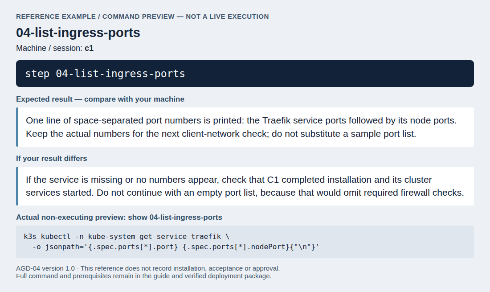
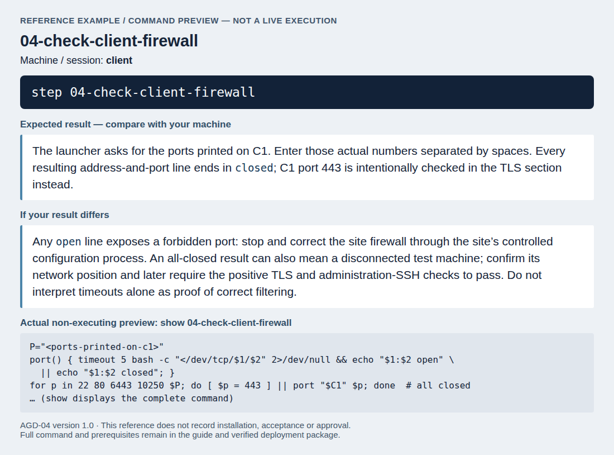
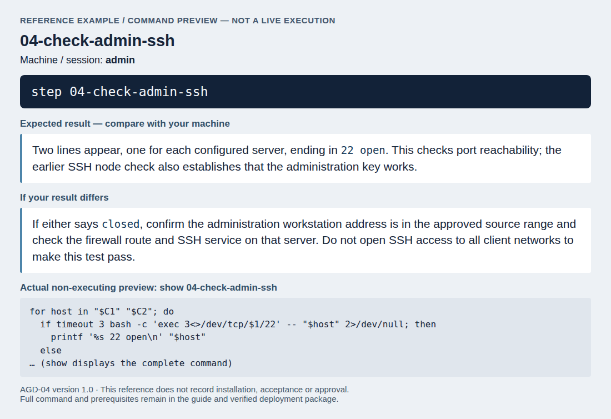
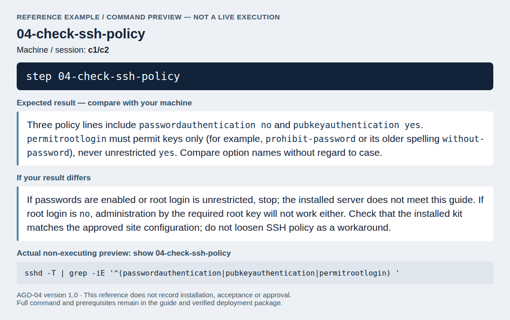
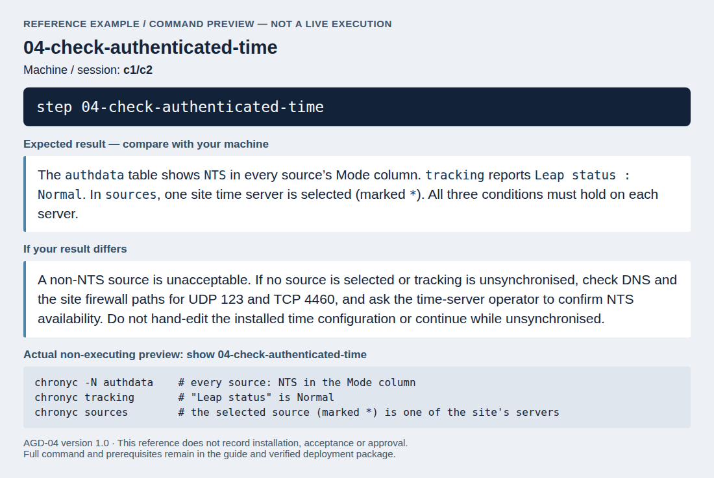
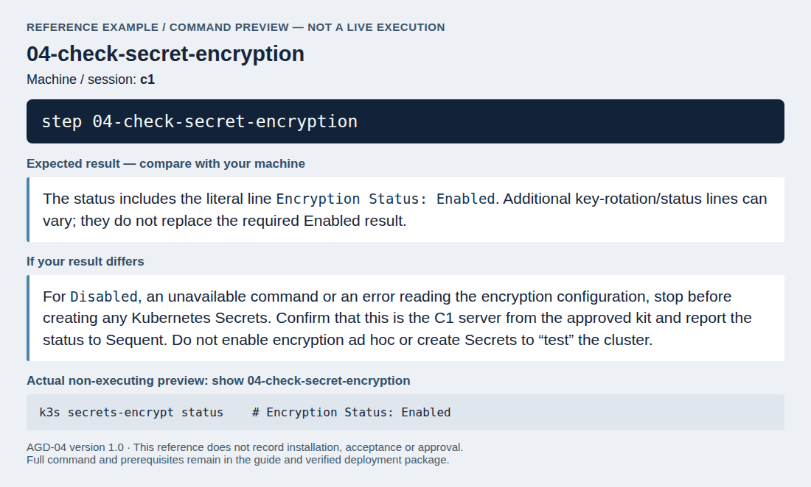
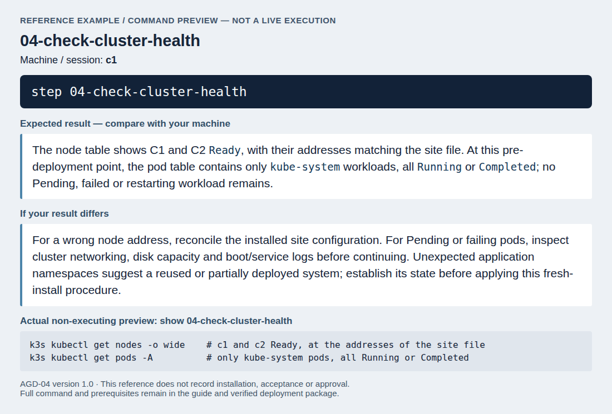

<!--
SPDX-FileCopyrightText: 2026 Sequent Tech Inc <legal@sequentech.io>
SPDX-License-Identifier: AGPL-3.0-only
-->

These checks confirm that the installed servers and their network give the
protection the TOE relies on. Make them before any part of the TOE is
deployed, and stop at the first one that fails.

## Network filtering

:::warning
The site firewall must allow only the connections listed in
[Operational Environment](02-operational_environment.md#network).
:::

First, on C1, list the ports that the cluster's ingress uses (its service
ports and node ports):

<!-- deployment-step: 04-001 -->

**Run on: `c1`.** In that machine’s deployment session, enter:

```bash
step 04-list-ingress-ports
```

**Expected result.** One line of space-separated port numbers is printed: the Traefik service ports followed by its node ports. Keep the actual numbers for the next client-network check; do not substitute a sample port list.

**If the result differs.** If the service is missing or no numbers appear, check that C1 completed installation and its cluster services started. Do not continue with an empty port list, because that would omit required firewall checks.



*Reference screenshot of the command and its documented checks; it is not a record of a successful run on your servers.*

Then, from a computer on a client network (not the administration
workstation), with the variables of `/root/deploy/hosts.env` set and P set to
the port numbers that C1 printed, separated by spaces:

<!-- deployment-step: 04-002 -->

**Run on: `client`.** In that machine’s deployment session, enter:

```bash
step 04-check-client-firewall
```

**Expected result.** The launcher asks for the ports printed on C1. Enter those actual numbers separated by spaces. Every resulting address-and-port line ends in `closed`; C1 port 443 is intentionally checked in the TLS section instead.

**If the result differs.** Any `open` line exposes a forbidden port: stop and correct the site firewall through the site’s controlled configuration process. An all-closed result can also mean a disconnected test machine; confirm its network position and later require the positive TLS and administration-SSH checks to pass. Do not interpret timeouts alone as proof of correct filtering.



*Reference screenshot of the command and its documented checks; it is not a record of a successful run on your servers.*

Every line must say `closed`. Port 443 of C1 belongs to the TLS endpoint,
which [Check the TLS profile](05-certificates_tls.md#check-the-tls-profile)
checks. Then check SSH from the separate administration workstation:

<!-- deployment-step: 04-007 -->

**Run on: `admin`.** In that machine’s deployment session, enter:

```bash
step 04-check-admin-ssh
```

**Expected result.** Two lines appear, one for each configured server, ending in `22 open`. This checks port reachability; the earlier SSH node check also establishes that the administration key works.

**If the result differs.** If either says `closed`, confirm the administration workstation address is in the approved source range and check the firewall route and SSH service on that server. Do not open SSH access to all client networks to make this test pass.



*Reference screenshot of the command and its documented checks; it is not a record of a successful run on your servers.*

Both server lines must print `open`.

## SSH access

:::warning
Root logs in with a key only. A server that accepts a password is not in the
evaluated configuration.
:::

On each server:

<!-- deployment-step: 04-003 -->

**Run on: `c1/c2`.** In that machine’s deployment session, enter:

```bash
step 04-check-ssh-policy
```

**Expected result.** Three policy lines include `passwordauthentication no` and `pubkeyauthentication yes`. `permitrootlogin` must permit keys only (for example, `prohibit-password` or its older spelling `without-password`), never unrestricted `yes`. Compare option names without regard to case.

**If the result differs.** If passwords are enabled or root login is unrestricted, stop; the installed server does not meet this guide. If root login is `no`, administration by the required root key will not work either. Check that the installed kit matches the approved site configuration; do not loosen SSH policy as a workaround.



*Reference screenshot of the command and its documented checks; it is not a record of a successful run on your servers.*

Option names may be printed with different capitalization; compare the names
without regard to case. The output must show `passwordauthentication no` and
`pubkeyauthentication yes`, and `permitrootlogin` must not be `yes`.

## Authenticated time

:::warning
The servers must take their time only from NTS-authenticated sources.
:::

On each server:

<!-- deployment-step: 04-004 -->

**Run on: `c1/c2`.** In that machine’s deployment session, enter:

```bash
step 04-check-authenticated-time
```

**Expected result.** The `authdata` table shows `NTS` in every source’s Mode column. `tracking` reports `Leap status : Normal`. In `sources`, one site time server is selected (marked `*`). All three conditions must hold on each server.

**If the result differs.** A non-NTS source is unacceptable. If no source is selected or tracking is unsynchronised, check DNS and the site firewall paths for UDP 123 and TCP 4460, and ask the time-server operator to confirm NTS availability. Do not hand-edit the installed time configuration or continue while unsynchronised.



*Reference screenshot of the command and its documented checks; it is not a record of a successful run on your servers.*

If a source shows a mode other than NTS, the installed system does not meet
this requirement: stop, and report it to
[security@sequentech.io](mailto:security@sequentech.io). Do not edit the time
configuration of the installed system by hand.

## Encryption of cluster secrets

:::warning
The cluster must store its Secrets encrypted. They hold the database
passwords, the client secrets and the trustee keys.
:::

On C1:

<!-- deployment-step: 04-005 -->

**Run on: `c1`.** In that machine’s deployment session, enter:

```bash
step 04-check-secret-encryption
```

**Expected result.** The status includes the literal line `Encryption Status: Enabled`. Additional key-rotation/status lines can vary; they do not replace the required Enabled result.

**If the result differs.** For `Disabled`, an unavailable command or an error reading the encryption configuration, stop before creating any Kubernetes Secrets. Confirm that this is the C1 server from the approved kit and report the status to Sequent. Do not enable encryption ad hoc or create Secrets to “test” the cluster.



*Reference screenshot of the command and its documented checks; it is not a record of a successful run on your servers.*

If the status is not `Enabled`, stop and report it to
[security@sequentech.io](mailto:security@sequentech.io). Do not create any of
the Secrets of the later pages on a cluster that stores them unencrypted.

## Cluster nodes

On C1:

<!-- deployment-step: 04-006 -->

**Run on: `c1`.** In that machine’s deployment session, enter:

```bash
step 04-check-cluster-health
```

**Expected result.** The node table shows C1 and C2 `Ready`, with their addresses matching the site file. At this pre-deployment point, the pod table contains only `kube-system` workloads, all `Running` or `Completed`; no Pending, failed or restarting workload remains.

**If the result differs.** For a wrong node address, reconcile the installed site configuration. For Pending or failing pods, inspect cluster networking, disk capacity and boot/service logs before continuing. Unexpected application namespaces suggest a reused or partially deployed system; establish its state before applying this fresh-install procedure.



*Reference screenshot of the command and its documented checks; it is not a record of a successful run on your servers.*
