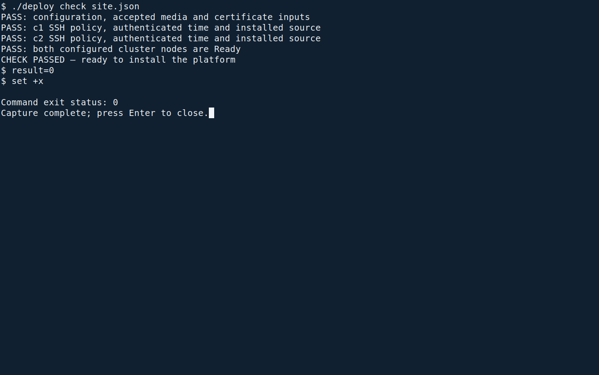
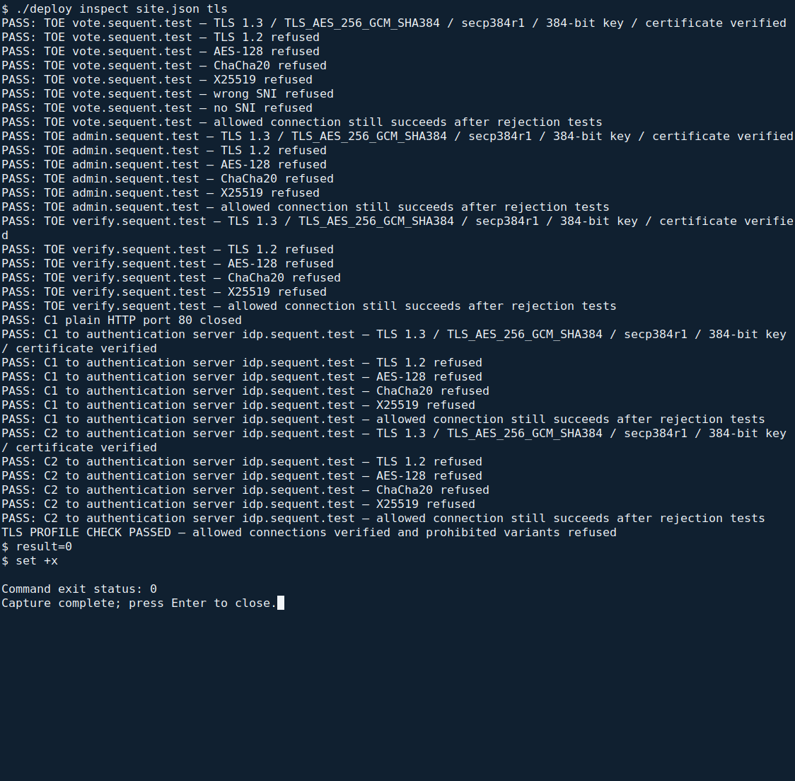

<!--
SPDX-FileCopyrightText: 2026 Sequent Tech Inc <legal@sequentech.io>
SPDX-License-Identifier: AGPL-3.0-only
-->

This chapter prepares the certificate inputs for
[the three-command installation](01-about.md#install-from-one-configuration-file).
The installer checks the inputs and installs the certificate automatically. You
supply the approved files; you do not create cluster Secrets by hand.

## Required TLS profile

Every connection to the TOE's web hosts must use this profile:

| Property | Required value |
| --- | --- |
| Protocol | TLS 1.3 only |
| Cipher suite | TLS_AES_256_GCM_SHA384 only |
| Key exchange group | secp384r1 only |
| Server certificate | ECDSA key on the P-384 curve |
| Names | The voting, administration and ballot-verifier host names in `site.json` |
| Plain HTTP | None; port 80 closed |

The same protocol, cipher and group requirements apply to the
[external authentication server](06-authentication_server.md).

## Create the key and the certificate request

<!-- deployment-step: 05-001 -->

**Before installation, on the administration workstation:** obtain an issued
certificate, its matching private key and its CA chain through your approved
certificate procedure. The issuing CA's procedure depends on your organization;
its screens are outside this installer. Request all three web host names and
an ECDSA P-384 key.

The configuration-driven installer reads the key from a protected input file on
the administration workstation and transfers it to C1 over the verified SSH
connection. Keep both machines and these files within the protected
administration environment. Do not paste private-key material into `site.json`,
a terminal, an e-mail or a screenshot.

In your private working configuration, set these file paths:

| `site.json` field | File or value |
| --- | --- |
| `tls.certificate` | PEM server certificate and its intermediate chain |
| `tls.private_key` | Matching private key, owned by root and accessible only to root |
| `tls.ca` | Trusted CA certificate used to validate the chain |
| `tls.ca_sha256` | SHA-256 CA fingerprint received independently |

Use absolute paths. Your certificate must be trusted by voters' ordinary,
current browsers. A laboratory CA shown in a rehearsal is not suitable for
consumer deployment; adding such a CA locally does not establish public trust.

**If the certificate is wrong:** obtain the correct certificate for the approved
key and names. Do not regenerate a key after submitting its CSR and then attempt
to use the old response. Resolve any untrusted chain, expired certificate or
missing name before installation.

## Check the certificate

<!-- deployment-step: 05-002 -->
<!-- deployment-step: 05-003 -->

**Where:** a root terminal on the administration workstation, in the extracted
package's `deployment` directory. After preparing the complete `site.json` and
installing C1 and C2, run:

```bash
./deploy check site.json
```

This is the same preflight command from [Check the site](01-about.md#check-the-site).
It checks the independently supplied CA fingerprint, certificate chain, each
configured host name, P-384 curve and certificate/private-key match. Do not run
it a second time if that preflight has already passed with these exact inputs.

**Expected result:** `PASS: configuration, accepted media and certificate inputs`,
followed by the node checks and `CHECK PASSED — ready to install the platform`.
The private key and client secrets are not printed.



*Actual rehearsal capture. The certificate-input PASS line is followed by the
server checks. The shown laboratory identities illustrate the command's output;
your approved inputs and browser trust must be checked for your own site.*

**If it stops:** read the named failure. For a fingerprint mismatch, compare the
independently received record with the supplied file; do not copy an observed
mismatch into the expected field. For a key mismatch, name mismatch, expiry or
untrusted chain, correct the input with the CA. A successful file check does not
replace the live TLS-profile check below.

## Install the certificate

<!-- deployment-step: 05-004 -->

**Automatic part of installation.** After the full preflight passes, the command
below securely transfers the configured certificate and key, creates the TLS
Secret in both `step-apps` and `step-infra`, and prepares the operating-system
TLS endpoint:

```bash
./deploy install site.json
```

Run it once from the same administration-workstation directory, as described in
[Install the platform](01-about.md#install-the-platform). If that installation
is already complete, do not rerun it for this chapter.

**Expected result:** installation proceeds through its numbered stages and ends
with `INSTALL 4/4: platform installed; customer and trustee commissioning still required`.
The [actual installation screenshot](01-about.md#install-the-platform) shows the
complete command and its successful end state.

**If it fails:** keep the error and stage name. An existing Secret or occupied
installation may indicate a partial earlier attempt. Inspect that state with
the operator; do not delete Secrets or retry installation blindly.

## Set up the TLS endpoint

<!-- deployment-step: 05-005 -->

**Also automatic within `./deploy install site.json`.** C1's operating-system
`nginx` service reads the protected certificate and key from
`/var/lib/sequent-site/tls/`. It is the only externally reachable listener on
TCP 443. It accepts the configured SNI names and permitted TLS profile, then
forwards encrypted traffic through C1's loopback interface to cluster ingress.

The ingress's own listeners must remain unreachable from client networks, and
port 80 must remain closed. [Network filtering](04-hosts_network_time.md#network-filtering)
checks that boundary from a separate client-network machine. Do not expose the
ingress or another application listener to work around a failed TLS endpoint.

Certificate renewal is a separate controlled maintenance change. These fresh
installation commands are not a renewal procedure: do not delete both TLS
Secrets and rerun installation against an occupied cluster. Use an approved
renewal procedure, then repeat the live TLS check below before returning service.

## Check the TLS profile

<!-- deployment-step: 05-006 -->

**Where:** the administration workstation, in the same `deployment` directory.
After installation, run:

```bash
./deploy inspect site.json tls
```

This verifies the configured CA fingerprints, tests each of the three TOE host
names from this workstation, and tests the authentication server from **both
C1 and C2**. It uses short, bounded probes and does not change server settings.
It also repeats the allowed connection after the rejection tests: a disconnected
service that refuses everything cannot pass.



*Actual TLS probe results from the rehearsal. `TOE` lines are checks from the
administration workstation; `C1 to authentication server` and `C2 to authentication
server` identify the upstream checks. Laboratory host names and certificates are
examples, not deployment inputs.*

**Expected final result:** `TLS PROFILE CHECK PASSED — allowed connections verified and prohibited variants refused`.
All individual lines must pass as summarized below. Save the output in the
installation record; [Verifying the Installation](10-verification.md#tls-endpoint-and-ingress-ports)
uses this same inspection, so a completed check with unchanged configuration
need not be repeated merely to read another chapter.

| Check | Required result |
| --- | --- |
| Each of the three configured web names | TLS 1.3, `TLS_AES_256_GCM_SHA384`, `secp384r1`, 384-bit server public key, trusted certificate and correct name |
| TLS 1.2, AES-128, ChaCha20 or X25519 | Connection refused |
| Wrong SNI name or no SNI | Connection refused |
| C1 port 80 | Closed |

**If any prohibited connection succeeds or the allowed connection fails:** stop.
Check the configured names, certificate chain and controlled endpoint settings
with the operator. Do not disable certificate verification, accept a browser
warning or route clients around nginx.
