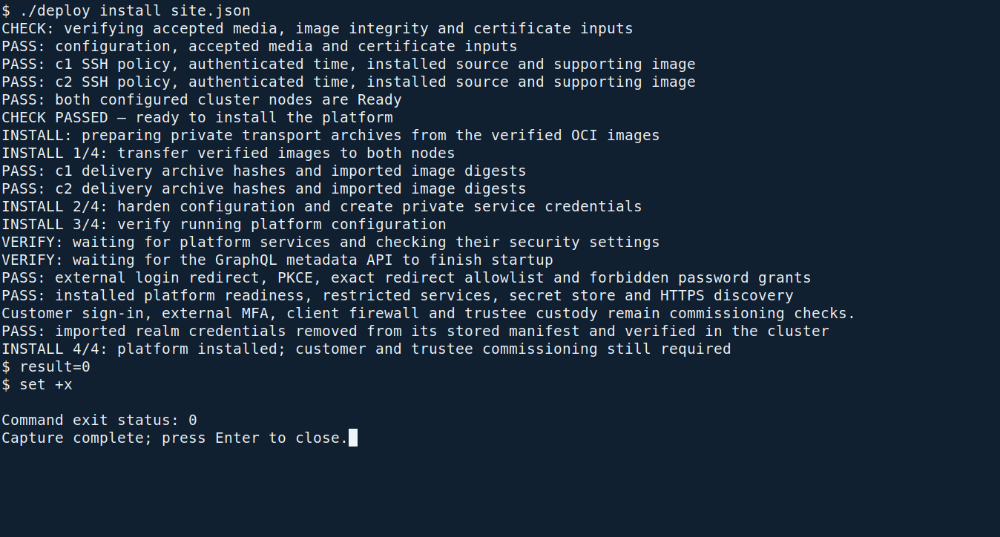

<!--
SPDX-FileCopyrightText: 2026 Sequent Tech Inc <legal@sequentech.io>
SPDX-License-Identifier: AGPL-3.0-only
-->

This chapter explains the configuration that the installer applies. **You do
not run a command for each heading below.** Supply the values in `site.json`,
then run the single installation command from a root terminal in the deployment
directory on the administration workstation:

```bash
./deploy install site.json
```

Run it only after `./deploy check site.json` has passed, as shown in
[Install from one configuration file](01-about.md#install-from-one-configuration-file).
If installation is already running, leave that terminal open instead of starting
another copy. C1 and C2 are the two servers; the installer connects to them using
`nodes` and `ssh_identity` from your configuration.

**What you will see.** The terminal reaches
`INSTALL 2/4: harden configuration and create private service credentials`,
then `INSTALL 3/4: verify running platform configuration`. The individual
server-side command output is captured by the installer, so you do not type
additional server commands.



*Terminal capture from a test installation. Your addresses, names and digests differ.*

**If it stops.** Keep the reported stage and error, and follow
[If something fails](01-about.md#if-something-fails). Do not rerun an individual
transformation, delete the directory `/root/deploy`, regenerate passwords or relax
a policy. After a successful run, continue with
[Create the customer's tenant](08-installing_toe.md#create-the-customers-tenant)
and [Verifying the Installation](10-verification.md).

## Set the host names

<!-- deployment-step: 07-001 -->
<!-- deployment-step: 07-002 -->

**Automatic installation stage.** The installer substitutes the voting,
administration and verifier names from `hosts` in `site.json`. They must be the
three names covered by the site certificate. Each portal uses the voting host
for the identity service, so sign-in and token issuers agree.

Confirm the public names in `site.json` before running the command. If a name is
wrong after installation has started, stop and ask Sequent how to correct the
deployment; do not redirect a portal to another identity service or edit a running
container.

## Set the browser storage endpoint

<!-- deployment-step: 07-003 -->

**Automatic installation stage.** The public storage endpoint is the voting
portal's HTTPS origin with no path suffix. The browser allowlist contains only
the three portal HTTPS origins. The private endpoint stays inside the cluster.
The ingress preserves each signed request's host, bucket path and query. Its
route `/storage/public` serves the public assets: through it, anyone can read the
objects of the bucket `public`, and nothing else. No route reaches the storage
administration console or the bucket `electoral-log-checkpoints`. Private objects
still require valid signed URLs.

A failed signed upload is not corrected by stripping `/storage`, a bucket name
or query parameters from its URL. Use the storage and cross-origin checks in
[Verifying the Installation](10-verification.md).

## Set the displayed software identity

<!-- deployment-step: 07-004 -->

**Automatic installation stage.** The installer writes the settings `APP_VERSION`
and `APP_HASH` from `release.version` and `release.step_commit` in `site.json`, checked
against the accepted delivery. For this TOE the version is `10.0.0`; the hash is
the exact 40-character source revision that produced the accepted images. The
header shows the version and the first eight characters of the hash.

Check the visible header using [Version](10-verification.md#version). Do not
choose another version or hash merely to match a screen or example.

## Generate the deployment secrets

<!-- deployment-step: 07-005 -->

**Automatic, one-time installation stage.** The installer generates the service
passwords and client secrets and writes `/root/deploy/secrets.env` on C1 with
root ownership and mode `600`. It replaces demonstration credentials before
services start. The object-storage client secret matches the storage root
password. `operator.service_administrator` supplies the service administrator's
name; it is not a personal login account.

The installer then checks that the master secret, with which Harvest and Windmill
encrypt the secrets they store, is 64 hexadecimal characters. Otherwise it stops with
`Stopped: Hardened platform deployment failed: The generated master secret is missing or not 64 hexadecimal characters; stop and inspect this stage privately; see If something fails in the Deployment Guide`.

Never print or copy this file into a terminal transcript. Never regenerate it
after first startup: the databases and encrypted application data depend on the
original values. An existing file during fresh installation means a partial earlier
attempt: follow [If something fails](01-about.md#if-something-fails), and do not
replace it.

## Create the service credentials

<!-- deployment-step: 07-006 -->
<!-- deployment-step: 07-007 -->

**Automatic installation stage.** The installer creates
`keycloak-bootstrap-admin` and `keycloak-service-credentials` as encrypted cluster
Secrets. Harvest and both Windmill services receive, through Secret references,
the identity and secret of the service client and of the administration API
client `step-admin-api`. The service administrator's credentials stay with the
identity service and the installer. People must not use these credentials.

The database, storage and identity-service credentials are part of the protected
backup. Recovery must retain those original values; an `AlreadyExists` error does
not authorize deleting or replacing a Secret.

## Run the identity service in production mode

<!-- deployment-step: 07-008 -->
<!-- deployment-step: 07-009 -->

**Automatic installation stage.** The installer applies the reviewed identity
service transformation. Keycloak starts with the arguments `start --import-realm`, its fixed
public hostname and the required outbound TLS profile. Toward the authentication
server it trusts only the authentication server's CA, not the default CAs of
Java or of the cluster, and offers only the signature scheme
`ecdsa_secp384r1_sha384`. The realm is loaded from a Secret. It does not use development mode or
accept an arbitrary hostname.

## Close the GraphQL console

<!-- deployment-step: 07-010 -->

**Automatic installation stage.** The console and development mode are disabled.
Only `/hasura/v1/graphql` is routed, with an exact-path match on each portal host.
The metadata API and console are not externally exposed. Do not expose either
for troubleshooting.

## Limit cross-origin access

<!-- deployment-step: 07-011 -->

**Automatic installation stage.** Both the ingress and the GraphQL backend allow
exactly the three configured portal HTTPS origins. Neither list contains `*`.
An ingress allowlist alone cannot remove a permissive header returned by the
backend; [GraphQL endpoint and cross-origin requests](10-verification.md#graphql-endpoint-and-cross-origin-requests)
checks the deployed behavior.

## Block the master realm

<!-- deployment-step: 07-012 -->

**Automatic installation stage.** The ingress refuses access to the identity
service's master realm on all three portal hosts. The master realm holds the
service administrator and the administration API client, not personal users. The external discovery checks must
receive HTTP `403`; a connection failure is not evidence of a successful block.

## Give harvest its service

<!-- deployment-step: 07-013 -->

**Automatic installation stage.** Harvest receives a cluster-internal Service on
port 8400. No public, NodePort or LoadBalancer service is substituted for it.

## Keep the results and kiosk portals off

<!-- deployment-step: 07-014 -->

**Automatic installation stage.** The results-portal and kiosk-portal addresses
remain unset; neither portal is deployed in this configuration. The realm
transformation disables the corresponding unused clients. Do not add an address
to make an unavailable screen reachable.

## Configure the realms

<!-- deployment-step: 07-015 -->
<!-- deployment-step: 07-016 -->
<!-- deployment-step: 07-017 -->

**Automatic installation stage.** The installer transforms the initial tenant
realm, the template for new tenants and the template for new election events.
The original templates are imported only at their intended creation point.
Changing a template later does not prove that an existing realm changed.

The required sign-in policy is:

- Require TLS for external requests; use a 900-second idle timeout, brute-force
  protection with the realm setting `failureFactor` at 5, and authentication-event
  recording through the event listener `custom-event-listener`. `failureFactor` is
  the identity service's own lockout of accounts with a local password; in these
  realms only the machine accounts `trustee1` and `trustee2` have one. It is not the
  [Authentication failure threshold](../../02-election_managers/04-administrator_handbook/08-authentication_and_sessions.md#authentication-failure-threshold),
  which the administrator sets in the admin portal.
- Keep self-registration and password reset off: they are off in the delivered
  realm files, and the installer stops if either is on. Set the realm setting
  `rememberMe` to false. Redirect personal sign-in to the sole external identity provider.
  Disable local password and one-time-code forms, and link a first sign-in only
  to an existing account.
- Disable every local required action, such as `mfa-method-selector`, also as a
  default action. The external provider still enforces the user's required factors.
- Use authorization code flow with PKCE `S256`, with redirect addresses only on
  the portals' own host names. Disable password grants for portal clients and the
  client `admin-cli`, and disable the client `cli-account-admin`.
- The trustee instances' client `api-key-client` allows only the password grant,
  and the client `service-account` only the client credentials grant. Neither has
  a redirect address or web origin. Tokens of `api-key-client` name the GraphQL
  role `trustee-ceremony` by default.
- Preserve the external authentication time needed for fresh board authorization:
  the identity-provider setting `passMaxAge` is `true`, and the client `admin-portal`
  carries the session's authentication time in the claim `auth_time`. A new access
  token is not a substitute for a fresh external login.
- Use random client secrets and native trustee passwords. Personal accounts have
  no local password, and demonstration credentials are removed.
- Remove the board-only and prohibited named permissions from seeded
  administrator groups. Give no group the permissions "Edit Results Publication"
  (`publish-results-write`), "Datafix account" (`datafix-account`) or "Manually
  Verify Voter" (`voter-manually-verify`).
- Disable the account clients `account` and `account-console` in every realm,
  and give the default role no `manage-account`: users cannot manage their own
  account. Only administrators can change a user's `username` and `email`.
- Disable the client `security-admin-console` and offline access in every realm:
  no client and no realm default offers the scope `offline_access`. In event
  realms, also disable voter sign-in codes, messaging channels and the unused
  channel/results clients.

The installer checks these settings in the three transformed files before it
imports them. A difference stops the installation at the stage
`07-check-realm-security`.

The relevant permissions and values are described in
[Users, Roles and Role Separation](../../02-election_managers/04-administrator_handbook/04-users_and_roles.md)
and [Authentication and Session Settings](../../02-election_managers/04-administrator_handbook/08-authentication_and_sessions.md).
Run the deployed checks in [Verifying the Installation](10-verification.md);
do not accept only the transformed template as proof of live realm settings.

## Add the installation account

<!-- deployment-step: 07-020 -->

**Automatic installation stage.** The installer creates the installation account:
the personal account described by `operator.username` and `operator.email`. It has no local
password and signs in through the external provider. It is used only to create
the customer's tenant. Commissioning then creates the customer's first personal
administrator and disables the personal accounts of the super-admin tenant.

## Write the documents back

<!-- deployment-step: 07-021 -->

**Automatic installation stage.** Realm documents and templates are written as
Secrets, never secret-bearing ConfigMaps. Setup jobs read the templates through
Secret references. After the first realm import, the installer removes import
credentials from the stored realm manifest; the live realm retains the values
it imported.

Do not distribute the directory `/root/deploy`. Verify platform security
with [Verifying the Installation](10-verification.md), then finish the explicit
browser, trustee-custody and handover checks.
