<!--
SPDX-FileCopyrightText: 2026 Sequent Tech Inc <legal@sequentech.io>
SPDX-License-Identifier: AGPL-3.0-only
-->

This page turns the working copy of the cluster manifests in
`/root/deploy/kubernetes` into the evaluated configuration. Every command runs
on C1, as root, after `. /root/deploy/hosts.env`. Make the sections in order
and each only once; each ends with a check. Several commands change their
files in place or remove their input, so a second run gives a wrong result.
To repeat a section, remove `/root/deploy/kubernetes`, make the working copy
again as [Prepare the deployment directory](03-installation_kit.md#prepare-the-deployment-directory)
describes, and make every section of this page again.

:::warning
Every section of this page is security relevant. Deploy only after all of
them: together they replace the kit's demonstration passwords, run the
identity service in production mode, close the GraphQL console and make the
external authentication server the only way to sign in, as the evaluated
configuration requires.
:::

## Set the host names

:::warning
The host names decide where the identity service sends a browser after
sign-in and which origins may call the TOE. Use exactly the three names of
the certificate.
:::

<!-- deployment-step: 07-001 -->

**Run on C1, in the `c1` deployment session:**

```bash
step 07-set-site-hostnames
```

**Expected result.** No output after the command; no demonstration portal host names remain.

**If the result differs.** If a matching file or host name is printed, check the three configured host names and the clean working copy. Do not deploy partially substituted manifests; restart this chapter from a fresh copy as described above.

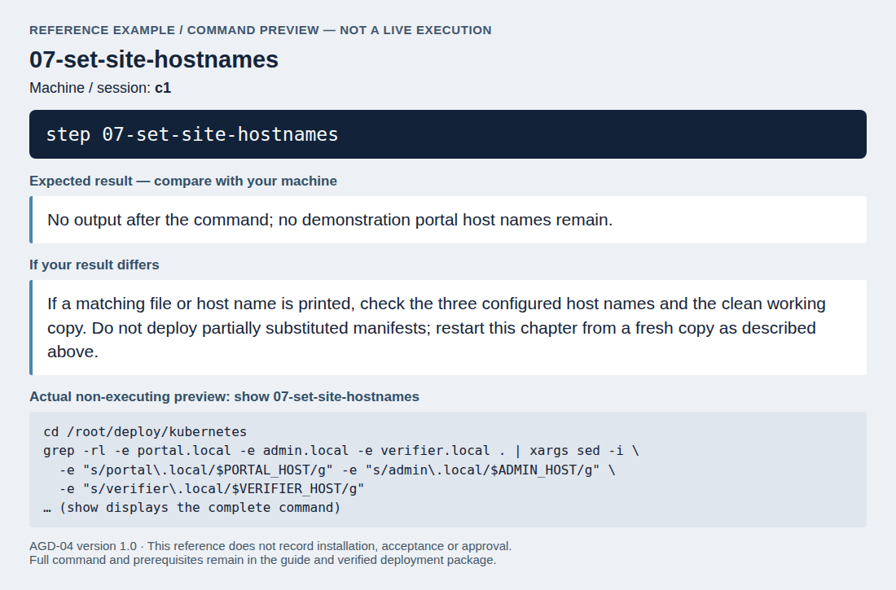

*Command preview only: this image shows the bundled command, without executing it. Compare your actual result with the expectations above.*

The last command must print nothing.

All three portals must reach the identity service under one host name, the
voting portal's:

<!-- deployment-step: 07-002 -->

**Run on C1, in the `c1` deployment session:**

```bash
step 07-set-login-url
```

**Expected result.** Three `KEYCLOAK_URL` entries, all with your voting portal origin, for example `value: "https://vote.example.org"`. The example domain is not a value to enter.

**If the result differs.** If an entry is absent or still uses another host, check that all three portal manifests came from the verified kit. Rebuild the working copy; do not redirect a portal to a different identity service.

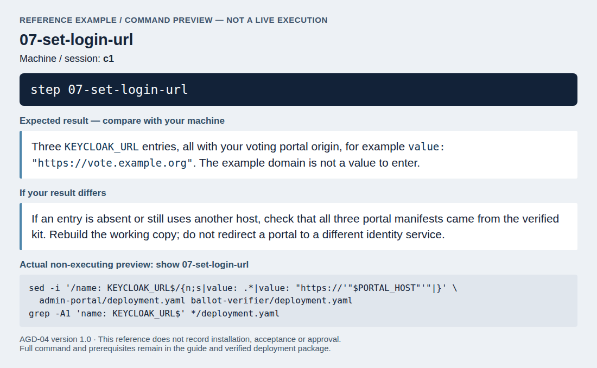

*Command preview only: this image shows the bundled command, without executing it. Compare your actual result with the expectations above.*

The three values shown must be `"https://PORTAL_HOST"` with your voting portal
host.

## Set the browser storage endpoint

Backups, uploads and election files use signed storage URLs that the browser
must reach over HTTPS. The public endpoint is the voting portal host, without
a path suffix; the private endpoint stays inside the cluster. Preserve the
bucket path, host and query of each signed request: stripping `/storage`
from a signed URL would invalidate its signature.

<!-- REUSE-IgnoreStart -->

<!-- deployment-step: 07-003 -->

**Run on C1, in the `c1` deployment session:**

```bash
step 07-configure-storage-route
```

**Expected result.** An `AWS_S3_PUBLIC_URI` line with your voting portal HTTPS origin, followed by the three portal HTTPS origins under `accessControlAllowOriginList`.

**If the result differs.** If an origin is missing, contains a demonstration host or includes a path, correct the public host inputs and recreate the working copy. Do not remove bucket paths or query strings to work around a failed signed URL.

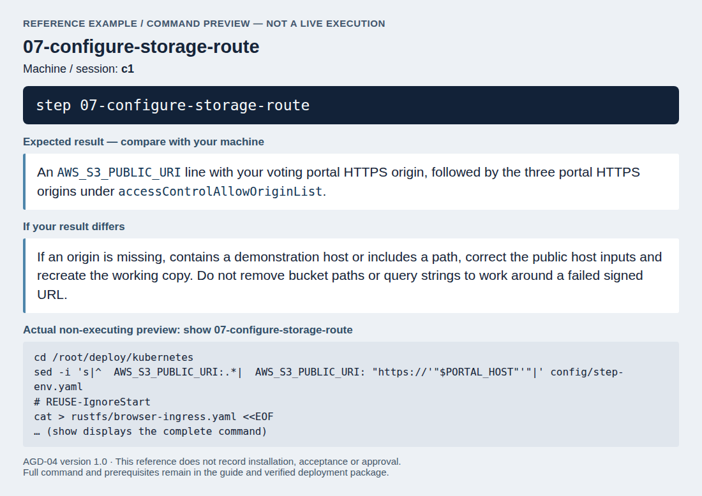

*Command preview only: this image shows the bundled command, without executing it. Compare your actual result with the expectations above.*

<!-- REUSE-IgnoreEnd -->

The public endpoint must be `https://PORTAL_HOST` with your voting portal
host and no trailing path. The origin list must contain exactly the three
portal HTTPS origins. This adds only the public and election-document bucket
paths; keep the existing `/storage` ingress for public assets. The new ingress
preserves signed paths and handles browser preflights without exposing the
storage administration console. Private objects still require valid signed
URLs; this configuration grants no anonymous access to them.

## Set the displayed software identity

The portals display the software release and the Step source revision that
produced the images. Set both from the installed provenance of the verified
installation kit, before the first deployment:

<!-- deployment-step: 07-004 -->

**Run on C1, in the `c1` deployment session:**

```bash
step 07-set-release-identity
```

**Expected result.** Two lines: `APP_VERSION: "10.0.0"` and `APP_HASH: "…"`, where the hash is exactly the 40-character Step revision from the verified kit provenance.

**If the result differs.** If nothing prints, a value is missing or either key already exists, stop. Check the kit provenance and whether this one-time step already ran; do not guess a version or append duplicate keys.

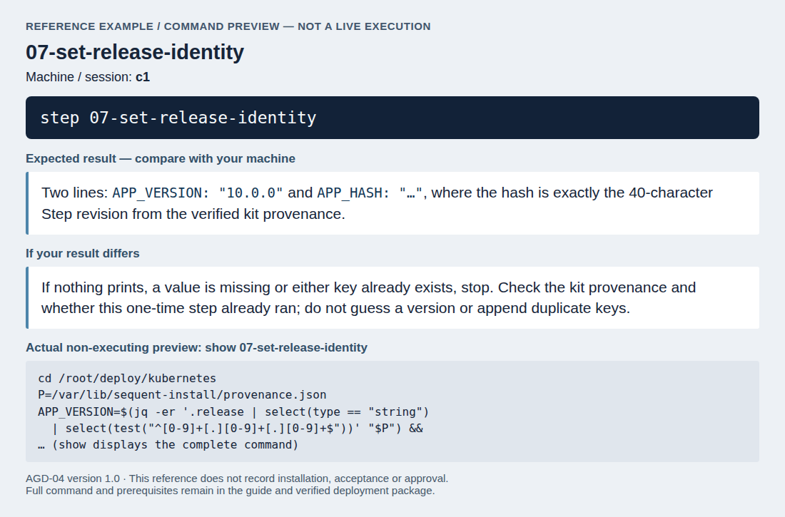

*Command preview only: this image shows the bundled command, without executing it. Compare your actual result with the expectations above.*

The block must print the two public values. For release `v10.0.0`,
`APP_VERSION` must be `10.0.0`; `APP_HASH` must be the 40-character Step
revision in the verified image provenance. Stop if either value is missing,
or if the block prints nothing. The portal may display the hash in upper
case. Keep the file in YAML format: later sections check its keys.

## Generate the deployment secrets

:::warning
Run this once, before the first deployment. The database creates its roles
with these passwords on its first start, so the file must never be generated
again. Keep `/root/deploy/secrets.env` readable by root only, and never print
it.
:::

At the public input prompt, enter a name for the identity
service's administrator account, used only by the TOE's services:

<!-- deployment-step: 07-005 -->

**Run on C1, in the `c1` deployment session:**

```bash
step 07-generate-service-secrets
```

**Expected result.** The final two lines are `600 root` and `19`. No password or secret value is printed.

**If the result differs.** If `secrets.env` already exists, do not overwrite it or generate another set of passwords. Check the installation record. Any mode other than `600` or owner other than root must be corrected before continuing; never inspect the file by printing it.

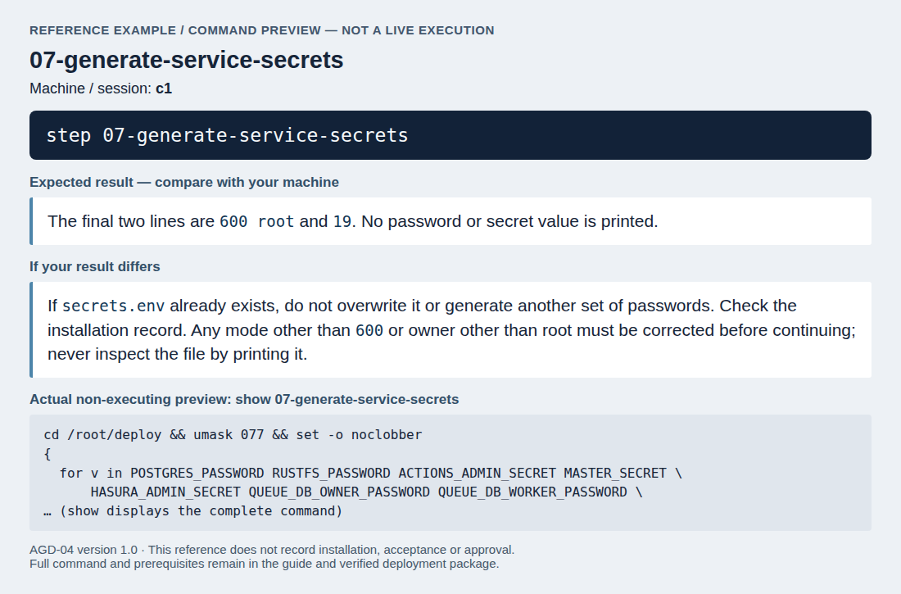

*Command preview only: this image shows the bundled command, without executing it. Compare your actual result with the expectations above.*

`S3_SECRET` must equal `RUSTFS_PASSWORD`: the services use the object
storage's root account. Every later command that needs a secret loads this
file with `. /root/deploy/secrets.env`.

## Create the service credentials

:::warning
The service administrator account can create and change every realm. Its
password exists only in `secrets.env` and in these two Secrets.
:::

The identity service gets an administrator account in its master realm, which
the TOE's services use to create the realms of election events. The services
also get the secret of their own client in the tenant realm.

<!-- deployment-step: 07-006 -->

**Run on C1, in the `c1` deployment session:**

```bash
step 07-install-service-secrets
```

**Expected result.** Creation messages for `keycloak-bootstrap-admin` and `keycloak-service-credentials`, followed by the six key names listed below. Values are not displayed.

**If the result differs.** If creation reports `AlreadyExists`, stop and establish whether this installation step was already completed; do not delete or replace credentials blindly. For a missing namespace, return to the namespace preparation step.

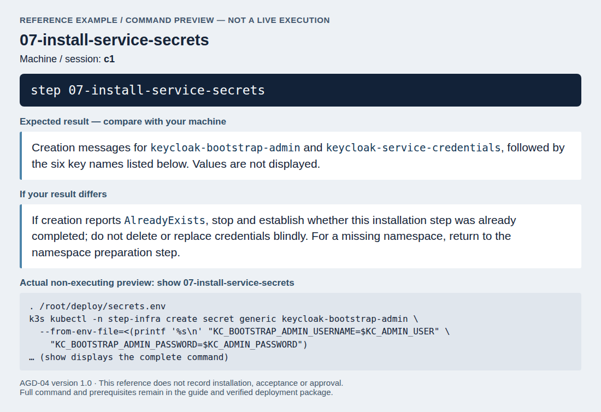

*Command preview only: this image shows the bundled command, without executing it. Compare your actual result with the expectations above.*

The output must list `KC_BOOTSTRAP_ADMIN_PASSWORD` and
`KC_BOOTSTRAP_ADMIN_USERNAME`, then `KEYCLOAK_ADMIN_CLIENT_ID`,
`KEYCLOAK_ADMIN_CLIENT_SECRET`, `KEYCLOAK_CLIENT_ID` and
`KEYCLOAK_CLIENT_SECRET`. Then give harvest and the two windmill services the
second Secret:

<!-- deployment-step: 07-007 -->

**Run on C1, in the `c1` deployment session:**

```bash
step 07-connect-service-credentials
```

**Expected result.** Three file/count lines ending in `:1`: one for harvest and one for each windmill manifest.

**If the result differs.** A count of `0` means the expected insertion point is missing; a count above `1` usually means the transformation ran twice. Recreate the clean working copy and repeat the chapter once.

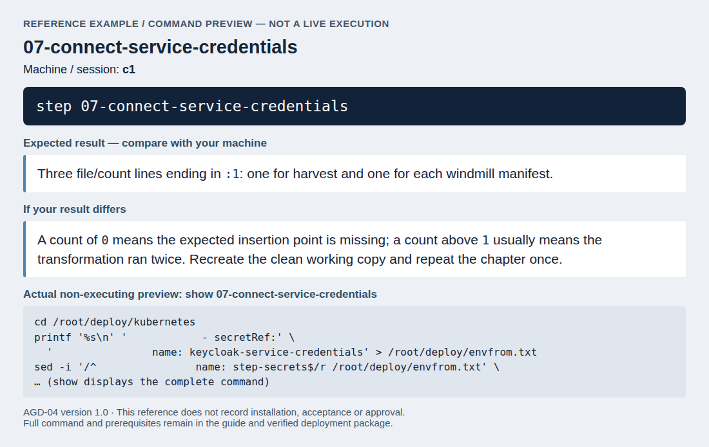

*Command preview only: this image shows the bundled command, without executing it. Compare your actual result with the expectations above.*

Each of the three files must count 1.

## Run the identity service in production mode

:::warning
The identity service must run in production mode: only then does it use one
fixed host name and trust the authentication server's CA. Do not deploy
without this section.
:::

The identity service must run in production mode, with one fixed host name,
the trust anchor of the authentication server and the TLS profile for its own
connections. The following step installs the reviewed filter at `/root/deploy/keycloak.jq`:

<!-- deployment-step: 07-008 -->

**Run on C1, in the `c1` deployment session:**

```bash
step 07-install-keycloak-filter
```

**Expected result.** The launcher reports that the reviewed filter was installed at `/root/deploy/keycloak.jq`. It does not change the running identity service.

**If the result differs.** If the package check fails or the destination is refused, re-check the verified command package and root session. Do not paste a replacement filter from another source.

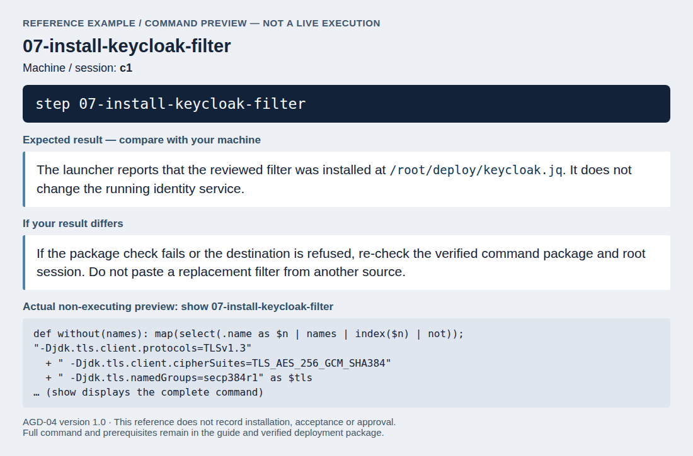

*Command preview only: this image shows the bundled command, without executing it. Compare your actual result with the expectations above.*

Then apply it to the manifest, which becomes a JSON file:

<!-- deployment-step: 07-009 -->

**Run on C1, in the `c1` deployment session:**

```bash
step 07-configure-keycloak
```

**Expected result.** `start --import-realm`, the four environment setting names and `keycloak-realm`, exactly as listed below; no `KC_HOSTNAME_STRICT` line.

**If the result differs.** A missing `deployment.yaml` can mean this one-time conversion already ran. Do not rerun against the resulting JSON or deploy incomplete files; check the previous result and recreate the working copy if necessary.

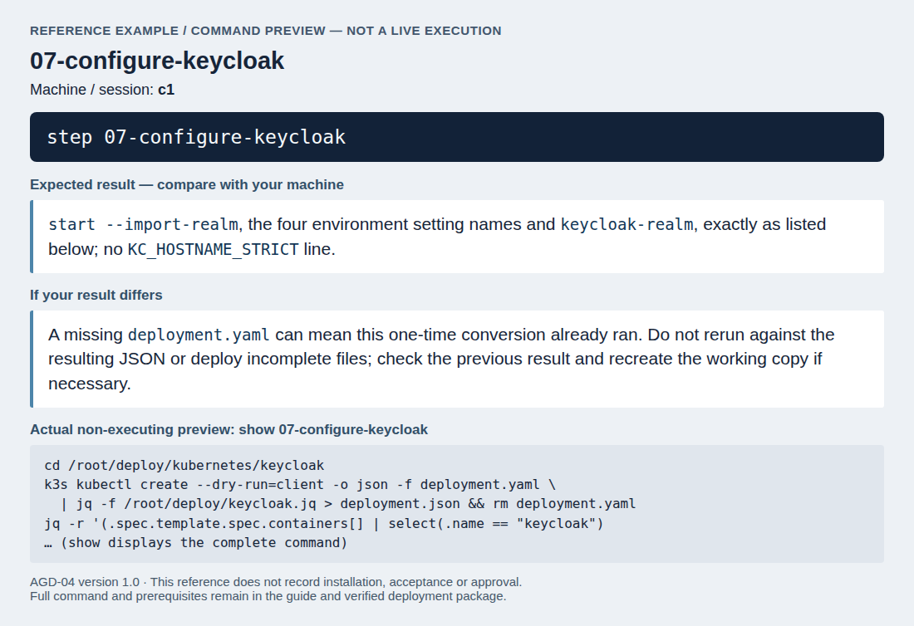

*Command preview only: this image shows the bundled command, without executing it. Compare your actual result with the expectations above.*

The output must be `start --import-realm` followed by `KC_HOSTNAME`,
`KC_HTTP_ENABLED`, `KC_TRUSTSTORE_PATHS`, `JAVA_OPTS_APPEND` and
`keycloak-realm`, and no `KC_HOSTNAME_STRICT`. The identity service now reads
the tenant realm from a Secret, which
[Write the documents back](#write-the-documents-back) creates.

## Close the GraphQL console

:::warning
The GraphQL console and the metadata API give full access to the database
schema and its permissions. They must not be reachable.
:::

The GraphQL engine must offer only its GraphQL endpoint: no console, no
development mode, no metadata or other API.

<!-- deployment-step: 07-010 -->

**Run on C1, in the `c1` deployment session:**

```bash
step 07-restrict-graphql
```

**Expected result.** The console and development-mode values are both `"false"`; each of the three ingress paths is `/hasura/v1/graphql` with `pathType: Exact`.

**If the result differs.** If any value is `true`, a path is shorter, or its type is `Prefix`, do not deploy. Check the kit manifests and rebuild the hardening transformations; do not expose the metadata API to make troubleshooting easier.

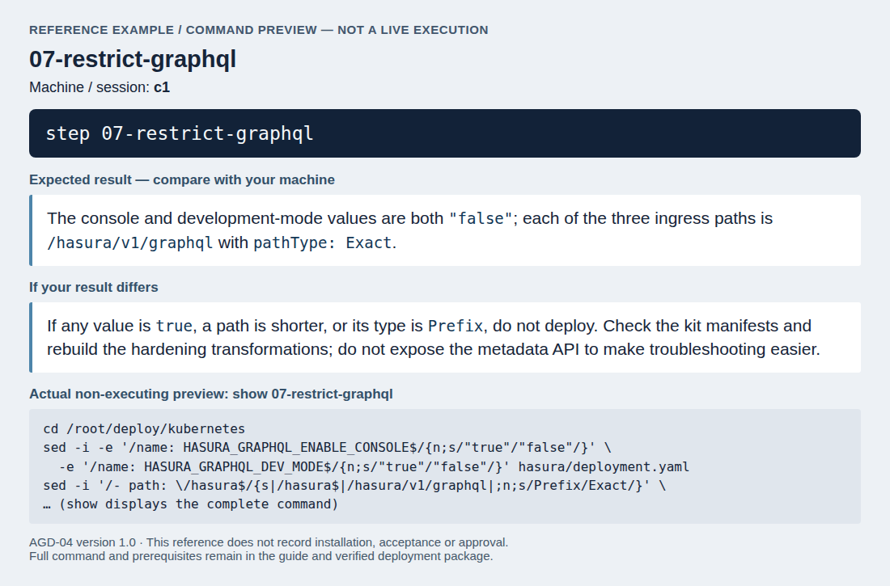

*Command preview only: this image shows the bundled command, without executing it. Compare your actual result with the expectations above.*

Both values must be `"false"`, and each of the three ingress files must show
`path: /hasura/v1/graphql` with `pathType: Exact`.

## Limit cross-origin access

:::warning
Allow cross-origin requests only from the three portal origins. From any
other origin, a web page on another site could call the TOE with a voter's
browser.
:::

Set the same three allowed origins on the ingress and on the GraphQL
backend. The ingress allowlist alone does not remove an allow-origin header
returned by the backend:

<!-- deployment-step: 07-011 -->

**Run on C1, in the `c1` deployment session:**

```bash
step 07-restrict-browser-origins
```

**Expected result.** Both allowlists contain exactly your three HTTPS portal origins; neither contains `*`.

**If the result differs.** If origins differ between ingress and backend, check the configured host names and the current working directory. Recreate the affected manifests from the verified kit; a wildcard is not an acceptable workaround.

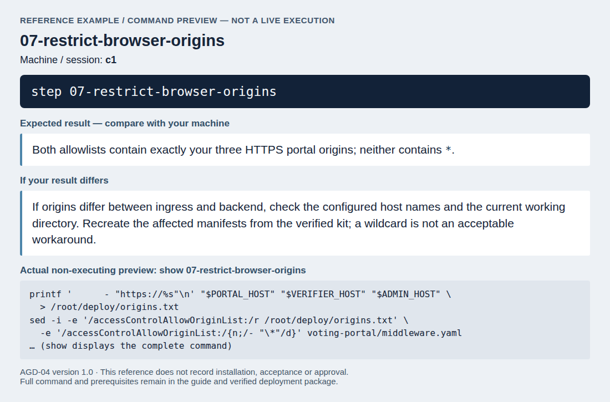

*Command preview only: this image shows the bundled command, without executing it. Compare your actual result with the expectations above.*

The ingress list and the comma-separated backend value must contain the
same three `https://` origins and no `"*"`. The backend setting applies only
to the `hasura` container; preserve the other deployment settings.

## Block the master realm

:::warning
Without this block, anyone who reaches the portal hosts could try to sign
in to the identity service's master realm.
:::

The identity service's master realm holds its service administrator and must
not be reachable from outside the cluster:

<!-- deployment-step: 07-012 -->

**Run on C1, in the `c1` deployment session:**

```bash
step 07-block-master-realm
```

**Expected result.** Exactly three `- host:` lines, matching your voting, administration and verifier hosts.

**If the result differs.** If a host is absent or unexpected, correct the public input and recreate this ingress before deploying. After deployment, the master-realm HTTP checks must still pass.

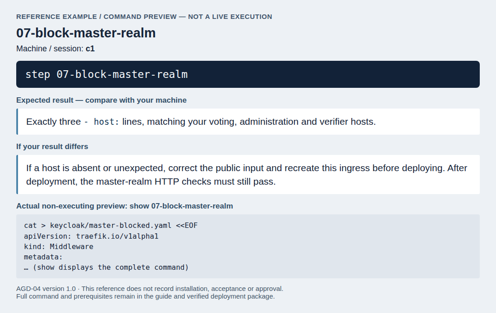

*Command preview only: this image shows the bundled command, without executing it. Compare your actual result with the expectations above.*

The last command must list the three host names. The only address allowed,
192.0.2.1, is reserved for documentation and is never a client's, so the
ingress refuses every request to the master realm, also those that the TLS
endpoint forwards from C1's loopback interface.
[Verifying the Installation](10-verification.md) checks that the master realm
answers with an error.

## Give harvest its service

The other services reach harvest inside the cluster at port 8400. Add its
Service, reachable only inside the cluster:

<!-- deployment-step: 07-013 -->

**Run on C1, in the `c1` deployment session:**

```bash
step 07-restrict-harvest-route
```

**Expected result.** No terminal output. The step writes `harvest/service.yaml` for internal port 8400. Later deployment and service checks verify it in the cluster.

**If the result differs.** If a file or directory error appears, check that the session is in `/root/deploy/kubernetes` and the working copy includes the harvest directory. Do not substitute a public or NodePort service.

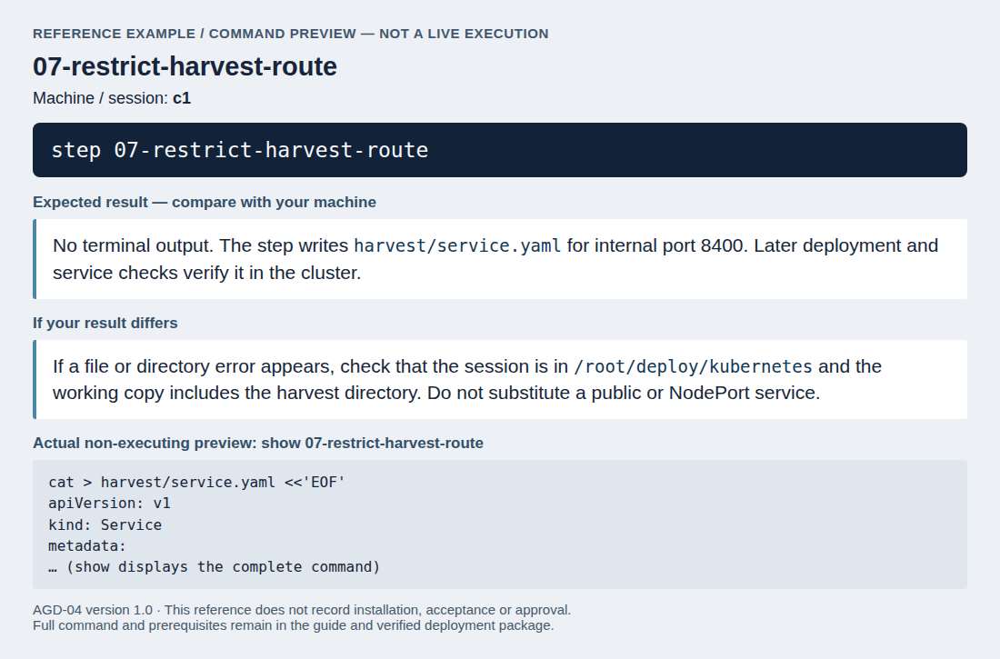

*Command preview only: this image shows the bundled command, without executing it. Compare your actual result with the expectations above.*

## Keep the results and kiosk portals off

:::warning
Do not set either address, and do not deploy either portal.
:::

No results portal and no kiosk voting portal are part of the evaluated
configuration. Their addresses stay unset:

<!-- deployment-step: 07-014 -->

**Run on C1, in the `c1` deployment session:**

```bash
step 07-check-excluded-portals
```

**Expected result.** `Neither excluded-portal setting is present.` Both results-portal and kiosk-portal addresses remain unset.

**If the result differs.** If either name and a value are printed, stop and return to the verified kit configuration. Do not deploy the results or kiosk portal in this configuration.

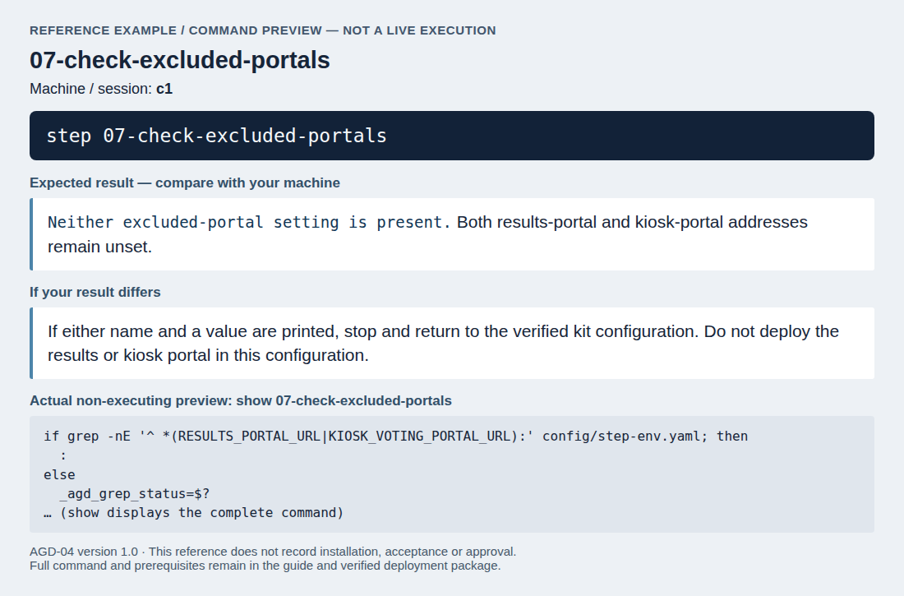

*Command preview only: this image shows the bundled command, without executing it. Compare your actual result with the expectations above.*

The command confirms that neither excluded-portal setting is present. The realm
settings below also disable the results portal's client.

## Configure the realms

:::warning
These settings decide who can sign in to the TOE and how. Apply all of them
before the first deployment: the identity service imports the tenant realm
only once.
:::

The identity service imports the tenant realm from the manifest
`keycloak/realm.yaml`. New tenants and election events take their realm from
the two templates in `keycloak/realm-templates.yaml`. All three documents get
the same sign-in settings:

- TLS required for external requests; idle sessions end after 15 minutes;
  brute-force protection locks an account after 5 failed attempts; events
  are recorded and passed to the TOE's event listener;
- no self-registration, password reset or "remember me";
- the external authentication server is the only identity provider, every
  sign-in is redirected to it, the local sign-in forms are disabled, and a
  first sign-in only links to an existing account;
- the local `mfa-method-selector` required action is disabled, including its
  default action, so it does not request a second enrollment after external
  authentication; the external server's required factors remain enforced and
  the other required actions remain unchanged;
- the administration and voting portals use the authorization code flow with
  PKCE (S256), no password grant, and redirect only to their own hosts; the
  command-line client `admin-cli` has no password grant either.

The tenant realm also gets the operator's client secrets and trustee
passwords, and all demonstration passwords are removed. The seeded
administrator groups (`admin`, `admin-light` and `admin-lockdown`) lose every
permission that the administrator role must not hold, as the role tables of
the [Handbook for Election Administrators (AGD-02)](../../02-election_managers/04-administrator_handbook/01-about.md)
list them: the election board's permissions, among them "Create Election
Event" (`election-event-create`), the only permission that the import of
election data needs, the "Sign:" permissions, the scheduled events and the
areas, and every permission that reads, changes or exports election data,
election execution data or audit records. No group holds "Edit Results
Publication" (`publish-results-write`), "Datafix account"
(`datafix-account`) or "Manually Verify Voter" (`voter-manually-verify`).
The election event template also
gets: no sign-in code step and no messaging channel for voters, no account console,
no offline sessions, and the results portal's and the other unused channels'
clients disabled.

Save the list of the permissions that the administrator role must not hold
as `/root/deploy/board.jq`:

<!-- deployment-step: 07-015 -->

**Run on C1, in the `c1` deployment session:**

```bash
step 07-install-board-role-filter
```

**Expected result.** The launcher reports that `/root/deploy/board.jq` was installed. This copies the reviewed permissions filter; it does not yet change accounts.

**If the result differs.** If installation is refused, verify the package and destination permissions. Do not shorten the exclusion list to make a later check pass.

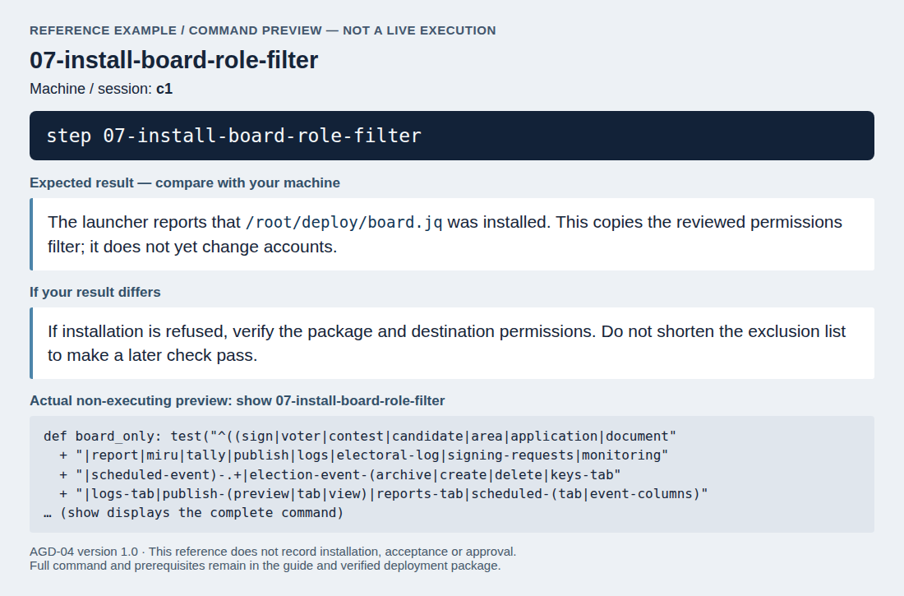

*Command preview only: this image shows the bundled command, without executing it. Compare your actual result with the expectations above.*

Then install the reviewed filter at `/root/deploy/realm.jq`:

<!-- deployment-step: 07-016 -->

**Run on C1, in the `c1` deployment session:**

```bash
step 07-install-realm-filter
```

**Expected result.** The launcher reports that `/root/deploy/realm.jq` was installed. Apply it only with the next step.

**If the result differs.** If the file cannot be installed or the package hash differs, stop and recover the verified package. Do not use an unreviewed realm filter.

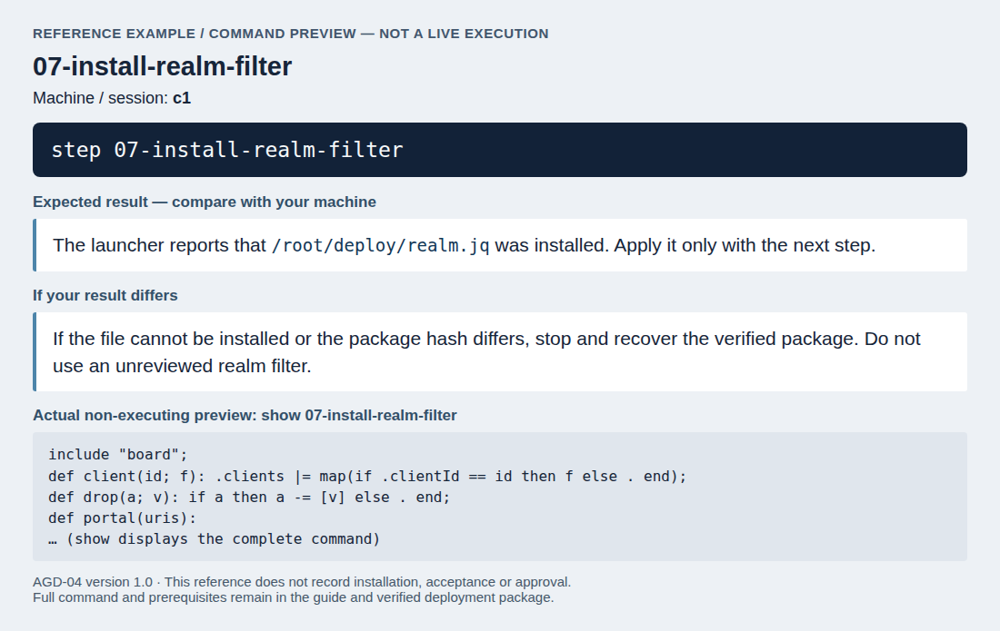

*Command preview only: this image shows the bundled command, without executing it. Compare your actual result with the expectations above.*

Extract the three documents and apply the filter to each:

<!-- deployment-step: 07-017 -->

**Run on C1, in the `c1` deployment session:**

```bash
step 07-prepare-realms
```

**Expected result.** Three lines: `tenant done`, `tenant-template done` and `event-template done`.

**If the result differs.** If jq reports an error or one line is absent, check that the IdP definition, all three reviewed filters and the original realm manifests are present. Keep the incomplete output out of the cluster; recreate the working copy before repeating transformations.

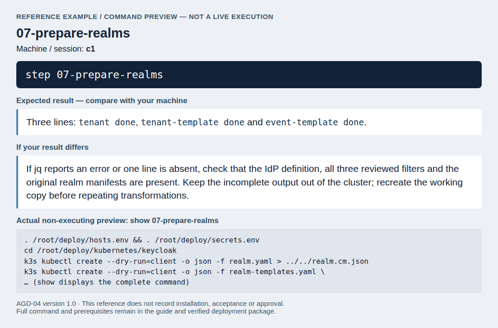

*Command preview only: this image shows the bundled command, without executing it. Compare your actual result with the expectations above.*

The loop must print `done` for the three documents. Then check them:

<!-- deployment-step: 07-018 -->

**Run on C1, in the `c1` deployment session:**

```bash
step 07-check-realm-security
```

**Expected result.** Three compact JSON records with the exact security values listed below, including a 900-second idle timeout, failure factor 5 and disabled local MFA selector.

**If the result differs.** If a record is missing or any setting differs, do not write the realm documents back. Check the external IdP inputs and filter application; do not weaken a required value merely to pass the comparison.

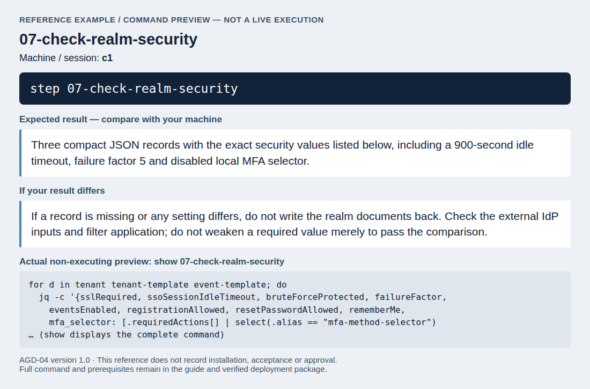

*Command preview only: this image shows the bundled command, without executing it. Compare your actual result with the expectations above.*

Each line must show `"sslRequired":"external"`, `"ssoSessionIdleTimeout":900`,
`"bruteForceProtected":true`, `"failureFactor":5`, `"eventsEnabled":true`,
`false` for the three self-service settings, `"mfa_selector":[[false,false]]`,
and IDP_ALIAS as the only identity provider. Only the tenant document lists
users with a credential:
`trustee1` and `trustee2`. The tenant document and the tenant template list
the disabled client `cli-account-admin`; the event template lists
`account-console`, `ivr-service`, `ivr-voting`, `onsite-voting-portal`,
`results-portal`, `vp-sso` and `voting-portal-certs`.

Check the sign-in settings in detail:

<!-- deployment-step: 07-019 -->

**Run on C1, in the `c1` deployment session:**

```bash
step 07-check-role-separation
```

**Expected result.** Each document has the detailed sign-in, role, PKCE and authentication-time values listed below. The final record shows messaging absent, code step disabled and offline access null.

**If the result differs.** If any forbidden role, enabled local form, smart-link flow or missing authentication-time mapper appears, stop before first deployment. Recreate and re-check all realm transformations; do not approve only the fields that happened to match.

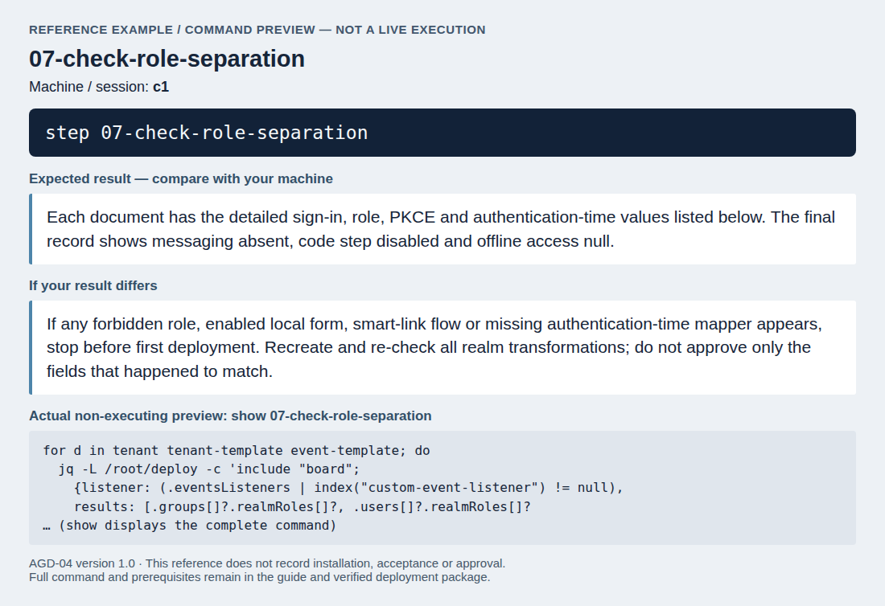

*Command preview only: this image shows the bundled command, without executing it. Compare your actual result with the expectations above.*

For each document, `listener` must be `true`, `results` (no group or account
with "Edit Results Publication", "Datafix account" or "Manually Verify
Voter") and `admin_groups` (no excluded permission left in an administrator
group) empty, every `forms` entry `DISABLED`, `redirect` IDP_ALIAS, each portal
client must show `false` and `"S256"`, `admin_cli` must be `[false]` and
`smart_link` (no sign-in flow with the smart-link authenticator) empty. For the
tenant document and the tenant template, `broker_freshness` must name IDP_ALIAS
with `passMaxAge` equal to `"true"` and `prompt` empty. The identity service
then forwards the board's requested maximum authentication age to the external
server, checks that server's signed `auth_time`, and preserves that time in the
TOE session. `admin_auth_time` must be one entry containing
`"oidc-usersessionmodel-note-mapper"`, `"AUTH_TIME"`, `"long"`, `"true"`, `"true"`:
the admin client's ID and access tokens carry the actual session authentication
time, never a constant or token refresh time. An empty provider `prompt` lets the portal's request for a fresh
login reach the external server; do not override it with `none`. The election
event template keeps its voter authentication policy. For the
tenant document and the tenant template, `cli_account_admin` must be
`[[false,false]]` (the command-line account client is disabled and has no
password grant) and `admin_events` `[true,true]` (changes made through the
administration interface are recorded with their details); for the event
template they are `[]` and `[false,false]`. The last command must print
`{"messaging":"absent","code_step":["DISABLED"],"offline":null}`.

### Add the installation account

The tenant of this realm is the super-admin tenant. It serves only the steps
of this guide and holds no election work. The identity service imports its
realm only at its first start, so the installation account is added to the
tenant document now. The operator holds it and uses it only to create the
customer's tenant
([Create the customer's tenant](08-installing_toe.md#create-the-customers-tenant)),
which disables it afterwards. It gets the group and roles of the seeded
administrator account, no password, and the user name and e-mail address that
the external authentication server holds for the operator:

<!-- deployment-step: 07-020 -->

**Run on C1, in the `c1` deployment session:**

```bash
step 07-add-bootstrap-operator
```

**Expected result.** The listed administrator entries include `admin`, `api-user` and your installation user name, each paired with `false` for stored credentials.

**If the result differs.** If the user name is wrong or appears twice, do not create more accounts by rerunning. Recreate the tenant document and enter the external authentication server's exact user name and e-mail; never add a local password.

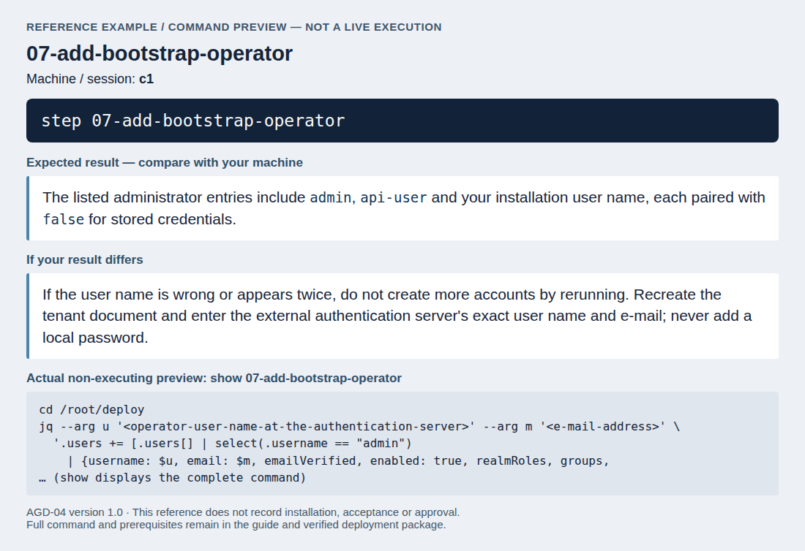

*Command preview only: this image shows the bundled command, without executing it. Compare your actual result with the expectations above.*

The last command must list `admin`, `api-user` and the new user name, each
with `false`.

### Write the documents back

:::warning
The documents hold client secrets, the trustee passwords and the external
authentication server's client secret. They go into the cluster only as
Secrets, which the cluster stores encrypted, never as ConfigMaps.
:::

Write the documents back into the manifests as Secrets, and let the setup job
of the object storage read the templates from them:

<!-- deployment-step: 07-021 -->

**Run on C1, in the `c1` deployment session:**

```bash
step 07-package-realm-secrets
```

**Expected result.** The six keycloak manifest files, `Secret` type lines, and the two secret-backed template references listed below. Only the two permitted ConfigMap paths may appear in the final scan.

**If the result differs.** If realm files remain ConfigMaps or another ConfigMap is listed as containing secrets, do not deploy or copy the directory. Re-check conversion from the protected working copy; never print the secret-bearing documents.

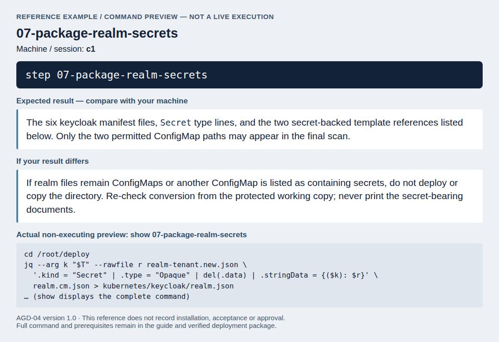

*Command preview only: this image shows the bundled command, without executing it. Compare your actual result with the expectations above.*

The `ls` command must list `deployment.json`, `ingress.yaml`,
`master-blocked.yaml`, `realm-templates.json`, `realm.json` and
`service.yaml`. The next commands must print `Secret`, then
`Secret keycloak-tenant-realm-template` and
`Secret keycloak-election-event-realm-template`, then two `- secret:` lines,
each followed by the name of one template. The last command lists the
manifests with ConfigMaps that contain the words "secret" or "password": it
may list only `config/step-env.yaml` and `postgres/init-script.yaml`, which
name passwords and Secrets but hold no secret value.

The Secret `keycloak-realm` holds the operator's client secrets and the
trustee passwords only until
[Installing the TOE](08-installing_toe.md#remove-the-secrets-from-the-realm-manifest)
removes them after the first start. Do not copy the deployment directory
anywhere.
