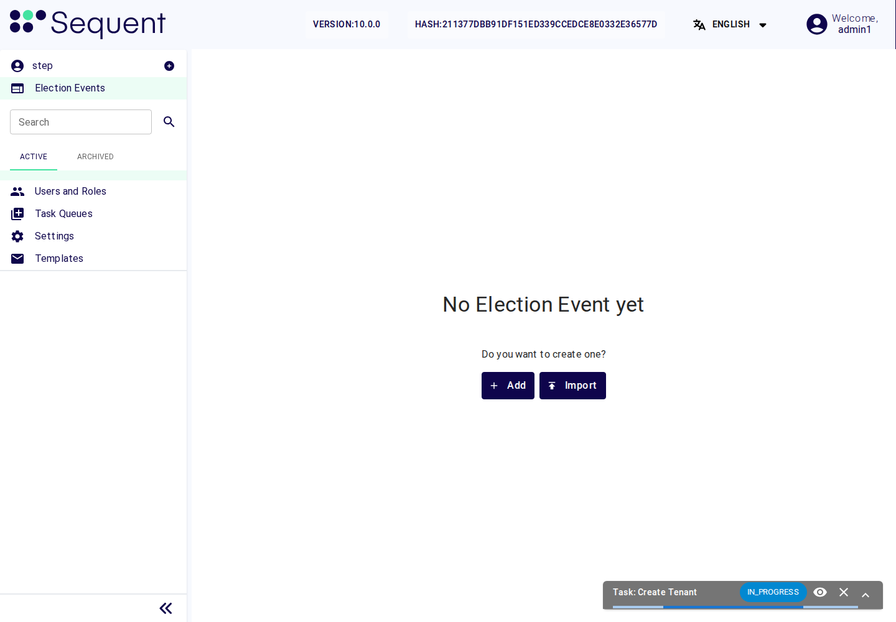
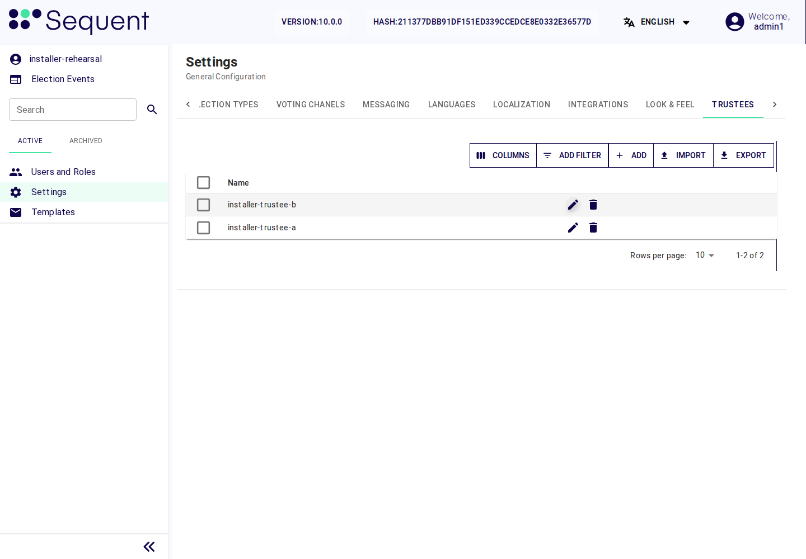
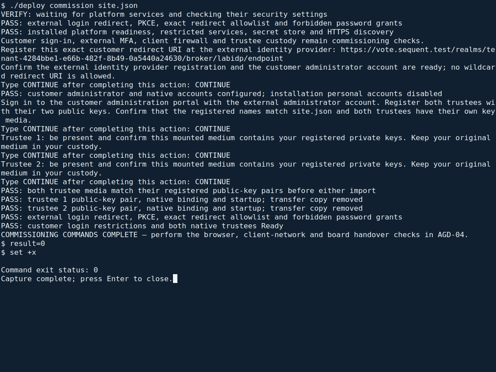

<!--
SPDX-FileCopyrightText: 2026 Sequent Tech Inc <legal@sequentech.io>
SPDX-License-Identifier: AGPL-3.0-only
-->

Read this chapter for the requirements and expected results behind the
[configuration-driven installation](01-about.md#install-from-one-configuration-file).
Follow the explicit commands and human checkpoints below. The installer performs
the server-side operations; you do not run internal numbered operations yourself.

This page loads the TOE images from the verified delivery medium onto both
servers, pins every TOE container to its delivered digest, deploys, and
installs the trustees' keys. It also covers the offline trustee tool from the same delivery. Trustees may
share an existing workstation through separate protected offline sessions.

:::warning
Use only the delivery medium that passed every step of
[Verifying the Delivery](../08-delivery_verification.md). The installation kit
also carries images under the same names; the TOE parts must never run from
those.
:::

## Load the TOE images

Keep the accepted delivery medium mounted read-only as described in
[Verifying the Delivery](../08-delivery_verification.md). Set `toe.directory` to
its root and `toe.format` to `oci` in `site.json`. `./deploy check site.json`
validates all seven delivered OCI images against the accepted digest list.

During `./deploy install site.json`, the installer prepares private temporary
transport archives from the six server images, copies them to C1 and C2, and
checks the transferred hashes. Do not manually create archives or change the
accepted delivery layout:

<!-- deployment-step: 08-001 -->

**Expected result.** The installer prints `INSTALL: preparing private transport archives from the verified OCI images`; transfers to C1 and C2 complete without SSH, archive or disk errors. The source delivery remains unchanged. Transfer checks do not replace the imported-image checks below.

**If the result differs.** If either host is unreachable or the target is full, fix connectivity or capacity before importing. Keep the source medium protected; do not substitute images from the installation kit.


The installer imports the transported images on both servers and checks that each
one is present under its delivered digest. Its local import preserves the
digest-qualified names of the delivered image manifests:

<!-- deployment-step: 08-002 -->

**Expected result.** Six final lines ending in `loaded`, one for each delivered image, on each server.

**If the result differs.** If any line ends in `MISSING`, compare the delivery digest list and transferred archives, then repair the transfer/import on that server. Do not continue because the other server passed.


All six server images must be present on both servers before deployment proceeds.

## Pin the TOE images

:::warning
Every TOE container must name its image by the digest of the delivery. A
container that names an image by a tag can run the kit's image of the same
name.
:::

On C1:

<!-- deployment-step: 08-003 -->

**Expected result.** The seven reference/count lines shown below, with every TOE image pinned to `@sha256:`.

**If the result differs.** If a count differs or a TOE image still uses a tag, stop and check that the working manifests and digest list match this delivery. Do not replace a missing digest with `latest`.


The output must be exactly:

```text
      1 sequentech.local/b4@sha256:...
      1 sequentech.local/ballot-verifier@sha256:...
      2 sequentech.local/braid@sha256:...
      1 sequentech.local/harvest@sha256:...
      1 sequentech.local/keycloak@sha256:...
      2 sequentech.local/trustee:latest
      3 sequentech.local/windmill@sha256:...
```

The two `trustee:latest` references are the setup steps of the bulletin board
and of the object storage, which use the tools of the kit's image and run no
TOE function.

## Deploy

:::warning
Load `secrets.env` in the same shell before every deployment. A deployment
without it sets demonstration passwords on the databases and services.
:::

On C1:

<!-- deployment-step: 08-005 -->

**Expected result.** `step-tls-cert already exists; keeping it.`, successful identity-service rollout, and pods `Running` or `Completed`. Only the two trustee instances may remain not ready until their keys are installed.

**If the result differs.** On a rollout timeout or `CrashLoopBackOff`, inspect that component's operating log using the server operations section and check the verified manifests. Keep the original secrets; do not rerun secret generation or use demonstration credentials.


The deployment must print `step-tls-cert already exists; keeping it.` and end
without an error. After a few minutes every pod must be `Running` or
`Completed`, except `trustee1` and `trustee2`: they stay not ready until their
keys are installed during commissioning. Later configuration changes require a
reviewed maintenance procedure; do not rerun the fresh-install command against an
occupied cluster.

## Remove the secrets from the realm manifest

:::warning
The identity service has now imported the tenant realm. Its manifest and the
Secret `keycloak-realm` still hold the client secrets and the trustee
passwords, and must no longer.
:::

On C1:

<!-- deployment-step: 08-006 -->

**Expected result.** HTTP `200` for the imported realm, then the exact zero-credential summary below after updating its stored manifest.

**If the result differs.** If the realm is not available or the summary differs, stop: confirm its first import completed before removing import material. Do not print client secrets or recreate the realm to work around the error.


The last command must print
`{"credentials":0,"idp_secret":0,"secrets":["CHANGE_ME_API_KEY_CLIENT_SECRET","CHANGE_ME_SERVICE_ACCOUNT_SECRET"]}`.
The running realm keeps the values set at its import. Check with
`k3s kubectl get pods -A` that the pods are still running.

## Create the customer's tenant

:::warning
All election work happens in the customer's tenant. The tenant of the realm R
is the super-admin tenant: it serves only the steps of this guide, holds no
election event, and none of its personal accounts stays enabled.
:::

The operator creates the customer's tenant once, after [Deploy](#deploy) and
before the trustee keys are installed:

1. Open `https://ADMIN_HOST` on the administration workstation and sign in at
   the external authentication server as the installation account of
   [Add the installation account](07-hardening.md#add-the-installation-account).
2. In the menu, next to the tenant's name, select the plus button "Create new
   tenant". Enter the customer's short name in the field "Slug" and select
   "Save". The TOE creates the tenant and its realm from the tenant template
   that [Configure the realms](07-hardening.md#configure-the-realms) has
   hardened, with the service accounts and a seeded `admin` account without a
   password.

   

   *Actual portal capture from the final VM rehearsal. The **Create Tenant** task
   can remain **IN_PROGRESS** while the customer is provisioned. Wait for it to
   finish and confirm the agreed customer slug exists before commissioning; do
   not submit another creation request while this task is running. The displayed
   installation account and site values are laboratory examples.*

3. Put the customer slug and administrator identity in `commissioning` in
   `site.json`, then run `./deploy commission site.json` from the administration
   workstation. The command resolves the customer tenant on C1:

   <!-- deployment-step: 08-007 -->

   **Required result.** The lookup identifies exactly the installation tenant and the customer tenant matching the configured slug. The customer realm is `tenant-` followed by that customer UUID.

   **If the result differs.** If the customer row is absent, finish its creation in the portal first. If more than two tenants appear, stop and reconcile the installation state; never choose an arbitrary tenant or repeat creation.


   The installation tenant is `90505c8a-23a9-4cdf-a26b-4e19f6a097d5`; the
   other tenant must have the customer slug you supplied. The commissioning
   command records the resolved customer realm. Do not type or guess a UUID or
   edit a shell environment file to select a different tenant.
4. At the commissioning checkpoint, ask the operator of the external
   authentication server to register the exact redirect URI `https://PORTAL_HOST/realms/CR/broker/IDP_ALIAS/endpoint`,
   with your value of CR (see
   [Connecting the Authentication Server](06-authentication_server.md)).
5. The commissioning command adds the customer's first administrator and the
   two native trustee accounts, configures the trustee client secret, and disables
   the personal accounts of the installation realm. The administrator's user name
   and e-mail must match the identity supplied by the external authentication
   server; they come from the same configuration file:

   <!-- deployment-step: 08-008 -->

   **Expected result.** The customer realm lists the new administrator and trustees enabled; the installation realm lists all personal accounts disabled, as detailed below.

   **If the result differs.** If account creation reports a conflict or a user remains enabled in the installation realm, stop and inspect the account state with the administrator. Do not rerun the entire creation block or give these accounts local passwords.


   For the realm CR the list must show `admin`, the first administrator's
   user name, `trustee1` and `trustee2`, each with `true`. For the realm R
   every line must end in `false`. Neither list shows the accounts whose names
   start with `service-account-`: the identity service does not list them, and
   they stay enabled.
   The installation account is now disabled: no later step of this guide
   needs an account of the super-admin tenant.
6. Make the checks of
   [Identity service](10-verification.md#identity-service) for the customer realm, and of
   [Data correction, telephone channel, plugins and tenants](10-verification.md#data-correction-telephone-channel-plugins-and-tenants).

## Install the trustee keys

Each trustee generates their keys on a trustee workstation (see
[Preparing a trustee workstation](#preparing-a-trustee-workstation) and the
trustee procedures of the
[Handbook for Election Organizers (AGD-03)](../../02-election_managers/05-election_organizer_handbook/01-about.md)),
and the administrators register the public keys as the section "Registering
the trustees' public keys" of the
[Handbook for Election Administrators (AGD-02)](../../02-election_managers/04-administrator_handbook/01-about.md)
describes. The trustee then hands over the keys file for their instance of
the trustee server: `trustee1` for the first trustee, `trustee2` for the
second.

### Bind each native account to its registered trustee

Before starting either instance, agree with the election administrator which
registered trustee and public keys belong to each instance. The machine login
names remain `trustee1` and `trustee2`; they can differ from the names registered
in Settings > "TRUSTEES". Each machine account's `trustee` attribute must name
exactly its registered trustee. The person's separate account uses "Act as
Trustee" for the same registered name.

The commissioning configuration associates the first trustee entry with native
instance `trustee1` and the second with `trustee2`. At its checkpoint, the
administrator registers the two public keys in the portal and each trustee
provides the corresponding private key file on their own medium. Before importing
either file, the command compares its public-key pair with the registered trustee
record. It changes only the native account's trustee binding; personal trustee
accounts remain separate and receive no local password.



*Actual customer portal from the final VM rehearsal. Open each registered trustee
record and check both public keys against that trustee's own keys before
continuing. The customer and trustee names shown here are laboratory examples.*

<!-- deployment-step: 08-009 -->

**Required result.** Each native account is bound to its configured registered trustee name, and the installed key file matches that record’s public keys. Both instances must pass.

**If the result differs.** If there is no success line, check the exact registered name, customer tenant and instance number with the administrator and trustee. Do not start either server with an uncertain key-to-account mapping.


Record the native
account, registered trustee name and checked public-key pair in the protected
installation record. The binding is persistent customer-realm state; verify it
again after restoring a customer backup. The process's `TRUSTEE_NAME` also
selects its native login, so keep it as `trustee1` or `trustee2`. That display
alias does not replace verification of the trustee's signing public key.

### Transfer the matching keys and start the instances

:::warning
The keys file holds the trustee's private keys. Take it over only in person,
with the trustee watching every step, directly from the trustee's own medium.
No copy may remain on the administration workstation or on C1: it is kept
only in the cluster's encrypted Secret.
:::

**Where to work:** the administration workstation—the computer from which you
connect to C1 and C2 over SSH. This is not the admin portal, a user named `admin`,
or a separate trustee server.

1. Complete [customer creation and account setup](#create-the-customers-tenant)
   and register both trustees as described above. In `site.json`, each
   `commissioning.trustees` entry must contain the exact registered `name` and
   the absolute `keys_file` path on that trustee's mounted medium.
2. Open a root terminal in the extracted package's `deployment` directory. If
   commissioning is not already running, start it with the same configuration:

   ```bash
   ./deploy commission site.json
   ```

   If that command is already waiting for you, continue in that terminal;
   do not start a second copy. `./deploy` is the executable in the current
   directory. From another directory, use its full path and the full path to
   `site.json`.
3. At the trustee-registration prompt, verify the names and both public keys
   in the [portal screenshot above](#bind-each-native-account-to-its-registered-trustee).
   Type `CONTINUE` and press Enter only after completing that check.
4. At each `Trustee 1: be present...` / `Trustee 2: be present...` prompt,
   have that trustee confirm their own mounted medium and private-key file.
   Type `CONTINUE` and press Enter. Keep both media available, unchanged, and
   under their owners' supervision until both imports finish: the installer
   checks both key pairs before importing either, then reads each file again.
5. Let the command transfer the keys, create the encrypted cluster Secrets,
   bind the native accounts and start both instances. These are automatic
   operations; no additional command on C1 is required.

<!-- deployment-step: 08-010 -->

**Expected result.** First the terminal prints
`PASS: both trustee media match their registered public-key pairs before either import`.
After each successful import, it prints
`PASS: trustee 1 public-key pair, native binding and startup; transfer copy removed`
and the corresponding line for trustee 2. Only then unmount each trustee's
medium and return it to its owner. These messages confirm removal of the
installer's temporary transfer copies; do not make additional copies yourself.



*Actual terminal capture from the VM rehearsal on 2026-10-26. The command at
 the top is the one to run. The `CONTINUE` prompts and `PASS` lines show the
 expected sequence. Hostnames and account identifiers are laboratory examples;
 use your approved `site.json` values.*

**If the result differs:**

- **Keys do not match:** stop. With the trustee, check the configured file,
  registered name, tenant and both registered public keys. Do not replace keys
  or alter the registration simply to silence a mismatch.
- **Transfer, Secret creation or startup fails:** stop and inspect the stated
  error and the actual cluster state. Do not overwrite an existing Secret,
  generate replacement keys or assume that temporary-file cleanup succeeded.
- **A previous attempt stopped during writes:** the installer refuses automatic
  replay. Resolve the partial state with the operator before retrying; do not
  remove its state markers to bypass this refusal.

<!-- deployment-step: 08-011 -->

The same commissioning command configures each native instance's sign-in and
waits for its deployment to become ready. Keep the configured names and keys;
personal trustee accounts remain separate from these native machine accounts.

<!-- deployment-step: 08-012 -->

**Final expected result.** The terminal prints
`PASS: customer login restrictions and both native trustees Ready`, followed by
`COMMISSIONING COMMANDS COMPLETE — perform the browser, client-network and board handover checks in AGD-04.`
This is not authorization to start an election.

Before each key or tally ceremony, the operator must confirm that both instances
are ready. From the same `deployment` directory, run `./deploy commission site.json`
with the unchanged completed configuration. On a completed installation it checks
readiness and login restrictions without importing the keys again. Expect the
`PASS: customer login restrictions and both native trustees Ready` line; the
first-run completion banner is not repeated. If the check fails, do not authorize
the ceremony until the operator resolves the fault and the check passes.

## Back up the trustee state

The instances keep their protocol state, which they need to continue the
protocol, on C1 under `/var/lib/sequent-data/trustee1` and
`/var/lib/sequent-data/trustee2`.

:::warning
Back up the state only while no ceremony is running, and only encrypted.
Keep the backup and its passphrase in separate locked places.
:::

After the key ceremony, from the administration workstation, with a backup
medium mounted at the path you give:

Run from the extracted `deployment` directory on the administration workstation,
with the same `site.json`. The first line reads C1’s address from that file.

<!-- deployment-step: 08-013 -->

```bash
set -e -o pipefail
C1=$(jq -er '.nodes.c1' site.json)
read -r -p "Mounted backup directory: " BACKUP_DIRECTORY
B="$BACKUP_DIRECTORY"/trustee-state-$(date +%F).tar.gpg
ssh root@$C1 'k3s kubectl -n step-infra scale --replicas=0 \
  deployment/trustee1 deployment/trustee2'
ssh root@$C1 'tar -C /var/lib/sequent-data -cf - trustee1 trustee2' \
  | gpg --symmetric --cipher-algo AES256 -o "$B"
ssh root@$C1 'k3s kubectl -n step-infra scale --replicas=1 \
  deployment/trustee1 deployment/trustee2'
gpg -d "$B" | tar -tf - | cut -d/ -f1 | sort -u    # trustee1 and trustee2
```

**Expected result.** The encrypted backup can be decrypted with its passphrase and the final listing contains both `trustee1` and `trustee2`. The deployments are scaled back to one replica.

**If the result differs.** If encryption or archive validation fails, keep the original state, verify whether trustees remain stopped, and restore their intended running state only outside a ceremony. Do not delete state or accept a partial backup.


## Remove the trustee keys at the end of the election

When the trustee procedures say so (the retention period has ended and the
election execution data has been deleted), remove the trustees' keys and
state from the servers, on C1:

:::warning
This destroys the trustees' keys files and protocol state on the servers:
the instances can then no longer take part in decrypting the votes. Do it
only at the end of the retention period, with the election board present.
:::

<!-- deployment-step: 08-014 -->

```bash
set -e -o pipefail
read -r -p "Type REMOVE TRUSTEE KEYS to confirm: " CONFIRM
test "$CONFIRM" = "REMOVE TRUSTEE KEYS"
k3s kubectl -n step-infra scale --replicas=0 deployment/trustee1 deployment/trustee2
k3s kubectl -n step-infra delete secret trustee1-keys trustee2-keys \
  trustee1-auth trustee2-auth
find /var/lib/sequent-data/trustee1 /var/lib/sequent-data/trustee2 -mindepth 1 -delete
if _agd_absent=$(k3s kubectl -n step-infra get secret trustee1-keys trustee2-keys 2>&1); then
  printf 'Unexpected trustee key secret remains\n' >&2
  false
else
  printf '%s\n' "$_agd_absent" | grep -c NotFound
fi
unset _agd_absent
find /var/lib/sequent-data/trustee1 /var/lib/sequent-data/trustee2 -mindepth 1 | wc -l
```

**Expected result.** After the explicit destruction confirmation, deletion messages are followed by `2` (both key Secrets absent) and `0` (no remaining state entries).

**If the result differs.** If either count differs, stop and establish exactly what remains; do not destroy the backups yet or start another ceremony. Record the partial outcome and have the board direct completion of the authorized removal.


The last two commands must print `2` and `0`. Then destroy every backup of
the trustee state, and record the removal and the destruction in the election
board's minutes.

## Preparing a trustee workstation

A trustee workstation runs the `trustee` program of the delivered `braid`
image, offline.

:::warning
The workstation has no network connection while handling keys. Use each
trustee’s encrypted medium and a clean offline session as described in
[Trustee key handling](02-operational_environment.md#trustee-key-handling).
The hardware may be shared; the keys, media and sessions must remain separate.
Load the tool only from the verified delivery after checking its digest.
:::

The workstation needs podman and skopeo. Mount the delivery medium read-only
with the commands of step 3 of
[Verifying the Delivery](../08-delivery_verification.md), then:

<!-- deployment-step: 08-015 -->

```bash
set -e -o pipefail
M=/mnt/temenos-delivery
D=$(sed -n 's/^braid \(sha256:[0-9a-f]*\)$/\1/p' "$M/image-digests.txt")
[ "$(skopeo inspect --format '{{.Digest}}' "oci:$M/images/braid:v10.0.0")" = "$D" ]
echo "braid image verified"
skopeo copy "oci:$M/images/braid:v10.0.0" containers-storage:localhost/braid:v10.0.0
[ "$(podman image inspect --format '{{.Digest}}' localhost/braid:v10.0.0)" = "$D" ]
echo "braid image loaded"
umount "$M" && cryptsetup close temenos-delivery
echo "D=$D" > ~/braid-digest
```

**Expected result.** Both `braid image verified` and `braid image loaded` appear. The delivery medium is unmounted and the checked digest is retained locally.

**If the result differs.** If either line is absent or a digest check fails, do not use the trustee tool. Re-check the verified delivery and local image import while keeping the workstation offline.


Both checks must print their line; if one does not, do not use the
workstation.

:::warning
Never start the image with its default command on the workstation: that
command starts the trustee server of the platform. Use only the `trustee`
command below. It runs the program `/usr/bin/trustee` instead, gives the
container no network, and mounts only the current directory, which holds the
keys file.
:::

Define the `trustee` command in each new shell:

<!-- deployment-step: 08-016 -->

```bash
set -e -o pipefail
. ~/braid-digest
trustee() { podman run --rm --network none --entrypoint /usr/bin/trustee \
  -v "$PWD":/work:Z -w /work "localhost/braid@$D" "$@"; }
trustee --help
```

**Expected result.** The trustee help screen lists `generate`, `public-keys`, `attest` and `verify`, among its subcommands.

**If the result differs.** If the command is missing or starts a server instead, stop. Check the verified braid image and this wrapper; do not run the image's default entry point or enable network access.


`trustee --help` lists, among others, the subcommands `generate`,
`public-keys`, `attest` and `verify`. The program sees only the current
directory: run every command from the directory on the trustee's own medium
that holds the keys file, and give file names relative to it, for example
`trustee public-keys --trustee-config trustee.toml`. The trustees use the
subcommands as the trustee procedures of the
[Handbook for Election Organizers (AGD-03)](../../02-election_managers/05-election_organizer_handbook/01-about.md)
describe. The `election-verifier` image is loaded the same way, with its own
name and digest, only where that handbook calls for it.
