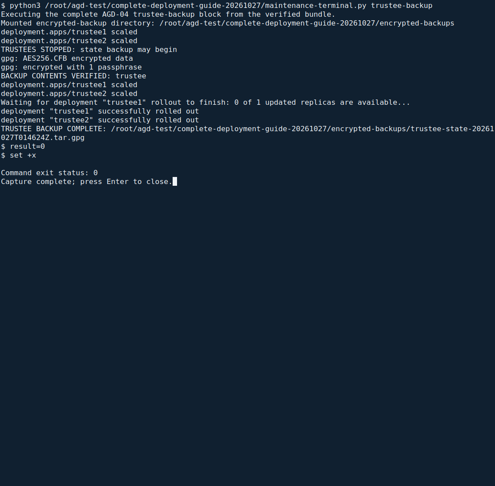
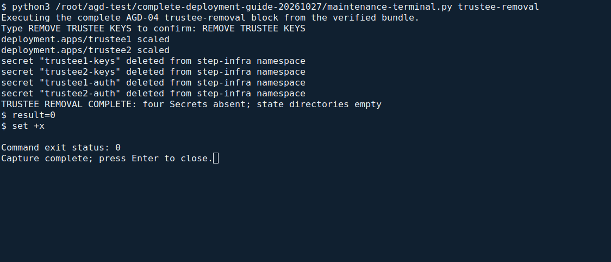
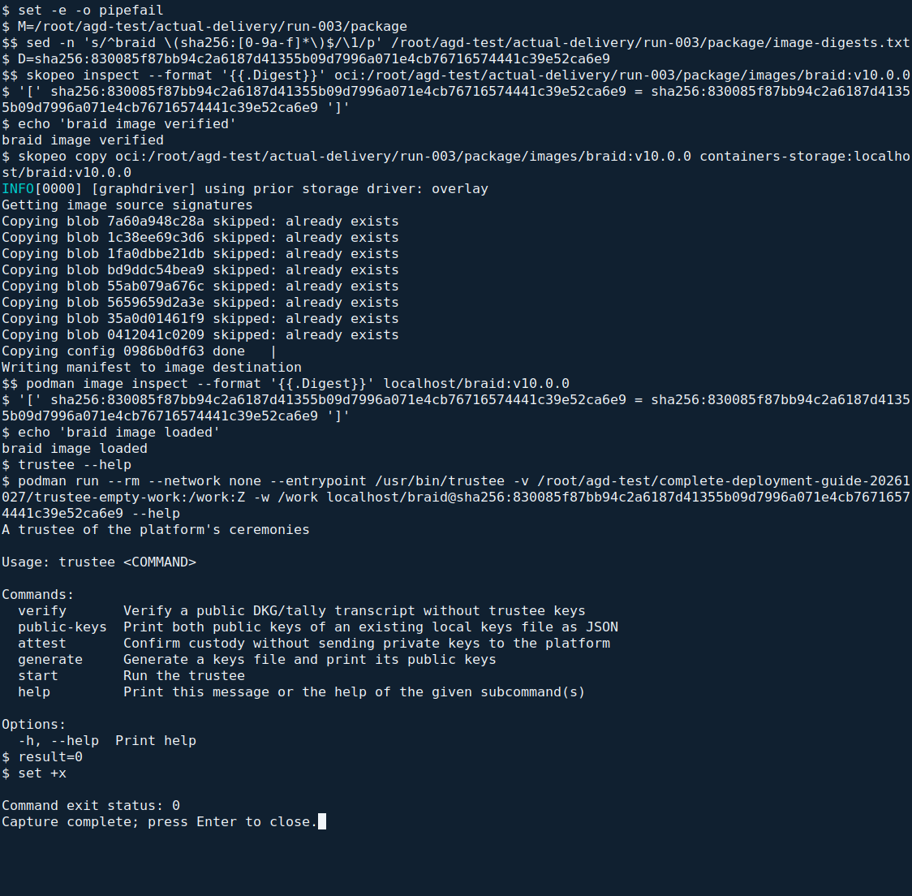

<!--
SPDX-FileCopyrightText: 2026 Sequent Tech Inc <legal@sequentech.io>
SPDX-License-Identifier: AGPL-3.0-only
-->

This page covers the one-command platform installation, the browser checkpoint
for creating the customer, and the guided trustee-key import. Later backup and
retirement procedures are separate maintenance actions, not installation steps.

:::warning
Use only the TOE delivery accepted through
[Verifying the Delivery](../08-delivery_verification.md). The installation kit's
supporting images do not replace the delivered TOE images.
:::

## Deploy

**Where:** a root terminal on the administration workstation, in the extracted
`deployment` directory. Keep the accepted delivery medium mounted read-only and
use the checked `site.json` from [the start of this guide](01-about.md#install-from-one-configuration-file).
After `./deploy check site.json` passes, run:

```bash
./deploy install site.json
```

<!-- deployment-step: 08-005 -->

**Expected result.** Four numbered installation stages appear. The final line is
`INSTALL 4/4: platform installed; customer and trustee commissioning still required`.
The installer loads the protected credentials in its own server-side process;
you do not type a separate deployment command or source `secrets.env` yourself.


*Actual VM installation capture. Read the final stage and verification lines.
The screenshot's site values are examples; match the running identity to your
accepted delivery. Trustee commissioning is still outstanding at this point.*

**If it stops:** preserve the reported stage and original credentials. Resolve
connectivity, capacity or the stated configuration fault before continuing.
The command refuses an occupied cluster and does not replay failed writes.
Do not regenerate secrets, replace a digest with `latest`, or rerun the fresh
installation as a recovery operation.

## Load the TOE images

<!-- deployment-step: 08-001 -->
<!-- deployment-step: 08-002 -->

**Automatic part of the command above.** The installer validates the seven
accepted OCI image directories, prepares private transfer archives for the six
server images, transfers them to C1 and C2, and checks their hashes and imported
digests. It prints `PASS: c1 delivery archive hashes and imported image digests`
and the corresponding line for `c2`.

You do not create tar archives or type a separate image-import command. Keep the
accepted delivery unchanged and the imported content cache available for later
verification. Either server failing its import blocks installation.

## Pin the TOE images

<!-- deployment-step: 08-003 -->

**Automatic part of the command above.** Every TOE container reference is pinned
to its accepted `@sha256:` digest. The two supporting `trustee:latest` references
belong to the kit's setup jobs, not to the two native braid trustee instances;
the installer verifies the supporting setup image separately against the kit.
The later [Running images](10-verification.md#running-images) check verifies
actual running content rather than relying only on a manifest's text.

## Remove the secrets from the realm manifest

<!-- deployment-step: 08-006 -->

**Automatic part of the command above.** After the initial realm has imported,
the installer removes its imported credentials from the stored manifest and
checks the resulting cluster Secret. The running realm retains the values it
imported. Expect
`PASS: imported realm credentials removed from its stored manifest and verified in the cluster`.

If the realm is unavailable or cleanup fails, stop and establish its actual
import state. Do not print secret-bearing documents, recreate the realm or
repeat secret generation.

## Create the customer's tenant

:::warning
All election work happens in the customer's tenant. The initial installation
tenant is the super-admin tenant: it serves only the steps of this guide, holds no
election event, and none of its personal accounts stays enabled.
:::

The operator creates the customer's tenant once, after [Deploy](#deploy) and
before the trustee keys are installed. `ADMIN_HOST` below means the value of
`hosts.administration` in your `site.json`; replace that label in the browser URL:

1. Open `https://ADMIN_HOST` on the administration workstation and sign in at
   the external authentication server as the installation account of
   [Add the installation account](07-hardening.md#add-the-installation-account).
2. In the menu, next to the tenant's name, select the plus button "Create new
   tenant". Enter the customer's short name in the field "Slug" and select
   "Save". The TOE creates the tenant and its realm from the tenant template
   that [Configure the realms](07-hardening.md#configure-the-realms) has
   hardened, with the service accounts and a seeded `admin` account without a
   password.

   

   *Actual portal capture from the final VM rehearsal. The **Create Tenant** task
   can remain **IN_PROGRESS** while the customer is provisioned. Wait for it to
   finish and confirm the agreed customer slug exists before commissioning; do
   not submit another creation request while this task is running. The displayed
   installation account and site values are laboratory examples.*

3. Put the customer slug and administrator identity in `commissioning` in
   `site.json`, then run `./deploy commission site.json` from the administration
   workstation. The command resolves the customer tenant on C1:

   <!-- deployment-step: 08-007 -->

   **Required result.** The lookup identifies exactly the installation tenant and the customer tenant matching the configured slug. The customer realm is `tenant-` followed by that customer UUID.

   **If the result differs.** If the customer row is absent, finish its creation in the portal first. If more than two tenants appear, stop and reconcile the installation state; never choose an arbitrary tenant or repeat creation.


   The installation tenant is `90505c8a-23a9-4cdf-a26b-4e19f6a097d5`; the
   other tenant must have the customer slug you supplied. The commissioning
   command records the resolved customer realm. Do not type or guess a UUID or
   edit a shell environment file to select a different tenant.
4. At the commissioning checkpoint, copy the complete URI printed after
   `Register this exact customer redirect URI`. Have the external provider
   operator register that exact address, following
   [Connecting the Authentication Server](06-authentication_server.md). Type
   `CONTINUE` only after registration and the external administrator account
   are ready; do not construct a URI by guessing the customer identifier.
5. The commissioning command adds the customer's first administrator and the
   two native trustee accounts, configures the trustee client secret, and disables
   the personal accounts of the installation realm. The administrator's user name
   and e-mail must match the identity supplied by the external authentication
   server; they come from the same configuration file:

   <!-- deployment-step: 08-008 -->

   **Expected result.** The terminal prints `PASS: customer administrator and native accounts configured; installation personal accounts disabled`. The next prompt asks you to register the two trustees in the customer portal.

   **If the result differs.** If account creation reports a conflict or a user remains enabled in the installation realm, stop and inspect the account state with the administrator. Do not rerun the entire creation block or give these accounts local passwords.


   The installer checks the account creation and disables the installation
   personal accounts. Native service accounts stay enabled. You do not receive
   or type a service password, and no later step uses the installation personal
   account. The exact prompts and success messages are shown in the
   [commissioning terminal screenshot](#transfer-the-matching-keys-and-start-the-instances).
6. Continue with [Install the trustee keys](#install-the-trustee-keys) below in
   the same commissioning terminal. Run the
   [platform inspection](10-verification.md#run-the-platform-inspection) only
   after both trustees are ready and commissioning completes.

## Install the trustee keys

Each trustee generates their keys on a trustee workstation (see
[Preparing a trustee workstation](#preparing-a-trustee-workstation) and the
trustee procedures of the
[Trustee Procedures (AGD-03)](../../02-election_managers/05-election_organizer_handbook/09-trustee-procedures.md)),
and the administrators register the public keys as the section "Registering
the trustees' public keys" of the
[Registering the trustees' public keys (AGD-02)](../../02-election_managers/04-administrator_handbook/04-users_and_roles.md#registering-the-trustees-public-keys)
describes. The trustee then hands over the keys file for their instance of
the trustee server: `trustee1` for the first trustee, `trustee2` for the
second.

### Bind each native account to its registered trustee

Before starting either instance, agree with the election administrator which
registered trustee and public keys belong to each instance. The machine login
names remain `trustee1` and `trustee2`; they can differ from the names registered
in Settings > "TRUSTEES". Each machine account's `trustee` attribute must name
exactly its registered trustee. The person's separate account uses "Act as
Trustee" for the same registered name.

The commissioning configuration associates the first trustee entry with native
instance `trustee1` and the second with `trustee2`. At its checkpoint, the
administrator registers the two public keys in the portal and each trustee
provides the corresponding private key file on their own medium. Before importing
either file, the command compares its public-key pair with the registered trustee
record. It changes only the native account's trustee binding; personal trustee
accounts remain separate and receive no local password.


*Actual customer portal from the final VM rehearsal. Open each registered trustee
record and check both public keys against that trustee's own keys before
continuing. The customer and trustee names shown here are laboratory examples.*

<!-- deployment-step: 08-009 -->

**Required result.** Each native account is bound to its configured registered trustee name, and the installed key file matches that record’s public keys. Both instances must pass.

**If the result differs.** If there is no success line, check the exact registered name, customer tenant and instance number with the administrator and trustee. Do not start either server with an uncertain key-to-account mapping.


Record the native
account, registered trustee name and checked public-key pair in the protected
installation record. The binding is persistent customer-realm state; verify it
again after restoring a customer backup. The process's `TRUSTEE_NAME` also
selects its native login, so keep it as `trustee1` or `trustee2`. That display
alias does not replace verification of the trustee's signing public key.

### Transfer the matching keys and start the instances

:::warning
The keys file holds the trustee's private keys. Take it over only in person,
with the trustee watching every step, directly from the trustee's own medium.
No copy may remain on the administration workstation or on C1: it is kept
only in the cluster's encrypted Secret.
:::

**Where to work:** the administration workstation—the computer from which you
connect to C1 and C2 over SSH. This is not the admin portal, a user named `admin`,
or a separate trustee server.

1. Complete [customer creation and account setup](#create-the-customers-tenant)
   and register both trustees as described above. In `site.json`, each
   `commissioning.trustees` entry must contain the exact registered `name` and
   the absolute `keys_file` path on that trustee's mounted medium.
2. Open a root terminal in the extracted package's `deployment` directory. If
   commissioning is not already running, start it with the same configuration:

   ```bash
   ./deploy commission site.json
   ```

   If that command is already waiting for you, continue in that terminal;
   do not start a second copy. `./deploy` is the executable in the current
   directory. From another directory, use its full path and the full path to
   `site.json`.
3. At the trustee-registration prompt, verify the names and both public keys
   in the [portal screenshot above](#bind-each-native-account-to-its-registered-trustee).
   Type `CONTINUE` and press Enter only after completing that check.
4. At each `Trustee 1: be present...` / `Trustee 2: be present...` prompt,
   have that trustee confirm their own mounted medium and private-key file.
   Type `CONTINUE` and press Enter. Keep both media available, unchanged, and
   under their owners' supervision until both imports finish: the installer
   checks both key pairs before importing either, then reads each file again.
5. Let the command transfer the keys, create the encrypted cluster Secrets,
   bind the native accounts and start both instances. These are automatic
   operations; no additional command on C1 is required.

<!-- deployment-step: 08-010 -->

**Expected result.** First the terminal prints
`PASS: both trustee media match their registered public-key pairs before either import`.
After each successful import, it prints
`PASS: trustee 1 public-key pair, native binding and startup; transfer copy removed`
and the corresponding line for trustee 2. Only then unmount each trustee's
medium and return it to its owner. These messages confirm removal of the
installer's temporary transfer copies; do not make additional copies yourself.


*Actual terminal capture from the VM rehearsal on 2026-10-26. The command at
 the top is the one to run. The `CONTINUE` prompts and `PASS` lines show the
 expected sequence. Hostnames and account identifiers are laboratory examples;
 use your approved `site.json` values.*

**If the result differs:**

- **Keys do not match:** stop. With the trustee, check the configured file,
  registered name, tenant and both registered public keys. Do not replace keys
  or alter the registration simply to silence a mismatch.
- **Transfer, Secret creation or startup fails:** stop and inspect the stated
  error and the actual cluster state. Do not overwrite an existing Secret,
  generate replacement keys or assume that temporary-file cleanup succeeded.
- **A previous attempt stopped during writes:** the installer refuses automatic
  replay. Resolve the partial state with the operator before retrying; do not
  remove its state markers to bypass this refusal.

<!-- deployment-step: 08-011 -->

The same commissioning command configures each native instance's sign-in and
waits for its deployment to become ready. Keep the configured names and keys;
personal trustee accounts remain separate from these native machine accounts.

<!-- deployment-step: 08-012 -->

**Final expected result.** The terminal prints
`PASS: customer login restrictions and both native trustees Ready`, followed by
`COMMISSIONING COMMANDS COMPLETE — perform the browser, client-network and board handover checks in AGD-04.`
This is not authorization to start an election.

Before each key or tally ceremony, the operator must confirm that both instances
are ready. From the same `deployment` directory, run `./deploy commission site.json`
with the unchanged completed configuration. On a completed installation it checks
readiness and login restrictions without importing the keys again. Expect the
`PASS: customer login restrictions and both native trustees Ready` line; the
first-run completion banner is not repeated. If the check fails, do not authorize
the ceremony until the operator resolves the fault and the check passes.

## Back up the trustee state

**When:** after a key ceremony, with no ceremony running, and with the board and
trustees informed. The command briefly stops the two native trustee instances,
encrypts and verifies their state, then restores their original replica counts.

**Where:** the administration workstation, in the accepted `deployment` folder.
Use the existing `site.json` and mount the encrypted backup medium. Run:

<!-- deployment-step: 08-013 -->

```sh
./deploy backup-trustees site.json
```

The command asks for the mounted backup directory and the encryption passphrase
privately. Enter the passphrase again when requested. It creates a new dated
backup; it does not overwrite an earlier one. Keep the encrypted backup and its
passphrase in separate locked places.

**Expected result:**

1. `TRUSTEES STOPPED: state backup may begin`.
2. `BACKUP CONTENTS VERIFIED: trustee`.
3. `TRUSTEE REPLICA COUNTS RESTORED`.
4. `TRUSTEE BACKUP COMPLETE:` followed by the encrypted file's path and SHA-256.

Record the final path and digest in the backup record. The encrypted archive is
accepted only after decryption and complete content validation succeed.



*Actual encrypted trustee-state backup and replica restoration in the isolated
rehearsal. No passphrase is shown.*

**If the result differs:** keep the original state and the last known-good
backup. Do not accept a partial archive. Failure to stop all trustee pods prevents
copying. Encryption or verification failure leaves the trustees stopped, so
inspect the reported error before retrying or resuming.

### Resume unchanged trustees after a failed backup

Use this only when the original state is intact and the board authorizes resuming
it. This does not restore damaged state or undo key removal. Run:

```sh
./deploy resume-trustees site.json
```

Read the warning, then type `RESUME UNCHANGED TRUSTEES`. Expect
`TRUSTEE REPLICA COUNTS RESTORED`. The command checks and uses the saved original
replica counts. If their record is missing or invalid, it stops: do not guess the
counts, remove markers manually or authorize another ceremony.

## Remove the trustee keys at the end of the election

:::warning
This destroys server-side trustee keys and protocol state. Use it only after the
retention period has ended, the required election execution data has been deleted,
and the election board has authorized retirement and is present. It is not an
installation or troubleshooting command.
:::

**Where:** the administration workstation, in the accepted `deployment` folder.
Verify the target addresses in `site.json` with the board, then run:

<!-- deployment-step: 08-014 -->

```sh
./deploy remove-trustees site.json
```

Read the warning and type `REMOVE TRUSTEE KEYS`. The command stops both instances
and verifies that their pods have disappeared before it removes the four trustee
Secrets and empties the two fixed protocol-state directories.

**Expected result:**
`TRUSTEE REMOVAL COMPLETE: four Secrets absent; state directories empty`.
No trustee instance is restarted.



*Actual server-side trustee retirement on an isolated disposable copy.*

**If the result differs:** preserve the remaining state and backups and record
what was removed. Do not authorize another ceremony or destroy backups while the
outcome is uncertain. After confirmed server removal, the board directs each
custodian to destroy retained trustee-state backups and records their destruction.
Deleting files does not establish physical erasure of storage remnants; follow
the organizer's approved media-retirement procedure as well.

## Preparing a trustee workstation

Use the accepted tool folder's **`./trustee`** command. It selects the native
trustee program from the accepted `braid` image and supplies the offline container
options automatically. No shell function, container command or script needs to
be typed.

Trustees may use one organizer-controlled computer in separate clean offline
sessions. Each keeps their own encrypted working medium, keys and backups. Follow
[Trustee key handling](02-operational_environment.md#trustee-key-handling): disable
network interfaces, swap, hibernation and session recording before handling keys.
The wrapper checks the network interfaces, swap, encrypted working medium and
file permissions; it cannot verify physical custody or a clean boot for you.

### Set up the public configuration once

**Where:** a root terminal on the offline workstation. Python 3, Podman, Skopeo,
`findmnt` and `cryptsetup` must come from its approved operating environment.
Open the accepted delivery medium read-only as described in
[Decrypt the medium](../08-delivery_verification.md#3-decrypt-the-medium).

In the accepted `deployment` folder, copy `trustee.example.json` to
`trustee.json` using the file manager, then fill these public values:

| Setting | What to enter |
| --- | --- |
| `delivery_directory` | The read-only accepted delivery mount, normally `/mnt/temenos-delivery`. |
| `manifest_sha256` | The independently accepted SHA-256 of `image-digests.txt`, already used for `toe.manifest_sha256` in the installation configuration. |
| `working_directory` | The private `session` directory on this trustee's own unlocked LUKS-encrypted medium, for example `/media/trustee-one/session`. It must be owned by root with permissions **700**. |
| `keys_file` | Keep `trustee.toml`. This file is created on the private medium. |
| `request_file` | Keep `custody-request.json`; copy and rename the downloaded public request to this name when needed. |
| `proof_file` | Keep `custody-proof.json` for the key ceremony; use a new name for each tally. |
| `tally_session_id` | Keep `null` for the key ceremony. For a tally, enter the exact tally identifier shown by the portal, in quotes. |

Do not put passwords, private keys or the contents of `trustee.toml` into this
configuration. A separate `trustee.json` for each trustee avoids selecting another
person's medium accidentally.

### Prepare the accepted tool

Before attaching a trustee's key medium, run:

<!-- deployment-step: 08-015 -->

```sh
./trustee prepare trustee.json
```

**Expected result:** `TRUSTEE IMAGE VERIFIED: all accepted manifests and layers
match`, followed by `TRUSTEE TOOL READY: accepted image loaded; safely eject the
delivery medium`. The command checks the entire OCI image graph against the
accepted manifest, loads it locally and retains only the public digest manifest
beside `trustee.json`. Safely eject the delivery medium through the file manager.

**If the result differs:** stop. A checksum or image mismatch requires the
accepted delivery to be checked again. Do not replace the expected checksum with
the observed value or enable networking to download an image.

### Generate keys in the trustee's private session

Unlock only this trustee's encrypted working medium and select its private
working directory in `trustee.json`. Then run:

<!-- deployment-step: 08-016 -->

```sh
./trustee generate trustee.json
```

**Expected result:** `TRUSTEE KEYS CREATED: trustee.toml`, followed by JSON with
only `signing_public_key` and `share_encryption_public_key`. The keys file is
created with owner-only permissions. An existing file is never replaced.

To display those public keys again, run:

```sh
./trustee public-keys trustee.json
```

**If the result differs:** an active interface or swap requires shutting down and
correcting the offline operating environment. A medium or permission error means
the private working directory is not ready. An existing keys file means this
trustee already has keys: use `public-keys`; do not delete it and generate a
replacement. If the accepted image is missing, repeat the prepare command with
the accepted delivery medium.

Only this trustee's working directory is mounted into the offline container.
The command supplies the private-key file path explicitly, so private keys are
never intentionally printed. Make the two required protected backups and follow
[Trustee Procedures (AGD-03)](../../02-election_managers/05-election_organizer_handbook/09-trustee-procedures.md)
for the portal's public-key registration and custody-proof upload.



*Actual native trustee tool in the accepted image with its network disabled. The
short commands above select that program automatically; the image's default
server command is never used for offline key handling.*
