<!--
SPDX-FileCopyrightText: 2026 Sequent Tech Inc <legal@sequentech.io>
SPDX-License-Identifier: AGPL-3.0-only
-->

This page loads the TOE images from the verified delivery medium onto both
servers, pins every TOE container to its delivered digest, deploys, and
installs the trustees' keys. It also covers the trustee workstations, which
run the trustee tool from the same delivery.

:::warning
Use only the delivery medium that passed every step of
[Verifying the Delivery](../08-delivery_verification.md). The installation kit
also carries images under the same names; the TOE parts must never run from
those.
:::

## Load the TOE images

On the administration workstation, mount the delivery medium read-only with
the commands of step 3 of [Verifying the Delivery](../08-delivery_verification.md),
then copy the six images that run on the servers to C1 and C2:

<!-- deployment-step: 08-001 -->

**Run on the administration workstation, in the `admin` deployment session:**

```bash
step 08-copy-toe-images
```

**Expected result.** The copy completes for C1 and C2 without SSH, tar or disk errors, and the verified delivery medium is unmounted. This transfer does not itself verify the imported images; the next step does.

**If the result differs.** If either host is unreachable or the target is full, fix connectivity or capacity before importing. Keep the source medium protected; do not substitute images from the installation kit.

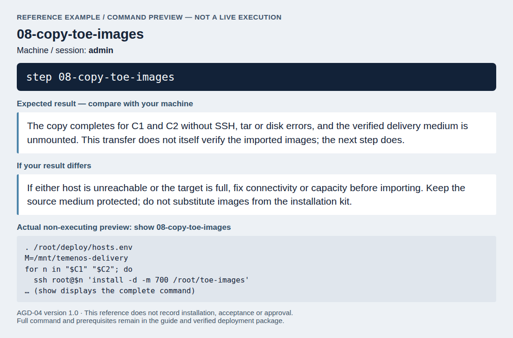

*Command preview only: this image shows the bundled command, without executing it. Compare your actual result with the expectations above.*

On C1, and then on C2, import them and check that each one is present under
its delivered digest. Use `--local` so the digest-qualified names identify the
delivered image manifests:

<!-- deployment-step: 08-002 -->

**Run on C1, then separately on C2, in the `c1/c2` deployment session:**

```bash
step 08-import-toe-images
```

**Expected result.** Six final lines ending in `loaded`, one for each delivered image, on each server.

**If the result differs.** If any line ends in `MISSING`, compare the delivery digest list and transferred archives, then repair the transfer/import on that server. Do not continue because the other server passed.

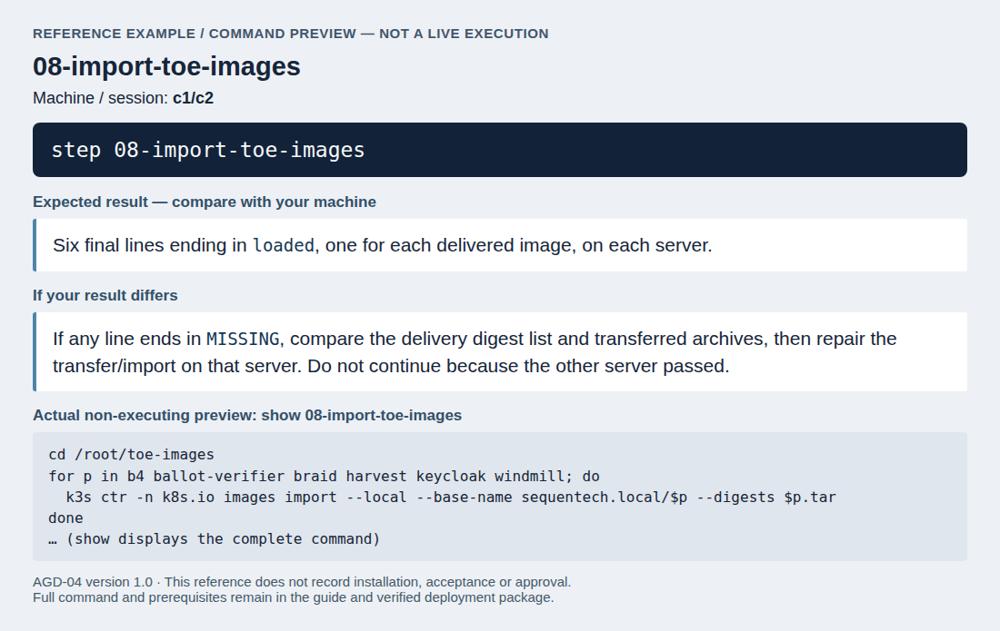

*Command preview only: this image shows the bundled command, without executing it. Compare your actual result with the expectations above.*

The last command must print `loaded` for all six images on both servers. If
one is `MISSING`, do not continue.

## Pin the TOE images

:::warning
Every TOE container must name its image by the digest of the delivery. A
container that names an image by a tag can run the kit's image of the same
name.
:::

On C1:

<!-- deployment-step: 08-003 -->

**Run on C1, in the `c1` deployment session:**

```bash
step 08-pin-image-digests
```

**Expected result.** The seven reference/count lines shown below, with every TOE image pinned to `@sha256:`.

**If the result differs.** If a count differs or a TOE image still uses a tag, stop and check that the working manifests and digest list match this delivery. Do not replace a missing digest with `latest`.

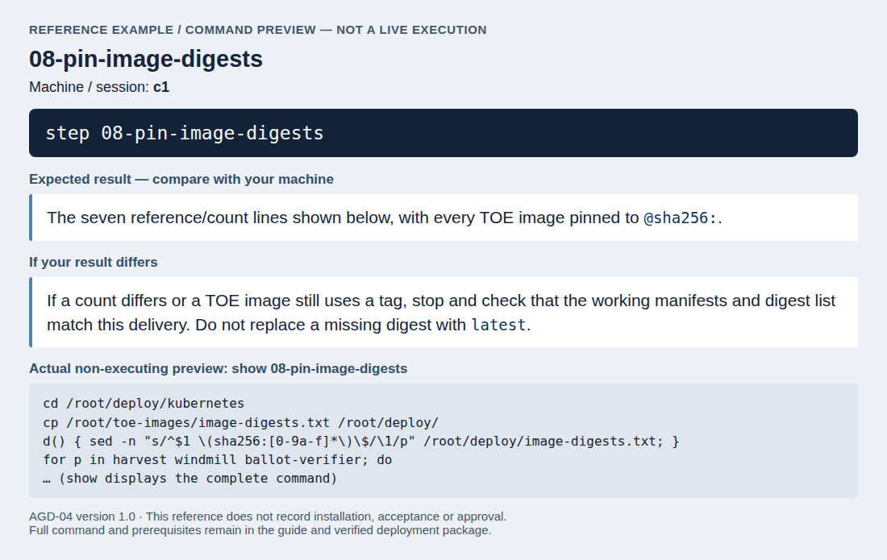

*Command preview only: this image shows the bundled command, without executing it. Compare your actual result with the expectations above.*

The output must be exactly:

```text
      1 sequentech.local/b4@sha256:...
      1 sequentech.local/ballot-verifier@sha256:...
      2 sequentech.local/braid@sha256:...
      1 sequentech.local/harvest@sha256:...
      1 sequentech.local/keycloak@sha256:...
      2 sequentech.local/trustee:latest
      3 sequentech.local/windmill@sha256:...
```

The two `trustee:latest` references are the setup steps of the bulletin board
and of the object storage, which use the tools of the kit's image and run no
TOE function.

## Deploy

:::warning
Load `secrets.env` in the same shell before every deployment. A deployment
without it sets demonstration passwords on the databases and services.
:::

On C1:

<!-- deployment-step: 08-005 -->

**Run on C1, in the `c1` deployment session:**

```bash
step 08-start-services
```

**Expected result.** `step-tls-cert already exists; keeping it.`, successful identity-service rollout, and pods `Running` or `Completed`. Only the two trustee instances may remain not ready until their keys are installed.

**If the result differs.** On a rollout timeout or `CrashLoopBackOff`, inspect that component's operating log using the server operations section and check the verified manifests. Keep the original secrets; do not rerun secret generation or use demonstration credentials.

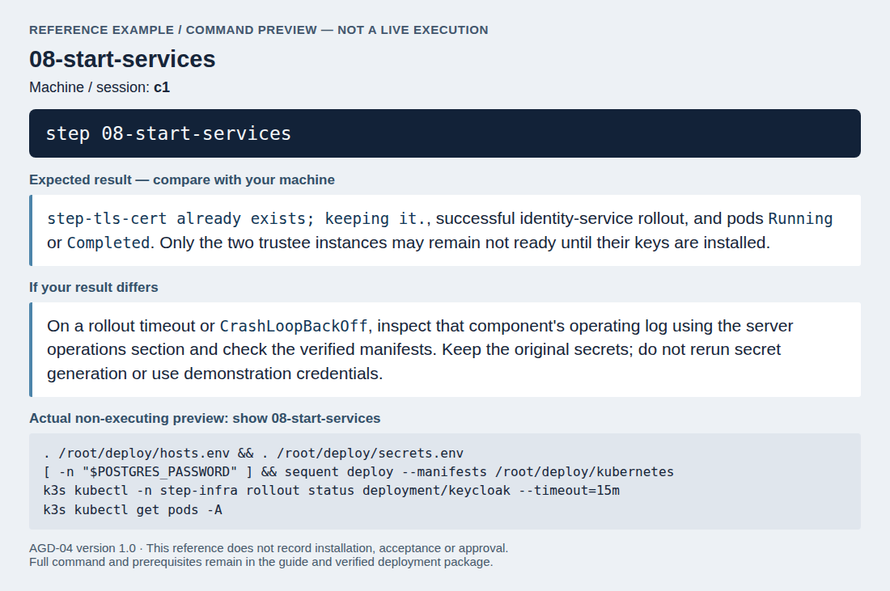

*Command preview only: this image shows the bundled command, without executing it. Compare your actual result with the expectations above.*

The deployment must print `step-tls-cert already exists; keeping it.` and end
without an error. After a few minutes every pod must be `Running` or
`Completed`, except `trustee1` and `trustee2`: they stay not ready until their
keys are installed below. Run the same commands again after every later change
to `/root/deploy/kubernetes`.

## Remove the secrets from the realm manifest

:::warning
The identity service has now imported the tenant realm. Its manifest and the
Secret `keycloak-realm` still hold the client secrets and the trustee
passwords, and must no longer.
:::

On C1:

<!-- deployment-step: 08-006 -->

**Run on C1, in the `c1` deployment session:**

```bash
step 08-remove-import-secrets
```

**Expected result.** HTTP `200` for the imported realm, then the exact zero-credential summary below after updating its stored manifest.

**If the result differs.** If the realm is not available or the summary differs, stop: confirm its first import completed before removing import material. Do not print client secrets or recreate the realm to work around the error.

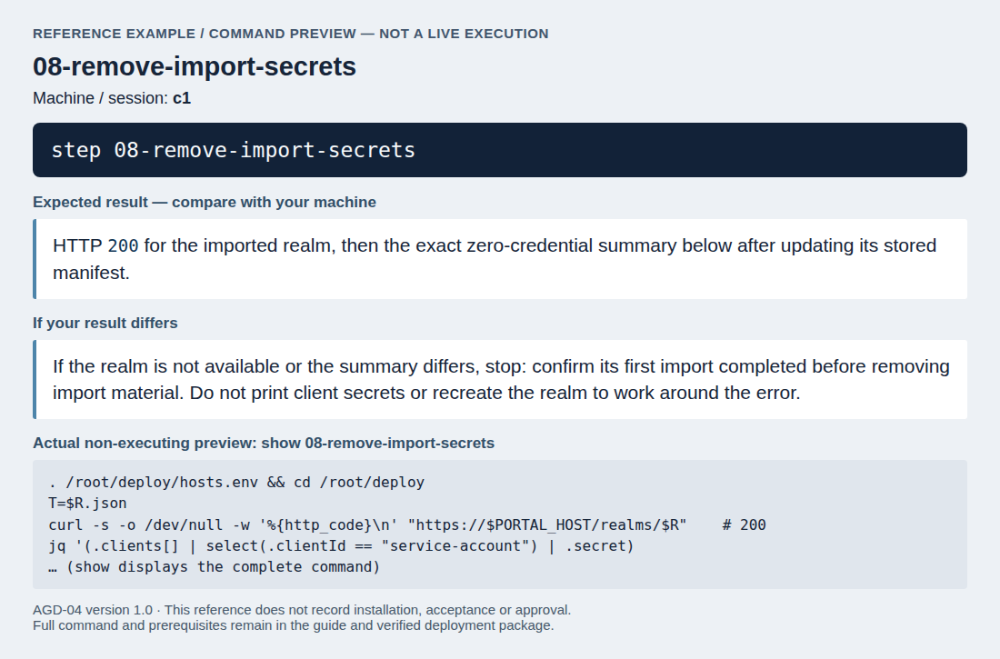

*Command preview only: this image shows the bundled command, without executing it. Compare your actual result with the expectations above.*

The last command must print
`{"credentials":0,"idp_secret":0,"secrets":["CHANGE_ME_API_KEY_CLIENT_SECRET","CHANGE_ME_SERVICE_ACCOUNT_SECRET"]}`.
The running realm keeps the values set at its import. Check with
`k3s kubectl get pods -A` that the pods are still running.

## Create the customer's tenant

:::warning
All election work happens in the customer's tenant. The tenant of the realm R
is the super-admin tenant: it serves only the steps of this guide, holds no
election event, and none of its personal accounts stays enabled.
:::

The operator creates the customer's tenant once, after [Deploy](#deploy) and
before the trustee keys are installed:

1. Open `https://ADMIN_HOST` on the administration workstation and sign in at
   the external authentication server as the installation account of
   [Add the installation account](07-hardening.md#add-the-installation-account).
2. In the menu, next to the tenant's name, select the plus button "Create new
   tenant". Enter the customer's short name in the field "Slug" and select
   "Save". The TOE creates the tenant and its realm from the tenant template
   that [Configure the realms](07-hardening.md#configure-the-realms) has
   hardened, with the service accounts and a seeded `admin` account without a
   password.
3. On C1, list the tenants and record the realm name of the customer's tenant:

   <!-- deployment-step: 08-007 -->

   **Run on C1, in the `c1` deployment session:**

   ```bash
   step 08-select-customer-tenant
   ```

   **Expected result.** Two tenant ID/slug rows: the installation tenant and your customer tenant. After listing those rows, the step asks for the customer UUID and prints `Customer realm selected: tenant-` followed by that UUID.

   **If the result differs.** If the customer row is absent, finish its creation in the portal first. If more than two tenants appear, stop and reconcile the installation state; never choose an arbitrary tenant or repeat creation.

   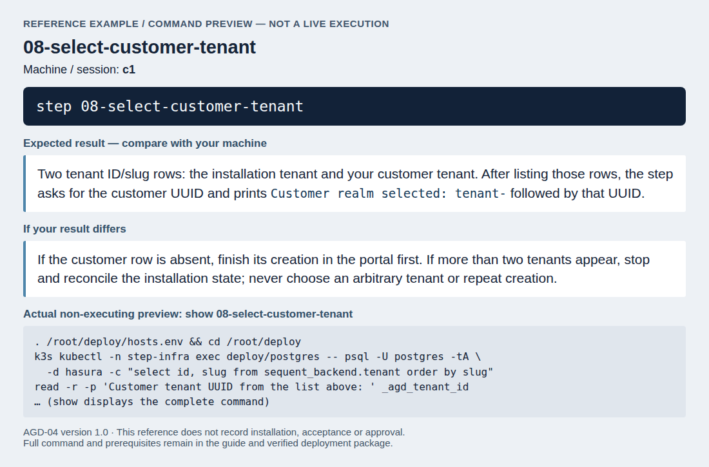

   *Command preview only: this image shows the bundled command, without executing it. Compare your actual result with the expectations above.*

   The first command must list two tenants: `90505c8a-23a9-4cdf-a26b-4e19f6a097d5`
   (the super-admin tenant) and the customer's tenant with the short name you
   entered. At the prompt after that listing, enter the customer row's UUID.
   The step records `export CR=tenant-` followed by that UUID in
   `/root/deploy/hosts.env` on C1. Add the same public line to
   `/root/deploy/hosts.env` on the administration workstation before its
   customer-realm checks.
4. Ask the operator of the external authentication server to register the
   redirect URI `https://PORTAL_HOST/realms/CR/broker/IDP_ALIAS/endpoint`,
   with your value of CR (see
   [Connecting the Authentication Server](06-authentication_server.md)).
5. On C1, add the customer's first administrator and the two trustee accounts
   to the realm CR, give its client `api-key-client` the trustees' client
   secret, and disable every personal account of the realm R. The
   identity service's own administration tool does this inside the identity
   service. At the public prompts, enter the user name and e-mail address
   that the external authentication server holds for the customer's first
   administrator:

   <!-- deployment-step: 08-008 -->

   **Run on C1, in the `c1` deployment session:**

   ```bash
   step 08-add-customer-operator
   ```

   **Expected result.** The customer realm lists the new administrator and trustees enabled; the installation realm lists all personal accounts disabled, as detailed below.

   **If the result differs.** If account creation reports a conflict or a user remains enabled in the installation realm, stop and inspect the account state with the administrator. Do not rerun the entire creation block or give these accounts local passwords.

   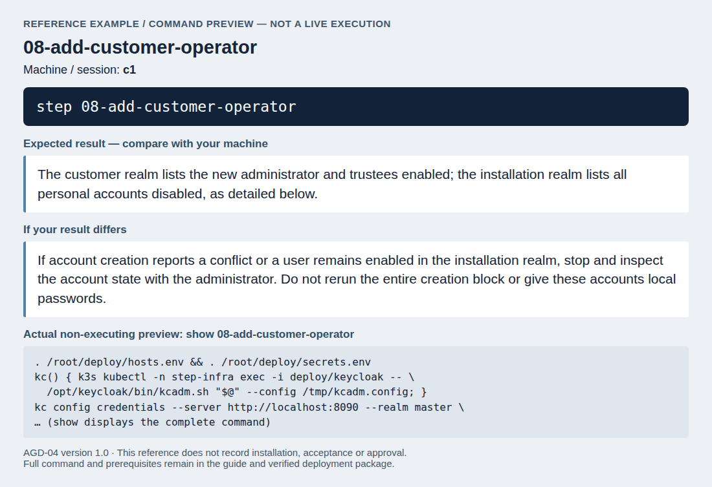

   *Command preview only: this image shows the bundled command, without executing it. Compare your actual result with the expectations above.*

   For the realm CR the list must show `admin`, the first administrator's
   user name, `trustee1` and `trustee2`, each with `true`. For the realm R
   every line must end in `false`. Neither list shows the accounts whose names
   start with `service-account-`: the identity service does not list them, and
   they stay enabled.
   The installation account is now disabled: no later step of this guide
   needs an account of the super-admin tenant.
6. Make the checks of
   [Identity service](10-verification.md#identity-service) using the customer-realm command sequence given there, and of
   [Data correction, telephone channel, plugins and tenants](10-verification.md#data-correction-telephone-channel-plugins-and-tenants).

## Install the trustee keys

Each trustee generates their keys on a trustee workstation (see
[Preparing a trustee workstation](#preparing-a-trustee-workstation) and the
trustee procedures of the
[Handbook for Election Organizers (AGD-03)](../../02-election_managers/05-election_organizer_handbook/01-about.md)),
and the administrators register the public keys as the section "Registering
the trustees' public keys" of the
[Handbook for Election Administrators (AGD-02)](../../02-election_managers/04-administrator_handbook/01-about.md)
describes. The trustee then hands over the keys file for their instance of
the trustee server: `trustee1` for the first trustee, `trustee2` for the
second.

### Bind each native account to its registered trustee

Before starting either instance, agree with the election administrator which
registered trustee and public keys belong to each instance. The machine login
names remain `trustee1` and `trustee2`; they can differ from the names registered
in Settings > "TRUSTEES". Each machine account's `trustee` attribute must name
exactly its registered trustee. The person's separate account uses "Act as
Trustee" for the same registered name.

On C1, answer the public prompts with native trustee number `1` and the registered
name whose keys will be installed in `trustee1`. Repeat with number `2` and the second
registered name. This changes only the native account's trustee binding; it
preserves its login name, password, roles and all other attributes. Do not use
the personal trustee account or add a password to it.

<!-- deployment-step: 08-009 -->

**Run on C1, in the `c1` deployment session:**

```bash
step 08-register-native-trustee
```

**Expected result.** `Native trustee binding verified` for the chosen instance. Repeat separately for the second instance with its own registered name.

**If the result differs.** If there is no success line, check the exact registered name, customer tenant and instance number with the administrator and trustee. Do not start either server with an uncertain key-to-account mapping.

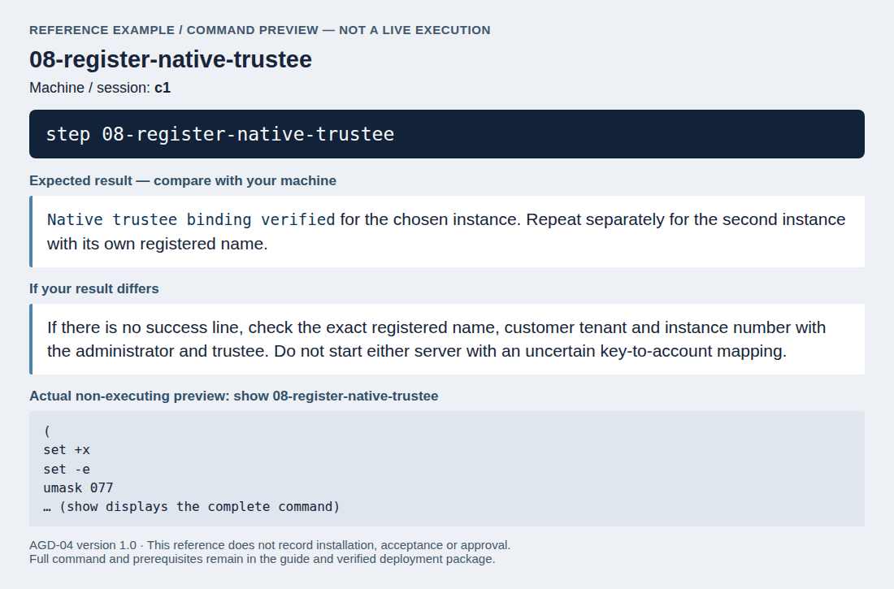

*Command preview only: this image shows the bundled command, without executing it. Compare your actual result with the expectations above.*

Each run must print "Native trustee binding verified". Record the native
account, registered trustee name and checked public-key pair in the protected
installation record. The binding is persistent customer-realm state; verify it
again after restoring a customer backup. The process's `TRUSTEE_NAME` also
selects its native login, so keep it as `trustee1` or `trustee2`. That display
alias does not replace verification of the trustee's signing public key.

### Transfer the matching keys and start the instances

:::warning
The keys file holds the trustee's private keys. Take it over only in person,
with the trustee watching every step, directly from the trustee's own medium.
No copy may remain on the administration workstation or on C1: it is kept
only in the cluster's encrypted Secret.
:::

On the administration workstation, with the trustee's medium mounted, set N
to the trustee's instance number and the path to their keys file:

<!-- deployment-step: 08-010 -->

**Run on the administration workstation, in the `admin` deployment session:**

```bash
step 08-install-trustee-keys
```

**Expected result.** A creation message for the chosen trustee key Secret, then `Trustee key import complete; temporary key file removed.` No nonzero status is expected.

**If the result differs.** Any Secret-creation or transfer error is a failure; do not continue without the completion message. Keep the trustee present, verify the chosen instance and Secret before starting it, and do not overwrite an existing Secret or leave an extra private-key copy.

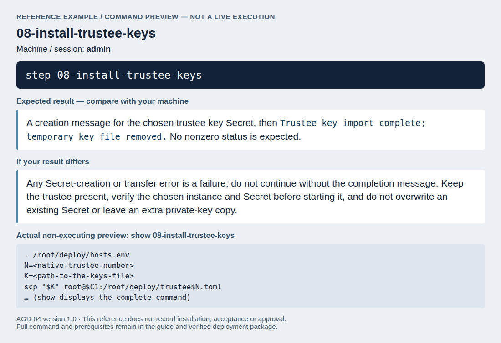

*Command preview only: this image shows the bundled command, without executing it. Compare your actual result with the expectations above.*

The completion message confirms that the temporary copy was removed. Unmount the
trustee's medium and give it back. Then, on C1, give the instance its sign-in
details and start it:

<!-- deployment-step: 08-011 -->

**Run on C1, in the `c1` deployment session:**

```bash
step 08-configure-trustee-login
```

**Expected result.** The authentication Secret is created and the selected trustee deployment reports `successfully rolled out`.

**If the result differs.** If rollout fails, check its operating log and the previously verified native-account binding. Keep the trustee's existing keys and password; do not generate replacements to make the service start.

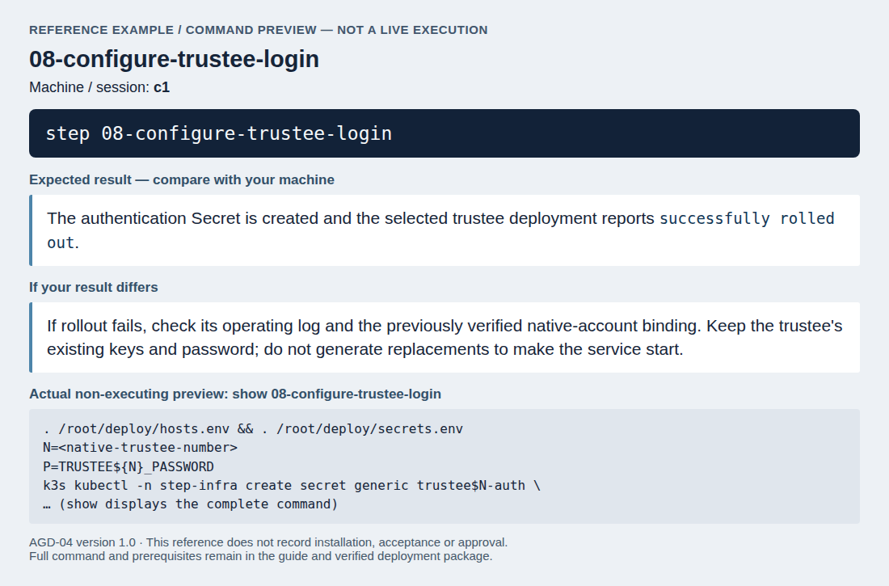

*Command preview only: this image shows the bundled command, without executing it. Compare your actual result with the expectations above.*

The last command must report that the rollout finished. Repeat both transfer
and start blocks, answering native trustee number `2` for the second trustee, using its matching keys
and the native-account binding checked above.

Before the key ceremony and before each tally ceremony, check on C1 that both
instances are ready, and confirm it to the election board, which waits for
this confirmation:

<!-- deployment-step: 08-012 -->

**Run on C1, in the `c1` deployment session:**

```bash
step 08-check-trustee-health
```

**Expected result.** Two rows, `trustee1` and `trustee2`, each with `READY` equal to `1/1`.

**If the result differs.** If either is `0/1`, missing or restarting, do not authorize a key or tally ceremony. Resolve the failed instance and repeat this read-only check before confirming readiness to the board.

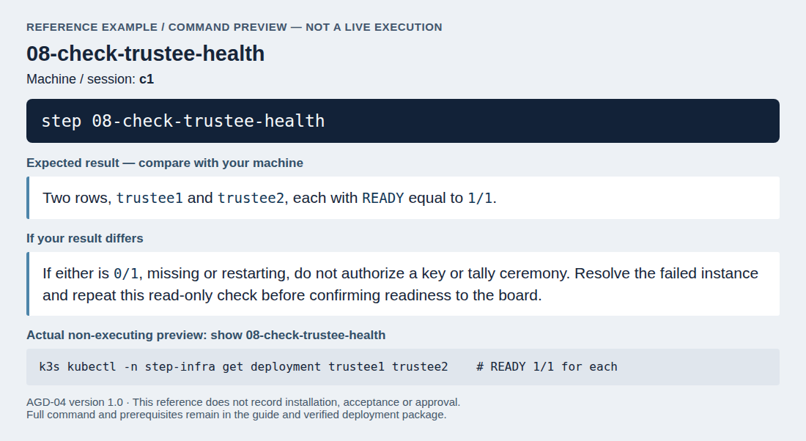

*Command preview only: this image shows the bundled command, without executing it. Compare your actual result with the expectations above.*

## Back up the trustee state

The instances keep their protocol state, which they need to continue the
protocol, on C1 under `/var/lib/sequent-data/trustee1` and
`/var/lib/sequent-data/trustee2`.

:::warning
Back up the state only while no ceremony is running, and only encrypted.
Keep the backup and its passphrase in separate locked places.
:::

After the key ceremony, from the administration workstation, with a backup
medium mounted at the path you give:

<!-- deployment-step: 08-013 -->

**Run on the administration workstation, in the `admin` deployment session:**

```bash
step 08-backup-trustee-state
```

**Expected result.** The encrypted backup can be decrypted with its passphrase and the final listing contains both `trustee1` and `trustee2`. The deployments are scaled back to one replica.

**If the result differs.** If encryption or archive validation fails, keep the original state, verify whether trustees remain stopped, and restore their intended running state only outside a ceremony. Do not delete state or accept a partial backup.

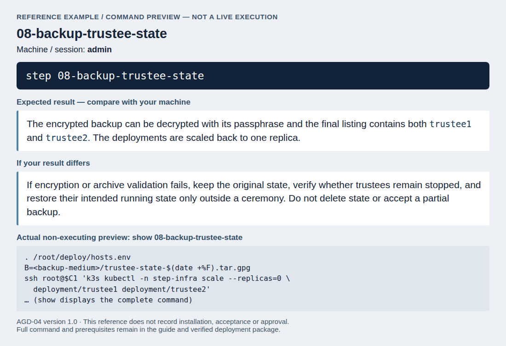

*Command preview only: this image shows the bundled command, without executing it. Compare your actual result with the expectations above.*

## Remove the trustee keys at the end of the election

When the trustee procedures say so (the retention period has ended and the
election execution data has been deleted), remove the trustees' keys and
state from the servers, on C1:

:::warning
This destroys the trustees' keys files and protocol state on the servers:
the instances can then no longer take part in decrypting the votes. Do it
only at the end of the retention period, with the election board present.
:::

<!-- deployment-step: 08-014 -->

**Run on C1, in the `c1` deployment session:**

```bash
step 08-remove-trustee-keys
```

**Expected result.** After the explicit destruction confirmation, deletion messages are followed by `2` (both key Secrets absent) and `0` (no remaining state entries).

**If the result differs.** If either count differs, stop and establish exactly what remains; do not destroy the backups yet or start another ceremony. Record the partial outcome and have the board direct completion of the authorized removal.

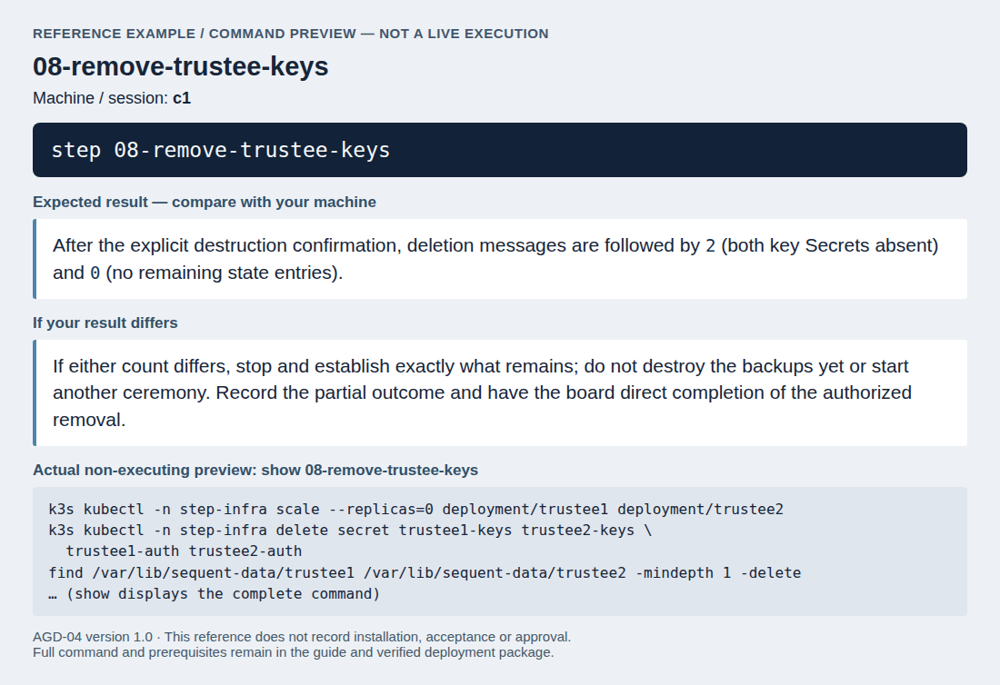

*Command preview only: this image shows the bundled command, without executing it. Compare your actual result with the expectations above.*

The last two commands must print `2` and `0`. Then destroy every backup of
the trustee state, and record the removal and the destruction in the election
board's minutes.

## Preparing a trustee workstation

A trustee workstation runs the `trustee` program of the delivered `braid`
image, offline.

:::warning
The workstation has no network connection, an encrypted disk and a screen
lock, and serves only this purpose. Load the trustee tool only from the
verified delivery medium, and only after checking its digest.
:::

The workstation needs podman and skopeo. Mount the delivery medium read-only
with the commands of step 3 of
[Verifying the Delivery](../08-delivery_verification.md), then:

<!-- deployment-step: 08-015 -->

**Run on the offline trustee workstation, in the `trustee` deployment session:**

```bash
step 08-load-offline-trustee-image
```

**Expected result.** Both `braid image verified` and `braid image loaded` appear. The delivery medium is unmounted and the checked digest is retained locally.

**If the result differs.** If either line is absent or a digest check fails, do not use the trustee tool. Re-check the verified delivery and local image import while keeping the workstation offline.

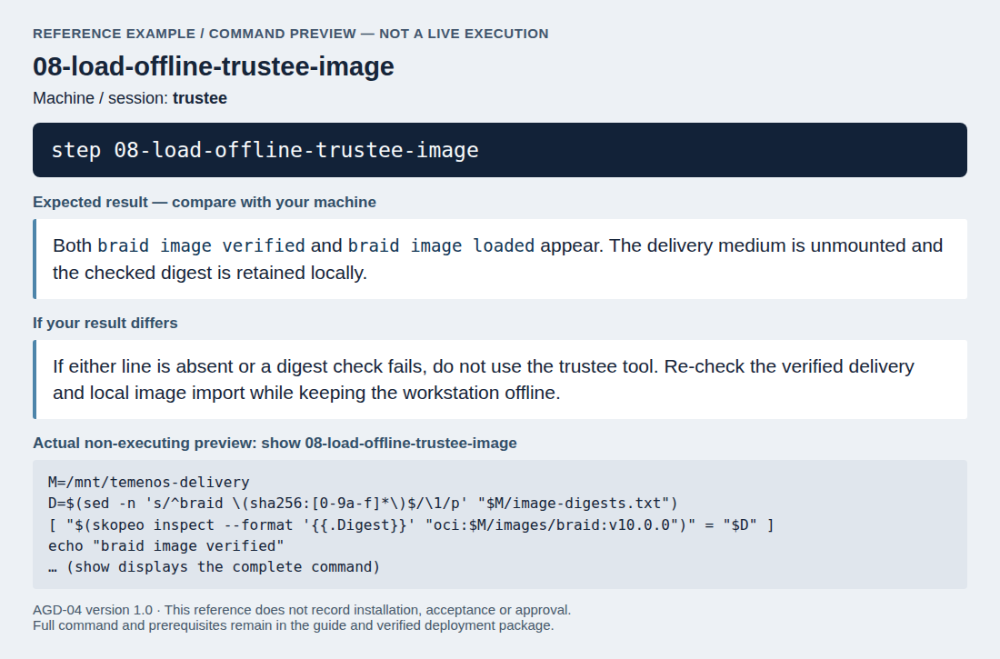

*Command preview only: this image shows the bundled command, without executing it. Compare your actual result with the expectations above.*

Both checks must print their line; if one does not, do not use the
workstation.

:::warning
Never start the image with its default command on the workstation: that
command starts the trustee server of the platform. Use only the `trustee`
command below. It runs the program `/usr/bin/trustee` instead, gives the
container no network, and mounts only the current directory, which holds the
keys file.
:::

Define the `trustee` command in each new shell:

<!-- deployment-step: 08-016 -->

**Run on the offline trustee workstation, in the `trustee` deployment session:**

```bash
step 08-check-offline-trustee-tool
```

**Expected result.** The trustee help screen lists `generate`, `public-keys`, `attest` and `verify`, among its subcommands.

**If the result differs.** If the command is missing or starts a server instead, stop. Check the verified braid image and this wrapper; do not run the image's default entry point or enable network access.

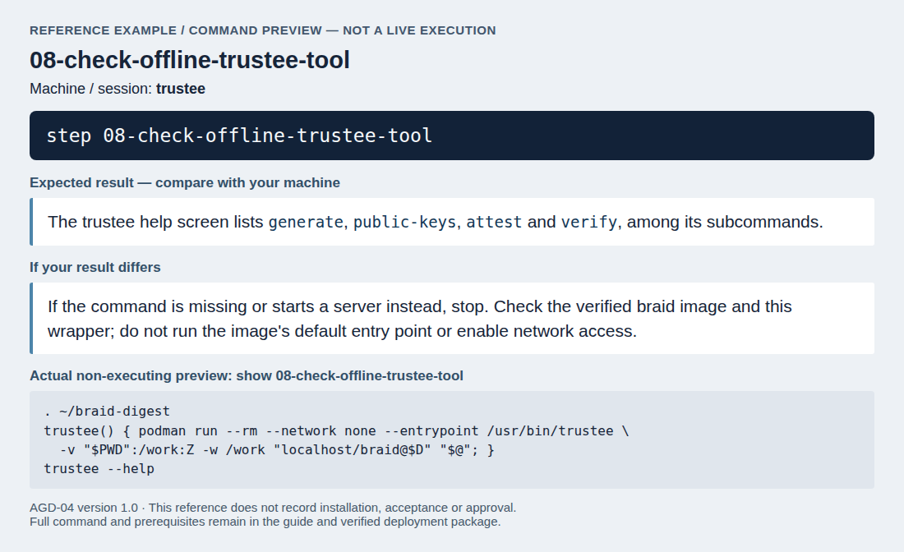

*Command preview only: this image shows the bundled command, without executing it. Compare your actual result with the expectations above.*

`trustee --help` lists, among others, the subcommands `generate`,
`public-keys`, `attest` and `verify`. The program sees only the current
directory: run every command from the directory on the trustee's own medium
that holds the keys file, and give file names relative to it, for example
`trustee public-keys --trustee-config trustee.toml`. The trustees use the
subcommands as the trustee procedures of the
[Handbook for Election Organizers (AGD-03)](../../02-election_managers/05-election_organizer_handbook/01-about.md)
describe. The `election-verifier` image is loaded the same way, with its own
name and digest, only where that handbook calls for it.
