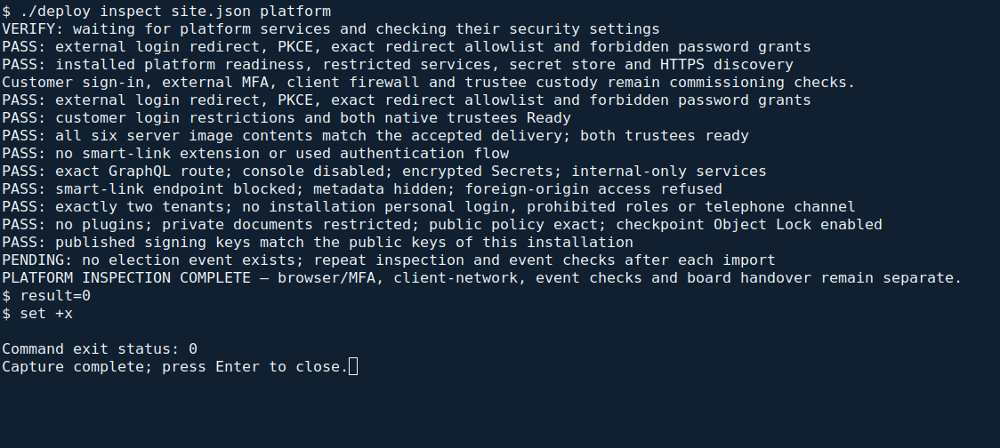

<!--
SPDX-FileCopyrightText: 2026 Sequent Tech Inc <legal@sequentech.io>
SPDX-License-Identifier: AGPL-3.0-only
-->

Run this chapter **after customer and trustee commissioning** and before handing
the installation over. It groups the server checks into one command, then lists
the browser, network and election-specific checks that still need a person.

## Run the platform inspection

**Where:** a root terminal on the administration workstation, in the extracted
`deployment` directory, with the completed installation's unchanged `site.json`.
Both trustees must already be commissioned; keep the accepted image content on
C1 available for the image check.

```bash
./deploy inspect site.json platform
```

The command connects to C1, checks the running configuration and makes HTTPS
requests from the workstation. It does not import an election, alter an account
or authorize handover. The storage check creates a temporary check pod and removes
it afterwards; it refuses to replace an existing pod with that name.

**Expected result.** Each completed group prints `PASS: ...`. The final line is
`PLATFORM INSPECTION COMPLETE — browser/MFA, client-network, event checks and board handover remain separate.`
Before the first election import, it also prints
`PENDING: no election event exists; repeat inspection and event checks after each import`.
That pending result does not waive the checks required after an import.



*Actual VM capture of the inspection command. Read the command's own status and
site-specific output; example names and identifiers are not values to copy. The
caption and terminal outcome describe the captured run, not an authorization to
hand over a different installation.*

**If the result differs.** A failed group, timeout, missing final line or unexpected
response is a failed inspection. Record the group and error, keep the installation
out of handover, and have the operator correct its controlled configuration.
Do not delete data, regenerate credentials or hide a failed check. Read-only
inspection can be repeated after correction. If storage-check cleanup failed,
establish whether its pod remains before rerunning that group.

The following sections explain the checks and remaining operator actions. You do
not run an additional server command for every heading.

## Running images

<!-- deployment-step: 10-001 -->

**Included in the platform inspection.** The check requires ready containers for
all six server TOE parts, with at least two for Windmill and two for braid. It
checks digest-qualified references against the accepted delivery and hashes the
referenced content blobs. A runtime image ID referring to a single-child OCI
index is resolved to its image configuration before comparison.

An absent blob, ambiguous index, missing container or different digest fails.
A matching pod specification alone is insufficient. The `PASS` line confirms the
image group; it does not establish that the source implements every ST requirement.

## Version

**Where:** the administration workstation's browser.

1. Follow [The first sign-in](09-accounts.md#the-first-sign-in).
2. Find **VERSION** in the administration portal's header. It must show
   `10.0.0`, matching `release.version` in the accepted installation configuration.
   This is the displayed release number for the TOE identified in this guide.
3. Compare the complete **HASH** beside it with `release.step_commit` and the
   independently accepted delivery record. Letter case of a hexadecimal revision
   does not change its value.


*Actual VM portal capture after customer commissioning. VERSION and HASH appear
at the top. The laboratory tenant, account and source revision are examples;
compare your running header with your independently accepted delivery record.*

**If different:** stop handover and reconcile the accepted delivery, running
images and portal asset identity. Do not edit the displayed version to conceal a
mismatch.

## TLS endpoint and ingress ports

**Still required from the network positions stated in those chapters:**

- Run [Check the TLS profile](05-certificates_tls.md#check-the-tls-profile).
- Repeat [Network filtering](04-hosts_network_time.md#network-filtering) from a
  computer on the client network using the actual current ingress ports.

Each linked procedure provides its exact command, expected result, screenshot
and failure handling. A timeout from the administration workstation cannot stand
in for a test from the client network. Use the positive HTTPS connection check
to distinguish filtering from a disconnected test machine.

## Identity service

<!-- deployment-step: 10-002 -->
<!-- deployment-step: 10-003 -->

**Included in the platform inspection.** Both the initial installation realm and
the customer realm must publish the expected issuer. The checks require:

- external identity-provider redirect for the administration portal;
- rejection without a PKCE challenge or with an unregistered redirect address;
- disabled password grants for the portal and `admin-cli`;
- disabled `cli-account-admin`;
- master-realm HTTP `403` on all three portal hosts.

**Browser action:** the personal administrator must complete the actual external
sign-in with the required factors. Follow [The first sign-in](09-accounts.md#the-first-sign-in)
and its screenshots. Automated redirect checks do not prove that a real user
completed MFA. If the local TOE password form appears or the external provider
does not enforce the required factors, stop handover and correct the provider and
realm configuration.

## No smart-link sign-in

<!-- deployment-step: 10-004 -->
<!-- deployment-step: 10-005 -->
<!-- deployment-step: 10-006 -->

**Included in the platform inspection.** No identity-service extension filename
may contain `smart-link-hmac`; no authentication flow used by a realm, client or
identity provider may invoke the smart-link authenticator; the public smart-link
endpoint must answer HTTP `404` on each portal host.

An unused built-in flow is not evidence that users can sign in through it. A
network or TLS error is not an acceptable `404`. Do not delete files from a
running container or alter realm tables directly to make the check pass.

## GraphQL endpoint and cross-origin requests

<!-- deployment-step: 10-007 -->
<!-- deployment-step: 10-008 -->

**Included in the platform inspection.** The ingress routes only
`/hasura/v1/graphql` with an exact-path match; console and development mode are
both disabled. Requests to the metadata path must receive a verified denial or
the portal's HTML fallback, never a GraphQL metadata API response. Requests from
`https://other.invalid` receive no allow-origin header.

Do not expose the console or metadata API for diagnosis. The check does not
establish complete ST access-control coverage: ADV records remaining table-role
limitations separately.

## Encrypted secrets and the internal bulletin board

<!-- deployment-step: 10-009 -->
<!-- deployment-step: 10-010 -->

**Included in the platform inspection.** Cluster-secret encryption is enabled.
The bulletin board has a `ClusterIP` Service and no ingress. No external Service
is permitted by this accepted private-ingress layout. Harvest and Windmill use
`EnvVarMasterSecret` with a master key of the expected length; the check prints
no secret value.

If the secret-store check fails, preserve the existing master key. Replacing it
can make previously encrypted application data unreadable. Never print the key,
enable shell tracing or generate a replacement as a diagnostic step.

## Election event realms

<!-- deployment-step: 10-011 -->
<!-- deployment-step: 10-012 -->
<!-- deployment-step: 10-013 -->

**When:** after every election-event import, while the event is in Preparation
and before the board approves its configuration. Register that event's exact
external-provider redirect address as described in
[Connecting the Authentication Server](06-authentication_server.md).

1. Run `./deploy inspect site.json platform` again from the same administration
   terminal. It prints `EVENT REALM:` followed by each actual imported realm.
   Compare the list with the board's import record. An absent or unexpected
   realm is a failure, not a reason to skip the check.
2. Copy one complete realm name from that output. Run the following command,
   replacing `REALM_FROM_THE_OUTPUT` with that exact name:

   ```bash
   ./deploy inspect site.json election REALM_FROM_THE_OUTPUT
   ```

3. Repeat for every imported event. Expect a `PASS` line naming that realm and
   its TLS/session/audit policy, issuer, absent code channels and disabled
   password grant. Confirm the event's configured failure threshold with the
   administrator; the initial value is 5 and must stay positive.

The realm policy must require external TLS, a 900-second idle timeout,
brute-force protection, event recording and `custom-event-listener`. Voters must
have no sign-in code channel, and the realm's `admin-cli` password grant must be
refused. The command cannot prove that the external provider will admit an
eligible voter; the board must complete the guided browser rehearsal as well.

**If the command fails:** keep that event out of voting and configuration
approval. Reconcile its exact realm, imported template and provider registration
with the operator and administrator. Do not substitute a different realm or
enable a password grant.

## Data correction, telephone channel, plugins and tenants

<!-- deployment-step: 10-014 -->
<!-- deployment-step: 10-015 -->
<!-- deployment-step: 10-016 -->

**Included in the platform inspection.** The checks require:

- exactly the initial installation tenant and configured customer tenant;
- no election in the installation tenant and no enabled personal installation
  account;
- no assigned `datafix-account` or `voter-manually-verify` permission;
- disabled telephone-channel clients and no telephone provider credentials;
- administration-event recording, including details, in both tenant realms;
- no plugin objects; private document storage denies anonymous access and has no
  bucket policy granting public access;
- the public bucket's exact permitted read policy and Object Lock on electoral
  log checkpoints;
- a nonempty published signing-key set whose identifiers **and public key
  material** match keys of this installation's known realms.

Do not upload files to object storage or edit `certs.json` by hand. An unknown key,
unexpected tenant or storage-policy mismatch blocks handover. Give the
administrator the written result using
[Confirm the server settings to the administrator](11-selftest_handover.md#confirm-the-server-settings-to-the-administrator).

The platform inspection, browser checks and network checks are prerequisites for
handover. They do not replace the unimplemented complete ST self-test suite or
close other implementation limitations described in AGD-02 and ADV.
