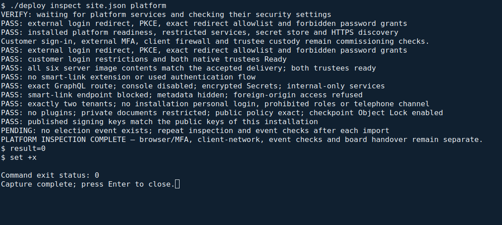
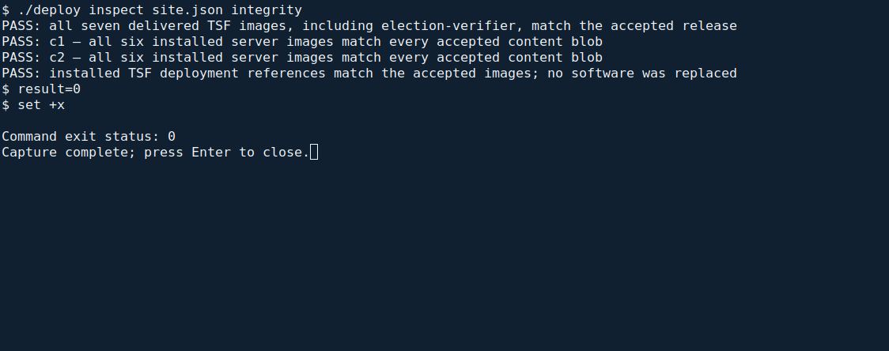
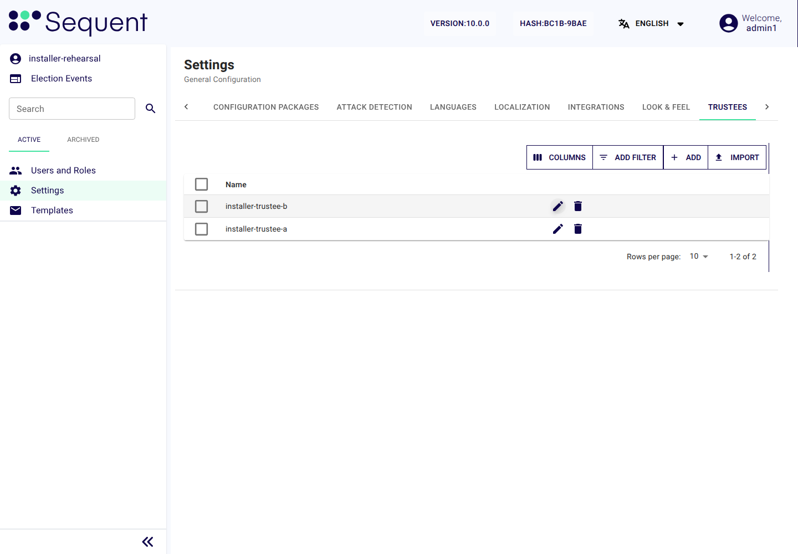

<!--
SPDX-FileCopyrightText: 2026 Sequent Tech Inc <legal@sequentech.io>
SPDX-License-Identifier: AGPL-3.0-only
-->

Run this chapter **after customer and trustee commissioning** and before
[Handover to the election board](11-selftest_handover.md#handover-to-the-election-board).
It groups the server checks into one command, then lists the browser, network and
election-event checks that still need a person.

## Run the platform inspection

**Where:** a root terminal on the administration workstation, in the deployment
directory, with the completed installation's unchanged `site.json`.
Both trustees must already be commissioned; keep the accepted image content on
C1 available for the image check.

```bash
./deploy inspect site.json platform
```

The command connects to C1, checks the running configuration and makes HTTPS
requests from the workstation. It does not import an election event, alter an account
or authorize handover. The storage check creates a temporary check pod and removes
it afterwards; it refuses to replace an existing pod with that name.

**Expected result.** Each completed group prints `PASS: ...`. The final line is
`PLATFORM INSPECTION COMPLETE — browser/MFA, client-network, event checks and board handover remain separate.`
Before the first election-event import, it also prints
`PENDING: no election event exists; repeat inspection and event checks after each import`.
That pending result does not waive the checks required after an import.



*Terminal capture from a test installation. Your addresses, names and digests differ.*

**If the result differs.** A failed group, timeout, missing final line or unexpected
response is a failed inspection. Keep the installation out of handover and correct
its configuration; if you cannot, ask Sequent. Do not delete data, regenerate credentials or hide a failed check. Read-only
inspection can be repeated after correction. If storage-check cleanup failed, check
whether its pod remains before rerunning that group:

```bash
SERVER=$(jq -er '.nodes.c1' site.json)
ADMIN_KEY=$(jq -er '.ssh_identity' site.json)
ssh -i "$ADMIN_KEY" "root@$SERVER" 'k3s kubectl -n step-infra get pod storage-check'
```

If the pod remains, ask Sequent.

The following sections explain the checks and remaining operator actions. You do
not run an additional server command for every heading.

## Running images

<!-- deployment-step: 10-001 -->

**Included in the platform inspection.** The check requires ready containers for
all six server TOE parts, with at least two for Windmill and two for braid. It
checks digest-qualified references against the accepted delivery and hashes the
referenced content blobs. A runtime image ID referring to a single-child OCI
index is resolved to its image configuration before comparison.

An absent blob, ambiguous index, missing container or different digest fails.
A matching pod specification alone is insufficient. The `PASS` line confirms the
image group.

## Repeat the complete TSF software integrity check

**Where:** the administration workstation, in the deployment directory.
Keep the original accepted seven-image OCI delivery mounted at `toe.directory`
in `site.json`. The command checks its `image-digests.txt` against
`toe.manifest_sha256` of `site.json`.

```bash
./deploy inspect site.json integrity
```

**Expected result:** four `PASS` lines confirm:

- all seven delivered TOE images, including the on-demand election verifier;
- every installed server image manifest, configuration and layer on C1;
- the same complete content check on C2;
- the cluster's deployed image references match that accepted release.



*Terminal capture from a test installation. Your addresses, names and digests differ.*

This command reads image content and does not replace software. It also works
when a trustee is idle; it checks the accepted trustee image on both servers.

The section "TOE software integrity" of the tab "Security and self-tests" of the
election event ([Verify the TOE software](../../02-election_managers/04-administrator_handbook/07-self_tests.md#verify-the-toe-software))
compares the six server TOE parts, using the image observer on C1
([TOE image observation](11-selftest_handover.md#toe-image-observation)). This
complete check covers all seven images, including the election verifier, and the
content stores of both servers. Run it for
[Confirm the server settings to the administrator](11-selftest_handover.md#confirm-the-server-settings-to-the-administrator),
after recovery or software replacement, when the admin portal shows the result "Differs
from the accepted delivery", and whenever the integrity of the software is in doubt.

**If the result differs:** keep voting unavailable, tell the administrators and the
election board, and keep the failed result. Obtain the steps to restore the
complete accepted software from Sequent, then repeat this command. Never copy an
observed digest into the file `image-digests.txt` to make a mismatch pass. The
background election-event self-tests and their data checks do not replace this
seven-component software verification.

## Version

**Who:** a personal administrator, in the browser they use for the admin portal.
The operator gives them the values of `release.version` and `release.step_commit`.
To check the version and hash in the portal's header:

1. Follow [The first sign-in](09-accounts.md#the-first-sign-in).
2. Find **VERSION** in the administration portal's header. It must show
   `10.0.0`, matching `release.version` in the accepted installation configuration.
   This is the displayed release number for the TOE identified in this guide.
3. Compare the **HASH** beside it with the first eight characters of
   `release.step_commit`. The
   header shows them in the form `1A2B-3C4D`, and only in a wide window. Letter
   case does not change the value.



*Admin portal capture from a local build with test data. VERSION and HASH appear at the
top. The tenant, account and source revision are examples.*

**If different:** the administrator stops and tells the operator. The operator
compares `release.version` and `release.step_commit` with the `tag:` and `commit:`
lines of the file `image-digests.txt` and runs
[Repeat the complete TSF software integrity check](#repeat-the-complete-tsf-software-integrity-check).
If the header still differs, ask Sequent. Do not edit the displayed version to
conceal a mismatch.

## TLS endpoint and ingress ports

**Still required, from the positions that these sections state:**

- Run [Check the TLS profile](05-certificates_tls.md#check-the-tls-profile).
- Repeat [Network filtering](04-hosts_network_time.md#network-filtering) from a
  computer on the client network using the actual current ingress ports.

Every procedure listed here provides its exact command, expected result, screenshot
and failure handling. A timeout from the administration workstation cannot stand
in for a test from the client network. Use the positive HTTPS connection check
to distinguish filtering from a disconnected test machine.

## Identity service

<!-- deployment-step: 10-002 -->
<!-- deployment-step: 10-003 -->

**Included in the platform inspection.** Both the realm of the super-admin tenant
and the customer's realm must publish the expected issuer. The checks require:

- external identity-provider redirect for the administration portal;
- rejection without a PKCE challenge or with an unregistered redirect address;
- disabled password grants for the portal and the client `admin-cli`;
- disabled client `cli-account-admin`;
- master-realm HTTP `403` on all three portal hosts.

**Browser action:** the personal administrator must complete the actual external
sign-in with the required factors. Follow [The first sign-in](09-accounts.md#the-first-sign-in)
and its screenshots. Automated redirect checks do not prove that a real user
completed MFA. If the local TOE password form appears, stop and ask Sequent. If the
external provider does not enforce the required factors, have the authentication
server's administrator correct it.

## No smart-link sign-in

<!-- deployment-step: 10-004 -->
<!-- deployment-step: 10-005 -->
<!-- deployment-step: 10-006 -->

**Included in the platform inspection.** No identity-service extension filename
may contain `smart-link-hmac`; no authentication flow used by a realm, client or
identity provider may invoke the smart-link authenticator; the public smart-link
endpoint must answer HTTP `404` on each portal host.

An unused built-in flow is not evidence that users can sign in through it. A
network or TLS error is not an acceptable `404`. Do not delete files from a
running container or alter realm tables directly to make the check pass.

## GraphQL endpoint and cross-origin requests

<!-- deployment-step: 10-007 -->
<!-- deployment-step: 10-008 -->

**Included in the platform inspection.** The ingress routes only
`/hasura/v1/graphql` with an exact-path match; console and development mode are
both disabled. Requests to the metadata path must receive a verified denial or
the portal's HTML fallback, never a GraphQL metadata API response. Requests from
`https://other.invalid` receive no allow-origin header.

Do not expose the console or metadata API for diagnosis.

## Encrypted secrets and the internal bulletin board

<!-- deployment-step: 10-009 -->
<!-- deployment-step: 10-010 -->

**Included in the platform inspection.** Cluster-secret encryption is enabled.
The bulletin board has a `ClusterIP` Service and no ingress. No external Service
is permitted by this accepted private-ingress layout. Harvest and Windmill use
the secret backend `EnvVarMasterSecret` with a master key of the expected length; the check prints
no secret value.

If the secret-store check fails, keep the existing master key and ask Sequent. Replacing it
can make previously encrypted application data unreadable. Never print the key,
enable shell tracing or generate a replacement as a diagnostic step.

## Election event realms

<!-- deployment-step: 10-011 -->
<!-- deployment-step: 10-012 -->
<!-- deployment-step: 10-013 -->

**When:** after every election-event import, while the election event is in the
preparation phase and before the election board approves its configuration version.
Have the election event's redirect address registered, as step 1 of
[For each new election event](11-selftest_handover.md#for-each-new-election-event)
describes. To check the election event realms:

1. Run `./deploy inspect site.json platform` again from the same administration
   terminal. It prints `EVENT REALM:` followed by each actual imported realm.
   Compare the list with the election events that the election board has told the
   administrators it imported. An absent or unexpected
   realm is a failure, not a reason to skip the check.
2. Copy one complete realm name from that output. Run the following command,
   replacing `REALM_FROM_THE_OUTPUT` with that exact name:

   ```bash
   ./deploy inspect site.json election REALM_FROM_THE_OUTPUT
   ```

3. Repeat for every imported election event. Expect a `PASS` line naming that realm and
   its TLS/session/audit policy, issuer, absent code channels and disabled
   password grant. The check requires brute-force protection with a positive
   value of the realm setting `failureFactor`: 5 from the realm template, or the
   value in the signed configuration package. That setting is the identity
   service's own lockout of accounts with a local password; it is not the
   [Authentication failure threshold](../../02-election_managers/04-administrator_handbook/08-authentication_and_sessions.md#authentication-failure-threshold),
   which the administrator sets in the admin portal.

The realm policy must require external TLS, a 900-second idle timeout,
brute-force protection, event recording and the event listener
`custom-event-listener`. Voters must have no sign-in code channel, and the password
grant of the realm's client `admin-cli` must be refused. The command cannot prove
that the external provider will admit an eligible voter. The administrator makes
the browser checks of
[What you check](../../02-election_managers/04-administrator_handbook/08-authentication_and_sessions.md#what-you-check).

**If the command fails:** tell the administrators that the election board must not
approve the configuration version of that election event. If the realm's settings
are wrong, nobody corrects them on the servers: the election organizer issues a
corrected signed package, and the board imports it as a new election event and
archives the wrong one
([Correcting imported election data](../../02-election_managers/04-administrator_handbook/05-tenant_and_event_settings.md#correcting-imported-election-data)).
Check the new realm the same way; if it fails too, ask Sequent. If only the redirect
registration is wrong, have the authentication server's administrator correct it and
repeat the check. Do not substitute a different realm or enable a password grant.

## Data correction, telephone channel, plugins and tenants

<!-- deployment-step: 10-014 -->
<!-- deployment-step: 10-015 -->
<!-- deployment-step: 10-016 -->

**Included in the platform inspection.** The checks require:

- exactly the super-admin tenant and the configured customer's tenant;
- no election event in the super-admin tenant and no enabled personal account in it;
- no assigned permission "Datafix account" (`datafix-account`) or "Manually Verify
  Voter" (`voter-manually-verify`);
- disabled telephone-channel clients and no telephone provider credentials;
- administration-event recording, including details, in both tenant realms;
- no plugin objects; private document storage denies anonymous access and has no
  bucket policy granting public access;
- the public bucket's exact permitted read policy and Object Lock on electoral
  log checkpoints;
- a nonempty published signing-key set whose identifiers **and public key
  material** match keys of this installation's known realms.

Do not upload files to object storage or edit the published signing-key file
`certs.json` by hand. An unknown key, unexpected tenant or storage-policy mismatch
blocks handover. Tell the administrators the result, as
[Confirm the server settings to the administrator](11-selftest_handover.md#confirm-the-server-settings-to-the-administrator)
describes.

These facts of the evaluated configuration also hold:

- The seeded administrator groups hold none of the permissions reserved to the election board
  ([Configure the realms](07-hardening.md#configure-the-realms)), and at sign-in the
  TOE gives an administrator account only the permissions of the administrator role.
- Only the election board's role holds "Create Election Event"
  (`election-event-create`), with which a board member imports election data with the
  menu entry "Import Election Event" and a signed configuration package, and the
  permissions to publish configuration versions and to read the electoral log.
- No role holds "Edit Results Publication" (`publish-results-write`), no account holds
  "Datafix account" (`datafix-account`), and no role and no group holds "Manually
  Verify Voter" (`voter-manually-verify`).
- The results portal is not deployed
  ([Keep the results and kiosk portals off](07-hardening.md#keep-the-results-and-kiosk-portals-off)),
  and without the permission "Edit Results Publication" nobody can configure or publish
  the results website, whatever a package contains.

The platform inspection, browser checks and network checks are prerequisites for
[Handover to the election board](11-selftest_handover.md#handover-to-the-election-board).
They do not replace the six current election-event self-tests or the
protected board procedures.
