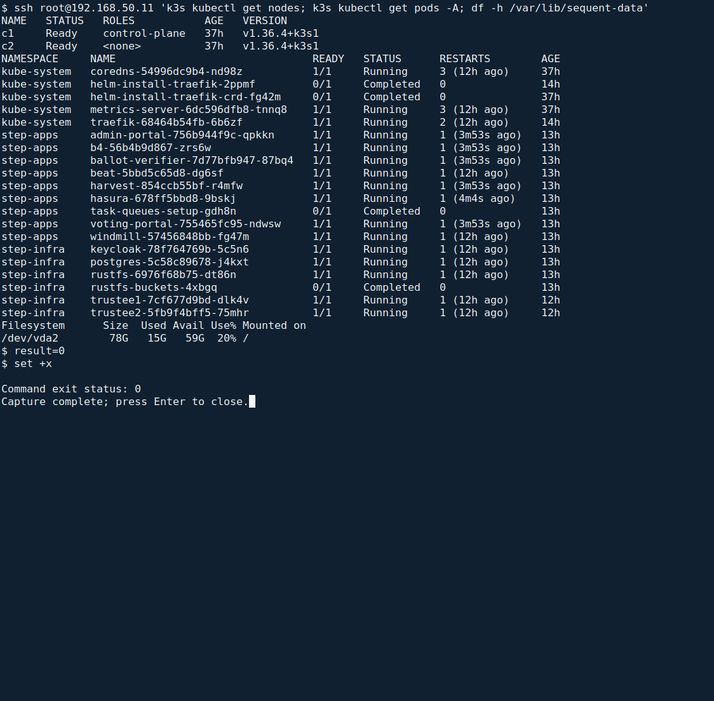
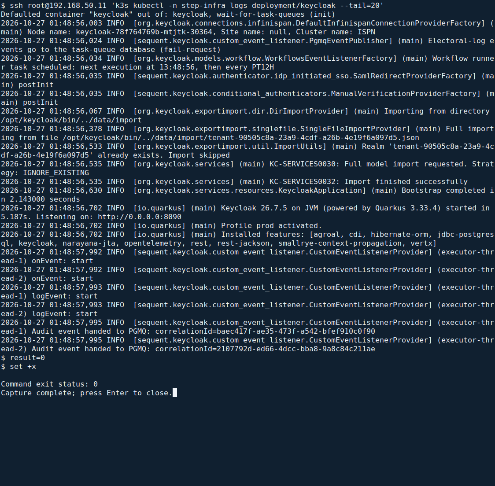
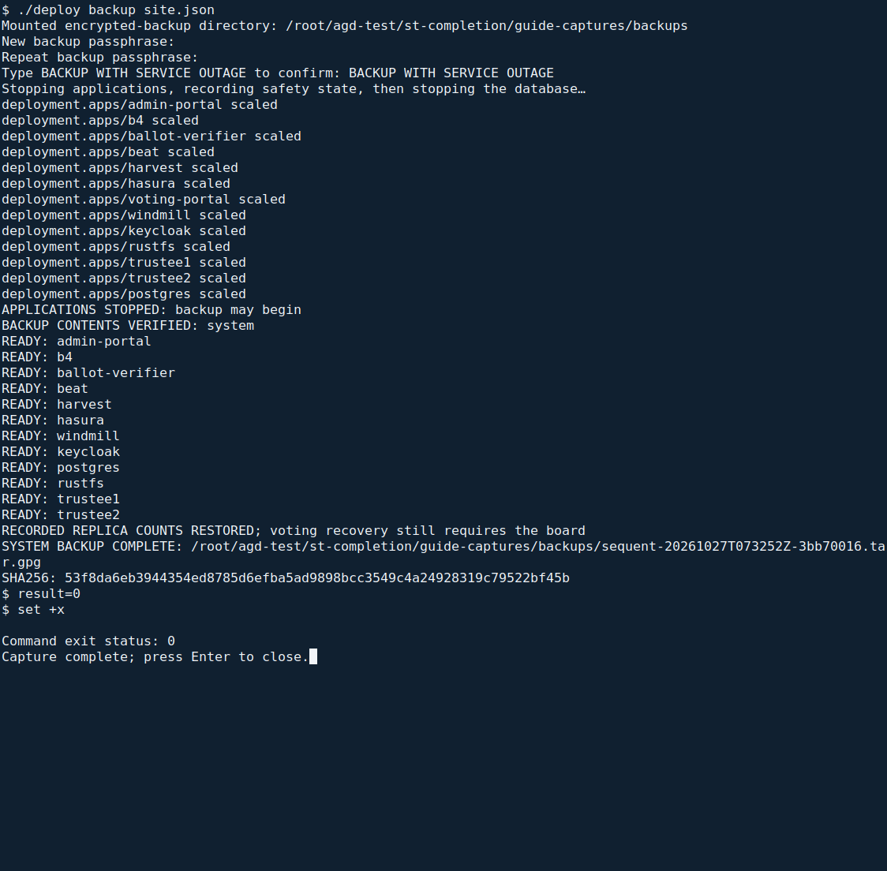
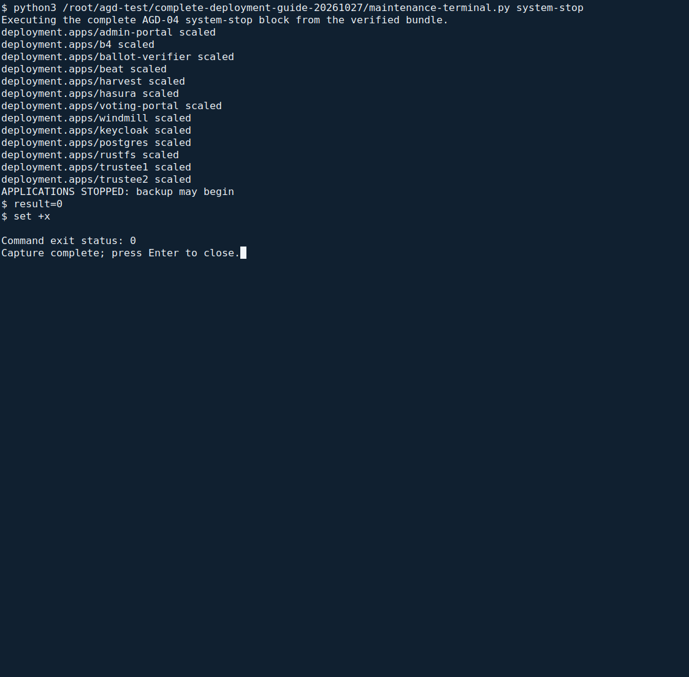
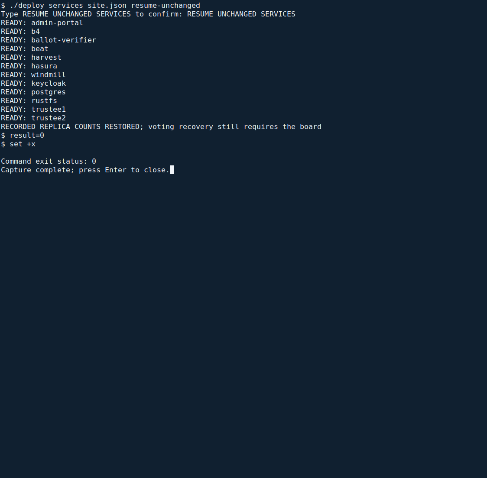
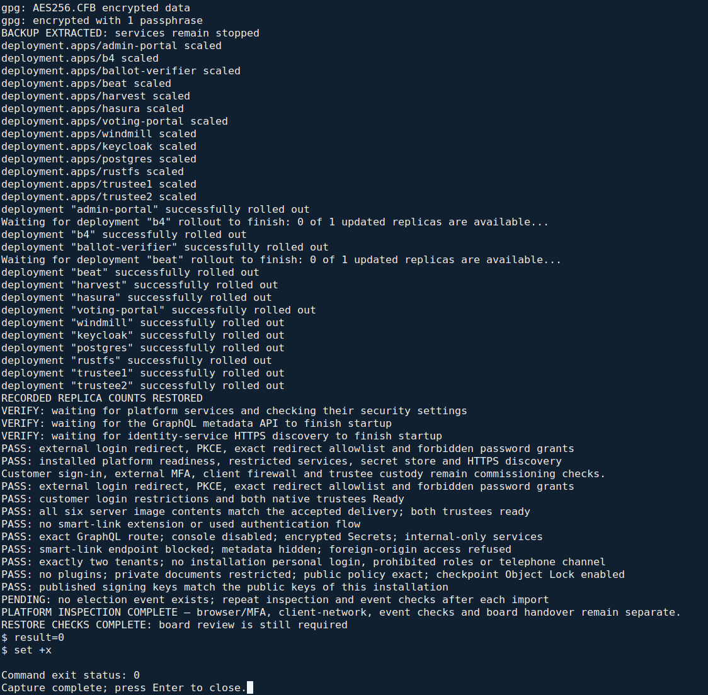

<!--
SPDX-FileCopyrightText: 2026 Sequent Tech Inc <legal@sequentech.io>
SPDX-License-Identifier: AGPL-3.0-only
-->

This chapter describes the handover, the remaining human checks and the separate
maintenance procedures. Passing the installation checks alone does not complete the
handover: see [Handover to the election board](#handover-to-the-election-board).

## Handover to the election board

The installation is handed over when all of these hold:

1. You made the checks of [Verifying the Installation](10-verification.md), each with
   its stated result. Those of
   [Election event realms](10-verification.md#election-event-realms) follow after
   each import.
2. A personal administrator made
   [The first sign-in](09-accounts.md#the-first-sign-in) and the check of
   [Version](10-verification.md#version).
3. The test of [Network filtering](04-hosts_network_time.md#network-filtering) passed
   from a client network.
4. You told the administrators the result of
   [Confirm the server settings to the administrator](#confirm-the-server-settings-to-the-administrator).

Then tell the election board that the installation is handed over, with the date, the
SHA-256 of the file `image-digests.txt` (`toe.manifest_sha256` of `site.json`) and the
test machine and network of the client network check: the board records them in the
board's minutes.

## Before the first import

The TOE refuses every import of election data until the tenant's rules for signed
configuration packages are set. Before a board member creates the first election
event, the administrator sets these rules
([Configure certificates in the admin portal](../../02-election_managers/04-administrator_handbook/05-tenant_and_event_settings.md#configure-certificates-in-the-admin-portal))
and sets up the accounts
([Users, Roles and Role Separation](../../02-election_managers/04-administrator_handbook/04-users_and_roles.md)).
You have no step here unless you are also the administrator.

## For each new election event

:::warning
An election event's realm is created at its import. Voters can sign in to it
only after its redirect address is registered, and it must be checked before
voters use it.
:::

When the administrators tell you that the election board has imported an election
event ([Checking the import](../../02-election_managers/05-election_organizer_handbook/06-preparation.md#checking-the-import)),
in its preparation phase:

1. From the deployment directory on the administration workstation, run
   `./deploy inspect site.json platform` as shown in
   [Election event realms](10-verification.md#election-event-realms). Copy the
   realm's complete name from the line `EVENT REALM:`. Ask the authentication server's administrator
   to register `https://HOST/realms/REALM/broker/ALIAS/endpoint`, replacing **HOST**
   with `hosts.voting` from `site.json`, **REALM** with that complete printed name,
   and **ALIAS** with `idp_alias`. Register the exact resulting URI, with no wildcard.
2. The operator makes the checks of
   [Election event realms](10-verification.md#election-event-realms) and
   tells the administrators the result.
3. The administrator follows
   [Authentication and Session Settings](../../02-election_managers/04-administrator_handbook/08-authentication_and_sessions.md)
   for the imported election event.
4. In the tab "Security and self-tests" of the election event, the administrator
   sets the interval, suite timeout and additional conditions during the
   preparation phase, and verifies the saved values against the electoral regulation.
5. A board member selects the purpose **On request**, then the button **Run
   self-tests**. Wait for all six results and check their details. If the run does
   not finish, the operator checks the services as
   [Read the current server state](#read-the-current-server-state) describes.
   Before opening or resuming voting,
   repeat with the required **Before starting voting** or **Before resuming
   voting** purpose. A passing run does not itself open or resume voting.
6. The operator repeats the checks of
   [Confirm the server settings to the administrator](#confirm-the-server-settings-to-the-administrator)
   and tells the administrators the result, before the election board approves the
   configuration version of the election event.

## Confirm the server settings to the administrator

The section "TOE software integrity" of the tab "Security and self-tests" of the
election event compares the ten server TOE parts with the accepted delivery
([Verify the TOE software](../../02-election_managers/04-administrator_handbook/07-self_tests.md#verify-the-toe-software)),
but it does not cover the election verifier image or the content store of C2. The
admin portal shows no plugins, no telephone provider and no other tenants. The
operator therefore checks these settings and tells the administrators that the
checks passed, after the installation and again for each new election event, before
the election board approves its configuration version. If the operator and the
administrator are one person, no message is needed. To confirm the server settings:

1. Make the checks of
   [Repeat the complete TSF software integrity check](10-verification.md#repeat-the-complete-tsf-software-integrity-check),
   of [Data correction, telephone channel, plugins and tenants](10-verification.md#data-correction-telephone-channel-plugins-and-tenants)
   and of [No smart-link sign-in](10-verification.md#no-smart-link-sign-in).
2. If every check gave the result stated there, tell the administrators, through a
   channel that protects its integrity (in person or a signed email), that the checks passed, and give them the
   SHA-256 of `image-digests.txt` (`toe.manifest_sha256` of `site.json`), which they
   compare with the value "SHA-256 of the accepted digest list" that the admin portal
   shows. The checks establish that:
   - the running images are those of the accepted TOE delivery: the complete
     TSF software integrity check gave its four `PASS` lines;
   - no plugin can run: the accepted images contain no plugin runtime;
   - no telephone provider and no credentials for the telephone channel's
     endpoints are configured;
   - election work uses only the customer's tenant: the TOE has no tenant
     other than the customer's and the super-admin tenant, which serves only
     the installation steps of this guide, holds no election event and has
     no enabled personal account;
   - no account, group or role holds the permissions "Datafix account"
     (`datafix-account`) or "Manually Verify Voter" (`voter-manually-verify`);
   - the identity service has no smart-link sign-in and accepts no sign-in
     link: none of its extension files has `smart-link-hmac` or
     `sign-in-link-handlers` in its name or holds a sign-in link handler or a
     provider that issues sign-in links, and the smart-link sign-in address
     answers `404`.
3. If a check gives another result, stop. Tell the administrators that the
   election board must not approve the configuration version, and report the result
   to [security@sequentech.io](mailto:security@sequentech.io).

## Operating the servers

**Where:** use a root terminal in the deployment directory on the
administration workstation. Keep the accepted `site.json` beside `./deploy`.
`./deploy` uses its recorded C1 address and SSH identity; no separate server
shell or copied connection variables are needed. Unknown or changed SSH host
keys stop the operation. Verify the server identity as
[Verify SSH host keys before first use](03-installation_kit.md#verify-ssh-host-keys-before-first-use)
describes before proceeding.

The recurring duties are these:

| When | What | Section | Who is told |
| --- | --- | --- | --- |
| Daily in preparation and execution | Storage | [Storage](#storage) | Administrator and board, if low |
| After each import | Realm and server checks | [Election event realms](10-verification.md#election-event-realms), [Confirm the server settings to the administrator](#confirm-the-server-settings-to-the-administrator) | Administrators |
| Before each key or tally ceremony | `./deploy commission site.json` | [Transfer the matching keys and start the instances](08-installing_toe.md#transfer-the-matching-keys-and-start-the-instances) | Board |
| During each key ceremony, before a trustee downloads the custody request | Protocol manager key, with the trustee watching | [Show each trustee the protocol manager key](08-installing_toe.md#show-each-trustee-the-protocol-manager-key) | The trustee |
| After each key ceremony | Trustee backup | [Back up the trustee state](08-installing_toe.md#back-up-the-trustee-state) | Board (path and digest) |
| Before the execution phase and after voting | System backup | [Create and verify the encrypted backup](#create-and-verify-the-encrypted-backup) | Board (path and digest) |
| Before each election event | Certificate end date: `openssl x509 -in "$(jq -er '.tls.certificate' site.json)" -noout -enddate`; it must be after the election event's end, otherwise renew it | [Renew the certificate](05-certificates_tls.md#renew-the-certificate) | Board, if the CA file changes |
| After the tally and the export, on the board's instruction | Remove keys | [Remove the trustee keys at the end of the election event](08-installing_toe.md#remove-the-trustee-keys-at-the-end-of-the-election-event) | Board |
| After a key removal, before the next election event's key ceremony | New trustee keys: `./deploy commission site.json` | [Install new trustee keys for a later election event](08-installing_toe.md#install-new-trustee-keys-for-a-later-election-event) | Board |

### Read the current server state

```bash
./deploy services site.json status
```

**Expected result:** the recorded C1 hostname, both nodes marked `Ready`,
application pods marked `Running`, among them two `harvest` pods, two `windmill`
pods and the `tls-endpoint` pod, and completed setup jobs marked `Completed`.
The final table shows the `Use%` and `Avail` columns of the file system that holds
`/var/lib/sequent-data` ([Storage](#storage)). The command
does not report the host observer of [TOE image observation](#toe-image-observation).



*Terminal capture from a test installation of an earlier build, with one `harvest` pod, one `windmill` pod and no `tls-endpoint` pod. Your addresses and names differ.*

To read the identity service's most recent 20 operating-log lines:

```bash
./deploy services site.json logs keycloak
```

To read the last 20 lines of another component's log, put its name
([Restart an authorized failed component](#restart-an-authorized-failed-component))
in place of `keycloak`. The command shows the last 20 lines of each pod of the
component, such as both `windmill` workers, and starts each line with the pod's
name, as in `[pod/<pod>/keycloak]`.

These are operating logs, not audit records: the election board reviews the
electoral log in the admin portal. The electoral log is kept by `postgres` (a
database for each election event) and written by `windmill`; write-once copies of
its checkpoints are kept by `rustfs`. If `windmill` cannot write such a copy, it
logs `Could not write the write-once copy of the electoral-log checkpoint at size`
followed by the size and the error, and publishes the checkpoint without its copy.
When the administrators ask you to restore the
audit service after the check "Audit recording and integrity" failed with
**Recovery required**
([Security and Self-Tests](../../02-election_managers/04-administrator_handbook/07-self_tests.md)),
read the state and the logs of these three components, then follow
**If different** below.



*Terminal capture from a test installation of an earlier build, which did not yet start each line with the pod's name.*

**If different:** keep the failed component's error
([If something fails](01-about.md#if-something-fails)), investigate connectivity,
storage and its controlled configuration, and inform the administrator and the
election board. Do not delete records, change a Secret or edit a running container
to recover it. Ask the administrator to check the tab "Security and self-tests" of
the election event. Stopping both Harvest instances or both Windmill workers,
an expired service heartbeat, a failed current check or an expired test prevents
voter admission. A successful service rollout does not clear the
state **Recovery required** or authorize resumption.

### Restart an authorized failed component

A restart interrupts service. During the execution phase, obtain the election
board's decision first
([A crash or shutdown of a server component](../../02-election_managers/04-administrator_handbook/10-modes_of_operation.md#a-crash-or-shutdown-of-a-server-component)).
If Keycloak is the agreed failed component:

```bash
./deploy services site.json restart keycloak
```

Type `RESTART keycloak` when prompted. Expect `COMPONENT READY: keycloak`, followed
by the reminder to complete platform and browser checks. `./deploy` waits up to
10 minutes for that deployment, 22 minutes for `windmill`. On timeout or failure, read its log with
`./deploy services site.json logs COMPONENT`; do not restart unrelated services or
bypass an active maintenance operation. To restart another component, put its name in
the same command and type `RESTART` followed by that name: `postgres` (the database),
`rustfs` (the object storage), `trustee1`, `trustee2` (the trustee instances),
`harvest`, `windmill`, `beat` (the worker's scheduler), `b4` (the bulletin board),
`hasura` (the GraphQL engine), `admin-portal`, `voting-portal`, `ballot-verifier` or
`tls-endpoint` (the TLS endpoint).

`harvest` runs two instances and `windmill` two workers. A restart replaces them one
at a time, each only once its replacement has registered, so voter admission goes on.
A stopping worker takes no new tasks and finishes those it holds, for up to 660 seconds.
Outside the execution phase, agree the time with the administrator.

`tls-endpoint` stops before it starts again: until it is ready, nothing answers on
port 443 of C1 and the request activity monitoring is unavailable, so during the
execution phase the election event enters maintenance mode (on screen, the state
**Recovery required**). Restart it outside the execution phase, or when the election
board has agreed.

Then run `./deploy inspect site.json platform`, and have an administrator make the sign-in of
[The first sign-in](09-accounts.md#the-first-sign-in) and tell you the result (if you
also work in the admin portal, make it yourself). Only then tell the
administrators that the component is back; the administrator then makes the check of
[Verify the TOE software](../../02-election_managers/04-administrator_handbook/07-self_tests.md#verify-the-toe-software).
The election board retains all decisions on voting and audit review.

For time problems, use
[Restore time synchronization](04-hosts_network_time.md#restore-time-synchronization). For certificate renewal, see
[Renew the certificate](05-certificates_tls.md#renew-the-certificate). Change the
operating system, the cluster software and the TOE only with a new delivery or
installation kit from Sequent, outside the execution phase. The fresh-install command
refuses an occupied cluster, so obtain the steps for an existing installation from
Sequent, and keep the installation unchanged until you have them. Never replace
credentials or install an unaccepted image.

### A security notification is not delivered

An administrator reports that an email did not arrive, or the delivery state "Delivery
failed" or "Delivery outcome unknown", and gives you the notification's identifier
([Check security notifications](../../02-election_managers/04-administrator_handbook/07-self_tests.md#check-security-notifications)).
To follow it up:

1. Ask for the failure text that the area "Security email delivery" shows under that
   identifier.
2. Compare it with your private SMTP configuration
   ([Configure security email](01-about.md#configure-security-email)).
3. Ask the mail administrator to look for that time at the relay.
4. Tell the administrator the result.

If the relay's credentials have changed or expired, ask Sequent: `./deploy` has no
command to replace them. Until they are replaced, no security notification reaches
anyone by email: tell the administrators, who follow the security state and the
delivery state of each notification in the tab "Security and self-tests" of the
election event.

### Storage

Use `./deploy services site.json status` and read the final table's `Use%` and
`Avail` columns. Check daily during the preparation and execution phases, and arrange
expansion well before `Use%` reaches 80: above that, voters and trustees are refused.

An observer in the database's pod measures the file system that holds
`/var/lib/sequent-data` on C1 every 30 seconds; you do not start it. That file
system holds the databases, the object storage and the trustee instances' state.
It is the partition labelled `SEQUENT_DATA` of C1's data disk if the site
configuration declares one, and otherwise C1's system partition `SEQUENT_ROOT`.
Above 80% use, or without a fresh trustworthy observation, voter token issuance,
refresh and voter operations are refused. In the tenants, the identity service
also refuses tokens to trustees and to every other account except board members
and administrators, whose access remains available for recovery. Ask the
administrator to check the security state and the notification delivery; restoring
capacity may also require the board's protected resumption.

If capacity is low, inform the administrator and the election board immediately.
The election board decides whether to pause operations while the operator expands
the storage as [Extend the data file system](#extend-the-data-file-system)
describes. Never delete records, logs or arbitrary files to make space.

#### Extend the data file system

**When:** `Use%` approaches 80, or the administrators report that the audit
storage threshold is exceeded.

**Where:** the deployment directory on the administration workstation and a root
shell on C1; for step 5, the system that provides C1's disks, such as its
hypervisor or storage array.

The partition grows into space added at the end of its disk, and its ext4 file
system grows while it stays mounted and the platform keeps running. The servers
mount it by its label and never partition disks themselves, so the change remains
after a restart. To extend it:

1. Inform the administrator and the election board. The board decides whether
   voting is paused.
2. Outside the execution phase, first create and verify an encrypted backup
   ([Create and verify the encrypted backup](#create-and-verify-the-encrypted-backup))
   and keep the archive.
3. Open a root shell on C1 from the deployment directory:

   ```bash
   SERVER=$(jq -er '.nodes.c1' site.json)
   ADMIN_KEY=$(jq -er '.ssh_identity' site.json)
   ssh -i "$ADMIN_KEY" "root@$SERVER"
   ```

4. In that shell, find the partition and its disk:

   ```bash
   findmnt -T /var/lib/sequent-data
   lsblk -o NAME,SIZE,LABEL,MOUNTPOINTS
   ```

   The column `SOURCE` of `findmnt` names the partition, for example `/dev/sdb1`
   or `/dev/nvme1n1p1`. Write down its disk (`/dev/sdb` or `/dev/nvme1n1`) and
   its partition number (`1`). `lsblk` shows its label: `SEQUENT_DATA` for the
   only partition of the data disk, or `SEQUENT_ROOT` for the second partition of
   the system disk.
5. Enlarge the virtual disk, RAID volume or storage volume (LUN) behind that disk
   in the system that provides it. A physical disk cannot be enlarged: with C1
   shut down, copy the whole disk to a larger one, which keeps its partitions and
   their labels, use the larger one in its place, and open the shell of step 3
   again. The election board decides when C1 may be shut down.
6. In the shell on C1, enter the disk and the partition number from step 4, then
   enlarge the partition and its file system:

   ```bash
   DISK=/dev/sdb   # the disk from step 4
   PART=1          # the partition number from step 4
   sfdisk --relocate gpt-bak-std "$DISK"
   echo ',+' | sfdisk --no-reread -N "$PART" "$DISK"
   partx -u "$DISK"
   resize2fs /dev/disk/by-label/SEQUENT_DATA   # SEQUENT_ROOT for the system partition
   df -h /var/lib/sequent-data
   ```

   The first `sfdisk` moves the partition table's backup copy to the new end of
   the disk; the second keeps the start of the partition and extends it to the
   end of the disk. `partx` gives the kernel the new partition size, and
   `resize2fs` grows the file system to it.

   **Expected result:** `df` shows the larger size.
7. After 30 seconds, read the observer's latest measurement in the same shell,
   then leave the shell with `exit`:

   ```bash
   k3s kubectl exec -n step-infra deployment/postgres -c postgres -- \
     psql -U postgres -d queues \
     -c "SELECT state, observed_at, used_bytes, available_bytes FROM step_queue.audit_storage_health"
   ```

   **Expected result:** `state` is `available`, and `observed_at` lies within
   the last minute.
8. On the administration workstation, run `./deploy services site.json status`:
   `Use%` must be 80 or less. Tell the administrator and the election board; the
   board resumes voting as
   [Maintenance mode](../../02-election_managers/04-administrator_handbook/10-modes_of_operation.md#maintenance-mode)
   describes. Then run `./deploy inspect site.json platform`, which must pass.

**If a command fails or the size does not change:** stop and keep the output. Do
not repeat the commands with other values or other tools. Tell the administrator
and the election board, and ask Sequent
([If something fails](01-about.md#if-something-fails)).

### Request activity monitoring

`./deploy services site.json status` also reports `REQUEST MONITORING: available`
when the protected external-request observation is healthy and no more than
30 seconds old. The host counts completed external HTTP requests, including
unauthenticated refusals. Its raw observations omit client addresses, URLs,
queries, request bodies and credentials. The administrator configures detection
thresholds in the portal; the election board reviews the resulting detections.
During a stop for maintenance or a backup the TLS endpoint is stopped as well, and
the status reads `REQUEST MONITORING: unavailable — TLS endpoint is not running`
until the services resume.

**If unavailable:** inform the administrator and the election board. Voting remains
blocked and the election event enters maintenance mode (on screen, the state
**Recovery required**); staff access stays available.
An unavailable, stale, truncated or discontinuous source must never be treated
as zero activity.

Do not try to repair the monitor yourself. Read its state from the deployment
directory:

```bash
SERVER=$(jq -er '.nodes.c1' site.json)
ADMIN_KEY=$(jq -er '.ssh_identity' site.json)
ssh -i "$ADMIN_KEY" "root@$SERVER" 'systemctl status sequent-request-activity.timer sequent-request-activity.service'
```

The host's observation file is `/run/sequent-security/activity.json`. Tell the
administrator and the election board, keep voting stopped and give that output to
Sequent. Never delete the monitor's state, change its generation, reseed counters or
remove a failure marker to force a passing result. After a verified repair, the board
still requires fresh passing self-tests and its protected recovery action.

The raw observation buffer is bounded. Overflow records a persistent continuity
failure before reclaiming raw transport storage; retained attack detections and
signed records of the electoral log are preserved. This failure remains visible after
a service or host restart.

### TOE image observation

The section "TOE software integrity" of the tab "Security and self-tests" of the
election event ([Verify the TOE software](../../02-election_managers/04-administrator_handbook/07-self_tests.md#verify-the-toe-software))
compares the ten server TOE parts with the accepted delivery. It relies on a host
observer on C1, the units `sequent-image-status.service` and
`sequent-image-status.timer`. They come with the host configuration of the
installation kit, so there is nothing to install. The observer runs 5 seconds after
boot and then every 60 seconds, each run bounded at 90 seconds and at low priority.
It reads the file `/root/deploy/image-digests.txt`, which the installer copies
there, and reads the running containers and the content store through the commands
`k3s kubectl` and `k3s ctr`. It publishes the file `/run/sequent-images/status.json`, which the
Windmill pod mounts read-only. `./deploy services site.json status` does not report
the observer. To read its state, run from the deployment directory:

```bash
SERVER=$(jq -er '.nodes.c1' site.json)
ADMIN_KEY=$(jq -er '.ssh_identity' site.json)
ssh -i "$ADMIN_KEY" "root@$SERVER" 'systemctl status sequent-image-status.timer sequent-image-status.service'
```

**If the admin portal shows the result "Differs from the accepted delivery":** keep
voting unavailable and run
[Repeat the complete TSF software integrity check](10-verification.md#repeat-the-complete-tsf-software-integrity-check).
Tell the administrators and the election board its result. The election event stays
in maintenance mode until the election board resumes it
([Maintenance mode](../../02-election_managers/04-administrator_handbook/10-modes_of_operation.md#maintenance-mode)).

**If it shows the result "Could not verify":** the security state does not change,
and the section gives the reason. For a single TOE part the overall reason is "Not
every TOE part could be verified", and the row of that part gives the detail.
Correct the cause, then tell the administrators to verify again:

| Reason shown | Cause and what to do |
|---|---|
| "The host image observation is stale" | The observation is older than 180 seconds. A run that reaches its 90-second limit publishes nothing. Check the two units on C1. |
| "The host image observation is dated in the future" | The observation carries a time later than the check's. Check C1's time service as [Restore time synchronization](04-hosts_network_time.md#restore-time-synchronization) describes. |
| "The host image observation is unavailable or invalid" | The Windmill pod cannot read a valid `/run/sequent-images/status.json`. Check the two units and the file on C1. |
| "The host image observation does not cover exactly the ten TOE parts" | The published file does not describe the ten parts of this release. Run [Repeat the complete TSF software integrity check](10-verification.md#repeat-the-complete-tsf-software-integrity-check) and ask Sequent. |
| "The accepted digest list cannot be read" | The file `/root/deploy/image-digests.txt` on C1 is missing or invalid. Never edit it. Compare its SHA-256 with `toe.manifest_sha256` of `site.json`, and ask Sequent for the steps if the file is missing or differs. |
| "The running containers cannot be read" | `k3s kubectl` failed on C1. Follow [Read the current server state](#read-the-current-server-state). |
| A message such as "1 of the 2 required containers are ready" | Too few containers of that part are ready: the check requires 2 for braid, Harvest and Windmill and 1 for each other part. Follow [Read the current server state](#read-the-current-server-state) and [Restart an authorized failed component](#restart-an-authorized-failed-component). |
| "The accepted image could not be resolved", "The image of a running container could not be read", or another message about an image or the content store | The observer could not follow an image to its content. Run [Repeat the complete TSF software integrity check](10-verification.md#repeat-the-complete-tsf-software-integrity-check) and ask Sequent. |
| "The check could not be queued", "The check did not complete", "The start of this check could not be recorded in the electoral log" or "The electoral-log record of this check could not be verified" | The check did not complete in the TOE's own services. Follow [Read the current server state](#read-the-current-server-state). |

### Backups and restore

A system backup contains election data, election execution data, audit records, the
trustee instances' protocol state and the directory `/root/deploy` with its secrets.
`./deploy` encrypts it before writing it to the workstation or backup medium. Keep the
passphrase in a separate locked place. The election organizer names who keeps the
archive and, separately, who keeps the passphrase. The archive does **not** contain the cluster's own state
or its imported container-image store.

These commands operate on an **existing accepted cluster and the same software
release**. They restore data and the directory `/root/deploy`. They do not
cover replacement nodes, lost Kubernetes Secrets or changed software releases:
obtain the procedure for those from Sequent.

#### Create and verify the encrypted backup

**When:** after commissioning, before the execution phase, or after voting has ended and
the election board authorizes maintenance.
A backup briefly stops the services, the TLS endpoint among them. Coordinate the outage with the administrator
and the election board; do not use it in the execution phase. Mount an encrypted
medium that only the people named to keep backups can open, the kit at `kit.directory`
and the delivery medium at `toe.directory`.

Run this **one command**. It stops the services, creates and checks the encrypted
archive, then restores their original replica counts:

```bash
./deploy backup site.json
```

`./deploy` asks for:

1. The existing, absolute path to the mounted backup directory.
2. A new passphrase of at least 16 characters, entered twice without displaying it.
3. The exact confirmation `BACKUP WITH SERVICE OUTAGE`.

No service is stopped until these prompts have succeeded. `./deploy` records
replica counts, stops the applications, records the final electoral safety state,
and then stops PostgreSQL. It requires every application pod to stop before
reading the data. The encrypted archive is decrypted and checked without writing
plaintext to the workstation.

**Expected result, in order:**

- `APPLICATIONS STOPPED: backup may begin`.
- `BACKUP CONTENTS VERIFIED: system`.
- `READY:` for each deployment that originally had replicas.
- `RECORDED REPLICA COUNTS RESTORED` and the reminder that voting recovery remains
  a board decision.
- `SYSTEM BACKUP COMPLETE:` with the archive's absolute path, followed by its
  `SHA256:` digest.



The passphrase stays hidden. Your archive path and digest will differ. The capture is from an earlier build: the current output adds "Running tasks finish first; this can take up to 12 minutes" to the line that announces the stop, and also prints `deployment.apps/tls-endpoint scaled` and `READY: tls-endpoint`.

Keep the encrypted archive, and in the current directory the protected file
`.backup-receipt.json`, which holds the path and digest of the latest backup: the next
backup overwrites it, and a restore requires it.

Tell the election board the archive's path and SHA256 digest: it records them in the
board's minutes, and selects from them if a restore is needed. Each backup holds the whole
installation, with every election event in it. When the board has deleted the
election execution data of an election event
([Deleting the election execution data](../../02-election_managers/05-election_organizer_handbook/08-evaluation-and-post-processing.md#deleting-the-election-execution-data)),
it directs the keeper to destroy every system backup made since that election
event was imported, once no other election event still needs it under its
retention period, and records the destruction in the board's minutes.

Run `./deploy inspect site.json platform`, and have an administrator make the sign-in of
[The first sign-in](09-accounts.md#the-first-sign-in) and tell you the result (if you
also work in the admin portal, make it yourself), before you tell the
administrator and the election board that the service is back.

**If stopping fails:** no backup is accepted. An API error or timeout never counts
as a stopped service. Inspect the current state and keep the maintenance record of
`./deploy` (`/var/lib/sequent-maintenance` on C1). **If transfer, encryption or validation fails:** services remain stopped;
keep the original data and last known-good backup. Do not accept a partial
archive. Validation rejects unsafe paths, links, special files, duplicate entries,
missing directories and truncated data.

#### Stop services separately for maintenance

The backup command above already stops services. Use this separate command only
for an authorized maintenance outage:

```bash
./deploy services site.json stop
```

Type `STOP SERVICES FOR MAINTENANCE`. Expect
`APPLICATIONS STOPPED: backup may begin`. `./deploy` saves the original replica
counts and allows up to 720 seconds for application shutdown, because a stopping
`windmill` worker finishes the tasks it holds, then up to 90 seconds
for the database and remaining pods. The TLS endpoint stops with the applications:
until the services resume, nothing answers on port 443 of C1. A system or trustee maintenance operation
already in progress prevents another operation from starting.



*Terminal capture from a test installation of an earlier build. The current output adds "Running tasks finish first; this can take up to 12 minutes" to the line that announces the stop, and also prints `deployment.apps/tls-endpoint scaled`.*

**If it fails:** keep the maintenance record and inspect the actual service
state. Some services may already be stopped. Do not manually remove the record,
guess replica counts or start the normal backup command over an unfinished stop.

#### Resume unchanged services after a failed backup or separate stop

Use this only when the original data has not been replaced or changed by recovery
work. It also recovers an interrupted service stop. Never use it after restoration
has begun: `./deploy` refuses a durable `restoring` state.

```bash
./deploy services site.json resume-unchanged
```

Type `RESUME UNCHANGED SERVICES` after confirming that the original data is intact.
Expect `READY:` for each previously running deployment, then
`RECORDED REPLICA COUNTS RESTORED`. `./deploy` restores the saved counts, including
services that had zero replicas; it does not assume every service should run.



*Terminal capture from a test installation of an earlier build. The current output also prints `READY: tls-endpoint`.*

Then run `./deploy inspect site.json platform`, have an administrator make the sign-in of
[The first sign-in](09-accounts.md#the-first-sign-in) and tell you the result (if you
also work in the admin portal, make it yourself), and report the failed
operation to the administrator. If a rollout fails or the replica record is missing,
keep the maintenance record and ask Sequent. Successful
rollouts do not authorize voting or clear a security failure.

#### Restore an authorized backup on the existing cluster

A restore replaces current data with older data. The election board must
authorize the selected backup and the outage
([A restore from a backup](../../02-election_managers/05-election_organizer_handbook/12-modes-and-failures.md#a-restore-from-a-backup));
tell the administrators and the election board of every restore. First make a verified current-state
backup, and keep it separately from the older archive. From the deployment
directory, use these commands in order:

```bash
./deploy backup site.json
./deploy restore site.json
./deploy inspect site.json platform
```

The restore asks for the absolute path to the **authorized older backup**, its
passphrase and the exact confirmation `RESTORE AUTHORIZED BACKUP`. It requires
the current-state backup receipt from the preceding 24 hours and verifies that
its separate encrypted archive still has the recorded digest.

Before stopping services or replacing data, `./deploy` authenticates and validates
the complete older archive and checks its installation, release and image-manifest
identity. It keeps a private copy of the encrypted bytes so a changed removable
medium cannot exchange the archive after validation.

After services stop, `./deploy` compares the archive's electoral safety record
with the final current record. Both must contain the same election events in the same
phases. A restore that would remove or resurrect an election event, change an electoral
phase, or undo an unrecoverable security failure is refused. In particular,
**ended voting cannot reopen**.

The generic restore also refuses an election event in the execution phase, even when
the older archive has the same phase: it could omit ballots or audit records accepted
after that backup. Recovery in the execution phase requires a separately reviewed
procedure that preserves all accepted records: ask Sequent for it. Keep services stopped for that review when
a safety check fails.

During replacement, the maintenance record remains outside the restored
directories. On C1, `./deploy` deletes everything under `/var/lib/sequent-data`
(the data of the database, the object storage and the two trustee instances) and
under `/root/deploy` (the installation workspace), then extracts the older archive
there, so that no file written after that backup remains beside the restored
ones. This also deletes the write-once copies of the electoral log's checkpoints
written after that backup: they remain only in the current-state backup, so keep
it. The cluster's Secrets, the trustee keys among them, the operating systems,
the TLS files under `/var/lib/sequent-site` and the container images keep their
current state. Only PostgreSQL starts first. `./deploy` checks the actual restored
safety records, invalidates prior service admissions and successful test generations,
and records the restoration before starting other services. Each recoverable
election event requires current self-tests and the board's recovery decision.

**Expected result:** `BACKUP CONTENTS VERIFIED: system`,
`APPLICATIONS STOPPED: backup may begin`, the deployment `READY:` messages,
`RECORDED REPLICA COUNTS RESTORED`, and finally `RESTORE CHECKS COMPLETE` with the
reminder to inspect the platform and obtain current tests and board review.
The third command must also complete successfully. Identity-service startup may
produce a bounded read-only wait of under one minute; it does not bypass issuer,
certificate or policy failures.



*Terminal capture from a test installation of an earlier build. The current output adds "Running tasks finish first; this can take up to 12 minutes" to the line that announces the stop, and also prints `deployment.apps/tls-endpoint scaled` and `READY: tls-endpoint`.*

The restored system still requires current self-tests and the board's recovery
decision. Successful restoration does not reopen voting.

**If archive preflight fails:** no service or current data has been changed by the
restore. Check the archive and passphrase. **If a safety-state comparison fails
after stopping:** the services stay stopped; the original data is unchanged, so the
board chooses between
[Resume unchanged services after a failed backup or separate stop](#resume-unchanged-services-after-a-failed-backup-or-separate-stop)
and asking Sequent for a reviewed recovery. **If replacement, database checks or
recovery recording fails:** keep applications stopped, keep both encrypted
backups and the maintenance record, and ask Sequent for a reviewed recovery.
Do not use `resume-unchanged` or manually start partly restored data.

After success, the administrator completes the browser checks. The board reviews
the restored electoral log and all six current self-tests. Each trustee compares
their original keys file with the registered public keys
(`./trustee public-keys trustee.json`), and you check both instances with
`./deploy commission site.json`. Run
`./deploy inspect site.json integrity` to recheck all eleven accepted software
parts. Recovery from an incident during the execution phase follows
[Maintenance mode](../../02-election_managers/04-administrator_handbook/10-modes_of_operation.md#maintenance-mode):
a fresh successful run with the purpose **Before resuming voting** and the election
board's protected resumption within the approved period. Never resume an unrecoverable
election event.
