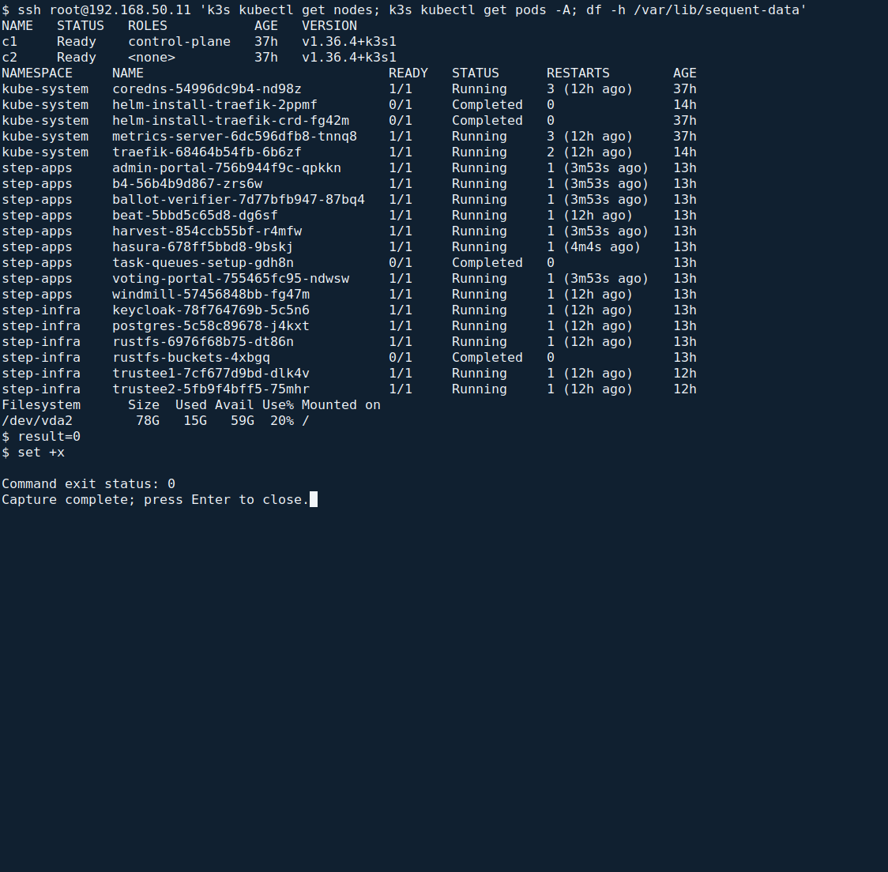
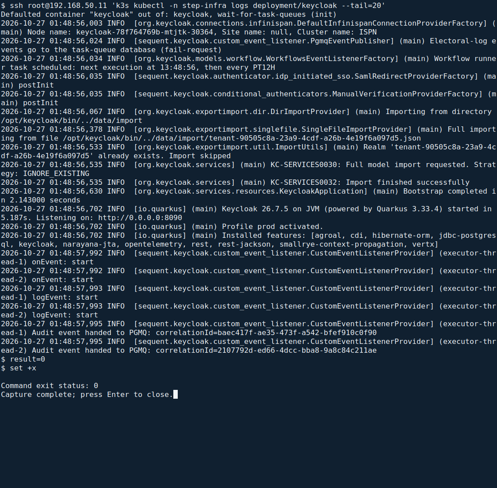
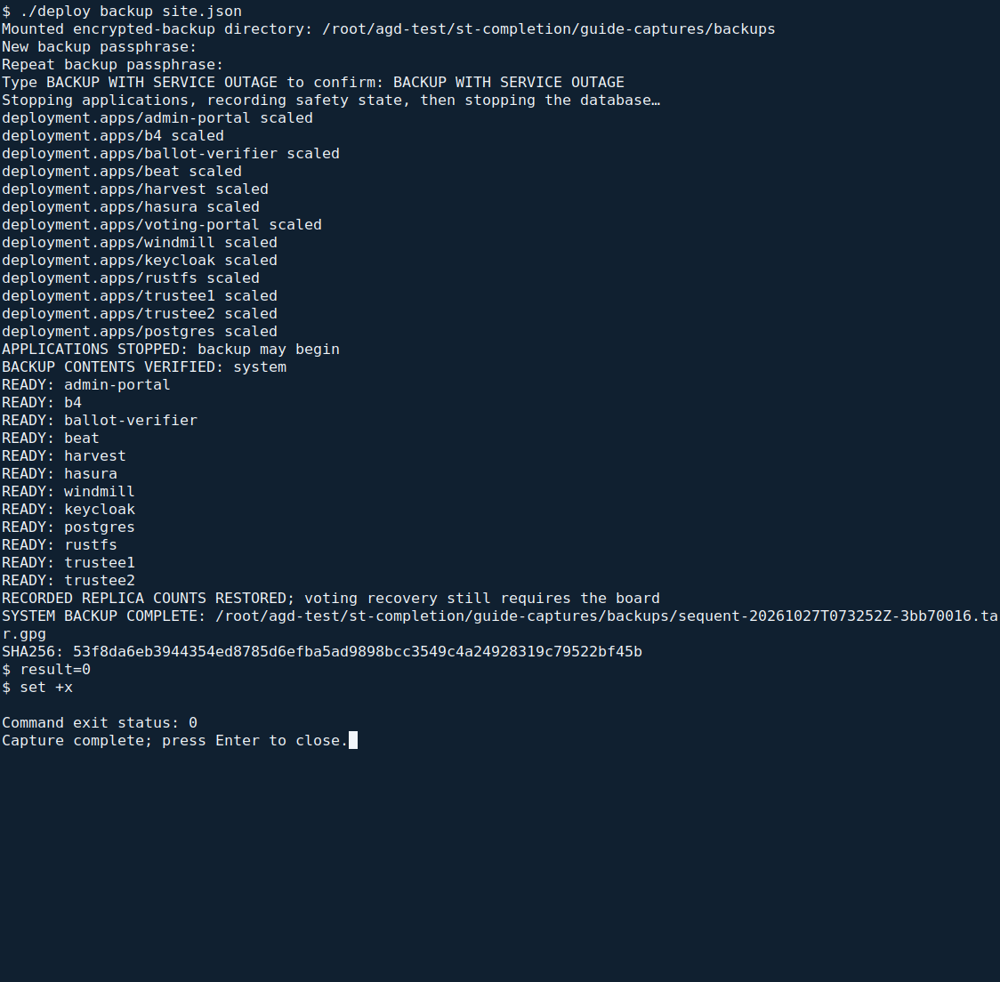
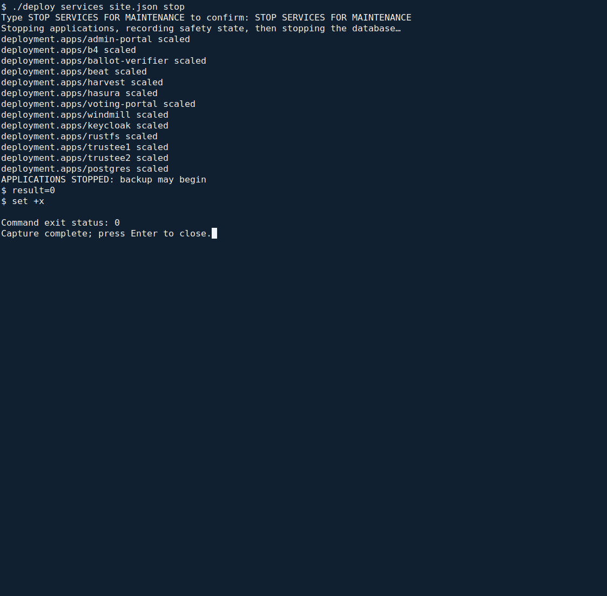
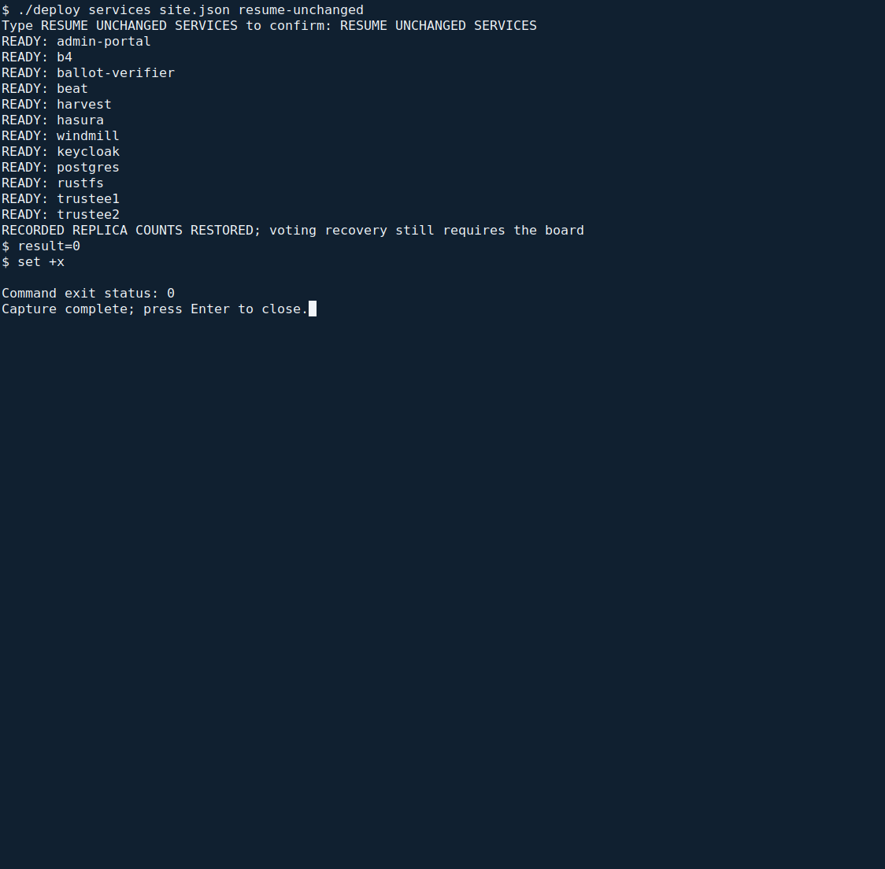
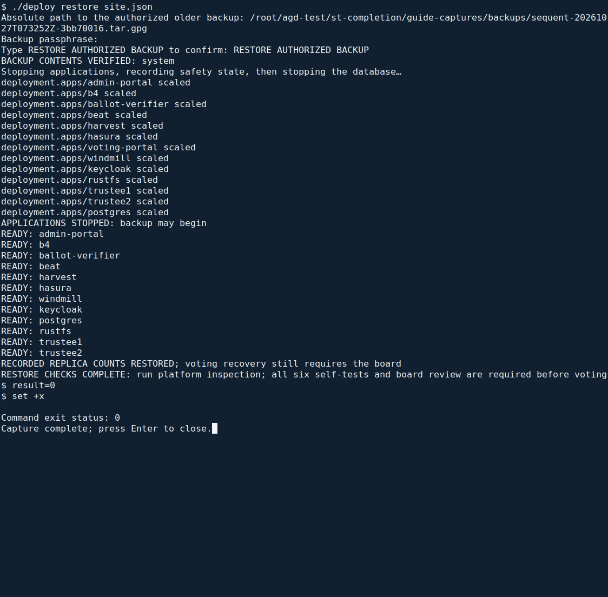

<!--
SPDX-FileCopyrightText: 2026 Sequent Tech Inc <legal@sequentech.io>
SPDX-License-Identifier: AGPL-3.0-only
-->

This chapter records the remaining human checks and the separate maintenance
procedures. Passing installation checks alone does not establish PP/CC conformance.
Complete the current election self-tests, board procedures and release
acceptance checks before handover; a successful command is not a substitute
for the evaluator's assessment.

## Before the first import

:::warning
The TOE refuses every import of election data until the tenant's rules for
signed configuration packages are set. Set them before the first import.
Afterwards only a staff CA is replaced, between elections, as the
Handbook for Election Administrators describes.
:::

Before the election board imports any election data:

1. In the administration portal, open **Settings → Configuration packages**.
   Upload the approved public CA certificates, independently check their
   fingerprints and set at least two approvals, following the illustrated
   [certificate setup procedure](../../02-election_managers/04-administrator_handbook/05-tenant_and_event_settings.md#configure-certificates-in-the-admin-portal).
   Save and check the read-back. A failed save or different fingerprint blocks
   the first import; do not substitute a different CA to make the form pass.
2. The administrator sets up the roles and the personal accounts and deletes
   the seeded accounts, following the illustrated
   [Users, Roles and Role Separation](../../02-election_managers/04-administrator_handbook/04-users_and_roles.md)
   procedure. The seeded administrator groups already hold none of the
   permissions that the handbook's role tables exclude from the administrator
   role ([Configuring the Deployment](07-hardening.md#configure-the-realms)). Only
   the election board's role holds "Create Election Event"
   (`election-event-create`), with which a board member imports election data
   with "Import Election Event" and a signed configuration package, and the
   permissions to publish configuration versions and to read the electoral
   log.
3. No role holds "Edit Results Publication" (`publish-results-write`), no
   account holds "Datafix account" (`datafix-account`), and no role and no
   group holds "Manually Verify Voter" (`voter-manually-verify`). The import
   refuses a package that enables the results website.

## For each new election event

:::warning
An election event's realm is created at its import. Voters can sign in to it
only after its redirect address is registered, and it must be checked before
voters use it.
:::

Each time the election board has imported an election event, in its
preparation phase:

1. From the administration workstation's `deployment` directory, run
   `./deploy inspect site.json platform` as shown in
   [Election event realms](10-verification.md#election-event-realms). Copy the
   event's complete name from `EVENT REALM:`. Ask the external provider's operator
   to register `https://HOST/realms/REALM/broker/ALIAS/endpoint`, replacing **HOST**
   with `hosts.voting` from `site.json`, **REALM** with that complete printed name,
   and **ALIAS** with `idp_alias`. Register the exact resulting URI, with no wildcard,
   following [Connecting the Authentication Server](06-authentication_server.md).
2. The operator makes the checks of
   [Election event realms](10-verification.md#election-event-realms) and
   tells the administrators the result.
3. The administrator follows the illustrated
   [Authentication and Session Settings](../../02-election_managers/04-administrator_handbook/08-authentication_and_sessions.md)
   procedure for the imported event.
4. In **Security and self-tests**, the administrator sets the interval, suite
   timeout and additional conditions during preparation. Verify the saved
   values against the electoral regulation. The operator confirms that Beat,
   Windmill, Harvest, authenticated time and the storage monitor are healthy.
5. A board member selects **On request**, then **Run self-tests**. Wait for
   all six results and check their details. Before opening or resuming voting,
   repeat with the required **Before starting voting** or **Before resuming
   voting** purpose. A passing run does not itself open or resume the election.
6. The operator gives the administrators the confirmation of
   [Confirm the server settings to the administrator](#confirm-the-server-settings-to-the-administrator)
   again, before the election board approves the configuration version of
   the election event.

## Confirm the server settings to the administrator

The admin portal shows no plugins, no telephone provider and no other
tenants. The administrators therefore rely on the operator's written
confirmation of these settings. The operator gives it after the installation
and again for each new election event, before the election board approves its
configuration version.

1. Make every check of
   [Data correction, telephone channel, plugins and tenants](10-verification.md#data-correction-telephone-channel-plugins-and-tenants)
   and of [No smart-link sign-in](10-verification.md#no-smart-link-sign-in).
2. If every check gave the result stated there, give the administrators a
   written confirmation, with the date, the time and your name, through a
   channel that protects its integrity. It states that:
   - no plugin is installed;
   - no telephone provider and no credentials for the telephone channel's
     endpoints are configured;
   - election work uses only the customer's tenant: the TOE has no tenant
     other than the customer's and the super-admin tenant, which serves only
     the installation steps of this guide, holds no election event and has
     no enabled personal account;
   - no account, group or role holds "Datafix account" (`datafix-account`)
     or "Manually Verify Voter" (`voter-manually-verify`);
   - the identity service has no smart-link sign-in: none of its extension
     files has `smart-link-hmac` in its name, and the smart-link sign-in
     address answers `404`.
3. If a check gives another result, give no confirmation. Stop, tell the
   administrators that the election board must not approve the configuration
   version, and report the result to
   [security@sequentech.io](mailto:security@sequentech.io).

The administrators know that the server settings are confirmed when they hold
this confirmation for the current election event.

## Operating the servers

**Where:** use a root terminal in the extracted `deployment` directory on the
administration workstation. Keep the accepted `site.json` beside `./deploy`.
The helper uses its recorded C1 address and SSH identity; no separate server
shell or copied connection variables are needed. Unknown or changed SSH host
keys stop the operation. Verify the server identity through the approved
console procedure before proceeding.

### Read the current server state

```bash
./deploy services site.json status
```

**Expected result:** the recorded C1 hostname, both nodes marked `Ready`,
application pods marked `Running` and completed setup jobs marked `Completed`.
The final table shows the data volume's `Use%` and `Avail` columns.



To read the identity service's most recent 20 operating-log lines:

```bash
./deploy services site.json logs keycloak
```

These are protected operational logs. Electoral audit records are reviewed by
the election board in the portal.



**If different:** preserve the failed component's error, investigate connectivity,
storage and its controlled configuration, and inform the administrator and board.
Do not delete records, change a Secret or edit a running container to recover it.
Check **Security and self-tests** with the board. Stopping or restarting Harvest
or Windmill, an expired service heartbeat, a failed current check or an expired
test prevents voter admission. A successful service rollout does not clear
**Recovery required** or authorize resumption.

### Restart an authorized failed component

A restart interrupts service. During an election, obtain the board's operational
decision with the administrator first. If Keycloak is the agreed failed component:

```bash
./deploy services site.json restart keycloak
```

Type `RESTART keycloak` when prompted. Expect `COMPONENT READY: keycloak`, followed
by the reminder to complete platform and browser checks. The helper waits up to
45 seconds for that deployment. On timeout or failure, inspect its log; do not
restart unrelated services or bypass an active maintenance operation.

Then run `./deploy inspect site.json platform` and complete the browser sign-in
check before reporting recovery. The board retains all decisions on voting and
audit review.

For time problems, use [Authenticated time](04-hosts_network_time.md#authenticated-time)
and its exact check. Certificate renewal, operating-system changes and TOE
upgrades require the accepted release's maintenance procedure. The fresh-install
command refuses an occupied cluster; use the supported maintenance operation
for an existing installation. Never replace credentials or install an
unaccepted image.

### Storage

Use `./deploy services site.json status` and read the final table's `Use%` and
`Avail` columns. Check daily during Preparation and Execution and arrange
expansion before free space becomes insufficient.

The evaluated installation requires the automatic audit-storage monitor.
Above 80% use, or without a fresh trustworthy observation, voter token issuance,
refresh and election requests are refused. Board and administrator access
remains available for recovery. Inspect the security state and notification
delivery; restoring capacity may also require the board's protected resumption.

If capacity is low, inform the administrator and board immediately. They decide
whether to pause operations while the operator applies the site's approved
storage-expansion procedure. Never delete records, logs or arbitrary files to
make space. Volume/device expansion is installation-specific. Follow the
approved host/storage procedure, then repeat the capacity and platform checks.

### Request activity monitoring

`./deploy services site.json status` also reports `REQUEST MONITORING: available`
when the protected external-request observation is healthy and no more than
30 seconds old. The host counts completed external HTTP requests, including
unauthenticated refusals. Its raw observations omit client addresses, URLs,
queries, request bodies and credentials. The administrator configures detection
thresholds in the portal; the election board reviews the resulting detections.

**If unavailable:** inform the administrator and board. Voting remains blocked
and an operational election enters recovery; staff access stays available.
An unavailable, stale, truncated or discontinuous source must never be treated
as zero activity. A successful Nginx restart alone does not repair a lost cursor
or missing observations.

Preserve the incident evidence and investigate the host, storage and collector.
Restore only verified continuous observation state. Never delete the collector's
state, change its generation, reseed counters or remove a failure marker to force
a passing result. If continuity cannot be established, keep voting stopped and
escalate the incident to the board and Sequent. After a verified repair, the board
still requires fresh passing self-tests and its protected recovery action.

The raw observation buffer is bounded. Overflow records a persistent continuity
failure before reclaiming raw transport storage; retained attack detections and
signed electoral audit records are preserved. This failure remains visible after
a service or host restart.

### Backups and restore

A system backup contains election data, execution data, audit records and the
working deployment directory with its secrets. The helper encrypts it before
writing it to the workstation or backup medium. Keep the passphrase in a
separate locked place. The archive does **not** contain the cluster's own state
or its imported container-image store.

These commands operate on an **existing accepted cluster and the same software
release**. They restore data and the working deployment directory. Replacement
nodes, Kubernetes Secrets and changed software releases require a separately
approved and rehearsed recovery procedure.

#### Create and verify the encrypted backup

**When:** after commissioning, before Execution, or after voting has ended and
the board authorizes maintenance.
A backup briefly stops the services. Coordinate the outage with the administrator
and board; do not use it as a routine operation during voting. Mount the protected
backup medium and keep the accepted delivery inputs available.

Run this **one command**. It stops the services, creates and checks the encrypted
archive, then restores their original replica counts:

<!-- deployment-step: 11-002 -->

```bash
./deploy backup site.json
```

The helper asks for:

1. The existing, absolute path to the mounted backup directory.
2. A new passphrase of at least 16 characters, entered twice without displaying it.
3. The exact confirmation `BACKUP WITH SERVICE OUTAGE`.

No service is stopped until these prompts have succeeded. The helper records
replica counts, stops the applications, records the final electoral safety state,
and then stops PostgreSQL. It requires every application pod to stop before
reading the data. The encrypted archive is decrypted and checked without writing
plaintext to the workstation.

**Expected result, in order:**

- `APPLICATIONS STOPPED: backup may begin`.
- `BACKUP CONTENTS VERIFIED: system`.
- `READY:` for each deployment that originally had replicas.
- `RECORDED REPLICA COUNTS RESTORED` and the reminder that voting recovery remains
  a board decision.
- `SYSTEM BACKUP COMPLETE:` with the archive's absolute path, followed by its
  `SHA256:` digest.



The passphrase stays hidden. The laboratory screenshot shows successful archive
verification and restoration of the original service counts; your archive path
and digest will differ.

Retain the encrypted archive, its digest and the protected `.backup-receipt.json`
created beside `site.json`. The receipt identifies the current backup when a
restore is requested. Complete `./deploy inspect site.json platform` and the
browser sign-in check before declaring service restored.

**If stopping fails:** no backup is accepted. An API error or timeout never counts
as a stopped service. Inspect the current state and preserve the maintenance
record. **If transfer, encryption or validation fails:** services remain stopped;
keep the original data and last known-good backup. Do not accept a partial
archive. Validation rejects unsafe paths, links, special files, duplicate entries,
missing directories and truncated data.

#### Stop services separately for maintenance

The backup command above already stops services. Use this separate command only
for an authorized maintenance outage:

<!-- deployment-step: 11-001 -->

```bash
./deploy services site.json stop
```

Type `STOP SERVICES FOR MAINTENANCE`. Expect
`APPLICATIONS STOPPED: backup may begin`. The helper saves the original replica
counts and allows up to 30 seconds for application shutdown, then up to 30 seconds
for the database and remaining pods. A system or trustee maintenance operation
already in progress prevents another operation from starting.



**If it fails:** retain the maintenance record and inspect the actual service
state. Some services may already be stopped. Do not manually remove the record,
guess replica counts or start the normal backup command over an unfinished stop.

#### Resume unchanged services after a failed backup or separate stop

Use this only when the original data has not been replaced or changed by recovery
work. It also recovers an interrupted service stop. Never use it after restoration
has begun: the helper refuses a durable `restoring` state.

```bash
./deploy services site.json resume-unchanged
```

Type `RESUME UNCHANGED SERVICES` after confirming that the original data is intact.
Expect `READY:` for each previously running deployment, then
`RECORDED REPLICA COUNTS RESTORED`. The helper restores the saved counts, including
services that had zero replicas; it does not assume every service should run.



Then run `./deploy inspect site.json platform`, complete the browser sign-in check
and report the failed operation to the administrator. If a rollout fails or the
replica record is missing, keep the maintenance record and investigate. Successful
rollouts do not authorize voting or clear a security failure.

#### Restore an authorized backup on the existing cluster

A restore replaces current data with older data. The administrator and board must
authorize the selected backup and the outage. First make a verified current-state
backup, and retain it separately from the older archive. From the same workstation
directory, use these commands in order:

<!-- deployment-step: 11-003 -->

```bash
./deploy backup site.json
./deploy restore site.json
./deploy inspect site.json platform
```

The restore asks for the absolute path to the **authorized older backup**, its
passphrase and the exact confirmation `RESTORE AUTHORIZED BACKUP`. It requires
the current-state backup receipt from the preceding 24 hours and verifies that
its separate encrypted archive still has the recorded digest.

Before stopping services or replacing data, the helper authenticates and validates
the complete older archive and checks its installation, release and image-manifest
identity. It keeps a private copy of the encrypted bytes so a changed removable
medium cannot exchange the archive after validation.

After services stop, the helper compares the archive's electoral safety record
with the final current record. Both must contain the same elections in the same
phases. A restore that would remove or resurrect an election, change an electoral
phase, or undo an unrecoverable security failure is refused. In particular,
**ended voting cannot reopen**.

The generic restore also refuses an election in **Execution**, even when the
older archive has the same phase: it could omit ballots or audit records accepted
after that backup. Execution recovery requires a separately reviewed procedure
that preserves all accepted records. Keep services stopped for that review when
a safety check fails.

During replacement, the maintenance record remains outside the restored
directories. Only PostgreSQL starts first. The helper checks the actual restored
safety records, invalidates prior service admissions and successful test generations,
and records the restoration before starting other services. Each recoverable
election requires current self-tests and the board's recovery decision.

**Expected result:** `BACKUP CONTENTS VERIFIED: system`,
`APPLICATIONS STOPPED: backup may begin`, the deployment `READY:` messages,
`RECORDED REPLICA COUNTS RESTORED`, and finally `RESTORE CHECKS COMPLETE` with the
reminder to inspect the platform and obtain current tests and board review.
The third command must also complete successfully. Identity-service startup may
produce a bounded read-only wait of under one minute; it does not bypass issuer,
certificate or policy failures.



The restored system still requires current self-tests and the board's recovery
decision. Successful restoration does not reopen voting.

**If archive preflight fails:** no service or current data has been changed by the
restore. Check the archive and passphrase. **If a safety-state comparison fails
after stopping:** the original data remains intact but the services stay stopped;
have the board decide the next action. **If replacement, database checks or
recovery recording fails:** keep applications stopped, preserve both encrypted
backups and the maintenance record, and use a separately reviewed recovery.
Do not use `resume-unchanged` or manually start partly restored data.

After success, the administrator completes the browser checks. The board reviews
the restored electoral log and all six current self-tests. Original trustee keys
and restored protocol state must agree. Run
`./deploy inspect site.json integrity` to recheck all seven accepted software
parts. Recovery from an execution-time incident requires its separate approved
procedure, a fresh successful **Before resuming voting** suite and the board's
protected resumption within the approved period. Never resume an unrecoverable
election.
