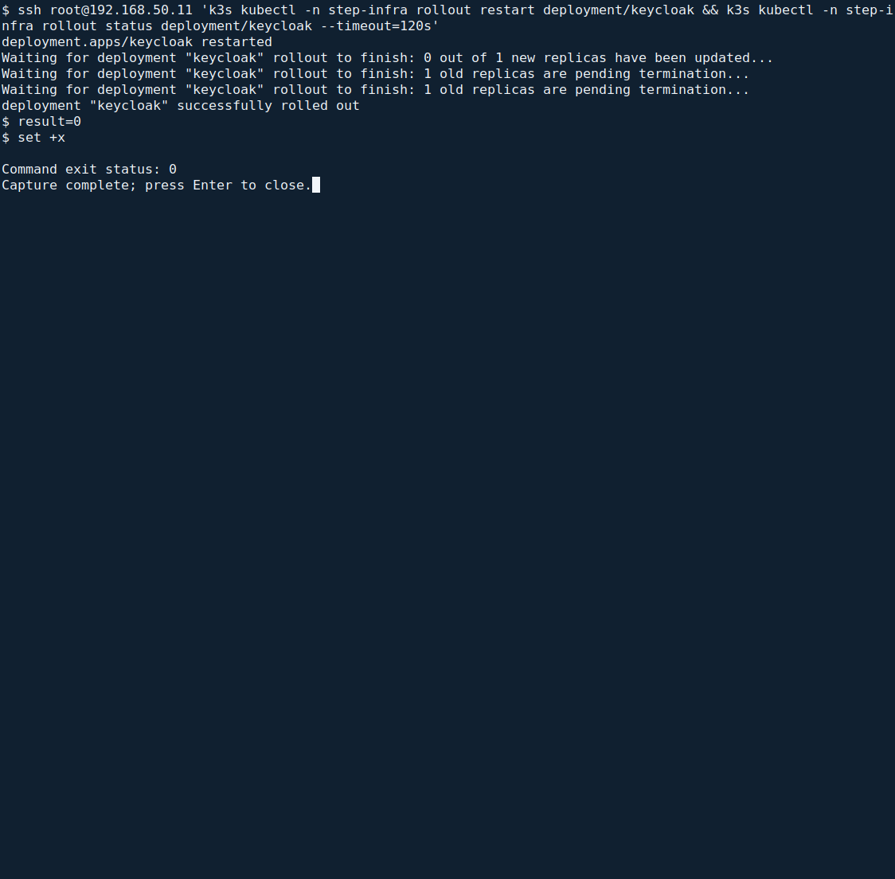

<!--
SPDX-FileCopyrightText: 2026 Sequent Tech Inc <legal@sequentech.io>
SPDX-License-Identifier: AGPL-3.0-only
-->

This chapter records the remaining human checks and the separate maintenance
procedures. Passing installation checks does not establish complete PP/CC
conformance: the full ST self-test suite and other implementation requirements
remain incomplete. Do not authorize the evaluated configuration as compliant
merely because the installer or platform inspection succeeds.

## Before the first import

:::warning
The TOE refuses every import of election data until the tenant's rules for
signed configuration packages are set. Set them before the first import.
Afterwards only a staff CA is replaced, between elections, as the
Handbook for Election Administrators describes.
:::

Before the election board imports any election data:

1. In the administration portal, open **Settings → Configuration packages**.
   Upload the approved public CA certificates, independently check their
   fingerprints and set at least two approvals, following the illustrated
   [certificate setup procedure](../../02-election_managers/04-administrator_handbook/05-tenant_and_event_settings.md#configure-certificates-in-the-admin-portal).
   Save and check the read-back. A failed save or different fingerprint blocks
   the first import; do not substitute a different CA to make the form pass.
2. The administrator sets up the roles and the personal accounts and deletes
   the seeded accounts, following the illustrated
   [Users, Roles and Role Separation](../../02-election_managers/04-administrator_handbook/04-users_and_roles.md)
   procedure. The seeded administrator groups already hold none of the
   permissions that the handbook's role tables exclude from the administrator
   role ([Configuring the Deployment](07-hardening.md#configure-the-realms)). Only
   the election board's role holds "Create Election Event"
   (`election-event-create`), with which a board member imports election data
   with "Import Election Event" and a signed configuration package, and the
   permissions to publish configuration versions and to read the electoral
   log.
3. No role holds "Edit Results Publication" (`publish-results-write`), no
   account holds "Datafix account" (`datafix-account`), and no role and no
   group holds "Manually Verify Voter" (`voter-manually-verify`). The import
   refuses a package that enables the results website.

## For each new election event

:::warning
An election event's realm is created at its import. Voters can sign in to it
only after its redirect address is registered, and it must be checked before
voters use it.
:::

Each time the election board has imported an election event, in its
preparation phase:

1. From the administration workstation's `deployment` directory, run
   `./deploy inspect site.json platform` as shown in
   [Election event realms](10-verification.md#election-event-realms). Copy the
   event's complete name from `EVENT REALM:`. Ask the external provider's operator
   to register `https://HOST/realms/REALM/broker/ALIAS/endpoint`, replacing **HOST**
   with `hosts.voting` from `site.json`, **REALM** with that complete printed name,
   and **ALIAS** with `idp_alias`. Register the exact resulting URI, with no wildcard,
   following [Connecting the Authentication Server](06-authentication_server.md).
2. The operator makes the checks of
   [Election event realms](10-verification.md#election-event-realms) and
   tells the administrators the result.
3. The administrator follows the illustrated
   [Authentication and Session Settings](../../02-election_managers/04-administrator_handbook/08-authentication_and_sessions.md)
   procedure for the imported event.
4. The operator sets the periodic electoral-log audit interval and time limit
   for Beat and Windmill, as [Self-Test Settings](../../02-election_managers/04-administrator_handbook/07-self_tests.md#configure-regular-background-audits)
   describes. The default interval is 15 minutes.
5. A board member requests **Logs → Audit** and checks the **Audit Electoral
   Log** result in **Tasks**. The complete six-check ST suite, startup/opening
   gates and automatic maintenance response remain unimplemented. This audit
   cannot authorize the evaluated configuration's acceptance or handover as
   compliant with FPT_TST.1.
6. The operator gives the administrators the confirmation of
   [Confirm the server settings to the administrator](#confirm-the-server-settings-to-the-administrator)
   again, before the election board approves the configuration version of
   the election event.

## Confirm the server settings to the administrator

The admin portal shows no plugins, no telephone provider and no other
tenants. The administrators therefore rely on the operator's written
confirmation of these settings. The operator gives it after the installation
and again for each new election event, before the election board approves its
configuration version.

1. Make every check of
   [Data correction, telephone channel, plugins and tenants](10-verification.md#data-correction-telephone-channel-plugins-and-tenants)
   and of [No smart-link sign-in](10-verification.md#no-smart-link-sign-in).
2. If every check gave the result stated there, give the administrators a
   written confirmation, with the date, the time and your name, through a
   channel that protects its integrity. It states that:
   - no plugin is installed;
   - no telephone provider and no credentials for the telephone channel's
     endpoints are configured;
   - election work uses only the customer's tenant: the TOE has no tenant
     other than the customer's and the super-admin tenant, which serves only
     the installation steps of this guide, holds no election event and has
     no enabled personal account;
   - no account, group or role holds "Datafix account" (`datafix-account`)
     or "Manually Verify Voter" (`voter-manually-verify`);
   - the identity service has no smart-link sign-in: none of its extension
     files has `smart-link-hmac` in its name, and the smart-link sign-in
     address answers `404`.
3. If a check gives another result, give no confirmation. Stop, tell the
   administrators that the election board must not approve the configuration
   version, and report the result to
   [security@sequentech.io](mailto:security@sequentech.io).

The administrators know that the server settings are confirmed when they hold
this confirmation for the current election event.

## Operating the servers

**Where:** use the administration workstation and the unchanged `site.json`.
For the short server-console commands below, open a root shell on C1 first:

```bash
C1=$(jq -er '.nodes.c1' site.json)
IDENTITY=$(jq -er '.ssh_identity' site.json)
ssh -o StrictHostKeyChecking=yes -i "$IDENTITY" "root@$C1"
```

The prompt now belongs to C1. Run `hostname` and compare the result with your
recorded C1 hostname before running the server commands.
Use `exit` to return to the workstation. Unknown or changed SSH host keys are a
failure; verify the server identity through the approved console procedure.

### Read the current server state

Run on C1:

```bash
hostname
k3s kubectl get nodes
k3s kubectl get pods -A
k3s kubectl -n step-infra logs deployment/keycloak --tail=20
```

**Expected result:** both nodes are `Ready`; application pods are `Running` or
completed setup jobs are `Completed`. The last command shows the identity
service's recent operating log. These are not the electoral audit records,
which only the election board reads. Treat logs as protected operational data.


*Actual read-only VM inspection of nodes, pods and storage. Compare node names,
readiness and capacity with your site; the image's values are examples.*


*Actual recent Keycloak log output. Messages depend on the current service state;
review errors without publishing private operational logs.*

**If different:** keep the failed component's error, investigate connectivity,
storage and its controlled configuration, and inform the administrator and board.
Do not delete records, change a Secret or edit a running container to recover it.
The current source does not implement the complete automatic maintenance-state
response described by the ST; do not assume a service failure safely paused voting.

### Restart an authorized failed component

A restart interrupts service. During an election, obtain the board's operational
decision with the administrator first. On C1, the following example restarts only
Keycloak; use it only when Keycloak is the agreed failed component:

```bash
k3s kubectl -n step-infra rollout restart deployment/keycloak
k3s kubectl -n step-infra rollout status deployment/keycloak --timeout=120s
```

Expect `deployment "keycloak" successfully rolled out`. On timeout or failure,
stop and inspect that component's log; do not restart unrelated services. Return
to the workstation with `exit`, run `./deploy inspect site.json platform`, and
complete the browser sign-in check before reporting recovery. The board retains
all decisions on voting and audit review.



*Actual isolated restart rehearsal. A successful rollout is followed by the
platform inspection and browser checks; it does not authorize an election restart.*

For time problems, use [Authenticated time](04-hosts_network_time.md#authenticated-time)
and its exact check. Certificate renewal, operating-system changes and TOE
upgrades require the accepted release's maintenance procedure. The fresh-install
command intentionally refuses an occupied cluster; it is not an upgrade or
recovery command. Never replace credentials or install an unaccepted image.

### Storage

On C1, run:

```bash
df -h /var/lib/sequent-data
```

Read the `Use%` and `Avail` columns for the volume holding the data. Check daily
during Preparation and Execution and arrange expansion before free space becomes
insufficient. The server-state screenshot above shows the command's table.

The current source does not establish the ST's complete automatic 80% storage
protection. Do not rely on that threshold to block voters or preserve records.
If capacity is low, inform the administrator and board immediately; they decide
whether to pause operations while the operator applies the site's approved
storage-expansion procedure. Never delete records, logs or arbitrary files to
make space. Volume/device expansion is installation-specific and must use the
approved host/storage procedure, followed by this capacity check and platform
inspection.

### Backups and restore

A system backup contains election data, execution data, audit records and the
working deployment directory with its secrets. Keep it encrypted, with the
passphrase in a separate locked place. It does **not** contain the cluster's own
state or the imported container-image store.

These commands operate on an **existing accepted cluster and the same software
release**. They restore data and the working deployment directory; they do not
rebuild Kubernetes Secrets or a replacement C1. Do not attempt replacement-node
recovery using the fresh-install command or by guessing missing Secrets. That
case needs a separately approved and rehearsed recovery procedure.

#### Stop services for a backup

**When:** after commissioning, before Execution and after Post-processing; never
as a routine operation during voting. Coordinate the service outage with the
administrator and board. Mount the protected backup medium.

**Where:** a root terminal in the extracted `deployment` directory on the
administration workstation. Copy this complete block:

<!-- deployment-step: 11-001 -->

```bash
set -Eeuo pipefail
umask 077
C1=$(jq -er '.nodes.c1' site.json)
IDENTITY=$(jq -er '.ssh_identity' site.json)
c1() { ssh -o BatchMode=yes -o StrictHostKeyChecking=yes -i "$IDENTITY" "root@$C1" "$@"; }
c1 'set -Eeuo pipefail; umask 077
 test ! -e /root/deploy/.backup-in-progress
 k3s kubectl -n step-apps get deploy -o json > /root/deploy/backup-apps.json
 k3s kubectl -n step-infra get deploy -o json > /root/deploy/backup-infra.json
 jq -s "[.[].items[] | {namespace:.metadata.namespace,name:.metadata.name,replicas:(.spec.replicas // 1)}]" \
   /root/deploy/backup-apps.json /root/deploy/backup-infra.json > /root/deploy/backup-replicas.json
 jq -e "length > 0 and all(.[]; .replicas >= 0)" /root/deploy/backup-replicas.json >/dev/null
 rm /root/deploy/backup-apps.json /root/deploy/backup-infra.json
 touch /root/deploy/.backup-in-progress
 for ns in step-apps step-infra; do k3s kubectl -n "$ns" scale deploy --all --replicas=0; done
 for attempt in $(seq 1 60); do
   count=$(k3s kubectl get pods -A -o json | jq "[.items[] | select(.metadata.namespace | startswith(\"step-\")) | select(.status.phase != \"Succeeded\" and .status.phase != \"Failed\")] | length")
   if test "$count" = 0; then echo "APPLICATIONS STOPPED: backup may begin"; exit 0; fi
   sleep 2
 done
 echo "Shutdown incomplete; do not create a backup" >&2; exit 1'
```

**Expected result.** Deployment scale-down messages followed by
`APPLICATIONS STOPPED: backup may begin`. The script records each original replica
count and waits up to two minutes for all nonterminal application pods to disappear.


*Actual terminal executing the complete stop block above. The laboratory test
driver runs the same block; it is not part of the installation instructions.*

**If it fails:** no backup is authorized. Check the connection and actual pod
state. Do not treat an API error or timeout as evidence that services stopped.
An existing in-progress marker requires investigation of the earlier attempt.
If stopping failed after some deployments scaled down, use **Resume unchanged
services after a failed backup** below only after checking that the original
data remains intact. Do not delete the marker or guess replica counts.

#### Create and verify the encrypted backup

Stay in the same workstation directory. This block asks for the mounted backup
directory and a new passphrase privately, verifies the complete decrypted archive
without writing plaintext to the workstation, and resumes the recorded replicas:

<!-- deployment-step: 11-002 -->

```bash
set -Eeuo pipefail
umask 077
C1=$(jq -er '.nodes.c1' site.json)
IDENTITY=$(jq -er '.ssh_identity' site.json)
c1() { ssh -o BatchMode=yes -o StrictHostKeyChecking=yes -i "$IDENTITY" "root@$C1" "$@"; }
read -r -p "Mounted encrypted-backup directory: " BACKUP_DIRECTORY
test -d "$BACKUP_DIRECTORY" && test ! -L "$BACKUP_DIRECTORY"
B="$BACKUP_DIRECTORY/sequent-$(date -u +%Y%m%dT%H%M%SZ).tar.gpg"
test ! -e "$B"
c1 'set -Eeuo pipefail
test -f /root/deploy/.backup-in-progress
count=$(k3s kubectl get pods -A -o json | jq "[.items[] | select(.metadata.namespace | startswith(\"step-\")) | select(.status.phase != \"Succeeded\" and .status.phase != \"Failed\")] | length")
test "$count" = 0
tar -C / -cf - var/lib/sequent-data root/deploy' |
  gpg --symmetric --cipher-algo AES256 --output "$B"
gpg --decrypt "$B" | python3 ./archive_check.py system
c1 'set -Eeuo pipefail
 test -f /root/deploy/.backup-in-progress
 jq -r ".[] | [.namespace,.name,(.replicas|tostring)] | @tsv" /root/deploy/backup-replicas.json |
 while read -r ns name replicas; do k3s kubectl -n "$ns" scale "deployment/$name" --replicas="$replicas"; done
 jq -r ".[] | [.namespace,.name] | @tsv" /root/deploy/backup-replicas.json |
 while read -r ns name; do k3s kubectl -n "$ns" rollout status "deployment/$name" --timeout=120s; done
 rm /root/deploy/.backup-in-progress
 echo "RECORDED REPLICA COUNTS RESTORED"'
printf 'SYSTEM BACKUP COMPLETE: %s\n' "$B"
```

**Expected result.** `BACKUP CONTENTS VERIFIED: system`, successful deployment
rollouts, `RECORDED REPLICA COUNTS RESTORED`, and `SYSTEM BACKUP COMPLETE:` with the
new encrypted archive's path. Then run `./deploy inspect site.json platform` and
perform the browser sign-in check before declaring service restored.


*Actual terminal executing the complete backup block above. The laboratory test
driver enters the test paths and prompts; it is not part of the installation
instructions. Preserve the reported encrypted file and its validation result;
the screenshot is not the backup.*

**If encryption or validation fails:** keep the original data and last known-good
backup. The script stops before resuming services. Do not accept or overwrite
a partial archive. The validator rejects unsafe paths, links, special files,
duplicate entries, missing directories and truncated data.

<details>
<summary>Resume unchanged services after a failed backup</summary>

Use this only after diagnosing a failed **backup**, when the original data has
not been replaced or changed by recovery work. Never use it after a failed
restore: partially restored data must stay stopped. From a root terminal in the
workstation's `deployment` directory, copy:

```bash
set -Eeuo pipefail
C1=$(jq -er '.nodes.c1' site.json)
IDENTITY=$(jq -er '.ssh_identity' site.json)
ssh -o BatchMode=yes -o StrictHostKeyChecking=yes -i "$IDENTITY" "root@$C1" 'set -Eeuo pipefail
 test -f /root/deploy/.backup-in-progress
 test -f /root/deploy/backup-replicas.json
 jq -e "length > 0 and all(.[]; (.namespace == \"step-apps\" or .namespace == \"step-infra\") and .replicas >= 0)" /root/deploy/backup-replicas.json >/dev/null
 jq -r ".[] | [.namespace,.name,(.replicas|tostring)] | @tsv" /root/deploy/backup-replicas.json |
 while read -r ns name replicas; do k3s kubectl -n "$ns" scale "deployment/$name" --replicas="$replicas"; done
 jq -r ".[] | [.namespace,.name] | @tsv" /root/deploy/backup-replicas.json |
 while read -r ns name; do k3s kubectl -n "$ns" rollout status "deployment/$name" --timeout=120s; done
 rm /root/deploy/.backup-in-progress
 echo "RECORDED REPLICA COUNTS RESTORED"'
./deploy inspect site.json platform
```

Expect successful rollouts, `RECORDED REPLICA COUNTS RESTORED` and a completed
platform inspection. The backup screenshot above shows the normal rollout
result. Complete the browser sign-in check and report the failed backup and
service state to the administrator. If a command fails or the replica record is
missing, keep the marker and investigate; do not guess replica counts or resume
voting on the basis of a partial recovery.

</details>

#### Restore an authorized backup on the existing cluster

A restore replaces the current data with older data. Keep a separate current-state
backup first. During Execution, act only after the board has made the required
recovery decision; inform the administrator and board of every restore.

1. Create and validate a current-state backup with the two procedures above.
   Keep it separately from the older archive selected for restoration.
2. Run **Stop services for a backup** again and require its stopped confirmation.
3. Confirm that the selected archive belongs to the same accepted installation
   and software release. Keep its medium under operator control, unchanged.
4. In the same workstation directory, copy the block below. Type the exact
   confirmation phrase and the absolute path to the **authorized older backup**.
   Its complete contents are checked before current directories are cleared.

<!-- deployment-step: 11-003 -->

```bash
set -Eeuo pipefail
umask 077
C1=$(jq -er '.nodes.c1' site.json)
IDENTITY=$(jq -er '.ssh_identity' site.json)
c1() { ssh -o BatchMode=yes -o StrictHostKeyChecking=yes -i "$IDENTITY" "root@$C1" "$@"; }
read -r -p "Type RESTORE AUTHORIZED BACKUP to confirm: " CONFIRM
test "$CONFIRM" = "RESTORE AUTHORIZED BACKUP"
read -r -p "Absolute path to the authorized backup: " B
test -f "$B" && test -r "$B" && test ! -L "$B"
case "$B" in /*) ;; *) echo 'Use an absolute backup path' >&2; exit 1;; esac
BACKUP_HASH=$(sha256sum "$B" | cut -d ' ' -f 1)
gpg --decrypt "$B" | python3 ./archive_check.py system
test "$(sha256sum "$B" | cut -d ' ' -f 1)" = "$BACKUP_HASH"
c1 'set -Eeuo pipefail
test -f /root/deploy/.backup-in-progress
count=$(k3s kubectl get pods -A -o json | jq "[.items[] | select(.metadata.namespace | startswith(\"step-\")) | select(.status.phase != \"Succeeded\" and .status.phase != \"Failed\")] | length")
test "$count" = 0
echo "RESTORE PRECHECK: services stopped"'
gpg --decrypt "$B" | c1 'set -Eeuo pipefail
test -f /root/deploy/.backup-in-progress
count=$(k3s kubectl get pods -A -o json | jq "[.items[] | select(.metadata.namespace | startswith(\"step-\")) | select(.status.phase != \"Succeeded\" and .status.phase != \"Failed\")] | length")
test "$count" = 0
find /var/lib/sequent-data -mindepth 1 -delete
find /root/deploy -mindepth 1 -delete
tar --numeric-owner -C / -xf -
echo "BACKUP EXTRACTED: services remain stopped"'
c1 'set -Eeuo pipefail
 test -f /root/deploy/.backup-in-progress
 jq -r ".[] | [.namespace,.name,(.replicas|tostring)] | @tsv" /root/deploy/backup-replicas.json |
 while read -r ns name replicas; do k3s kubectl -n "$ns" scale "deployment/$name" --replicas="$replicas"; done
 jq -r ".[] | [.namespace,.name] | @tsv" /root/deploy/backup-replicas.json |
 while read -r ns name; do k3s kubectl -n "$ns" rollout status "deployment/$name" --timeout=120s; done
 rm /root/deploy/.backup-in-progress
 echo "RECORDED REPLICA COUNTS RESTORED"'
./deploy inspect site.json platform
printf 'RESTORE CHECKS COMPLETE: board review is still required\n'
```

**Expected result.** Archive validation succeeds before
`RESTORE PRECHECK: services stopped`. After extraction, the terminal reports
`BACKUP EXTRACTED: services remain stopped`, restores the recorded replicas and
runs the platform inspection. If a newly started identity service is still
becoming reachable, `VERIFY: waiting for identity-service HTTPS discovery to
finish startup` is a bounded read-only wait of under one minute. It does not
retry certificate, issuer or policy failures. The final line is
`RESTORE CHECKS COMPLETE: board review is still required`.


*Actual terminal executing the complete restore block above on an isolated
disposable copy. The laboratory test driver enters the test paths and prompts;
it is not part of the installation instructions. The image demonstrates the
observed result for that copy, not permission to restore a customer system.*

**If preflight fails:** current data must remain intact; check the selected archive
and passphrase. **If decryption, transfer or extraction fails after replacement
starts:** keep the application stopped, preserve both encrypted backups and have
the operator recover from a validated archive. Do not resume a partly restored
database or assume a successful extraction message proves service correctness.

After the command succeeds, the administrator completes the browser checks and
the board reviews the restored electoral log and available integrity audit.
Original trustee keys and restored protocol state must agree. Handover and any
resumption of voting require the board's decision; this procedure does not
establish the unimplemented complete ST self-test suite.
