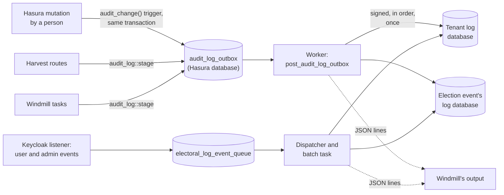

<!--
SPDX-FileCopyrightText: 2026 Sequent Tech Inc <legal@sequentech.io>
SPDX-License-Identifier: AGPL-3.0-only
-->

# Tenant log and audit entries

Every administrative action is logged. Actions inside an election event go to that event's log, as
before. Actions outside any event (Admin Portal sign-ins, staff accounts and roles, tenant settings,
templates, and creating, importing, archiving and deleting election events) go to a **tenant log**,
which each tenant has next to its events' logs. This page describes how both are written. The
[design](01-electoral-log-design.md) describes the log store itself: records, appends, the Merkle
tree, checkpoints and audits.

Section 13 lists what the design of this feature asked for and the code does not do yet.

## 1. Overview



Two paths write audit entries:

- **The outbox.** A change made through Hasura, a Harvest route or a Windmill task writes a row of
  `sequent_backend.audit_log_outbox` in the transaction of the change. A worker signs the rows and
  appends them to their log afterwards (sections 4 to 6).
- **The Keycloak queue.** Keycloak's event listener publishes the user events and the admin events
  of tenant realms and event realms to the existing event queue, and the batch task appends them
  (section 7).

A row or an event without an election event belongs to the tenant log.

## 2. Databases, boards and keys

| Thing | Name | Where |
| --- | --- | --- |
| A tenant's log database | `<base>_t<tenant ID as 32 hexadecimal digits>` | The electoral-log server; listed in `electoral_log_tenants` of the base database |
| A tenant's board | `<ENV_SLUG>tenant<tenant ID without hyphens>` (`get_tenant_board`) | The tenant's log database |
| A retired event database | `<base>_r<seconds since the epoch>_<event ID as 32 hexadecimal digits>` | The electoral-log server; listed in `electoral_log_retired_events` |
| The tenant log's system key | Secret `boards/<board>/protocol-manager`, without an election event | `sequent_backend.secret`, like the events' protocol-manager keys |

`<base>` is `ELECTORAL_LOG_PG_DATABASE`. A tenant database has the same schema as an event's
(`packages/electoral-log/schema.sql`), one board and one Merkle log.

- **Routing.** `EventDatabases::board_store` routes a board to its database by its name
  (`owner_of_board`): a name that ends with `event` and 32 hexadecimal digits is an event's, one that
  ends with `tenant` and 32 hexadecimal digits is a tenant's. Any other name is refused.
- **Creation.** `ensure_tenant_log` (Windmill, `services/electoral_log_board.rs`) returns the board
  and the system key, creating the database (`EventDatabases::create_tenant`), the board and the key
  the first time. Callers take turns on the advisory lock `tenant-log:<tenant>`. The key is saved in
  the caller's Hasura transaction: a caller that rolls back makes the next call generate a new key,
  for a log that holds no entry signed with the lost one.
- **When.** `insert_tenant` creates the log with the tenant and stages the tenant's creation as its
  first entry. Tenants that existed before get theirs from the one-off migration (section 11), and any
  writer or export that reaches a tenant without a log creates it.
- **Admin keys.** An administrator's signing key is one per tenant. `get_admin_user_signing_key`
  creates it on first use and `ElectoralLog::post_admin_pk` appends its `AdminPublicKey` record to
  the tenant log, not to the log of the event where the administrator happened to act first.

### 2.1 New columns

`electoral_log_messages` has two new nullable columns, `event_type` and `log_type`, copied out of the
signed statement's head so that lists can filter by them. They are not part of a record's commitment,
so they change no Merkle root. Appends fill them; `PostgresStore::backfill_statement_heads` fills
them for records stored earlier (section 12).

## 3. Entry kinds

`AuditStatementKind` (`packages/electoral-log/src/messages/newtypes.rs`) has five kinds, each also a
`StatementType` of the same name. They share one statement body, `StatementBody::Audit(AuditLogEntry)`:

```json
{"Audit": {
  "kind": "AdminChange",
  "event_type": "USER",
  "log_type": "INFO",
  "description": "Updated tenant \"acme\": settings.logs_timezone",
  "details_json": "<the details below, as a JSON string>",
  "entry_id": "<the outbox row's id, or the delivery ID for a Keycloak admin event>"
}}
```

The entry sets the statement head's kind, event type, log type and description. The details are
inside the signed statement, so who acted and what changed are signed. The message's `user_id` and
`username` stay outside the signature, as for every record, and are used for filtering.

`StatementBody::Audit` and the five `StatementType` variants are appended to their enums, which keeps
the Borsh encoding of the existing ones. Readers must be upgraded before writers emit the new
variant.

### 3.1 AdminChange

Written through the outbox for a change made through Hasura, Harvest or Windmill.

```json
{
  "object": {"type": "tenant", "id": "<uuid or key>", "name": "acme"},
  "action": "update",
  "actor": {"user_id": "…", "username": "…", "role": "admin-user"},
  "origin": "hasura",
  "changes": [
    {"path": "settings.logs_timezone", "old": "UTC", "new": "Asia/Manila"},
    {"path": "settings.gapi_key", "secret": true},
    {"path": "email.html_body", "old_sha256": "…", "new_sha256": "…"}
  ],
  "extra": {"count": 2, "file_sha256": "…"}
}
```

| Field | Values |
| --- | --- |
| `object.type` | A table name without its schema (`tenant`, `election_event`, `election`, `template`, …), or `staff_account`, `voter`, `role`, `permission`, `phone_blacklist`. `object.id` is `*` for an entry that stands for several objects (a bulk deletion, an import, an export) |
| `action` | `create`, `update`, `delete`, `import`, `export`, `archive`, `unarchive`, `enable`, `disable`, `reset_password`, `grant`, `revoke` (`AdminAction`) |
| `actor` | The person. Every field can be `null`: a task queued without its administrator writes a SYSTEM entry without an actor |
| `origin` | `hasura`, `harvest` or `windmill` (`AuditOrigin`) |
| `changes` | One element per changed field. `old` or `new` is absent when there was no value. A secret has `"secret": true` and no values. A long text has `old_sha256` and `new_sha256` instead of values |
| `extra` | Present only when the entry has facts that are not field changes: an import's or export's `count`, `document_id` and `file_sha256`, a deleted event's log state (section 8) |

The worker adds two things when it signs a row: the actor's `username`, when the row was queued
without one, and `rerouted_from_election_event`, when the entry was queued for an election event that
no longer exists (section 4.3).

An entry is `USER` when it has an actor with a user ID and `SYSTEM` otherwise. Its log type is `INFO`.

### 3.2 Secrets and long texts

The same two rules are implemented twice, in `services/audit_log.rs` for Harvest and Windmill and in
the database for the trigger. Change them together.

- **Secrets.** `is_secret_path` (Rust) and `sequent_backend.audit_is_secret` (SQL) take a dotted
  path. Each segment is read as snake_case words, whatever its case (`clientSecret` is
  `client_secret`). The path names a secret when a segment ends in `password`, `passwords`, `passwd`,
  `pwd`, `passphrase`, `secret`, `secrets`, `token`, `tokens`, `credential`, `credentials`,
  `authorization`, `apikey`, `apikeys` or `access_key_id`, or in `key` or `keys` after `api`, `gapi`,
  `private`, `secret`, `signing`, `access`, `auth`, `client` or `encryption`, optionally followed by
  `_hash` or `_salt`. A name that only starts with or contains such a word (`password_policy`,
  `token_length`, `public_key`) is not a secret.
- **Arrays.** Objects are compared key by key, so a secret key inside an object is found at any
  depth. A value compared whole, such as an array, is different: the trigger blanks the secrets inside
  it (`audit_redact` replaces each with `{"secret": true}`), but `diff_values` in Rust records it as it
  is. Do not pass an array that can hold secrets to `diff_values`; build its `FieldChange` yourself, as
  `services/audit.rs` does with `secret_change`.
- **Long texts.** When the old or the new value is longer than 64 KB (`LONG_TEXT_BYTES`, 65,536 bytes
  of the string, or of the JSON text of an array or object), the change carries the SHA-256 of each
  value instead of the values.

Harvest also treats as a secret any realm attribute that Keycloak's own redaction hides
(`realm_attribute_changes`).

### 3.3 KeycloakUserEvent

The existing statement, `{"KeycloakUserEvent": ["<text>", "<EVENT_TYPE>"]}`. For a tenant realm's
event the text is a JSON object, built by the listener's `UserEventDetails`:

```json
{
  "client_id": "admin-portal",
  "ip_address": "10.0.0.7",
  "error": "invalid_user_credentials",
  "auth_method": "openid-connect",
  "auth_type": "code",
  "credential_type": null,
  "identity_provider": "…",
  "unknown_account": true,
  "details": {"…": "the remaining Keycloak details"}
}
```

- `identity_provider` is present only when Keycloak gave one, and `unknown_account` only for an event
  about an account the realm does not have. For such an event the record has no user ID and no
  username, and the details leave out what was typed (`username`, `email`,
  `identity_provider_identity`).
- A Keycloak detail whose name contains `password`, `secret`, `token` or `code` is never sent.
- An event that could not be placed in its election event's log has `unplaced`:
  `{"election_event_id", "reason"}`, and `error` is `event_not_placed` when Keycloak gave none
  (section 7.2).
- **Log type.** `StatementHead::from_body` makes the entry `ERROR` when the event type contains
  `ERROR` or `LOCKOUT`, or when the JSON text has a non-null `error`; otherwise `INFO`. The
  description is the event type followed by the error.

Event realms' events keep their plain text. They also receive the `details` object from the listener,
but the batch task uses it only for tenant-log records.

### 3.4 KeycloakAdminEvent

Written by the batch task for a Keycloak admin event (section 7).

```json
{
  "operation": "CREATE",
  "resource_type": "REALM_ROLE_MAPPING",
  "resource_path": "users/<id>/role-mappings/realm",
  "representation": [{"name": "tenant-write"}],
  "error": null,
  "actor": {"user_id": "…", "username": "…", "client_id": "security-admin-console",
            "realm": "master", "ip_address": "10.0.0.7"},
  "made_by": "OPERATOR"
}
```

- `made_by` is `SERVICE_ACCOUNT` when the actor's username is `service-account-<client>`, where
  `<client>` is `KEYCLOAK_ADMIN_CLIENT_ID`, and `OPERATOR` for anyone else. A service account's entry
  is `SYSTEM`; an operator's is `USER`. The log type is `ERROR` when `error` is not null.
- `representation` is `null` when Keycloak sent none. The listener redacts it
  (`AdminRepresentation`): a text or container value under a key that contains `password`, `secret`,
  `private_key`, `privateKey`, `token` or `bindCredential`, or under a path that matches
  `credential…value`, becomes `**redacted**`. A representation over 64 KB after redaction is replaced
  by `{"sha256": "…", "truncated": true}`.
- The description is `Keycloak: <operation> <resource_type> <resource_path>`. The statement's
  timestamp is the time Keycloak gave the event. `entry_id` is the event's delivery ID.

### 3.5 LogsExported

```json
{
  "format": "SQL",
  "scope": "TENANT_LOG",
  "username": null,
  "election_id": null,
  "area_id": null,
  "created_from": "2028-02-01T00:00:00Z",
  "created_to": null,
  "time_zone": "Asia/Manila",
  "entries": 1234,
  "sha256": "<hex SHA-256 of the stored file>",
  "document_id": "<uuid>",
  "actor": {"user_id": "…", "username": "…", "role": null}
}
```

`format` is `CSV`, `SQL` or `PDF`. `scope` is `TENANT_LOG`, `ACCOUNT` or `ACCOUNT_WITH_EVENTS` for the
tenant log, and `ALL`, `ELECTION`, `AREA` or `ACCOUNT` for an event's log.

### 3.6 LogWriterStarted and LogWriterStopped

```json
{"release": "<APP_VERSION, or - when unset>", "last_entry_id": "<uuid or null>"}
```

`last_entry_id` is the outbox ID of the last entry the outbox posted to that tenant's log. Both are
`SYSTEM` entries of every tenant's log (section 4.4).

### 3.7 TenantAdminAction

A request to Harvest that belongs to no election event, whatever its outcome. Its body is not
`Audit` but `StatementBody::TenantActivity(TenantActivityEntry)`, which has the same fields but
`entry_id`; the statement type `TenantAdminAction` (and `TenantLogOpened`, the other
`TenantActivityKind`) comes before the five audit kinds. `TenantActivity` is Borsh variant 43 of
`StatementBody` and `Audit` is 44. As for `Audit`, the entry sets the head's kind, event type, log
type and description; the head's event is `Generic Event` (`GENERIC_EVENT`).

```json
{
  "action": "delete-election-event",
  "outcome": "denied",
  "status": 403,
  "user_id": "<uuid>",
  "username": "maria",
  "details": {"election_event_id": "<uuid>"}
}
```

- `outcome` is `succeeded`, `denied` or `failed`, and `status` the HTTP status of the answer. A
  denied or failed request is an `ERROR` entry, a succeeded one `INFO`. "Succeeded" means Harvest
  took the request: an import or a deletion continues as a task, which writes its own `AdminChange`.
- `details` is what the request named, such as the election event's ID or the role.
- The entries are signed by the tenant log's system key.

The requests recorded are those of election events (create, import, delete), staff accounts
(create, edit, delete, import, export), roles and permissions, tenants (create, delete), the tenant's
configuration (import, export), templates (import) and country limits. The routes shared with voters
(`/create-user`, `/edit-user`, `/delete-user`, `/delete-users`, `/import-users`, `/export-users`)
record only when the request names no election event.

**How an entry is written.** A route's handler takes a `TenantActivityRecorder`
(`packages/harvest/src/services/tenant_activity.rs`) and calls `record(&claims, TenantAction::…,
details)` before it authorizes the caller. Once the request is answered, the `tenant_activity` fairing
adds the status and the outcome and enqueues the event on `electoral_log_event_queue` with an empty
`election_event_id` and the `message_type` `tenant_activity`. A handler that records nothing queues
nothing. The batch task (section 7.2) appends it to the tenant log. To record a new action, add a
variant to `TenantAction` with its sentence and call `record` in the route.

The Admin Portal shows a `TenantAdminAction` entry's details as lines under the facts of the entry
popup (`StatementExplanation`): the action, the outcome with its status, who asked and each detail.

## 4. The outbox and its worker

### 4.1 The table

`sequent_backend.audit_log_outbox` is created by the migration
`hasura/migrations/backend-db/1791600000000_audit_log_outbox`. Hasura does not track it.

| Column | Content |
| --- | --- |
| `id` | The entry's ID (UUID). It becomes `entry_id` and the delivery ID |
| `seq` | A `bigserial`: the order in which entries are posted |
| `tenant_id`, `election_event_id` | The log. A `NULL` election event is the tenant log. Nothing references the event, because rows outlive it |
| `statement_kind`, `event_type`, `log_type` | Checked against the known values, since an unknown kind would stop the worker at that row |
| `user_id`, `username`, `election_id`, `area_id` | The record's metadata |
| `description`, `details` | The entry's description and its details (`jsonb`) |
| `occurred_at` | When the action happened; it becomes the statement's timestamp |
| `posted_at` | Set when the entry is on its log. Posted rows are kept; nothing purges them |
| `attempts`, `last_error`, `last_attempt_at` | Failed attempts to post |
| `created_at` | When the row was queued; the backlog's age is measured from it |

A partial index on `(tenant_id, election_event_id, seq) WHERE posted_at IS NULL` serves the worker.

### 4.2 A pass

`post_audit_log_outbox` (Windmill, `tasks/audit_log_outbox.rs`) runs on `electoral_log_beat_queue`.
Beat schedules it every 5 seconds (`--audit-log-interval`), and `kick_audit_log_outbox()` sends it
right after a change commits. It has no retries, expires after 30 seconds in the queue and has a
300-second time limit; a later message posts whatever an earlier one left.

One pass (`post_audit_log_outboxes`) lists the logs with unposted rows and, for each one
(`post_target`):

1. **Prepares the log** in a transaction of its own: the board and its system key, and the admin key
   of every person with unposted `USER` rows, creating the tenant log and missing admin keys. A key
   created here is kept even if the posting transaction rolls back.
2. **Takes the log's worker lock**, `pg_try_advisory_xact_lock` on `audit-log-worker:<tenant>:<event>`,
   without waiting. A pass that does not get it leaves the log to the worker that holds it.
3. **Reads up to 200 unposted rows** in `seq` order, `FOR UPDATE`.
4. **Signs each row** (`sign_row`). A `USER` row with a user ID is signed by that person's admin key
   as the sender, under their username (looked up in Keycloak when the row has none, as rows queued by
   the trigger do, and falling back to the user ID). Any other row is signed by the log's system key
   alone. The system key always makes the system signature. The statement's timestamp is
   `occurred_at`; the record's `created` is when it is posted.
5. **Appends** the signed entries to the board in one append.
6. **Marks them posted** and commits.
7. **Writes one monitoring line per entry** (section 10).

Each log has its own transactions, so one that fails does not hold up the others.

### 4.3 Guarantees

- **Only committed changes.** A row is written in the transaction of its change. A change that rolls
  back leaves no row.
- **Order.** A log's entries are posted in `seq` order, and a failure stops the log at the failed
  entry: nothing after it is posted before it.
- **Once.** An entry's delivery ID is `audit:<outbox id>`, and a board stores a delivery ID once
  ([design](01-electoral-log-design.md), section 6.4). A pass that appends and then fails to commit
  appends nothing new when it runs again.
- **Retries.** When the log refuses an append, nothing is marked posted and the first row is marked
  failed. When a row cannot be read or signed, the rows before it are posted and that row is marked
  failed. A failed row is tried again `2^attempts` seconds after its last attempt, at most 10 minutes;
  until then the pass skips that log (`PassOutcome::Backoff`). From the fifth failed attempt the
  worker logs an error, `An audit log entry keeps failing; its log is held up`. Entries wait in the
  outbox for as long as a log or the worker is down.
- **Deleted events.** When a row names an election event that no longer exists, or one without a
  board, the worker posts it to the tenant log instead, with `rerouted_from_election_event` in its
  details and the tenant as the statement's event.

### 4.4 The writer starting and stopping

A Windmill worker that consumes `electoral_log_beat_queue` queues a `LogWriterStarted` entry for
every tenant when it starts consuming, and a `LogWriterStopped` entry for every tenant when
consuming ends (`record_log_writer`, called from `bin/main.rs`). The start is queued in the
background and tried again every 15 seconds, up to 40 times, while the database is not ready, as
when the worker starts before the migrations ran. A failure to queue them is logged and does not
stop the worker. A worker that is killed queues no `LogWriterStopped`.

## 5. Changes made through Hasura

The migration creates the trigger function `sequent_backend.audit_change()` and an `audit_change`
trigger (`AFTER INSERT OR UPDATE OR DELETE … FOR EACH ROW`) on every table a person can write through
Hasura.

For each row a person changes, the function:

1. **Reads the Hasura session** from the transaction setting `hasura.user`: the user ID, the role and
   the tenant.
2. **Returns without logging** when there is no session (a direct SQL statement, Harvest, Windmill),
   when the role is `admin` or `service-account` (Step's own writes, which log themselves), when the
   row was written by another trigger (`pg_trigger_depth() > 1`), or when a deleted row went with a
   parent it references `ON DELETE CASCADE` (`audit_deleted_by_cascade`).
3. **Compares the old and new row** column by column, ignoring `created_at`, `updated_at` and
   `last_updated_at`. A JSON object column is compared key by key under dotted paths
   (`settings.logs_timezone`); anything else is compared whole. The secret and long-text rules of
   section 3.2 apply.
4. **Chooses the log.** A row with an `election_event_id` goes to that event's log; any other row goes
   to the tenant log. For `election_event` itself, an insert and a delete are tenant-log entries; an
   update to `is_archived` is a tenant-log entry with the action `archive` or `unarchive`, and its
   other changes are an `update` entry in the event's own log.
5. **Writes the outbox row** in the same transaction, as a `USER` `AdminChange` with `origin`
   `hasura`. The object's name is its `name`, `alias`, `slug`, `title`, `username` or `email`, or the
   name in its `presentation` (`audit_object_name`). The username is left `NULL`: the worker reads it
   from Keycloak.

An update that changes nothing but the ignored columns writes no row.

### 5.1 The coverage test

`hasura/tests/audit-change-coverage.test.cjs` reads the Hasura metadata and the migrations and fails
when a table that a role other than `service-account` can insert into, update or delete from has no
`audit_change` trigger. CI runs it with the other Hasura tests:

```bash
yarn --cwd hasura install --frozen-lockfile
node --test hasura/tests/audit-change-coverage.test.cjs
```

The only exemption is `sequent_backend.tasks_execution`: task bookkeeping rows the portal's widgets
create, not configuration. An exemption must give its reason, and the test also fails for an
exemption that names a table nobody can write or one that has the trigger.

### 5.2 Adding a table a person can write

When a new table gets an insert, update or delete permission for a role other than `service-account`:

1. Add the trigger in the migration that creates the table or its permission, in exactly this form,
   which is the one the test recognizes:

   ```sql
   CREATE TRIGGER audit_change AFTER INSERT OR UPDATE OR DELETE ON sequent_backend.<table>
       FOR EACH ROW EXECUTE FUNCTION sequent_backend.audit_change();
   ```

2. Give the table a `tenant_id` column, and an `election_event_id` column if its rows belong to an
   event: the function reads both from the row, and falls back to the session's tenant.
3. Check that its secret columns and keys are caught by `audit_is_secret`. If one is not, rename it
   or extend the rule in both `audit_is_secret` and `is_secret_path`.
4. Run the coverage test, and `packages/windmill/tests/postgres_audit_change.rs` if the function
   changed.

Add an exemption only for rows that are not configuration, with the reason.

## 6. Changes made by Harvest and Windmill

Code that changes state outside Hasura queues its own entry:

- build an `AdminChange` (`windmill::services::audit_log`): the target log, the object, the action,
  the actor and the origin, with `diff_values` for the changed fields;
- call `audit_log::stage(&transaction, &change)` **in the transaction of the change**, so the entry
  exists exactly when the change commits;
- call `kick_audit_log_outbox()` **after the commit**. It returns at once and never fails; beat posts
  the entry anyway within its interval.

From `packages/harvest/src/routes/phone_blacklist.rs`:

```rust
    stage(
        &hasura_transaction,
        &audit_entry(&claims, &entry, AdminAction::Create)?,
    )
    .await
    .context("Failed to queue the electoral log entry")
    .map_err(|e| (Status::InternalServerError, format!("{e:?}")))?;

    hasura_transaction.commit().await.map_err(|e| {
        (
            Status::InternalServerError,
            format!("Failed to commit the transaction: {e:?}"),
        )
    })?;
    kick_audit_log_outbox();
```

`audit_entry` builds the change with the helpers of `packages/harvest/src/services/audit.rs`
(`audit::target`, `audit::change`, and one constructor per kind of object), which take the actor from
the request's claims and set the origin to `harvest`.

- **Changes Keycloak makes** have no database transaction to share. The route reads the account or
  role before the call, makes the call, and then queues the entry in a transaction of its own
  (`audit::record`), so only a change that happened is logged. If queueing fails, the route answers
  500 with `The change was made, but its audit entry could not be queued`; Keycloak's own admin event
  (section 7) still records the change.
- **Tasks** use `windmill::services::task_audit`. The route passes the administrator as an optional
  task input, so a message queued before the input existed still runs and writes an entry without an
  actor. An import, an export or a bulk change is one entry (`task_audit::bulk`) with its count and the
  file's SHA-256 in `extra`, not one per row.
- **Targets.** `audit::target` and `task_audit::target` return the event's log when given an election
  event and the tenant log otherwise. Accounts follow their realm: an account of an event realm is a
  `voter` in the event's log, one of the tenant realm a `staff_account` in the tenant log.

What queues entries today:

| Where | Entries |
| --- | --- |
| Harvest `routes/users.rs` | Account created, edited (also enabled, disabled, password reset), deleted, several deleted |
| Harvest `routes/roles.rs`, `routes/permissions.rs`, `services/role_permissions.rs` | Role given to or removed from an account; role created or deleted; permission created or deleted; permission added to or removed from a role |
| Harvest `routes/phone_blacklist.rs` | Number added or removed (event log) |
| Harvest `routes/realm_attributes.rs`, `routes/realm_password_policy.rs`, `routes/set_voter_authentication.rs` | Changes to an event realm's attributes, password policy and voter authentication (event log) |
| Windmill `tasks/insert_tenant.rs` | Tenant created |
| Windmill `tasks/insert_election_event.rs`, `tasks/import_election_event.rs`, `tasks/delete_election_event.rs` | Election event created, imported, deleted (tenant log) |
| Windmill `tasks/import_templates.rs`, `tasks/export_templates.rs` | Templates imported, exported |
| Windmill `tasks/import_tenant_config.rs`, `tasks/export_tenant_config.rs` | Tenant configuration imported, exported |
| Windmill `tasks/import_users.rs`, `tasks/export_users.rs`, `tasks/delete_users.rs` | Accounts imported, exported, voters deleted in bulk |
| Windmill `tasks/export_audit_logs.rs`, `tasks/activity_logs_report.rs` | `LogsExported` |

## 7. Keycloak events

### 7.1 The listener

`custom-event-listener` reads the log from the realm's name (`LogRealm`): `tenant-<tenant>-event-<event>`
is an event realm, `tenant-<tenant>` a tenant realm, and any other realm, such as `master`, is not
logged. It publishes `enqueue_electoral_log_event` messages to `electoral_log_event_queue`, as before,
with these additions to the task's input:

| Field | Content |
| --- | --- |
| `election_event_id` | `""` for a tenant realm's event |
| `details` | Sent with every user event (section 3.3) |
| `admin_event` | Sent with an admin event, whose `message_type` is `KEYCLOAK_ADMIN_EVENT` (section 3.4, without `made_by`) |

- **User events of a tenant realm** are filtered (`TenantRealmEvents`). An event is kept when it has
  an error, when its type ends in `_ERROR`, or when its type is one of `LOGIN`, `LOGOUT`, `REGISTER`,
  `IDENTITY_PROVIDER_LOGIN`, `IDENTITY_PROVIDER_FIRST_LOGIN`, `IMPERSONATE`, `UPDATE_PASSWORD`,
  `RESET_PASSWORD`, `SEND_RESET_PASSWORD`, `UPDATE_TOTP`, `REMOVE_TOTP`, `UPDATE_CREDENTIAL`,
  `REMOVE_CREDENTIAL`, `FEDERATED_IDENTITY_LINK`, `REMOVE_FEDERATED_IDENTITY`,
  `USER_DISABLED_BY_TEMPORARY_LOCKOUT`, `USER_DISABLED_BY_PERMANENT_LOCKOUT`, `VERIFY_EMAIL`,
  `UPDATE_EMAIL`, `UPDATE_PROFILE`, `EXECUTE_ACTIONS`, `CUSTOM_REQUIRED_ACTION` and `DELETE_ACCOUNT`.
  Successful token refreshes, code exchanges and client logins are dropped. Event realms' user events
  are all sent, as before.
- **Admin events** of tenant realms and event realms are all sent, with the representation when the
  realm has admin event details on.
- **The realm** needs `custom-event-listener` among its event listeners, and `adminEventsEnabled` and
  `adminEventsDetailsEnabled` on. The development tenant realm template and the janitor's client
  template have them; existing tenant realms get them from the one-off migration (section 11).

### 7.2 The batch task

`process_electoral_log_events_batch` (`tasks/electoral_log.rs`) places each event of a batch on its
own:

| Event | Result |
| --- | --- |
| A `tenant_activity` message from Harvest (section 3.7) | A `TenantAdminAction` record in the tenant log, signed by its system key. One that names an election event is dead-lettered |
| A message Keycloak sends to an account, such as a sign-in code | A `KeycloakUserEvent` record with the event type `MESSAGE_SENT`. The message's text is left out |
| A user event without an election event | A `KeycloakUserEvent` record in the tenant log, signed by its system key. An authenticator reports the steps of a sign-in (a code sent, a code checked) as `LOGIN` events of their own: those are recorded as `LOGIN_STEP`, so one sign-in reads as one `LOGIN` |
| An admin event without an election event | A `KeycloakAdminEvent` record in the tenant log, `SERVICE_ACCOUNT` or `OPERATOR` |
| An admin event of an event realm made by an operator | A `KeycloakAdminEvent` record in the event's log |
| An admin event of an event realm made by Step's service account | Nothing: what made the change records it |
| A Keycloak event whose election event does not exist, has no board or has no protocol-manager key | A `KeycloakUserEvent` record in the tenant log with log type `ERROR` and `unplaced` in its text. The rest of the batch is stored |
| An internal message (built by the backend) without an election event, or whose event does not exist | Dead-lettered, as before |
| A message without a delivery ID, with an invalid tenant ID or with a malformed body | Dead-lettered, as before |

The dispatcher still sends a message it cannot parse to `electoral_log_dead_letter_queue` in its
handoff transaction, so it does not block the queue ([design](01-electoral-log-design.md), section
6.5). Records are stored under the delivery ID `<delivery ID>:event`, as other queued events.

## 8. Deleting an election event

`delete_election_event` (Windmill) no longer drops the event's log database.

1. **In the transaction that deletes the event**, before anything is removed,
   `stage_election_event_deletion` queues the tenant log's `AdminChange` (`delete`, object
   `election_event`) with the state of the event's log in `extra`:

   ```json
   {
     "status": "RETIRED",
     "log": "<the event's board>",
     "log_database": "<base>_r<seconds>_<event hex>",
     "last_entry_id": 5259,
     "entries": 5259,
     "state_hash": "<hex of the board's Merkle root>",
     "log_uid": "<the Merkle log's identity>",
     "task_id": "<the deletion task's execution ID>"
   }
   ```

   `entries` and `state_hash` are the board's checkpoint: its size and root. An event without a log
   database has `{"status": "ABSENT", "task_id": …}`.
2. **After the commit**, the task kicks the outbox and calls `EventDatabases::retire_event`: it sets
   `ALLOW_CONNECTIONS false` on the database, terminates the connections to it, renames it to the name
   recorded in the entry, and moves its catalog row from `electoral_log_events` to
   `electoral_log_retired_events`. Its records, Merkle data and ballot box stay as they were.

Retiring cannot be rolled back, so it runs only once the deletion is committed. If the deletion
fails, nothing is retired and no entry is posted. `EventDatabases::retired_events` lists a tenant's
retired databases.

Entries still queued for the deleted event are posted to the tenant log (section 4.3), and Keycloak
events that still name it become `ERROR` entries there (section 7.2).

## 9. Reading and exporting

### 9.1 Listing

`listElectoralLog` takes an optional `election_event_id`. Without one (absent, `null` or empty),
Harvest's `POST /electoral-log` reads the caller's tenant log and requires `tenant-logs-read`,
answering 403 otherwise. The action takes the tenant from the Hasura session, and Harvest checks it
against the caller's token. With an election event, it behaves as before and requires `logs-read`.

- `ElectoralLogFilter` has `event_type` and `log_type`. They match the whole value, in any case,
  against the new columns.
- The action also takes `election_id` and `area_ids`.
- The Hasura action accepts the roles `logs-read`, `admin-user` and `tenant-logs-read`. The Admin
  Portal sends tenant-log requests with the role `tenant-logs-read`.

### 9.2 Exports

| Action | Harvest route | Permission | Task type |
| --- | --- | --- | --- |
| `export_tenant_logs(format, scope, username, created_from, created_to, time_zone)` | `POST /export-tenant-logs` | `tenant-logs-export` (403 otherwise) | `EXPORT_TENANT_LOGS` |
| `export_election_event_logs(election_event_id, format, created_from, created_to, time_zone, scope, election_id, area_id, username)` | `POST /export-election-event-logs` | `logs-export` (it was `report-write`) | `EXPORT_ACTIVITY_LOGS_REPORT` |

- **Which code writes the file.** A tenant export, and an event export with a scope other than `ALL`
  or with the `SQL` format, run the `export_audit_logs` task (`services/audit_log_export.rs`). The
  whole event as CSV or PDF still runs the activity logs report. Both record the export.
- **Scope and range.** `AuditExportRequest::validate` refuses a scope that does not fit the log, or
  one without the username, election or area it names (400). `created_from` and `created_to` are RFC
  3339 instants; the range includes both ends to the minute (`MinuteRange`), as the list's does. An
  account is matched by its exact username.
- **Account with events.** `ACCOUNT_WITH_EVENTS` reads the tenant log and the log of every election
  event of the tenant that has a board and a key, and merges the rows by `created`, then log, then ID.
- **Timezone.** `time_zone` is an IANA name. Without it, a tenant export uses the tenant setting
  `logs_timezone` (UTC when it is not set) and an event export uses UTC.
- **Rows.** Each row (`AuditExportRow`) has `log` (`tenant` or `event <event ID>`), `id`, `created`,
  `statement_timestamp`, `statement_kind`, `event_type`, `log_type`, `user_id`, `username`,
  `description`, `message` (the message as JSON), `statement` (the Borsh bytes that were signed),
  `sender_name`, `sender_public_key`, `sender_signature`, `system_signature`, `created_utc`,
  `created_local` and `time_zone`. CSV writes the bytes and signatures in base64.
- **SQL.** One transaction: `CREATE TABLE audit_log`, one `INSERT` per row with `statement` and the
  signatures as `bytea`, then `CREATE TABLE audit_log_export (manifest JSONB)` with the manifest: the
  format, scope, range, timezone, entry count and, for each log read, its name, its system public key
  and its entry count.
- **PDF.** The export's facts and a table without signatures, rendered with `PdfRenderer`.
- **Recording.** The task stores the file as a document and, in the same transaction, queues a
  `LogsExported` entry (section 3.5) in the log it exports, with the SHA-256 of the stored file. An
  `ACCOUNT_WITH_EVENTS` export is recorded in the tenant log only.

[Verify a tenant log export](../../04-election_auditors/02-tutorials/07-auditor_verify-tenant-log-export.md)
shows how an auditor loads the SQL file and checks its signatures.

### 9.3 Admin Portal

| File | Role |
| --- | --- |
| `screens/SettingsScreen.tsx`, `services/settingsAccess.ts` | Which Settings tabs someone sees (`ESettingsAccess`): `settings-menu` opens Settings, `tenant-write` shows the configuration tabs, `tenant-logs-read` shows Logs |
| `resources/Settings/SettingsLogs.tsx` | The Logs tab: `ElectoralLogList` with `scope={ELogScope.TENANT}` |
| `components/ElectoralLogList.tsx`, `components/logs/logScope.ts` | The list for both logs, its filters and its layouts by width |
| `components/logs/LogEntryDialog.tsx`, `logEntryDetails.ts`, `logFieldLabels.ts` | The entry popup, the typed view of a row's message, and the translatable labels of known fields |
| `components/logs/ExportLogsDialog.tsx`, `exportLogsRequest.ts` | The export dialog and the variables of the two export actions |
| `resources/Settings/SettingsLanguages.tsx`, `components/logs/useLogZones.ts` | The tenant setting `logs_timezone` and the zones the tenant log is shown in |
| `services/Permissions.ts` | Someone who holds `tenant-logs-read` and no event read role reads the schema, and their own tenant row (`id`, `slug`, `is_active`, `settings`), as `tenant-logs-read` |

## 10. Monitoring lines

Windmill writes one JSON object per line to its standard output for:

- every entry the outbox worker posts, to a tenant log or an event's log;
- every record the Keycloak batch task stores in a tenant log, and every `KeycloakAdminEvent` it
  stores in an event's log.

```json
{
  "target": "audit_log",
  "log": "<board>",
  "entry_id": 5259,
  "kind": "AdminChange",
  "event_type": "USER",
  "log_type": "INFO",
  "time": "2028-02-03T04:05:06Z",
  "user_id": "…",
  "username": "…",
  "object": {"type": "tenant", "id": "…", "name": "acme"},
  "action": "update",
  "changed_fields": ["settings.logs_timezone"],
  "ip_address": null,
  "entry_sha256": "<hex SHA-256 of the stored message>"
}
```

| Key | Content |
| --- | --- |
| `entry_id` | The record's ID on its log |
| `time` | The statement's timestamp, in UTC |
| `object`, `action` | For `AdminChange`, its object and action. For `KeycloakAdminEvent`, `{"type": resource_type, "id": resource_path}` and the operation. For `KeycloakUserEvent`, `action` is the Keycloak event type and `object` is `null` |
| `changed_fields` | The paths of an `AdminChange`'s changes. Old and new values are never written |
| `ip_address` | For Keycloak user and admin events |

After each pass that leaves entries waiting, the worker also writes the backlog:

```json
{"target": "audit_log_outbox", "waiting": 3, "oldest_seconds": 412.7}
```

`waiting` is the number of unposted rows and `oldest_seconds` the age of the oldest. No line is
written while the outbox is empty. Alert rules and forwarding to a SIEM belong to the deployment.

## 11. The one-off migration

Beat schedules `migrate_tenant_logs` once, whenever it starts (`short_queue`). It is idempotent:

1. For every tenant, `ensure_tenant_log` creates the log and its key if they are missing, each tenant
   in a transaction of its own.
2. For every tenant realm, `set_up_realm` adds `custom-event-listener` to the realm's event listeners
   and turns on `adminEventsEnabled` and `adminEventsDetailsEnabled`, when any of the three is
   missing. A realm that already has them is left as it is.

Every realm is tried. If any failed, the task fails naming them and is retried up to five times with
a growing wait, as when Keycloak is still starting with beat.

3. For every tenant realm, `grant_tenant_log_roles` adds the realm roles `tenant-logs-read` and
   `tenant-logs-export` when the realm lacks them and grants them to the `admin` group, as the realm
   templates do.

## 12. Operating notes

- **Existing event databases.** Run the new build's `electoral-log-admin upgrade-event-databases`
  before starting the new Windmill and Harvest: appends write the `event_type` and `log_type` columns,
  so they fail on an event database that does not have them yet. The command applies the schema to
  every registered event database (or to one with `--election-event-id`) and fills the two columns of
  the records stored earlier, 2,000 at a time; a record whose message cannot be read keeps them empty
  and does not match an **Event Type** or **Log Type** filter.
- **Catalog.** `electoral-log-admin init` creates `electoral_log_tenants` and
  `electoral_log_retired_events`; the backend also creates them when it initializes the catalog.
- **Tenant databases** are created by the provisioning role, like event databases, and are not listed
  by `list-event-databases`. `upgrade-event-databases` does not reach them: a tenant database gets
  the schema when it is created.
- **Retired databases** stay on the server and keep their size. Include them in backups for as long
  as they must be kept.
- **Permissions.** Exporting an event's logs now needs `logs-export`. Roles that exported with
  `report-write` need it after the upgrade.
- **Realm template.** A deployment that stores the tenant realm template outside the repository must
  update it with the listener, the two admin event settings and the two realm roles before new
  tenants get them.
- **A stuck log.** `SELECT id, seq, attempts, last_error FROM sequent_backend.audit_log_outbox WHERE
  posted_at IS NULL ORDER BY seq` shows what waits and why. The worker retries by itself once the
  cause is fixed.

## 13. Not implemented relative to the design

- **Signing entries keep their own outbox.** The signatures feature still stages its entries in
  `signing_log_outbox`, posted by `post_signing_log_outbox`. It was not moved to `audit_log_outbox`.
- **Certificate authority routes are unchanged.** Importing and deleting a certificate authority
  still post their own record directly, after their change, and log an error if posting fails. Writes
  to `certificate_authority` through Hasura are covered by the trigger.
- **Not every route queues an `AdminChange`.** Only the routes and tasks of the table in section 6
  do. Other Harvest routes that change an event (areas, elections, dates, voting status, ceremonies,
  tallies, publications, scheduled events, reports, applications, the approval matrix, monitoring
  configuration and others) were not changed: they write the statements they wrote before, or none,
  and carry no old and new values. Exporting an election event writes no audit entry.
- **Erasing a retired database** has no command. Nothing reopens, exports or drops a retired
  database, and `electoral-log-admin drop-event-database` does not find one, because it is no longer
  registered as an event's. Retention and erasure are a separate piece of work.
- **Deleted events are not part of an account's export.** `ACCOUNT_WITH_EVENTS` reads the events that
  exist; a retired database is not read.
- **Deleting a tenant** does not retire or drop its log database.
- **No checkpoints, audits or proofs for the tenant log.** The tenant log has a Merkle log, but no
  code publishes its checkpoints, audits it or serves proofs of it; the Admin Portal offers **Audit**
  only in an election event's Logs tab.
- **A request's `TenantAdminAction` is not transactional.** It is queued after the request is
  answered. If the task-queue database cannot be reached then, the entry is lost and Harvest logs
  `tenant activity: <action> could not be queued`.
- **`AdminPublicKey` is appended directly**, not through the outbox, and has no monitoring line.
- **The SQL manifest has no SHA-256 of the file.** The file's hash is in the export's `LogsExported`
  entry.
- **A deleted event's database is retired, not unloaded.** The design spoke of unloading an immudb
  database and of an immudb state hash. On PostgreSQL the database is renamed and closed to
  connections, and the state hash is the board's Merkle root.
- **Alerting** is not part of Step: the lines of section 10 are written, and collecting them and
  alerting on them is left to the deployment.

## 14. Code map

| Path | What it holds |
| --- | --- |
| `packages/electoral-log/src/adapters/events.rs`, `catalog.sql` | Tenant log databases, retired event databases, board routing |
| `packages/electoral-log/schema.sql`, `src/adapters/postgres.rs` | The `event_type` and `log_type` columns and their backfill |
| `packages/electoral-log/src/messages/newtypes.rs`, `statement.rs`, `message.rs` | `AuditStatementKind`, `AuditLogEntry`, `StatementBody::Audit`, `Message::audit_message` |
| `hasura/migrations/backend-db/1791600000000_audit_log_outbox` | The outbox table, `audit_change()` and its triggers |
| `hasura/tests/audit-change-coverage.test.cjs` | The trigger coverage test |
| `packages/windmill/src/services/audit_log.rs` | `AdminChange`, `diff_values`, the secret and long-text rules, `stage` |
| `packages/windmill/src/postgres/audit_log_outbox.rs` | The outbox queries |
| `packages/windmill/src/services/audit_log_writer.rs`, `tasks/audit_log_outbox.rs` | The worker, the monitoring lines, the writer's start and stop, the kick |
| `packages/windmill/src/services/task_audit.rs` | Entries of tasks |
| `packages/windmill/src/services/audit_log_export.rs`, `tasks/export_audit_logs.rs` | Exports |
| `packages/windmill/src/services/delete_election_event.rs`, `tasks/delete_election_event.rs` | The deletion entry and retiring |
| `packages/windmill/src/tasks/electoral_log.rs` | Keycloak events: tenant log, admin events, unplaced events |
| `packages/windmill/src/tasks/migrate_tenant_logs.rs`, `tasks/migrate_realm_permissions.rs` | The one-off migrations |
| `packages/harvest/src/services/audit.rs` | Entries of Harvest routes |
| `packages/harvest/src/services/tenant_activity.rs` | `TenantActivityRecorder`, its fairing and `TenantAction`: the `TenantAdminAction` entries of requests |
| `packages/harvest/src/routes/electoral_log.rs`, `export_tenant_logs.rs`, `export_election_event_logs.rs` | Listing and exports |
| `packages/keycloak-extensions/custom-event-listener` | `LogRealm`, `TenantRealmEvents`, `UserEventDetails`, `AdminRepresentation` |
