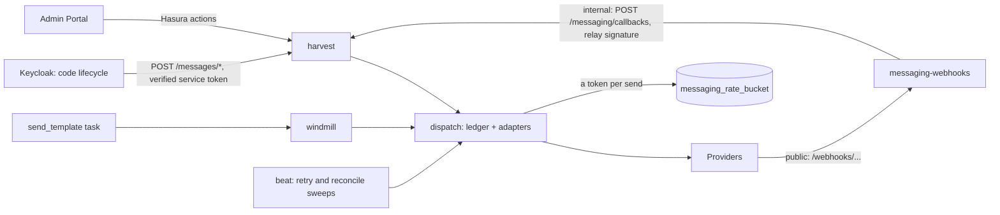

<!--
SPDX-FileCopyrightText: 2026 Sequent Tech Inc <legal@sequentech.io>
SPDX-License-Identifier: AGPL-3.0-only
-->

Codes, enrollment results, credentials and reminders reach voters by
WhatsApp, Viber, Messenger, SMS or email through one sending path shared by
Keycloak and bulk sends. Each voter has one channel, and nothing is ever
sent on another. The administrator's view is described in
[Messaging Channels](../../02-election_managers/02-reference/13-messaging-channels.md);
deployment is in [Messaging deployment](02-messaging-deployment.md).



Harvest is never public. Provider callbacks are the only inbound traffic
from outside, and they reach harvest only through the
[webhook component](#webhook-component).

## Components

| Where | What |
|---|---|
| `sequent-core/src/types/messaging.rs` | Channels, purposes, providers and their capabilities, the attempt state machine, account readiness, the event configuration, its validation and its public projection, and the internal API payloads |
| `sequent-core/src/types/voter_channel.rs` | `voter_channel`: the one rule that reads a voter's channel from Keycloak attributes, mirrored by Java `VoterChannel` |
| `packages/messaging` | Provider adapters behind `ChannelSender`, `preflight`, attempt decisions, destination masking and keyed digests, Messenger link references, rates, webhook verification and parsing, and the relay envelope (`relay.rs`). No database access |
| `packages/messaging-webhooks` | The public webhook component: a relay with no database and no secrets except the relay secret |
| `messaging/src/rate_limit.rs` | The rules of the per-account token bucket: capacity, refill, the OTP reserve, and "not throttled" |
| `windmill/src/postgres/messaging.rs` | Accounts, the event configuration table, the `message` ledger, `messenger_link` and `messenger_contact` |
| `windmill/src/postgres/rate_bucket.rs` | The shared per-account bucket (`messaging_rate_bucket`) and `CAPACITY_BUSY` |
| `windmill/src/postgres/messaging_insights.rs` | Monthly volumes and the support reference search |
| `windmill/src/services/messaging` | Credentials, event configuration, `deliver_within` and its send gate, callback handling, links, retries and reconciliation, the account checks (`accounts.rs`, `checks.rs`), and the event statistics, audience preview and voter counts (`insights.rs`) |
| `harvest/src/routes/messaging.rs` | Internal Keycloak routes, account actions and the relayed callback route |
| `harvest/src/routes/messaging_insights.rs` | Event statistics, voter counts and recount, audience preview, monthly volumes and the support reference search |
| `harvest/src/services/otp_capacity.rs` | The places and budgets of the sends Keycloak asks for |
| `harvest/src/routes/fake_provider.rs` | Development only: the [fake provider routes](03-messaging-development.md#fake-provider-routes), mounted only by `MESSAGING_FAKE_PROVIDER_ROUTES` |
| `keycloak-extensions/message-otp-authenticator/.../messaging` | The `messageSender` SPI and its `harvest` implementation |

Keycloak stays the authority on codes: it generates, expires, counts
attempts and replaces them. Harvest only transports them; a delivery report
never authenticates a voter.

## Webhook component

`messaging-webhooks` is a small Rocket binary, run as its own process and
container. It holds no database, no vault and no provider secrets, and
verifies nothing itself: verification happens in harvest, where the secrets
are. It doesn't retry or queue; providers retry when it answers non-2xx.

| Route | Purpose |
|---|---|
| `GET /webhooks/meta/<key>` | Meta subscription handshake (`hub.mode`, `hub.verify_token`, `hub.challenge`) |
| `POST /webhooks/meta/<key>` | WhatsApp statuses, Messenger delivery and Get Started |
| `POST /webhooks/viber/<key>` | Infobip Viber delivery reports |
| `POST /webhooks/aws/<key>` | SNS-wrapped SES events, and SNS subscription confirmation |
| `GET /healthz` | Liveness; never forwards |

Any other path is a 404 and is never forwarded.

- **Key**: `<key>` must be an account webhook key, 64 lowercase hex
  characters (`relay::is_webhook_key`). Anything else gets 404 and nothing
  is forwarded.
- **Body**: at most `MESSAGING_WEBHOOKS_MAX_BODY_BYTES` (262144 by default);
  a larger body gets 413. Any content type is accepted, because SNS sends
  `text/plain`.
- **In flight**: at most `MESSAGING_WEBHOOKS_MAX_IN_FLIGHT` callbacks (16
  by default) are relayed at once by each component process. One more is
  answered 503 before its body is read, logged as "Too many callbacks in
  flight", and the provider retries it. A burst can't hold more harvest
  requests than that.
- **Headers**: only `relay::FORWARDED_HEADERS` are kept, lowercased:
  `content-type`, `x-hub-signature-256`, `x-amz-sns-message-type`,
  `x-amz-sns-topic-arn`, `x-amz-sns-subscription-arn` and `authorization`
  (Viber reports use Basic auth). Everything else is dropped.

### Envelope

Each callback is wrapped in a `relay::CallbackEnvelope` and posted to
`http://$HARVEST_DOMAIN/messaging/callbacks` with a 10 s timeout:

```json
{"version": 1, "provider": "META|VIBER|AWS", "key": "<64 hex>",
 "method": "GET|POST", "query": "<raw query string>",
 "headers": {"x-hub-signature-256": "sha256=..."},
 "body_b64": "<raw body bytes, base64>", "received_at": "<RFC 3339>"}
```

The body travels base64-encoded so that harvest checks the provider's
signature on the exact bytes the provider signed, including Meta's escaped
slashes and non-ASCII.

### Relay authentication

The component signs the request body (the envelope JSON bytes) with the
shared `MESSAGING_RELAY_SECRET`:

```text
X-Messaging-Relay-Signature: t=<unix seconds>,v1=<hex HMAC-SHA256(secret, t + "." + body)>
```

Harvest checks it with `relay::verify` in constant time. A missing or
malformed header, a timestamp more than 300 s from harvest's clock
(`RELAY_MAX_SKEW_SECONDS`), or a wrong HMAC gets 401, and nothing is
processed. Only the component and harvest hold the secret. The route takes
no JWT and is not a Hasura action.

Each harvest process also takes a fresh signature only once
(`relay::ReplayGuard`). The guard is **per process**, an accepted
limit (R7-22): with N harvest replicas, a relayed request captured on the
internal network could be taken up to N times within the 300 s window.
Provider events are idempotent (a stored event or a flagged number change
is never applied twice), and the relay runs on the internal network only.

### Response passthrough

Harvest answers HTTP 200 with a `relay::RelayResponse`:

```json
{"status": 200, "content_type": "text/plain; charset=utf-8", "body": "<challenge>"}
```

The component replies to the provider with exactly that status, content
type and body. So Meta's handshake gets its `hub.challenge` as plain text,
a valid callback gets 200, a bad provider signature gets 401, and an
unknown key gets 404.

If harvest is unreachable, times out, or answers anything other than HTTP
200 (including a refused relay signature or a 5xx), the component answers
**503** and the provider retries later. So does harvest's own answer of a
500 when a verified callback couldn't be stored (see below). Only a 200 from harvest carries a
`RelayResponse`.

### Logging

The component logs the provider, the method, the first 6 characters of the
key, the status and the latency. It never logs bodies, query values or
header values.

## Callback handling in harvest

`POST /messaging/callbacks` decodes `body_b64` into the original bytes and
resolves the account from `key` only, never from the payload. It then runs
the provider's own checks on those bytes:

| Provider | Verification |
|---|---|
| Meta, `GET` | The handshake's `hub.verify_token` against the account's generated verify token; answers the `hub.challenge` as `text/plain` |
| Meta, `POST` | `X-Hub-Signature-256` with the account's app secret |
| Viber | The `authorization` header against the account's report username and password (Basic), in constant time. A report without it, or with a wrong one, is refused |
| AWS | SNS signature with a certificate from an SNS endpoint, and the account's notification topic. A subscription confirmation is confirmed by visiting its SNS `SubscribeURL` |

Entries for another business account, number or Page are dropped. Only
delivery statuses and Messenger's Get Started (postback or referral) are
processed. Every other event, including messages voters write, is
acknowledged and dropped: never stored and never answered.

A Get Started or referral writes `messenger_contact.last_get_started_at`
for the account and recipient digest **before** the code it unlocks is
sent. That row opens Messenger's 24-hour window; no other event does.

- **Database share.** Callbacks take a place out of their own share of
  harvest's database pool before they take a connection:
  `MESSAGING_CALLBACK_CONNECTIONS` places per harvest process (4 by
  default). A callback that gets none within 2 s is answered 503, logged
  as "Callback refused for now: callbacks hold their whole database
  share", and the provider retries it. Public callbacks can't take the
  connections codes and notices need. The codes a Get Started releases are
  sent after the answer, with connections of their own.
- **Storage failures are retried.** When a verified event can't be stored
  or applied, harvest logs "A callback event couldn't be stored: the
  provider will send it again" and answers an error, so the provider
  receives 503 and sends the callback again. Storing is idempotent: a
  status already applied doesn't move the message again, a Get Started
  already written is written once, and a WhatsApp number change already
  flagged is not flagged twice.
- **Unreadable reports are dropped.** An authenticated Viber report that
  can't be parsed is logged ("Viber report ignored: it can't be read") and
  answered 200, as Meta's are, so Infobip doesn't retry it for ever. An
  unauthenticated one is still refused.

## Keycloak to harvest: the verified service boundary

Keycloak calls harvest's internal `/messages/send`, `/messages/link`,
`/messages/link/status` and `/messages/link/confirm` with a
`client_credentials` token. Harvest is internal, but these routes still
verify the token, because anything on the internal network could otherwise
forge one:

- The `VerifiedServiceClaims` guard (`harvest/src/services/service_auth.rs`)
  checks the signature and `exp` against
  `$KEYCLOAK_URL/realms/tenant-<tenant_id>/protocol/openid-connect/certs`.
  Keys are cached for 10 minutes and fetched again once on an unknown `kid`.
- `iss` must end with `/realms/tenant-<tenant_id>`, because the internal and
  public Keycloak addresses differ.
- The token must carry the `service-account` role, its tenant must equal the
  body's `tenant_id`, and the event must belong to that tenant. A
  super-admin token gets no exception here.

An unsigned or forged token gets 401. Other harvest routes are unchanged:
Hasura verifies their tokens.

## Hasura access

| Permission | Reaches |
|---|---|
| `messaging-account-read` | The account list, with `credentials` holding only when each credential was last replaced (never a value), and without `webhook_key` |
| `messaging-account-write` | Account actions: upsert (with the credentials typed with it), credentials, check, test, delete, callback URL, `messaging_account_change_impact`; and, only where the fake provider routes are mounted, `messaging_fake_provider_messages`, `messaging_fake_provider_message` and `messaging_fake_provider_get_started` |
| `messaging-config-read` | The event configuration, `message` (including `logical_key`, to tell a message's latest attempt), the safe `messaging_account` columns and `messaging_callback_status`, for the event tab, Send Notification, Logs and the voter drawer; the actions `messaging_event_stats`, `messaging_voter_counts`, `messaging_recount_voters` and `messaging_audience_preview` |
| `messaging-account-read` or `messaging-config-read` | `messaging_monthly_volumes` |
| `messaging-config-write` | `update_event_messaging_config` |

`admin-user` no longer selects `messaging_account` or `message`, and
`service-account` selects are scoped by tenant. All four permissions are in
`MIGRATED_PERMISSIONS`, so existing realms get the roles on upgrade, and
the groups get them too, not only the roles: the same migration grants
`messaging-config-read` and the account permissions to the groups `admin`
and `admin-light` when they exist, as the new-realm template does, and
`messaging-config-read` to every group that already holds
`messaging-config-write` or `messaging-account-read`. It is idempotent and
logs what it grants. The Admin Portal
names the role of every messaging operation (`AdminOperationMap`), so none
falls back to `admin-user`.

An account's full callback URL is never computed in the browser: the upsert
and check actions and `messaging_account_callback_url` return it, or the
reason it is unavailable. The upsert stores the account and the credentials
sent with it in one transaction; an address change without them is refused
with "Enter the credentials again for the new address".

## Sending

`deliver_within` handles one logical message, identified by a
`logical_key` that is stable across retries
(`send-template:<task id>:<voter>`, `keycloak:otp:<code id>`), under a
`SendPolicy` that says how long it may wait and what it does when it can't
send yet. `deliver` is the same with windmill's default policy. Nothing is
written to the ledger until the attempt can go:

1. Read the voter's channel (`voter_channel`). There is no channel selection
   in the request: an old payload's `channel_selection` parses and is
   ignored.
2. Choose the account (`dispatch::account_for`): the event's for that
   channel, else the tenant default, else the environment transports for
   email and SMS. A configured account that no longer exists is
   `ConfiguredAccountMissing`, "No sending account for the channel": never
   the environment transport.
3. Run `preflight`: recipient kind, purpose, the Post's channels, approved
   template, conversation window, allowed calling codes, code expiry, and
   for Messenger the voter's Page: a voter connected to another Page than
   the account's is refused with "Not sent: the voter is connected to
   another Messenger Page" (`MESSENGER_PAGE_CHANGED`), for codes, notices,
   bulk sends, application results and due retries alike. A
   refusal is recorded as one `FAILED` attempt with its reason and never
   reaches the provider. Nothing tries another channel.
4. The [send-time gate](#send-time-readiness-gate): an account that isn't
   ready for the purpose sends nothing.
5. [Capacity](#sending-capacity): the caller's place, then a token from the
   account's shared bucket.
6. Insert the attempt as `QUEUED`, set `dispatched_at` and commit, in one
   transaction; send; record `ACCEPTED`, `FAILED` or `UNKNOWN`.

A message stopped at 4 or 5 is one `FAILED` attempt, a transient failure,
never handed to the provider (`dispatched_at` stays empty), unless it is a
due retry (see [Retries and the sweep](#retries-and-the-sweep)). The
retry rules then decide whether it is tried again.

Timeouts, lost responses and 5xx answers are `UNKNOWN`. SDK retries are
disabled so that only the ledger decides. States only move along
`MessageAttemptState::can_transition_to`, enforced in SQL, so late or
repeated reports can't regress a delivered message. `QUEUED` can move
straight to `DELIVERED`.

A notice Keycloak asks for on the voter's channel (`VOTER_CHANNEL`) goes to
the destination and Page of the voter's record, never to the destination
in the request; a different one is logged ("The notice names another
destination than the voter's record: the record's is used"). Only the
old-channel notice of a contact change (`PREVIOUS_CHANNEL`) uses the
request's destination.

A voter with no channel gets one `FAILED` row with no channel
(`message.channel` is nullable for this) and the reason "No contact
channel". It is never counted under a channel: the event tab shows it on a
row of its own. Every outcome has one reason string, shared by the ledger,
the log and the Admin Portal, which translates each one.

### Send-time readiness gate

Every send through an account checks the account's readiness for the
purpose first (`accounts::send_readiness`, which applies
`purpose_readiness`, the function the event configuration's save uses).
That covers harvest's codes and Keycloak notices, the Messenger code after
Get Started, windmill's bulk sends and application results, and the
sweep's retries. A refused send is recorded `FAILED` with
`not_ready_reason`, such as "Not sent: the account isn't ready
(NOT_CONNECTED)", and the Admin Portal shows the blocker in the
administrator's language.

- An account whose latest check is of another identity (see
  [Account checks](#account-checks)) has the blocker `UNCHECKED` and is
  ready for nothing.
- The administrator's test message is exempt
  (`ReadinessGate::NOT_CHECKED_FOR_TEST_MESSAGE`): it is how an account is
  tried before it is ready.
- The environment's email and SMS transports have no account and are
  outside the gate.

### Sending capacity

Each account that sets `limits.messages_per_second` has one token bucket,
shared by every harvest and windmill process, in
`sequent_backend.messaging_rate_bucket` (`account_id`, `tokens`,
`refilled_at`).

- The bucket holds one second of sending and refills at
  `messages_per_second`. Each message handed to the provider takes one
  token. `rate_bucket::try_take` refills by the elapsed time and takes the
  token in one `UPDATE … RETURNING`, using `statement_timestamp()`, so
  concurrent takers never spend more than the bucket holds. The first take
  creates the bucket full.
- `limits.otp_reserved_per_second` is a floor, not a separate rate:
  windmill's bulk sends and retries take only while the bucket is above it
  (`ShareRule::BY_PURPOSE`), so that many tokens are always there for codes.
  With no codes being sent, a bulk send may use the full rate. The reserve
  is capped at the rate minus one, so notices always get a token per
  second.
- Without `messages_per_second` (or with 0) the account has no bucket and
  nothing is throttled: "No sending limit: messages are not throttled".
  There are no global limits.

Every send Keycloak asks for, codes and Keycloak notices (reset links,
temporary passwords) alike, is interactive, because a voter is waiting
(`harvest/src/services/otp_capacity.rs`):

- It takes from the whole bucket, the reserve included
  (`ShareRule::WHOLE_BUCKET`).
- It holds one of the account's **places** until it is recorded:
  `limits.otp_concurrency`, empty or 0 meaning 8. The places are per
  harvest process; the shared bucket is the account's limit across
  replicas. A place is taken before any database connection.
- The wait for a place and a token ends 5 s (`CAPACITY_BUDGET`) after
  harvest received the request, timed by the route's first guard, before
  the token check and the body. A send still waiting is recorded `FAILED`
  with `CAPACITY_BUSY`, "Not sent: the account stayed at its sending limit
  for too long", and never handed to the provider. Keycloak gets the same
  state and reason, records the reason in its event and log, and shows
  Resend after its timer.
- The provider's answer is awaited until 8 s (`ANSWER_BUDGET`) after the
  request. Later, the attempt is `UNKNOWN`, "The provider didn't answer in
  time: the message may have been sent". So harvest always answers before
  Keycloak's own 10 s timeout (`timeout-seconds` of the `harvest` message
  sender).

The Messenger code a Get Started releases gets a code's capacity too: harvest
answers Meta's callback once the events are stored and the link is bound,
then sends the code in the background, with its own place, the whole bucket
and the 5 s budget. Its outcome is in the ledger; if harvest stops first,
the link stays bound without the code sent, and the voter taps Get Started
again.

Windmill takes its token before it writes the `QUEUED` row, so nothing
waits with a committed `QUEUED` row. Bulk sends from the Celery task wait
as long as needed.

### Retries and the sweep

- A transient failure sets `next_retry_at`, with backoff of 1 minute
  (before attempt 2) and 5 minutes (before attempt 3). The beat sweep
  creates attempt n+1 on the **same channel** when it is due; after 3
  attempts the message stays `FAILED`. Failures reported later by webhook
  are classified transient or permanent by provider error code.
- The ledger holds no body, so a retry is rendered again from what the
  message's origin stored:
  - bulk notices from the scheduled event's stored payload (what the
    administrator sent); `send_id` is the scheduled event's id;
  - application results (`confirm_application`) from their stored template
    reference.
- These are never retried, and stay `FAILED` with the real failure reason
  and, next to it, why they aren't retried:
  - codes: Keycloak's Resend replaces them;
  - Keycloak notices sent through harvest (reset links, temporary
    credentials): their content must not be stored; the voter asks again;
  - notices with protected fields (`secret_attribute_names` not empty):
    "Can't be retried: contains protected fields";
  - a row with no template reference: "Can't be retried: no stored
    template";
  - a failure reported more than 1 hour after the attempt: "Reported too
    late to retry".
- A `QUEUED` row older than 2 minutes with `dispatched_at` empty was never
  sent: it becomes `FAILED` (transient) and is retried. One with
  `dispatched_at` set may have been sent: it becomes `UNKNOWN`, which is
  never resent automatically.
- Retries never wait on reconciliation: they run first, or as their own
  beat task.
- A due retry that can't be sent yet, because its account isn't ready or
  has no capacity before the pass's deadline (25 s by default), writes no
  new attempt (`WhenNotSendable::KEEP_RETRY_DUE`): the failed attempt stays
  due a minute later, and the log says it is waiting for capacity or
  readiness. Once the account is ready, the normal retry rules apply. A
  retry still waiting 1 hour after the failed attempt stops with "Can't be
  retried: the message couldn't be prepared again".
- The reconcile sweep pages by keyset over `QUEUED` and `UNKNOWN` rows,
  takes only accounts whose provider can reconcile (Infobip), and backs off
  per row with `last_reconciled_at`. Each pass has a cap and a time budget;
  one bad account or row is logged and skipped, never aborting the pass.
  `UNKNOWN` older than 24 hours is flagged **Unresolved**: never turned into
  `FAILED`.
- Rows still `QUEUED` when the upgrade ran are treated as maybe-sent
  (`UNKNOWN`), never resent.
- Notices sent through harvest carry `election_ids`, so Post restrictions
  apply.
- The sweeps, link expiry, the [account checks](#account-checks) and the
  pass that picks events for a [voter recount](#voter-counts) run on the
  `beat` queue, not the bulk send queue.
- A replayed job writes no second electoral log entry and doesn't count
  twice: statistics come from the ledger.

## Messenger links

`/messages/link` stores digests of a random reference, the authentication
session and the challenge, and the code encrypted with the master key. The
reference lives at most ten minutes and never longer than the code. When
the voter taps Get Started on `m.me/<username>?ref=<reference>`, the
callback binds that conversation and writes `messenger_contact`; once
harvest has answered the callback, it sends the code (with a code's
[capacity](#sending-capacity)) and deletes it. `/messages/link/confirm`, called by Keycloak after the
code was accepted in the original session, returns the Page-scoped ID and
the Page ID (`page_id`) to store on the voter. A new link for the session
replaces the previous one; a reference for another Page, another session,
or one already used or expired is refused. There is no word typed into the
chat.

- **A saved voter's link** names the voter's conversation
  (`expected_recipient`, their Page-scoped ID) and their Page
  (`expected_page`). Only that conversation can bind it. When the
  account's Page isn't `expected_page` any more, the link is refused with
  409 and the reason "Not sent: the voter is connected to another
  Messenger Page", instead of a link that could never send. A request
  without `expected_page` (an older Keycloak) isn't checked for the Page.
- **The sign-in reconnect** (R7-10) is a link with neither field.
  Keycloak creates it only at sign-in, after the voter's password was
  validated in the session, never in a reset. Any conversation on the
  account's current Page binds it and gets the code; the confirmation
  returns the new Page-scoped ID and `page_id`, which Keycloak saves only
  when the Page is the event's current one and no other voter has that ID.
  A voter who can't pass the password step (or forgot it) needs staff to
  change their channel.
- The create answer also carries `page_id`, the account's current Page.
- Changing an account's Messenger Page expires its unfinished links
  (`PENDING` and `CODE_SENT`) in the same transaction and deletes their
  encrypted payloads. Confirmation then returns `EXPIRED` without a
  Page-scoped ID/Page pair; the voter requests a new link. Account and
  link operations take locks in that order, and a late send completion
  cannot reactivate an expired link.
- A code bound by Get Started is checked against the Page it was bound on:
  if the account moves to another Page before the code goes out, it is
  refused with the same reason.

## Accounts

### Account checks

A check asks the provider about the account and stores the result as its
status (`AccountCheck`); readiness always comes from it. Besides
connected, production access and approved templates, `details` holds what
the provider reported: the token's validity, expiry and missing
permissions (Meta `debug_token`); the app secret, checked with
`appsecret_proof`; the WhatsApp number's status, display-name status,
quality rating and messaging limit; template category and status per
language; the Viber partner login (Infobip balance); the Messenger Page's
`pages_messaging`, app subscription and Get Started button; and the
callback readiness. WhatsApp approval comes from the number's status and
display-name status; an administrator's entry counts only while the check
reports nothing. `FLAGGED` and `RATE_LIMITED` are a quality warning, not a
pending approval.

- **Identity-stamped.** Each check records the identity it checked
  (`details.identity`: the provider and its sender ids, from
  `AccountSender::identity()`) and when it started. A check counts only
  for the identity it names: once the WhatsApp number or business account,
  the Viber sender, the Messenger Page, or the SNS, SES or SMTP sender
  changes, the account is ready for nothing (`UNCHECKED`) until it is
  checked again. A check stored before checks named an identity counts
  until the next identity change.
- **No stale results.** A check is stored only if the account's identity
  and credentials are still the ones it started with, compared under a row
  lock; the provider is called without the lock. Otherwise it is dropped
  and logged, and **Check connection** answers 409, "The account changed
  while it was checked: check it again". Number-change flags written
  meanwhile are merged, never overwritten.
- **Daily.** Beat runs `check_messaging_accounts` every hour on the `beat`
  queue. A pass checks the accounts that are due: checked for another
  identity first, then never checked, then those last checked more than 24
  hours ago, taking tenants in turn until its 20-minute budget is spent. An
  account whose check can't run records the attempt and waits 3 hours.
  Accounts of removed providers are never checked.
- The callback status in a check comes from the environment of the process
  that ran it: harvest for **Check connection**, windmill for the daily
  pass. Both must have the same `MESSAGING_WEBHOOKS_PUBLIC_URL`.

### Credentials and identity changes

- **Candidate credentials.** When typed credentials replace stored ones
  the check uses (access token, app secret, API key, SMTP, AWS and partner
  secrets), harvest first checks the account with the candidates, after
  the address rules (`https`, the endpoint variables), and saves nothing
  unless the check connects. Meta candidates must also pass `debug_token`
  (valid, not expired, allowed to send) and the app secret's proof. The
  refusal is "`<why>`; The new credentials didn't connect: the previous
  ones are kept"; at a changed address only the second part, so the probed
  answer isn't echoed. The previous credentials keep sending until then;
  credentials are read per use, so a replacement needs no restart. First
  entries (nothing to keep) are saved and checked afterwards.
- **Identity change.** Saving a new identity leaves the account unchecked.
  After the save answers, harvest checks it in the background, in its own
  transaction; if that check can't run, the daily pass picks it up first.
  When the sender changed, the public projection of every event whose
  settings use the account is published again, so the voter pages name and
  link the current Page or label.
- **Page change impact.** `messaging_account_change_impact` returns
  `{affected_voters, events}`: the voters whose
  `sequent.read-only.messenger-page` is the account's current Page, across
  the realms of the events that use the account, read from the Keycloak
  database.
- **WhatsApp number changes.** A `user_changed_number` system message
  flags the voters the ledger reached at the old number (up to 20), with
  masked numbers, in `details.number_changes` (the newest 50 are kept),
  and logs "A voter changed their WhatsApp number: ask them to verify their
  contact again". Nothing changes automatically.
- **Delete.** Deleting an account locks its row and refuses with 409, "Used
  by an election event's messaging settings: remove it there first", while
  any event configuration references it. A configuration save locks the
  accounts it references (`FOR SHARE`), so a delete and a save never both
  win.

## Statistics and volumes

### Event statistics

`messaging_event_stats` counts an event's messages from the ledger, per
message by the state of its latest attempt, per channel, with Unresolved
apart and the no-channel row on its own. Only "Sent, last 24 h" is
windowed; the state columns count all of the event's messages, so the
Failed count matches the Logs filter, which has no time window. The event
tab lists the configured channels, every other channel with messages or
voters, then the no-channel row.

### Voter counts

Voters per channel are counted in one SQL aggregate over the Keycloak
database that applies `voter_channel`'s rule (channel values trimmed and
case-insensitive), and cached per event in
`sequent_backend.messaging_voter_count` (scope `ALL`, `VOTED` or
`NOT_VOTED`, area, channel or none, voters, voters whose Post doesn't
offer the channel for notices, `computed_at`), with the latest run in
`messaging_voter_count_run` (`COUNTED`, `TIMED_OUT` or `FAILED`, and the
reason).

- The windmill task `recount_messaging_voters` counts under a statement
  timeout of 600 s (`MESSAGING_VOTER_RECOUNT_TIMEOUT_SECS`). A count that
  times out or fails keeps the previous counts and records why.
- A recount is asked for by `messaging_recount_voters` (the **Recount**
  button) and after every save of the event's settings, deduplicated while
  one is pending (30 minutes). Every hour, beat recounts up to 12 events
  with a messaging configuration, never counted first, then those not
  counted for 6 hours, 120 s apart.
- `messaging_voter_counts` returns the cache and its run; the event tab and
  Send Notification show "Counted at" with Recount.

### Audience preview

`messaging_audience_preview` gives Send Notification's "Each voter's
channel" table: per channel, the voters, how many will get the notice,
and the account it sends from (`dispatch::account_for`, the send path's
own choice), or why not (not offered, no account, a deleted account, no
channel). All, Voted and Not voted read the cache; selected voters are
counted in the request, within 20 s, and the answer says when that timed
out.

### Monthly volumes

`messaging_monthly_volumes(month, election event?)` counts the tenant's
**dispatched attempts**, those handed to a provider (`dispatched_at` set,
or for older rows a provider message ID, `ACCEPTED` or `DELIVERED`), each
in the month of its attempt, by channel, account, destination country,
billing category and billable. Invoices bill per attempt, so a retry counts
again; refused attempts (not offered, no account, capacity busy, a code
expired before sending) never reached a provider and don't count. An
attempt whose account was deleted has no account any more
(`ON DELETE SET NULL`): for WhatsApp, Viber and Messenger it shows as a
deleted account; for email and SMS the ledger can't tell a deleted account
from the deployment's own sender. No prices are computed.

## Data

### Event configuration

`sequent_backend.messaging_event_config` holds each event's configuration:

| Column | Notes |
|---|---|
| `tenant_id`, `election_event_id` | Primary key `election_event_id` |
| `config` | The `EventMessagingConfig` JSON: accounts per channel, OTP and notice switches, template bindings, out-of-window policy, channels per Post |
| `version` | Configuration format version |
| `updated_at`, `updated_by` | Last write |

Only `update_event_messaging_config` writes it, after validation, and
records the author in `updated_by`; code that sends re-validates the
references it uses. The migration copied existing `messaging:config`
annotations once (`updated_by = 'migration'`). Nothing reads the
annotation any more, but every save also writes it (R7-25), so a rollback
to the previous release finds each event's last saved configuration
there. At beat start, `mark_migrated_configs`
validates each copied row once, logs the errors, and marks the invalid ones
`'migration: needs saving again'`; the event's Messaging tab then says
*Configuration needs saving again*. Event export and import carry this
table.

### Message ledger

`sequent_backend.message` has one row per attempt, unique on
`(tenant_id, logical_key, attempt)`:

| Column | Notes |
|---|---|
| `channel`, `account_id`, `purpose` | Where and why it was sent |
| `template_alias`, `language` | What to render again on a retry |
| `masked_destination`, `destination_digest` | `Destination::masked`: a number's country code and last 3 digits (`+966 ••• ••• 567`); an email's first 2 characters, fewer when its local part is that short, and its domain (`ma••••••••@example.com`); a Page-scoped ID's last 3 digits (`••• 321`). The hidden parts have a fixed length. A keyed digest per tenant |
| `destination_country` | ISO 3166 code, from the dial code |
| `attempt`, `state`, `provider_message_id` | The attempt and its state |
| `error`, `failure` | Sanitized reason and its class |
| `next_retry_at` | When the sweep retries a transient failure |
| `dispatched_at` | Set with the `QUEUED` row, right before the provider call: tells never-sent from maybe-sent, and what monthly volumes count |
| `last_reconciled_at` | Reconciliation backoff |
| `billing`, `billing_category`, `billable` | Billing evidence for monthly volumes |
| `created_at`, `accepted_at`, `delivered_at`, `failed_at` | Timestamps |

Codes, bodies and credentials are never stored. Rows with
`direction = INBOUND` were deleted by the migration and are no longer
written.

### Electoral log

Each attempt writes one `SendCommunications` entry for `ACCEPTED`,
`FAILED` and `UNKNOWN`, from windmill and harvest alike. Its JSON string
holds these fields, with the receiver masked:

```text
{channel, account_id, provider, purpose, kind, message_id, attempt, outcome, reason?, receiver}
```

The statement stays
`SendCommunications(Option<String>)`, so old entries keep decoding.

The Logs filters `channel` and `outcome` (`listElectoralLog`) match each
entry's message by its **current** state in the ledger, through
`message_id`, not the outcome the entry was written with. So the event
tab's Failed count, which counts messages by their latest attempt, and the
Logs it opens agree. The Logs Status column reads the same current state
with `messaging-config-read`; without it, it shows the state when logged,
marked as such.

## Configuration

| Setting | Where | Purpose |
|---|---|---|
| `MESSAGING_WEBHOOKS_PUBLIC_URL` | harvest, windmill, beat (one value for all three) | Public base of the webhook component; account callback URLs are `<base>/webhooks/<meta\|viber\|aws>/<key>`. Unset: accounts show "Callback address not configured" (`callback_readiness`). The query action `messaging_callback_status` (`messaging-config-read` or `messaging-account-read`) gives each account's callback blockers and reasons (`CALLBACK_NOT_CONFIGURED`; `REPORT_CREDENTIALS_MISSING` for Viber without report credentials): receipts then read *Unavailable*, and without the address Messenger isn't ready for OTP (`callback_blocker`), in the backend and the Admin Portal alike |
| `MESSAGING_RELAY_SECRET` | messaging-webhooks, harvest | Relay HMAC secret, at least 32 bytes. Nothing else reads it. Without a usable one the component doesn't start and harvest refuses every relayed callback with 503 |
| `MESSAGING_RELAY_SECRET_POLICY` | messaging-webhooks, harvest | `STRICT` (default) refuses the development stack's committed secret; `ALLOW_DEV_SECRET` is set only in the development compose file |
| `MESSAGING_WEBHOOKS_MAX_BODY_BYTES` | messaging-webhooks | Largest callback body, 262144 by default. Harvest accepts envelopes up to twice that |
| `MESSAGING_WEBHOOKS_MAX_IN_FLIGHT` | messaging-webhooks | Callbacks one component process relays at once, 16 by default; more get 503 and are retried. Not a positive whole number: the component doesn't start |
| `MESSAGING_CALLBACK_CONNECTIONS` | harvest | Database connections relayed callbacks may hold at once per harvest process, 4 by default; a callback waiting more than 2 s gets 503 and is retried. Not a positive whole number: the default is used and the error logged |
| `HARVEST_DOMAIN` | messaging-webhooks | Where the envelope goes |
| `MESSAGING_META_GRAPH_URL` | harvest, windmill, beat | Meta Graph API base, `https://graph.facebook.com` by default |
| `MESSAGING_INFOBIP_URL` | harvest, windmill, beat | Infobip base; unset, each account's own `base_url` is used |
| `MESSAGING_AWS_ENDPOINT_URL` | harvest, windmill, beat | AWS endpoint override; unset, the real AWS endpoints are used |
| `MESSAGE_SENDER_POLICY` or `--spi-message-sender-auto-policy` | Keycloak | `HARVEST_WHEN_CONFIGURED` (default) routes messaging-app channels through harvest when its address is known; `KEYCLOAK_ONLY` keeps email and SMS only. Read at run time by the `auto` sender. An unreadable value means `KEYCLOAK_ONLY` |
| `sequent.message-sender-policy` | Realm attribute | The same two values for one realm; it can't undo the deployment's `KEYCLOAK_ONLY` |
| `--spi-message-sender-harvest-url` | Keycloak | Harvest's internal base URL, `http://$HARVEST_DOMAIN` by default |
| `--spi-message-sender-harvest-channels` | Keycloak | Channels sent through harvest, `WHATSAPP,VIBER,MESSENGER` by default |
| `--spi-message-sender-harvest-timeout-seconds` | Keycloak | How long Keycloak waits for harvest, 10 s by default. Harvest answers within 8 s; keep it above that |
| `reconcile_messages_interval` | beat | Seconds between reconciliation passes, 60 by default |
| `MESSAGING_VOTER_RECOUNT_TIMEOUT_SECS` | windmill | Statement timeout of a voter recount, 600 by default |
| `MESSAGING_FAKE_PROVIDER_ROUTES` | harvest | Development only: `ENABLED` mounts the [fake provider routes](03-messaging-development.md#fake-provider-routes). Unset or `DISABLED` (the default) in every real deployment |

For Meta and Infobip, an endpoint variable that is set wins over the
account's own API address; when it's unset, the account's address is used,
else the provider default. Changing an account's address without new
credentials is refused, and account addresses must be `https`.

Credentials live in `sequent_backend.secret` under
`messaging-account-<id>-<NAME>`; per-tenant digest keys under
`messaging-destination-key-<tenant>` and `messaging-link-key-<tenant>`.

## Removed providers

`HTTP_API` (the configurable provider) and `CONSOLE` (nothing sent) are
gone. The enum values still parse, so a stored account doesn't break the
tenant's account list, but creating or sending with them is refused with
"Unsupported provider: replace this account". A new partner gets its own
adapter. `ReadinessPolicy::ADMIN_CONFIRMED` likewise only parses, and is
read as `PROVIDER_CHECK`.
