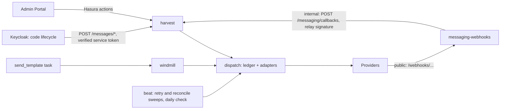

<!--
SPDX-FileCopyrightText: 2026 Sequent Tech Inc <legal@sequentech.io>
SPDX-License-Identifier: AGPL-3.0-only
-->

Codes, enrollment results, credentials and reminders reach voters by
WhatsApp, Viber, Messenger, SMS or email through one sending path shared by
Keycloak and bulk sends. Each voter has one channel, and nothing is ever
sent on another. The administrator's view is described in
[Messaging Channels](../../02-election_managers/02-reference/13-messaging-channels.md);
deployment is in [Messaging deployment](02-messaging-deployment.md).



Harvest is never public. Provider callbacks are the only inbound traffic
from outside, and they reach harvest only through the
[webhook component](#webhook-component).

## Components

| Where | What |
|---|---|
| `sequent-core/src/types/messaging.rs` | Channels, purposes, providers and their capabilities, the attempt state machine, account readiness, the event configuration, its validation and its public projection, and the internal API payloads |
| `sequent-core/src/types/voter_channel.rs` | `voter_channel`: the one rule that reads a voter's channel from Keycloak attributes, mirrored by Java `VoterChannel` |
| `packages/messaging` | Provider adapters behind `ChannelSender`, `preflight`, attempt decisions, destination masking and keyed digests, Messenger link references, rates, webhook verification and parsing, and the relay envelope (`relay.rs`). No database access |
| `packages/messaging-webhooks` | The public webhook component: a relay with no database and no secrets except the relay secret |
| `windmill/src/postgres/messaging.rs` | Accounts, the event configuration table, the `message` ledger, `messenger_link` and `messenger_contact` |
| `windmill/src/services/messaging` | Credentials, event configuration, `deliver`, callback handling, links, retries and reconciliation |
| `harvest/src/routes/messaging.rs` | Internal Keycloak routes, admin actions and the relayed callback route |
| `keycloak-extensions/message-otp-authenticator/.../messaging` | The `messageSender` SPI and its `harvest` implementation |

Keycloak stays the authority on codes: it generates, expires, counts
attempts and replaces them. Harvest only transports them; a delivery report
never authenticates a voter.

## Webhook component

`messaging-webhooks` is a small Rocket binary, run as its own process and
container. It holds no database, no vault and no provider secrets, and
verifies nothing itself: verification happens in harvest, where the secrets
are. It doesn't retry or queue; providers retry when it answers non-2xx.

| Route | Purpose |
|---|---|
| `GET /webhooks/meta/<key>` | Meta subscription handshake (`hub.mode`, `hub.verify_token`, `hub.challenge`) |
| `POST /webhooks/meta/<key>` | WhatsApp statuses, Messenger delivery and Get Started |
| `POST /webhooks/viber/<key>` | Infobip Viber delivery reports |
| `POST /webhooks/aws/<key>` | SNS-wrapped SES events, and SNS subscription confirmation |
| `GET /healthz` | Liveness; never forwards |

Any other path is a 404 and is never forwarded.

- **Key**: `<key>` must be an account webhook key, 64 lowercase hex
  characters (`relay::is_webhook_key`). Anything else gets 404 and nothing
  is forwarded.
- **Body**: at most `MESSAGING_WEBHOOKS_MAX_BODY_BYTES` (262144 by default);
  a larger body gets 413. Any content type is accepted, because SNS sends
  `text/plain`.
- **Headers**: only `relay::FORWARDED_HEADERS` are kept, lowercased:
  `content-type`, `x-hub-signature-256`, `x-amz-sns-message-type`,
  `x-amz-sns-topic-arn`, `x-amz-sns-subscription-arn` and `authorization`
  (Viber reports use Basic auth). Everything else is dropped.

### Envelope

Each callback is wrapped in a `relay::CallbackEnvelope` and posted to
`http://$HARVEST_DOMAIN/messaging/callbacks` with a 10 s timeout:

```json
{"version": 1, "provider": "META|VIBER|AWS", "key": "<64 hex>",
 "method": "GET|POST", "query": "<raw query string>",
 "headers": {"x-hub-signature-256": "sha256=..."},
 "body_b64": "<raw body bytes, base64>", "received_at": "<RFC 3339>"}
```

The body travels base64-encoded so that harvest checks the provider's
signature on the exact bytes the provider signed, including Meta's escaped
slashes and non-ASCII.

### Relay authentication

The component signs the request body (the envelope JSON bytes) with the
shared `MESSAGING_RELAY_SECRET`:

```text
X-Messaging-Relay-Signature: t=<unix seconds>,v1=<hex HMAC-SHA256(secret, t + "." + body)>
```

Harvest checks it with `relay::verify` in constant time. A missing or
malformed header, a timestamp more than 300 s from harvest's clock
(`RELAY_MAX_SKEW_SECONDS`), or a wrong HMAC gets 401, and nothing is
processed. Only the component and harvest hold the secret. The route takes
no JWT and is not a Hasura action.

### Response passthrough

Harvest answers HTTP 200 with a `relay::RelayResponse`:

```json
{"status": 200, "content_type": "text/plain; charset=utf-8", "body": "<challenge>"}
```

The component replies to the provider with exactly that status, content
type and body. So Meta's handshake gets its `hub.challenge` as plain text,
a valid callback gets 200, a bad provider signature gets 401, and an
unknown key gets 404.

If harvest is unreachable, times out, or answers anything other than HTTP
200 (including a refused relay signature or a 5xx), the component answers
**503** and the provider retries later. Only a 200 from harvest carries a
`RelayResponse`.

### Logging

The component logs the provider, the method, the first 6 characters of the
key, the status and the latency. It never logs bodies, query values or
header values.

## Callback handling in harvest

`POST /messaging/callbacks` decodes `body_b64` into the original bytes and
resolves the account from `key` only, never from the payload. It then runs
the provider's own checks on those bytes:

| Provider | Verification |
|---|---|
| Meta, `GET` | The handshake's `hub.verify_token` against the account's generated verify token; answers the `hub.challenge` as `text/plain` |
| Meta, `POST` | `X-Hub-Signature-256` with the account's app secret |
| Viber | The `authorization` header against the account's report username and password (Basic), in constant time. A report without it, or with a wrong one, is refused |
| AWS | SNS signature with a certificate from an SNS endpoint, and the account's notification topic. A subscription confirmation is confirmed by visiting its SNS `SubscribeURL` |

Entries for another business account, number or Page are dropped. Only
delivery statuses and Messenger's Get Started (postback or referral) are
processed. Every other event, including messages voters write, is
acknowledged and dropped: never stored and never answered.

A Get Started or referral writes `messenger_contact.last_get_started_at`
for the account and recipient digest **before** the code it unlocks is
sent. That row opens Messenger's 24-hour window; no other event does.

## Keycloak to harvest: the verified service boundary

Keycloak calls harvest's internal `/messages/send`, `/messages/link`,
`/messages/link/status` and `/messages/link/confirm` with a
`client_credentials` token. Harvest is internal, but these routes still
verify the token, because anything on the internal network could otherwise
forge one:

- The `VerifiedServiceClaims` guard (`harvest/src/services/service_auth.rs`)
  checks the signature and `exp` against
  `$KEYCLOAK_URL/realms/tenant-<tenant_id>/protocol/openid-connect/certs`.
  Keys are cached for 10 minutes and fetched again once on an unknown `kid`.
- `iss` must end with `/realms/tenant-<tenant_id>`, because the internal and
  public Keycloak addresses differ.
- The token must carry the `service-account` role, its tenant must equal the
  body's `tenant_id`, and the event must belong to that tenant. A
  super-admin token gets no exception here.

An unsigned or forged token gets 401. Other harvest routes are unchanged:
Hasura verifies their tokens.

## Hasura access

| Permission | Reaches |
|---|---|
| `messaging-account-read` | The account list, without `webhook_key` or credentials |
| `messaging-account-write` | Account actions: upsert, credentials, check, test, delete, callback URL, Page change impact |
| `messaging-config-read` | `message` and the safe `messaging_account` columns, for the event tab, Logs and the voter drawer |
| `messaging-config-write` | `update_event_messaging_config` |

`admin-user` no longer selects `messaging_account` or `message`, and
`service-account` selects are scoped by tenant. All four permissions are in
`MIGRATED_PERMISSIONS`, so existing realms get them on upgrade. An
account's full callback URL is never computed in the browser: the upsert
and check actions and `messaging_account_callback_url` return it, or the
reason it is unavailable.

## Sending

`deliver` handles one logical message, identified by a `logical_key` that is
stable across retries (`send-template:<task id>:<voter>`,
`keycloak:otp:<code id>`):

1. Read the voter's channel (`voter_channel`). There is no channel selection
   in the request: an old payload's `channel_selection` parses and is
   ignored.
2. Choose the account: the event's for that channel, else the tenant
   default, else the environment transports for email and SMS.
3. Run `preflight`: recipient kind, purpose, the Post's channels, approved
   template, conversation window, allowed calling codes, code expiry. A
   refusal is recorded as one `FAILED` attempt with its reason and never
   reaches the provider. Nothing tries another channel.
4. Insert the attempt as `QUEUED` and commit.
5. Take a token from the account's shared rate bucket (codes have reserved
   headroom), set `dispatched_at`, send, and record `ACCEPTED`, `FAILED` or
   `UNKNOWN`.

Timeouts, lost responses and 5xx answers are `UNKNOWN`. SDK retries are
disabled so that only the ledger decides. States only move along
`MessageAttemptState::can_transition_to`, enforced in SQL, so late or
repeated reports can't regress a delivered message. `QUEUED` can move
straight to `DELIVERED`.

A voter with no channel gets one `FAILED` row with the reason "No contact
channel". Every outcome has one reason string, shared by the ledger, the
log and the Admin Portal.

### Retries and the sweep

- A transient failure sets `next_retry_at`, with backoff of 1, 5 and 15
  minutes. The beat sweep creates attempt n+1 on the **same channel** when
  it is due; after 3 attempts the message stays `FAILED`. Failures reported
  later by webhook are classified transient or permanent by provider error
  code.
- The retry content is rendered again from the ledger's template alias,
  language, voter and event: the ledger holds no body. A row without a
  template reference is not retried and stays `FAILED` with "Can't be
  retried: no stored template".
- Codes are never retried by the platform; Keycloak's Resend replaces them.
- A `QUEUED` row older than 2 minutes with `dispatched_at` empty was never
  sent: it becomes `FAILED` (transient) and is retried. One with
  `dispatched_at` set may have been sent: it becomes `UNKNOWN`, which is
  never resent automatically.
- The reconcile sweep pages by keyset over `QUEUED` and `UNKNOWN` rows,
  takes only accounts whose provider can reconcile (Infobip), and backs off
  per row with `last_reconciled_at`. `UNKNOWN` older than 24 hours is
  flagged **Unresolved**: never turned into `FAILED`.
- Notices sent through harvest (Keycloak notices) use the same sweep, and
  carry `election_ids` so Post restrictions apply.
- The sweeps, link expiry and the daily account check run on the `beat`
  queue, not the bulk send queue.
- A replayed job writes no second electoral log entry and doesn't count
  twice: statistics come from the ledger.

## Messenger links

`/messages/link` stores digests of a random reference, the authentication
session and the challenge, and the code encrypted with the master key. The
reference lives at most ten minutes and never longer than the code. When
the voter taps Get Started on `m.me/<username>?ref=<reference>`, the
callback binds that conversation, writes `messenger_contact`, sends the
code and deletes it. `/messages/link/confirm`, called by Keycloak after the
code was accepted in the original session, returns the Page-scoped ID to
store on the voter. A new link for the session replaces the previous one; a
reference for another Page, another session, or one already used or
expired is refused. There is no word typed into the chat.

## Data

### Event configuration

`sequent_backend.messaging_event_config` holds each event's configuration:

| Column | Notes |
|---|---|
| `tenant_id`, `election_event_id` | Primary key `election_event_id` |
| `config` | The `EventMessagingConfig` JSON: accounts per channel, OTP and notice switches, template bindings, out-of-window policy, channels per Post |
| `version` | Configuration format version |
| `updated_at`, `updated_by` | Last write |

Only `update_event_messaging_config` writes it, after validation; code that
sends re-validates the references it uses. The migration copied existing
`messaging:config` annotations once and leaves the annotation untouched;
nothing reads it any more. Event export and import carry this table.

### Message ledger

`sequent_backend.message` has one row per attempt, unique on
`(tenant_id, logical_key, attempt)`:

| Column | Notes |
|---|---|
| `channel`, `account_id`, `purpose` | Where and why it was sent |
| `template_alias`, `language` | What to render again on a retry |
| `masked_destination`, `destination_digest` | Country code plus last 3 digits, or the first 2 characters of an email; a keyed digest per tenant |
| `destination_country` | ISO 3166 code, from the dial code |
| `attempt`, `state`, `provider_message_id` | The attempt and its state |
| `error`, `failure` | Sanitized reason and its class |
| `next_retry_at` | When the sweep retries a transient failure |
| `dispatched_at` | Set right before the provider call: tells never-sent from maybe-sent |
| `last_reconciled_at` | Reconciliation backoff |
| `billing`, `billing_category`, `billable` | Billing evidence for monthly volumes |
| `created_at`, `accepted_at`, `delivered_at`, `failed_at` | Timestamps |

Codes, bodies and credentials are never stored. Rows with
`direction = INBOUND` were deleted by the migration and are no longer
written.

### Electoral log

Each attempt writes one `SendCommunications` entry for `ACCEPTED`,
`FAILED` and `UNKNOWN`, from windmill and harvest alike. Its JSON string
holds these fields, with the receiver masked:

```text
{channel, account_id, provider, purpose, kind, message_id, attempt, outcome, reason?, receiver}
```

The statement stays
`SendCommunications(Option<String>)`, so old entries keep decoding.

## Configuration

| Setting | Where | Purpose |
|---|---|---|
| `MESSAGING_WEBHOOKS_PUBLIC_URL` | harvest, windmill | Public base of the webhook component; account callback URLs are `<base>/webhooks/<meta\|viber\|aws>/<key>`. Unset: accounts show "Callback address not configured" |
| `MESSAGING_RELAY_SECRET` | messaging-webhooks, harvest | Relay HMAC secret. Nothing else reads it |
| `MESSAGING_WEBHOOKS_MAX_BODY_BYTES` | messaging-webhooks | Largest callback body, 262144 by default. Harvest accepts envelopes up to twice that |
| `HARVEST_DOMAIN` | messaging-webhooks | Where the envelope goes |
| `MESSAGING_META_GRAPH_URL` | harvest, windmill | Meta Graph API base, `https://graph.facebook.com` by default |
| `MESSAGING_INFOBIP_URL` | harvest, windmill | Infobip base; unset, each account's own `base_url` is used |
| `MESSAGING_AWS_ENDPOINT_URL` | harvest, windmill | AWS endpoint override; unset, the real AWS endpoints are used |
| `MESSAGE_SENDER_POLICY` or `--spi-message-sender-auto-policy` | Keycloak | `HARVEST_WHEN_CONFIGURED` (default) routes messaging-app channels through harvest when its address is known; `KEYCLOAK_ONLY` keeps email and SMS only. Read at run time by the `auto` sender. An unreadable value means `KEYCLOAK_ONLY` |
| `sequent.message-sender-policy` | Realm attribute | The same two values for one realm; it can't undo the deployment's `KEYCLOAK_ONLY` |
| `--spi-message-sender-harvest-url` | Keycloak | Harvest's internal base URL, `http://$HARVEST_DOMAIN` by default |
| `--spi-message-sender-harvest-channels` | Keycloak | Channels sent through harvest, `WHATSAPP,VIBER,MESSENGER` by default |
| `reconcile_messages_interval` | beat | Seconds between reconciliation passes, 300 by default |

For Meta and Infobip, an endpoint variable that is set wins over the
account's own API address; when it's unset, the account's address is used,
else the provider default. Changing an account's address without new
credentials is refused, and account addresses must be `https`.

Credentials live in `sequent_backend.secret` under
`messaging-account-<id>-<NAME>`; per-tenant digest keys under
`messaging-destination-key-<tenant>` and `messaging-link-key-<tenant>`.

## Removed providers

`HTTP_API` (the configurable provider) and `CONSOLE` (nothing sent) are
gone. The enum values still parse, so a stored account doesn't break the
tenant's account list, but creating or sending with them is refused with
"Unsupported provider: replace this account". A new partner gets its own
adapter. `ReadinessPolicy::ADMIN_CONFIRMED` likewise only parses, and is
read as `PROVIDER_CHECK`.
