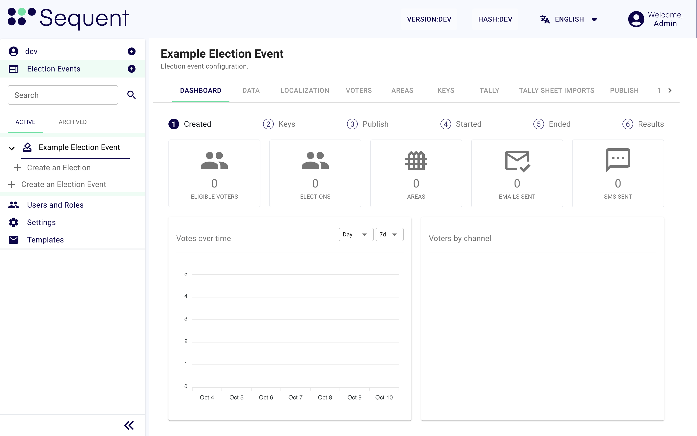

import GoogleVideo from '@site/src/components/GoogleVideo';

<!--
-- SPDX-FileCopyrightText: 2025 Sequent Tech Inc <legal@sequentech.io>
SPDX-License-Identifier: AGPL-3.0-only
-->

# Navegación básica

<GoogleVideo id="1SRsbPGWiA8woHHrjtmoL9PuwBkJZQY4_" />

La interfaz de usuario (UI) del sistema se divide en cuatro áreas principales, cada una con una función específica:

1. **Encabezado (barra superior)**
2. **Pestañas de navegación (debajo del título del proceso electoral)**
3. **Menú lateral (barra lateral izquierda)**
4. **Área de contenido principal (visualización de datos)**

---

## 1. Encabezado {#1-header}

El encabezado, situado en la parte superior de la pantalla, ofrece controles globales e información esencial que siempre están disponibles. Esta área incluye:

- **Logotipo del sistema y número de versión**: El logotipo del sistema, junto con el número de versión actual, se muestra de forma destacada para una fácil identificación.
- **Selector de idioma**: Un menú desplegable que permite cambiar de idioma, para que el sistema sea accesible a un público más amplio.
- **Icono de cuenta**: Un icono que da acceso a la configuración de la cuenta de usuario y a la opción de cerrar sesión. Aquí los usuarios pueden gestionar la información de su perfil y la configuración de seguridad.

---

## 2. Pestañas de navegación {#2-navigation-tabs}

Las pestañas de navegación situadas debajo del título de la entidad seleccionada le permiten recorrer fácilmente las distintas secciones, cada una con información específica. Cada entidad tiene varias pestañas propias, diseñadas para sus funciones y sus datos. Así resulta fácil encontrar y gestionar todos los detalles relacionados con cada entidad.

---

## 3. Menú lateral {#3-side-menu}

El menú lateral, situado a la izquierda de la pantalla, da acceso fácil a **Procesos Electorales**, **Usuarios y Roles**, **Configuracion** y **Plantillas**. Si su inquilino tiene enlaces de ayuda, también muestra **Ayuda**. Solo ve los elementos que permite su rol. Este menú, siempre visible, permite navegar sin interrupciones por todas las pantallas y acceder rápidamente a la configuración del sistema y a la gestión de los procesos electorales.

Esta parte de la pantalla es una de las áreas más importantes del sistema. Contiene el **árbol del proceso electoral**, desde el que puede acceder a las **Elecciones**, las **Preguntas** y los **Candidatos**, y crearlos.

Para facilitar la navegación, hay un **campo de búsqueda** que le permite buscar en el árbol del proceso electoral el nombre o el alias de un proceso electoral, una elección, una pregunta o un candidato.

Los procesos electorales se clasifican en **Activos** y **Archivados** para una mejor organización. Así puede archivar los procesos electorales que ya han terminado o que se usaron para pruebas, y mantener un árbol limpio, con solo los procesos en curso.

---

## 4. Área de contenido principal {#4-main-content-area}

El área de contenido principal, situada en el centro de la pantalla, muestra la sección seleccionada: un proceso electoral, **Configuracion**, **Plantillas** u otras.

Cada sección puede contener pestañas adicionales con opciones y configuración más detalladas sobre el tema elegido. Esta distribución le ofrece una visión completa y un acceso fácil a todas las funciones e información relevantes.
