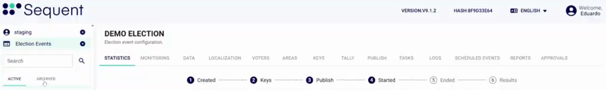
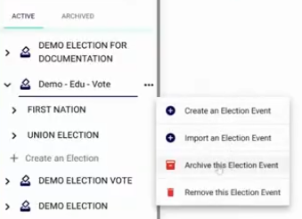
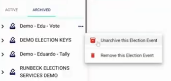

<!--
SPDX-FileCopyrightText: 2025 Sequent Tech <legal@sequentech.io>
SPDX-License-Identifier: AGPL-3.0-only
-->

import GoogleVideo from '@site/src/components/GoogleVideo';

<GoogleVideo id="1nC-EvQ7Xso6eAn5-PU67vKgl6zKTROC9" />

El portal de administración de Sequent le permite gestionar la visibilidad de sus procesos electorales, clasificándolos como activos o archivados. Así mantiene un espacio de trabajo limpio, separando los procesos en curso de los datos históricos.

## Comprender los estados de los procesos electorales {#understanding-election-statuses}

El menú lateral contiene dos pestañas principales para organizar sus procesos electorales:

* **Activos:** Esta pestaña muestra los procesos electorales que están en curso o que se van a abrir próximamente.
* **Archivados:** Esta pestaña guarda los procesos electorales pasados que han terminado, pero que se conservan para registros o auditorías.

## Archivar un proceso electoral {#archiving-an-election}

Cuando un proceso electoral ha terminado, puede moverlo a la lista de archivados para despejar su panel de activos.

1.  Busque el proceso electoral en la pestaña **Activos**.
2.  Haga clic en el **icono de tres puntos** junto al nombre del proceso electoral.
3.  Seleccione **Archivar este Evento Electoral**.

## Desarchivar y restaurar procesos electorales {#unarchiving-and-restoring-elections}

Si necesita reactivar un proceso electoral archivado o simplemente ver sus datos en la lista de activos, puede desarchivarlo en cualquier momento.

1.  Cambie a la pestaña **Archivados** del menú lateral.
2.  Busque el proceso electoral que desea.
3.  Haga clic en el **icono de tres puntos** y seleccione **Desarchivar este Evento Electoral**.
4.  Confirme la acción en el mensaje de advertencia. El proceso electoral volverá a aparecer en la pestaña **Activos**.

:::warning
**Eliminación permanente:** Los menús Activos y Archivados contienen una opción **Eliminar este Evento Electoral**. Al seleccionarla, se elimina de forma permanente el proceso electoral y todos los datos asociados del sistema.
:::
