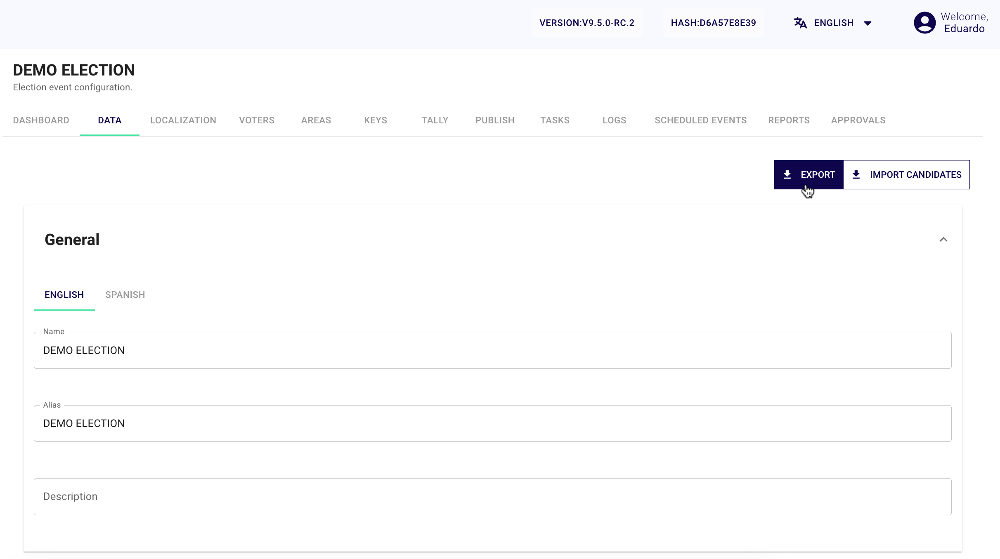
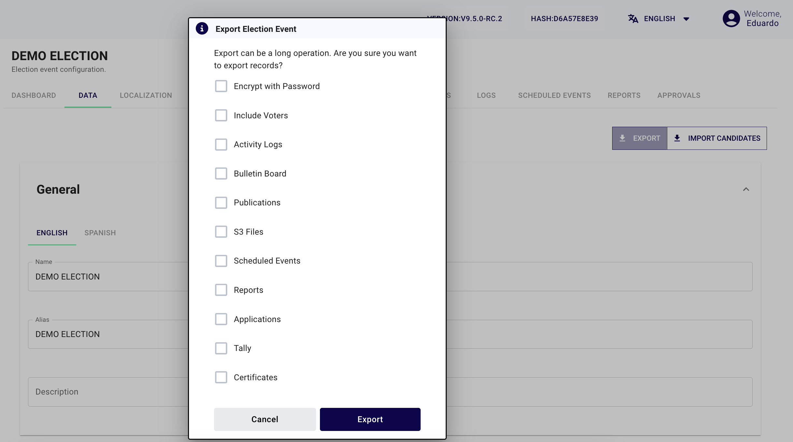
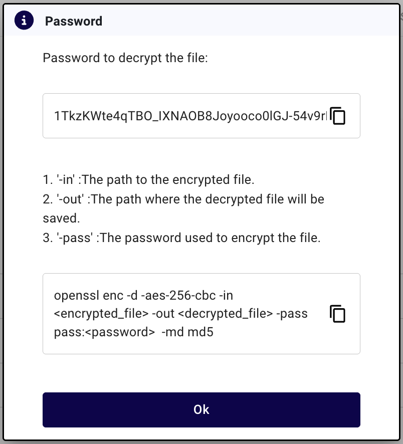

<!--
SPDX-FileCopyrightText: 2025 Sequent Tech <legal@sequentech.io>
SPDX-License-Identifier: AGPL-3.0-only
-->

import GoogleVideo from '@site/src/components/GoogleVideo';

<GoogleVideo id="13KrQtqIfsw24sZCCBjO0-f6wM_kcDUI-" />

El portal de administración de Sequent ofrece herramientas para exportar los datos de un proceso electoral como copia de seguridad o para auditoría, y para importar configuraciones de procesos electorales existentes y preparar rápidamente nuevos procesos.

## Exportar un proceso electoral {#exporting-an-election-event}

Exportar le permite guardar una instantánea completa de su proceso electoral.

1.  Abra la pestaña **Datos** del proceso electoral.
2.  Haga clic en **Exportar**.

3.  Elija los componentes de datos que desea incluir en la exportación:
    * **Incluir Votantes:** Exporta la lista de votantes registrados.
    * **Registros de Actividad:** Incluye un historial de las acciones administrativas.
    * **Tablón de Anuncios:** Incluye el estado criptográfico del proceso electoral, como las ceremonias de claves.
    * **Publicaciones:** Incluye el historial de publicaciones del proceso electoral.
    * **Archivos S3:** Incluye imágenes, materiales de soporte u otros archivos que se guardan en el almacenamiento en la nube.
    * **Eventos Programados:** Incluye los eventos programados configurados.
    * **Informes:** Incluye los informes electorales generados.
    * **Aplicaciones:** Incluye las solicitudes de inscripción de los votantes.
    * **Recuento:** Incluye los recuentos finales de votos (si están disponibles).
    * **Certificados:** Incluye las autoridades de certificación del proceso electoral.

:::info
**Seguridad:** Seleccione **Cifrar con Contraseña** para proteger el archivo con una contraseña. Si selecciona **Tablón de Anuncios**, **Informes** o **Aplicaciones**, el archivo siempre se protege con una contraseña. Seleccione **Cifrar con Contraseña** también para incluir los campos secretos descifrados de los votantes.
:::

1.  Haga clic en **Exportar**. Una exportación protegida con contraseña es un archivo `.ezip`.
2.  **Guardar contraseña:** Un cuadro de diálogo muestra una contraseña de descifrado única. Cópiela y guárdela de forma segura. La necesitará más adelante para importar el archivo o para descomprimirlo manualmente.

## Importar un proceso electoral {#importing-an-election-event}

Puede importar un proceso electoral desde un archivo `.json`, desde una exportación `.zip` o desde una exportación protegida con contraseña `.ezip`. Para ver los pasos, consulte [Crear el proceso electoral](../03-procedures/02-event.md#import-an-election-event-alternative).

:::info
Solo puede importar procesos electorales exportados desde la misma versión principal, con la misma versión secundaria o una inferior.
Por ejemplo, con la versión **10.0** instalada, puede importar procesos electorales exportados desde la versión **10.0**, pero no desde la versión **9.x** ni desde la **10.1**.
:::

1.  En el menú lateral, haga clic en el icono **+** junto a **Procesos Electorales**, o en **Crear un Evento Electoral** al final del árbol.
2.  Haga clic en **Importar Evento Electoral**.

